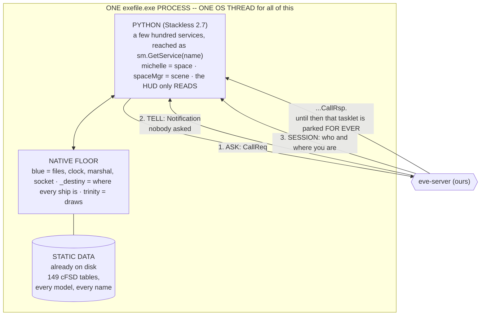
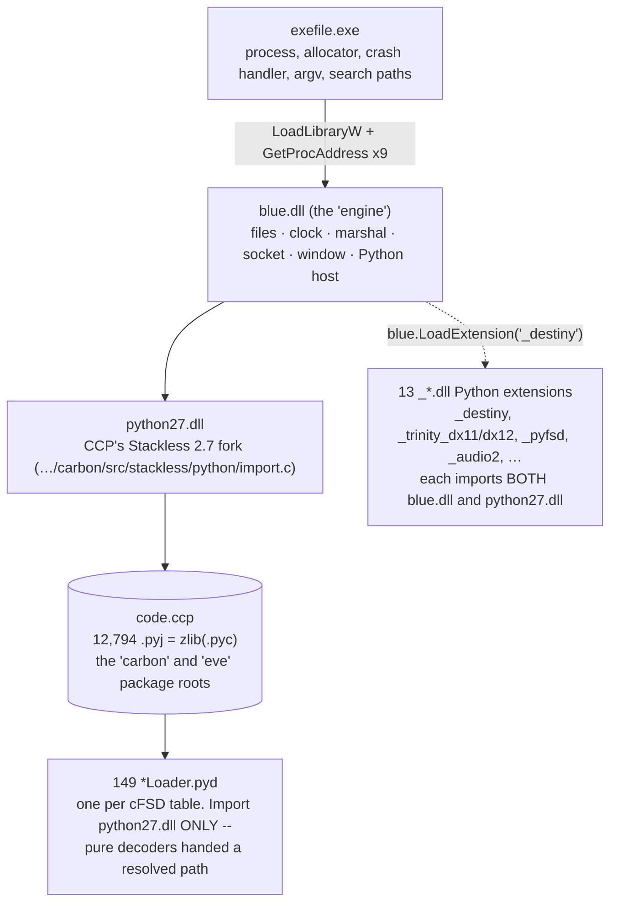
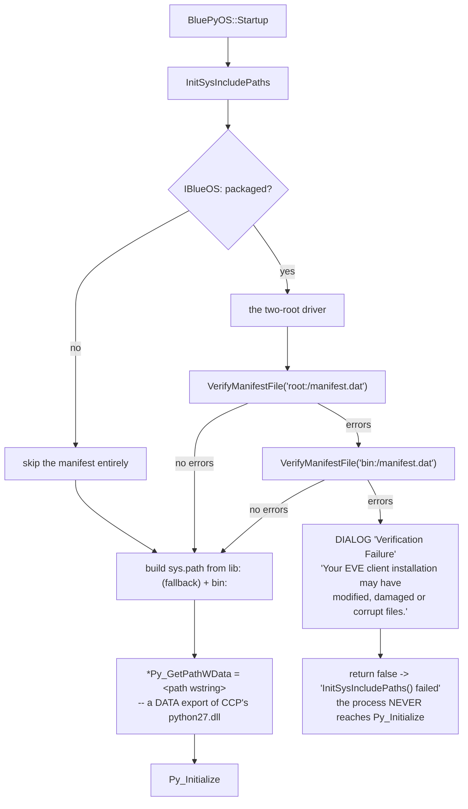
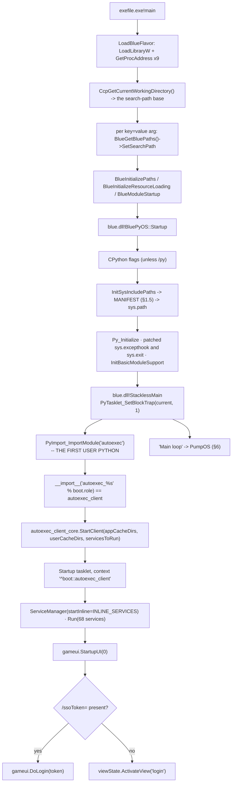
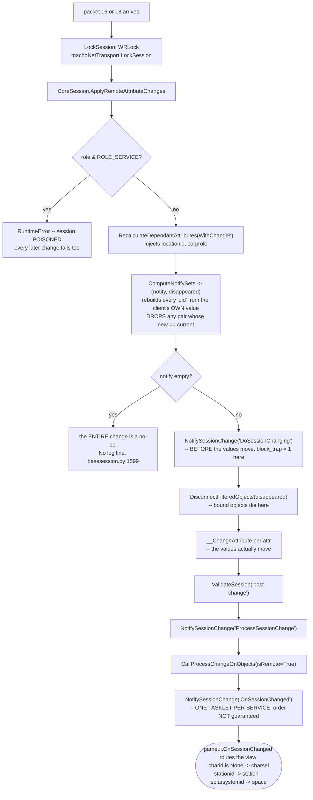
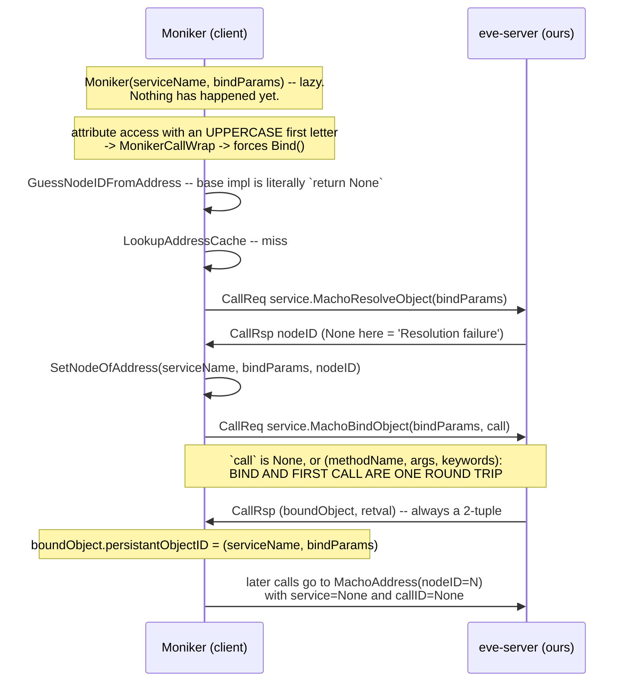
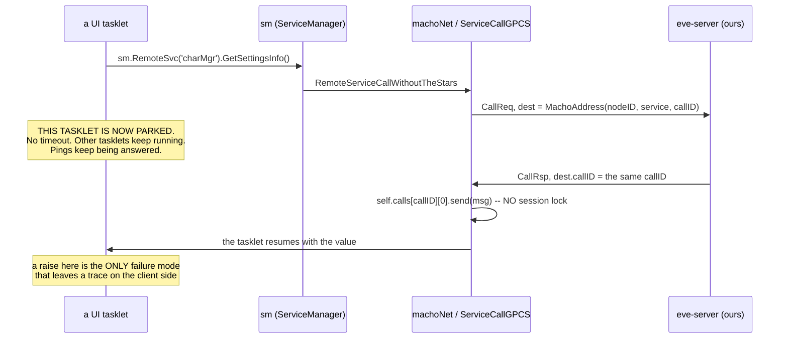
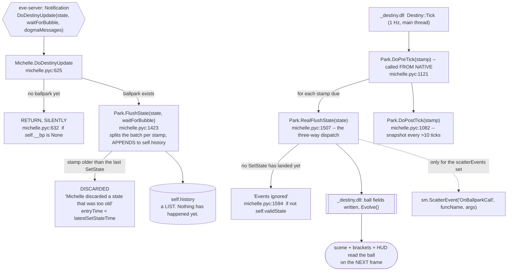
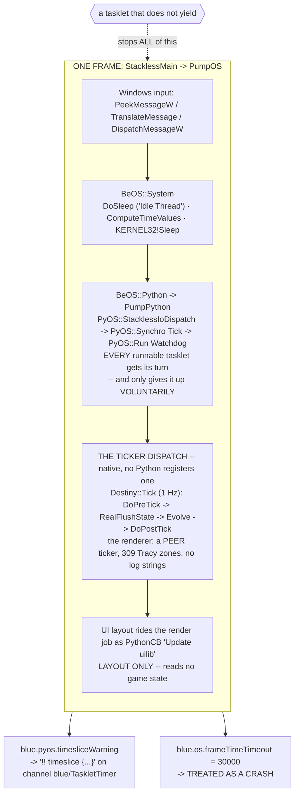

# The real EVE client, mapped from the server's side

**Build: V24.01, `region = ccp`, installed at `/client` (read-only).** Every
claim in this file is about *that* install. A fact from another build is worth
recording and is marked so; it is never allowed to stand in for this one.

> **Re-pinned 2026-10-31 (issue #19): the reference build is now 3662168.**
> The `[V build 3619879]` marks below were measured on the former reference.
> The 2026-10-30 delta (`findings/build-delta-3619879-3662168.tsv`, read in
> `docs/port-tracker.md` for this re-pin) found `blue.dll`, `_destiny.dll`,
> `python27.dll` and `exefile.exe` signature-only and the line unchanged
> (V24.01), so the native and wire claims hold for 3662168 too. In Python, 68
> modules changed and 7 were removed (camera hardening, bug reports, one QA-only
> call); where a changed module is cited, the line numbers were re-read from
> `co_firstlineno`. A mark that still says 3619879 is history until someone
> re-reads it. The real 2026-11-09 build will repeat this re-pin.

> ### Provenance, and a build number that moved under us
>
> **`/client/start.ini` now reads `build = 3628513`, not `3619879`.** Our docs
> say 3619879 throughout, and `out/pyc/` was extracted from a `code.ccp` dated
> 2026-10-19 00:24; the installed `code.ccp` is dated 2026-10-19 15:03. **The
> client was updated under us** `[V]`.
>
> That sounds alarming and it is not, because the drift is measurable and was
> measured. Decompressing every `.pyj` out of the **live** `/client/code.ccp`
> and comparing it to `out/pyc/` past the 8-byte `.pyc` header (which carries a
> rebuild timestamp and differs for all 12,794 entries):
>
> ```text
> identical past the header : 12,787
> GENUINELY DIFFERENT       :      7
> ```
>
> and **all seven are in the protobuf-gateway half** `[V]`:
> `eveProto/tracing`, `eveProto/monolith_converters/strings`,
> `eveProto/generated/eve/tournament/ruleset/ruleset_pb2`,
> `publicGateway/gateway`, `publicGateway/grpc/spanManager`,
> `publicGateway/notice/notice_routing_cache`,
> `stackless_response_router/stackless_response_router`.
>
> **Not one machoNet, service-layer, michelle, Destiny, godma or UI module
> changed.** So every Python claim in this file holds for both builds, and the
> one half that did change is the half that is not ours
> ([`docs/guides/debugging-the-client.md`](../guides/debugging-the-client.md) §3c).
>
> **And 3619879 is still on disk**, as `/client-root/tq-offline` (`start.ini`
> `build = 3619879`) — `/client-root/tq` is the one that moved. So the two can
> be compared directly, and they were `[V]`:
>
> | binary | 3619879 vs 3628513 |
> |---|---|
> | **`bin64/blue.dll`** | same size; 572 differing bytes in 14 ranges — `0x1a8` (the PE checksum), `0x1f4d97` (**our own** manifest patch, see below), and every other range inside the Authenticode certificate table at `0xb82600`–`0xb84eb0`. **Not one byte of code or data differs.** |
> | **`bin64/_destiny.dll`** | same size; 571 differing bytes in 11 ranges — `0x158` (checksum) and the rest inside the certificate table at `0xdd400`–`0xdfcb0`. **Not one byte of code or data differs.** |
> | `bin64/exefile.exe` | same size; 5,755 bytes in 117 ranges — first read as a real change, but **signature-only**: with the PE checksum, the security data-directory entry and the certificate table removed (and our `.eveoffline-orig` backup as the 3619879 side) every byte is equal (re-measured 2026-10-26) |
> | `bin64/python27.dll` | same size; 5,754 bytes in 118 ranges — likewise **signature-only** (re-measured 2026-10-26) |
>
> (The `0x1f4d97` range is ours: `tq-offline` has `48 31 db 90`
> — `xor rbx,rbx; nop` — where stock has `48 8b 58 10`, and
> `blue.dll.eveoffline-orig` sits beside it. That is exactly what
> `tools/client-patch-manifest.sh` claims to do, located here from the other
> direction `[V]`.)
>
> **So every claim in this file is `[V]` for build 3619879.** The Python is
> byte-identical outside the gateway; `blue.dll` and `_destiny.dll` — the source
> of every native string, docstring and disassembly quoted here — are
> code-identical and differ only in CCP's signature. So do `exefile.exe` and
> `python27.dll`: the byte counts above are the size of a certificate table,
> not a code change, so native claims about them hold for both builds too.
> (`tools/build-delta.py OLD NEW` repeats the PE-normalised comparison.)
>
> **One more consequence worth carrying:** our handshake still reports
> `boot.build = 3619879`, and that is still accepted, because the client's check
> is `boot.build < response[4]` with the **client's** build on the left
> ([§2.2](#22-connection-bring-up-end-to-end)) — a server claiming an *older*
> build is fine. A client update that bumps the number cannot break login this
> way; only a *server* claiming a newer build can.
>
> Whoever re-extracts `out/pyc` should re-run both comparisons rather than
> assume. Each is a few lines and the result is the whole answer.

**Who this is for.** You know `eve-server`. You do not know the client. This is
the map you keep open while the client is black-screened and you have four
minutes of patience left. It is diagram-first, dense, and organised so that the
thing you actually need at 1am — *what does the client do when we get it wrong*
— is never more than one scroll away: every section ends with a symptom table,
and [§8](#8-the-symptom-index) is all of them in one place.

**Evidence marks**, on every non-obvious claim:

| mark | means |
|---|---|
| `[V]` | verified against **our** client, build 3619879 |
| `[I]` | inferred — read the reasoning before you depend on it |
| `[V2]` | a third-party decode of a **different** build; re-verify before use |
| `[A]` | a shipped assumption; `docs/lanes/README.md` explains why we ship them |

**Two rules this file obeys, both bought with real debugging time.**

1. **Quote the disassembly for anything that turns on an operator, an argument
   count, or a sign.** A `[V]` that paraphrases is worse than an honest `[I]`,
   because it is trusted. This session two paraphrased `[V]`s — `GetSpeed`
   recorded without its trailing `.Length()`, and `IsPreparingWarp` as
   `effectStamp > 0` when the bytecode says `COMPARE_OP 0` i.e. `<` — made a
   test suite fail a server that was behaving correctly.
2. **Cite by symbol name first, line number second.** The last architecture
   document here had to be reworked because ~98 line citations drifted when
   code moved. A function name survives a refactor; `michelle.py:1133` does not.

**Companions.** This file is the map; those are the territory.
[`docs/archive/destiny-and-the-ballpark.md`](../archive/destiny-and-the-ballpark.md) and
[`re/warp.md`](../re/warp.md) for space, [`docs/reference/login-path.md`](login-path.md) for the
handshake payload by payload, [`docs/reference/bound-objects.md`](bound-objects.md) for the
bind protocol, [`docs/guides/debugging-the-client.md`](../guides/debugging-the-client.md) for the
instruments, [`docs/reference/threads-and-locks.md`](threads-and-locks.md) for **our** side of
the same picture.

---

## How to use this at 1am

**You have a symptom. Start at the symptom, not at the layer.**

| the client is… | start here |
|---|---|
| **black, and quiet** — nothing in its log, nothing in ours | [§3.8](#38-symptoms--the-service-layer). An unanswered `CallReq` is a hang, not a no-op. |
| **drawn, but frozen** | [§3.8](#38-symptoms--the-service-layer) and [§5.6](#56-symptoms--ui-and-the-hud). Something threw partway through building the UI, on a reply we already sent. |
| **in space, but nothing moves** | [§4.9](#49-symptoms--space). Grep its log for `Events ignored` first. |
| **frozen for exactly N seconds at a time** | [§6.6](#66-symptoms--concurrency). Something is blocking the one thread. |
| **showing a blank or wrong gauge** | [§5.6](#56-symptoms--ui-and-the-hud). The HUD reads; it does not store. |
| **stuck on a login progress string** | [§2.6](#26-symptoms--transport-and-session), then §3.8. |
| **in the wrong view** (station when it should be in space, charsel when it should be in game) | [§2.5](#25-the-session-change-dance). One session key routes all of it. |
| **throwing tracebacks that mention a `messenger`** | not ours. [`docs/guides/debugging-the-client.md`](../guides/debugging-the-client.md) §3c. |
| **refusing to start, or missing art** | [§1.8](#18-symptoms--boot-and-layering). |

Everything above collapses into one table at
[§8](#8-the-symptom-index). The instruments to read these with are in
[`docs/guides/debugging-the-client.md`](../guides/debugging-the-client.md); this file tells you what
the output *means*.

---

## 0. ELI5 — the whole client in thirty seconds

**Read this first if you have never read this file.** It is the smallest picture
that still makes the rest make sense. Nothing in it has to be unlearned later;
the indented notes mark where a simplification stops being safe.

### ASCII — reads correctly under `cat`

```
 ===============  ONE exefile.exe PROCESS  ===============

   NATIVE FLOOR -- C++, no Python, cannot be read as source
     blue       files, the clock, marshal, the window, the socket
     _destiny   WHERE EVERY SHIP IS, and where it will be next second
     trinity    draws it

   ONE PYTHON INTERPRETER BOLTED ON TOP (Stackless 2.7)
     a few hundred SERVICES, each reached as sm.GetService('name')
       michelle   owns the ballpark   (the client's copy of space)
       spaceMgr   owns the scene      (the client's copy of the view)
       the HUD    READS. It stores almost nothing.

   ONE OS THREAD RUNS ALL OF THAT.
   Green threads ("tasklets") take turns on it, by choice, not by
   force. A tasklet that does not yield freezes the render, the
   socket reader, Destiny and the UI together.  <-- the whole file
                                                   in one sentence

   OUR SERVER REACHES IT THROUGH THREE DOORS, AND ONLY THREE:

     1. THE ANSWER DOOR    client asked; we reply
        CallReq ---> us ---> CallRsp
        the asking tasklet is PARKED until we answer.
        FOR EVER. There is no client-side timeout. <-- most of our
                                                      black screens

     2. THE TELL DOOR      we speak first, nobody asked
        Notification ---> a service's method ---> michelle --->
        _destiny ---> drawn on the next frame

     3. THE SESSION DOOR   we change who and where the client thinks it is
        SessionChangeNotification ---> every service is told ---> the
        UI changes view (station <-> space), objects are re-bound

   WHAT IT ALREADY HAS WITHOUT US: every ship model, every type,
   every name, 149 static-data tables. The client is not a thin
   client. We supply *identity, position and permission* -- not content.
```

### Mermaid — renders on the git host



> **Where the simplification stops being safe, in one line each.**
> *"One thread"* — there are other OS threads (the CarbonIO socket engine,
> background resource loading, render submission, log writers, Crashpad, the
> native gRPC broker), but **no Python runs on them** `[I]`; see
> [§6.1](#61-one-pump-one-python-interpreter-cooperative-scheduling).
> *"For ever"* — strictly, **3600 seconds**, swept every 360 s, and nothing
> but a dialog for two method names in between. On a human timescale that is
> "for ever", and the operational advice is unchanged
> ([§3.1](#31-sm-and-the-one-rule-that-explains-most-black-screens)). The
> **protobuf gateway** is a second protocol that times out by itself in
> seconds and is not ours
> ([`docs/guides/debugging-the-client.md`](../guides/debugging-the-client.md) §3c).
> *"Three doors"* — a fourth exists and we use it on purpose: an answer the
> client **executes** as code ([§7.1](#71-charmgrgetsettingsinfo--our-ci-trigger)).

---

## 1. Boot and layering

### 1.1 The layer cake is not a link chain

**`exefile.exe` does not link `blue.dll`.** Its import table contains no CCP
DLL at all — only `KERNEL32`, `USER32`, `ADVAPI32`, `SHELL32`, `SHLWAPI`,
`MSVCP140`, `VCRUNTIME140` and the CRT `api-ms-win-crt-*` set `[V]`. The
coupling is a `LoadLibraryW("blue" + flavour)` followed by nine
`GetProcAddress` calls, and `blue.dll` exports exactly **eleven undecorated C
symbols** out of 510 `[V]`:

```text
BlueGetBeOS  BlueGetBluePaths  BlueInitializePaths  BlueInitializeResourceLoading
BlueInitializeSocketLogger  BlueLogFuncChannel  BlueModuleStartup
BlueSetCrashReporter  BlueShowInvalidOSVersionError  initblue  init_slsocket
```

Flavours present as wide literals: `release`, `internal`, `trinitydev`,
`debug`, selected by `/buildflavor=`, with the failure strings
`Failed to load Blue flavor: '%S', trying default` and
`Could not load Blue flavor '%S', defaulted to release flavor.` `[V]`.

**And `carbon` and `eve` are not native layers in V24.01.** They are Python
package roots inside `code.ccp` (`carbon/common/...`, `eve/client/...`) `[V]`.
The native "carbon" identity survives only as a component manifest,
`root:/carbon.json`, read by `carbonversion.get_carbon_version()` `[V]`:

```text
carbon_blue      carbon-blue/v2.6.6       carbon_destiny  carbon-destiny/v2.1.1
carbon_exefile   carbon-exefile/v3.0.0    carbon_fsd      carbon-fsd/v1.0.3
carbon_trinity   eve-trinity/v7.0.1       carbon_mesh     mesh/v1.0.1
carbon_localization  v1.1.0               carbon_pathfinder  v1.1.1
```

So the real chain is:



`bin64/` holds 208 shipped entries `[V]`: the 149 `*Loader.pyd`, the 13
`_*.dll` extensions (each exporting exactly one `init_<name>`), 10 stdlib-ish
`.pyd`, and the engine/support DLLs (`blue.dll`, `python27.dll`,
`CarbonMesh.dll`, `TracyClient.dll`, DLSS/FidelityFX/XeSS/Streamline,
`dbghelp.dll`, `rad_tm_win64.dll`, `cacert.pem`), plus `eve_crashmon.exe`
(Crashpad) and the subdirectories `staticdata/mapObjects.db`,
`packages/{certifi,evemap,monolithgeoip2}`, `exoplanets/sampledata`.

**An extension is not `import`ed, it is `blue.LoadExtension`ed** `[V]`.
`destiny/__init__.py` is:

```python
_destiny = blue.LoadExtension('_destiny')
_destiny.Ball       = decometaclass.WrapBlueClass('destiny.Ball')
_destiny.Ballpark   = decometaclass.WrapBlueClass('destiny.Ballpark')
_destiny.ClientBall = decometaclass.WrapBlueClass('destiny.ClientBall')
for memberName in dir(_destiny): globals()[memberName] = getattr(_destiny, memberName)
```

and the native loader logs `Trying to load python extension '%s' with flavor
'%s'` / `Successfully loaded…` / `Failed to load…` on channel `blue`/`Main`
`[V]`. **`_destiny` is not loaded during the pre-login boot** — it appears only
once the client goes to space `[I]`, from its absence across several boot logs.

### 1.2 What `blue` actually provides — counted, not guessed

Counting `blue.<attr>` access pairs across all 12,774 `.pyc` `[V]`:

```text
1605 blue.os        1149 blue.pyos      491 blue.synchro   322 blue.paths
 194 blue.sysinfo    144 blue.resMan    103 blue.statistics  73 blue.marshal
  62 blue.DBRow       36 blue.classes    36 blue.motherLode  34 blue.ResFile
  33 blue.SetCrashKeyValues  19 blue.net  12 blue.LoadExtension  10 blue.MemStream
   5 blue.recycler    2 blue.crypto      1 blue.objectMetadata
```

**Two corrections to names you may have inherited** `[V]`:

- **it is `blue.synchro`, never `blue.sync`** — 491 uses, and the native member
  name in `blue.dll` is `synchro` with the docstring *"Synchronization stuff"*;
- **`blue.rot` does not exist in V24.01.** A recursive grep over the whole
  corpus returns **zero** files, and no `rot`/`ROT` string exists in
  `blue.dll`. The legacy resource-object-tree is gone; its job is split between
  `blue.resMan` (`BlueResMan::GetResource`, `LoadObject`, `SaveObjectW`),
  `blue.motherLode` and `blue.recycler`.

### 1.3 `bluepy` — blue's Python half, and the native layer imports *it*

One file, `out/pyc/bluepy/__init__.pyc`. It is reached **from C++**, by
`PyImport_ImportModule("bluepy")`, not by user code first `[V]`, and the
traffic goes both ways: `bluepy` installs `blue.TaskletExt`, `blue.tasklets`
and `stackless.taskletext`, while `BluePyOS::Startup` interns the
`TaskletExt.__slots__` names (`storedContext`, `runTime`, …) that the C++ side
will read `[V]`.

What it wraps: `TaskletExt(stackless.tasklet)` and `CreateTaskletExt`
([§6.1b](#61b-uthread-and-uthread2-concretely)); `PyResFile`, a file-object
façade over `blue.ResFile()`; `GetBlueInfo` / `get_blue_info_last_tick`, which
format `blue.pyos.cpuUsage`; the `ccpProfile` timer re-exports; `Shutdown`,
`GetTaskletDump`, `KillTasklets`; and `Terminate` / `TerminateSilently`.

**`bluepy.Terminate` is how a scenario should exit, and it leaves three
greppable lines** `[V]`:

```text
509  isinstance(exit_code, (int, long)) or raise TypeError('exit_code must be an integer value.')
513  if exit_code == 0: log.general.Log('bluepy.Terminate - Reason: %s' % reason, log.LGNOTICE)
516  else:              log.general.Log('bluepy.Terminate - Reason: %s' % reason, log.LGERR)
519  if 'sm' in __builtins__: sm.ChainEvent('ProcessShutdown')
523  log.general.Log('Terminate - all ProcessShutdown done', log.LGNOTICE)
525  atexit._run_exitfuncs()
526  log.general.Log('Terminate - atexit done, about to shut down', log.LGNOTICE)
528  blue.os.Terminate(exit_code)
```

Note **`exit_code != 0` logs at `LGERR`**, and `TerminateSilently` skips both
the `ChainEvent` and the two "done" lines. (`blue.os.Quit()` does not exist in
this build — see `tools/client-ci/scenarios/_prelude.py`.)

> **Do not read `bluepy.Terminate` with uncompyle6**: it truncates the function
> silently. Use `tools/dis.py` `[V]`.

### 1.4 The virtual path roots, and why the CWD must be the install root

Path resolution is `BluePaths.cpp`, exposed as **`blue.paths`** ("BluePaths
handles search paths"). Its surface `[V]`: `SetSearchPath(key, value)`,
`GetSearchPath`, `ClearSearchPaths`, `ResolvePath`,
`ResolvePathForWriting`, `ResolvePathToRoot`, `GetAllSearchPaths`,
`GetExpandedSearchPaths`, `listdir`, `isdir`, `exists`, `open`,
`GetFileContentsWithYield`, `FileExistsLocally`,
`RegisterFileSystemBeforeLocal(systemName)`,
`RegisterFileSystemAfterLocal`, `UnregisterFileSystem`,
`IsFileSystemRegistered`, plus the attribute `initialWorkingDirectory`
("The initial working directory, as it was when the module was initialized.").

**Nine keys exist natively** — `root`, `app`, `bin`, `lib`, `res`, `script`,
`cache`, `settings`, `macro`/`macros` — plus `dynamic:` `[V]`. Which ones the
Python actually uses, counted over `out/pyc` `[V]`:

| root | files | what it is |
|---|---|---|
| `res:/` | 1527 | **every asset and every static-data table.** Resolved through `ResFiles` (§1.6) |
| `cache:/` | 30 | **not in the install** — `%LOCALAPPDATA%\CCP\EVE\<unique>\cache\` |
| `root:/` | 16 | `start.ini` on a packaged client, `carbon.json`, `manifest.dat` |
| `bin:/` | 9 | **`<install>/bin64`** — which is why `bin64/staticdata/mapObjects.db`, `bin64/cacert.pem` and `bin64/packages/*` live there |
| `settings:/` | 7 | **not in the install** — beside `cache:/` |
| `app:/` | 5 | **the install root.** `resfileindex.txt`, `start.ini` |
| `script:/` | 4 | the code root. `alert.pyc` carries `'script:/../../../carbon/common/script/sys/alert.py'` |
| `dynamic:/` | 8 | procedurally generated resources |
| `lib:/`, `macro:/`, `macros:/` | **0** | exist natively, no Python touches them |

**Why the CWD must be the install root, at instruction level** `[V]`.
`exefile.exe`'s main does:

```text
0x140012167  lea   rdx, [rip + …]            ; L"py"
0x14001217f  call  rbx                       ; IBlueOS::HasStartupArg(L"py")
0x1400121cc  call  0x140017970               ; CcpGetCurrentWorkingDirectory() -> base
0x1400121d5  je    0x1400123b8               ; NOT /py -> KEEP THE CWD, done
0x1400121e2  call  0x140017b20               ; /py only: CcpExecutablePath()
0x14001221c  lea   rdx, [rip + …]            ; L"/../../.."
0x140012283  call  0x140017460               ; CcpGetAbsolutePath(exe + "/../../..")
```

> **The base path for every search path is `GetCurrentDirectory()`,
> unconditionally.** It is replaced by `<exe>/../../..` only under `/py` — the
> dev layout. **Nothing derives the install root from the module filename on
> the normal path.** `tools/run-client.sh` does `cd "$EVE_CLIENT"` for exactly
> this reason.

`blue.dll` then keeps and validates it: `BlueResFileSystemLocal`'s constructor
`GetFileAttributesW`s the stored directory and, if it is not one, logs
`"%S" is not a valid directory, falling back to current working directory`
followed by `Current working directory is %S` — **and carries on** `[V]`.

End-to-end confirmation from a real 3619879 boot log `[V]`:

```text
5  remotefilecache  General   Loading index from app:/resfileindex.txt
6  blue BlueResFileSystemLocal
     Opening app:/resfileindex.txt (C:/CCP/EVE/tq-offline/resfileindex.txt)
```

**And there is a second, quieter CWD failure mode.** `eveprefs.Init()` puts
`cache:` and `settings:` under
`%LOCALAPPDATA%\CCP\EVE\<utillib.GetClientUniqueFolderName()>\`, where that
name is `blue.paths.ResolvePath('app:/')` lowercased with separators replaced
`[V]` — the real directory on this machine is
`c_ccp_eve_tq-offline_tranquility`. **Launch from a different CWD and, if the
manifest somehow passes, you silently get a different settings and cache
namespace** and the client looks factory-reset.

> The authoritative resolved table *is* printed at startup — `blue.dll` dumps
> `BlueOS search paths:` followed by `    %S:` per key — but **this happens
> before `autoexec_common` installs the file-log handler, so it is in no
> `client-*.log`** `[V]`. To capture it you need `/verbose` or `/stdout=`.

> **A finding that inverts an assumption in `docs/archive/recon-v24.01.md`.** `autoexec`
> does `[V]`:
>
> ```python
> if blue.pyos.packaged: blue.paths.RegisterFileSystemBeforeLocal('Remote')
> else:                  blue.paths.RegisterFileSystemAfterLocal('Remote')
> ```
>
> On a **packaged** client — ours — the Remote (content-addressed `ResFiles`)
> filesystem is searched **before** local, so for any `res:/` path listed in
> `resfileindex.txt` **a loose file cannot shadow it.** `[V]` on the
> registration order; `[I]` on the exact semantics inside
> `BlueResFileSystemRemote`. One experiment settles it: `ResolvePath` a path
> that exists both loose and in the index.

### 1.5 `manifest.dat` — it gates Python startup, before `Py_Initialize`

Four native functions, all in `blue.dll` `[V]`: `VerifyManifestEntry`,
`UnpackManifest`, `VerifyManifestFile`, and a two-root driver, called from
`InitSysIncludePaths`, called from `BluePyOS::Startup`:



Three things that fall out and matter `[V]`:

1. **`root:/manifest.dat` is tried first and fails *silently*; the message you
   see names `bin:/manifest.dat`.** That is why a wrong-CWD launch reports the
   `bin:` path even though the file is in the install root.
2. **The manifest is only consulted on a packaged client**, and a failure
   aborts before any Python runs — so **there is no file log at all**, because
   file logging is installed by `autoexec_common`, which never runs.
3. **`sys.path` really is set by writing a `wchar_t*` into `Py_GetPathWData`**,
   a *data* export of CCP's `python27.dll` fork. That closes
   `docs/archive/recon-v24.01.md` Round 3's open question about the path mechanism.

The version check is equality, not a floor: `cmp edx, 4 ; je` `[V]`, matching
the recorded `version = 4, 220 entries, 19,089 bytes`. The signature is RSA
over the table, verified with a key held by `blue.crypto`
(`GetSharedAsymmetricCipher` — *"should be initialized with the manifest
key"*) `[V]`.

> **Correction to [`docs/guides/jail.md`](../guides/jail.md), which says there is no "hash mismatch"
> string in the binary.** There is, and three more besides `[V]`:
> `VerifyManifestEntry: Invalid manifest entry hash`,
> `Verification passed: "%s"`, `File not found: `, and the whole
> `UnpackManifest:` family (`invalid manifest version`, `invalid field type`,
> `Invalid manifest signature`, `Invalid key`).
>
> **And `docs/guides/jail.md`'s "where `start.ini` is parsed was not found":** it is parsed
> in **Python**, by `eveprefs.Init()` →
> `iniformat.IniIniFile('start', blue.paths.ResolvePath(u'app:/'), 1)` `[V]`.
> That is why neither binary contains the string.

> **Also a correction to [`docs/archive/recon-v24.01.md`](../archive/recon-v24.01.md) Round 3**, which
> lists the CPython flag writes as unconditional. **They are gated on `/py`
> being absent** `[V]`:
>
> ```text
> 0x1801f12aa  Py_NoUserSiteDirectory++                 ; UNCONDITIONAL
> 0x1801f12b3  cmp byte ptr [rdi+0x3d9], 0              ; the /py flag
> 0x1801f12ba  jne …                                    ; if /py, SKIP everything below
> 0x1801f12bc  Py_DebugFlag = 0 ; Py_VerboseFlag = 0
> 0x1801f12de  Py_OptimizeFlag += <value of /pyoptimize>
> 0x1801f12e7  Py_NoSiteFlag++ ; Py_IgnoreEnvironmentFlag++ ; Py_DontWriteBytecodeFlag++
> ```
>
> So **`/py` leaves `PYTHONPATH` and `site.py` live** — a cheaper injection
> route than anything Round 3 lists — but it also moves the path base to
> `<exe>/../../..` (§1.4), so it is not a drop-in. `[V]` on the branch, `[I]`
> on whether a `/py` client boots normally. And `Py_OptimizeFlag` is `+=`, not
> a fixed `1`.

### 1.6 `ResFiles`, `resfileindex.txt`, and the cFSD tables

`/client-root/ResFiles/` is a **sibling of the install**, 257 entries: 256
two-hex-digit buckets `00`…`ff` plus `bundles` `[V]`. `resfileindex.txt` sits
at the install root, 122,754 lines / 20.7 MB, five comma-separated fields per
row `[V]`:

```text
res:/staticdata/types.fsdbinary,3c/3cc5bf8ff5e9099a_c0ee9c292aa113737029c9ec63503233,c0ee9c292aa113737029c9ec63503233,9169272,1186461
  res path                     , bucket/<id>_<md5>                                  , md5                            , size   , compressed
```

149 rows end in `.fsdbinary`, matching the 149 `*Loader.pyd` exactly `[V]`.

The mapping is three steps, all on the boot path `[V]`:

1. `autoexec_client_core.Startup` → `InitializeRemoteFileCacheIfNeeded()`,
   which picks the server (`https://clientresources.eveonline.com/`) and the
   index list (`app:/resfileindex.txt`, `app:/resfileindex_Windows.txt`), and
   the cache folder from `HKCU\SOFTWARE\CCP\EVEONLINE\CACHEFOLDER` or
   `<SharedAppData>/CCP/EVE/SharedCache/ResFiles`;
2. `remotefilecache.prepare` → `blue.remoteFileCache.AddFileIndex(stream.Read())`
   per index, logging `Loading index from %s`;
3. `BlueResFileSystemRemote` — registered **before** local (§1.4) — resolves
   `res:/x` through the loaded index into `<cacheFolder>/<bucket>/<id>_<md5>`,
   downloading on a miss.

Confirmed end to end on 3619879 `[V]`:

```text
56  fsdBuiltData  General
    Trying to load cFSD file at C:/CCP/EVE/ResFiles/3c/3cc5bf8ff5e9099a_c0ee9c292aa113737029c9ec63503233
```

— which is exactly the path `resfileindex.txt` names for
`res:/staticdata/types.fsdbinary`.

**cFSD loading is `fsdBuiltData.common.base.BuiltDataLoader`**, and the
declaration pattern is uniform across 30+ packages `[V]`:

```python
class Types(BuiltDataLoader):
    __resBuiltFile__ = 'res:/staticdata/types.fsdbinary'
    __loader__       = typesLoader            # the .pyd, or None if it failed to import
```

with the load path `[V]`:

```text
 95  resolvedBuiltFile = resolve_path(cls.__resBuiltFile__)     # blue.paths.ResolvePath
 96  log.info('Trying to load cFSD file at %s', resolvedBuiltFile)
104  get_file_contents_with_yield(cls.__resBuiltFile__)         # forces the download
111  if not os.path.exists(resolvedBuiltFile):
112      log.error('Could not find cFSD file at %s', resolvedBuiltFile);  return None
114  loaded = cls.__loader__.load(resolvedBuiltFile)
115  if loaded is None: log.error('Could not load cFSD file at %s', resolvedBuiltFile)
```

> **So a `*Loader.pyd` is handed an already-resolved absolute filesystem path
> and a single `load()` call**, which is why the 149 loaders import
> `python27.dll` and *not* `blue.dll` `[V]`. And **every failure returns
> `None`** rather than raising — except a missing `.pyd`, which raises
> `NoBinaryLoaderError`.

Two older FSD routes also ship, for the non-`fsdbinary` static data:
`fsd.schemas.binaryLoader.LoadFSDDataForCFG` and `fsdlite`, which
`eveCfg.LoadCfgData` uses for the `res:/staticdata/*.static` + `*.schema` pairs
(`regions`, `constellations`, `systems`, `jumps`, `solarSystemContent`,
`dialogs`, …); plus sqlite, where `eveCfg` picks
`bin:/staticdata/{name}.db` when packaged `[V]`.

### 1.7 The boot sequence, in call order



**`autoexec.run` does not exist on a retail client** — `autoexec` defines
`run()` only in the `inittools.gettool()` branch, which is `None` when
`blue.pyos.packaged`. `StacklessMain`'s `GetAttrString('run')`/`CallObject`
pair therefore fails harmlessly into `PyErr_Clear`, and **the real work happens
at `autoexec` *import* time** `[V]`.

`autoexec`'s import-time order, which is where several of our levers live `[V]`:
`eveprefs.Init()` (→ `start.ini`, `prefs.ini`, and the `cache:`/`settings:`
search paths) → warning handler → `iocp.UsingIOCP()` picks CarbonIO or
StacklessIO → `_socket`/`select` substitution → `logmodule.init` →
`stacklesslib.monkeypatch.patch_ssl()` → **`builtinmangler.MangleBuiltins()`**
→ **`whitelistpickle.patch_cPickle()`** → `RegisterFileSystemBeforeLocal('Remote')`
→ `SetCrashKeyValues` → `__import__('autoexec_client')`.

`autoexec_client_core.Startup` then, in order `[V]`:
`InitializeRemoteFileCacheIfNeeded()` → `monolithsentry.init` →
`autoexec_common.LogStarting('Client')` → `whitelist.InitWhitelist()` →
`localization.LoadLanguageData()` → the `cache:`/Documents directory trees →
**`basesession.CreateSession(None, SESSION_TYPE_GAME)` installed as
`__builtin__.session` *and* `__builtin__.charsession`** →
`basesession.EnableCallTimers(2)` → `LogStarted('Client')` →
`ServiceManager(startInline=INLINE_SERVICES)` → `srvMng.Run(<68 services>)` →
`blue.EnableCrashReporting` → **`blue.os.frameTimeTimeout = 30000`**
([§6.4](#64-the-30-second-cliff-and-this-is-why-a-blocking-scenario-is-dangerous))
→ `blue.os.sleeptime = 250` → `gameui.StartupUI(0)`.

**`autoexec_common` is where file logging turns on**, via
`blue.EnableFileLogging(fileLoggingDirectory, boot.role, fileLoggingThreshold)`
from `/fileLogDirectory=` `[V]`. Its `LogStarting`/`LogStarted` are the two
anchor lines in every client log:

```text
EVE Client version 24.01 build 3619879 starting 10/19/2026 13:24:23
EVE Client version 24.01 build 3619879 started  10/19/2026 13:24:24
```

Everything the native layer logged before that — the search-path dump, the
manifest verdict — is **not in the file log** `[V]`.

### 1.8 Symptoms — boot and layering

| what is wrong | what the client does | what to grep for |
|---|---|---|
| **CWD is not the install root** | modal dialog, caption **`Verification Failure`**, body `Your EVE client installation may have modified, damaged or corrupt files.`, then exit **before Python starts**. **No file log at all** | `VerifyManifestFile: Couldn't open manifest file bin:/manifest.dat` — on stdout only (`/stdout=`), and note `root:/manifest.dat` failed silently first `[V]` |
| CWD wrong but the manifest passes | a **different** `cache:`/`settings:` namespace; the client looks factory-reset | the directory name under `%LOCALAPPDATA%\CCP\EVE\`, e.g. `c_ccp_eve_tq-offline_tranquility` `[V]` |
| any shipped file edited (e.g. `start.ini`) | `Verification Failure`, no Python | `VerifyManifestEntry: Invalid manifest entry hash` `[V]` |
| `manifest.dat` edited, even re-hashed | still `Verification Failure` | `UnpackManifest: Invalid manifest signature` / `Invalid key` `[V]` |
| manifest version ≠ 4 | same | `UnpackManifest: invalid manifest version <n>` (`cmp edx, 4 ; je`) `[V]` |
| a manifest-listed file is absent | same | `File not found: <path>` `[V]` |
| `exefile.exe` not in the manifest | same | `Executable path not included in manifest file` `[V]` |
| manifest check fails at all | process never reaches `Py_Initialize` | `InitSysIncludePaths() failed` at severity 3 `[V]` |
| a search path is self-referential | the exe aborts | `Error setting search paths. You might have a circular reference.` / `Search paths contain a circular reference` `[V]` |
| `/root=` or `/bin=` with no `=` | abort | `Invalid path specification: %S` `[V]` |
| a search path points at a file or a missing dir | **carries on with the CWD** | `"%S" is not a valid directory, falling back to current working directory`, then `Current working directory is %S` `[V]` |
| `blue<flavor>.dll` missing | falls back, then dies | `Failed to load Blue flavor: '%S', trying default`, `Failed to load release Blue flavor` `[V]` |
| a `_*.dll` extension cannot load | varies by extension | `Failed to load python extension '%s' with flavor '%s'` on channel `blue`/`Main` `[V]` |
| a `res:/` path is neither in the index nor local | asset missing | `Not a valid res path`, `File does not exist on remote server`, `Couldn't download file` `[V]` |
| a ResFile is corrupt | asset missing | `Checksum does not match expected value`, `Size does not match expected value`, `File is corrupt` `[V]` |
| ResFile download blocked (**our jail does this on purpose**) | retries, then uses the backup | `Download failed for %S from %s - retrying from backup server: %s`, then `Primary server sequential failures has exceeded the failure threshold of: %d` `[V]` |
| a cFSD file is missing after resolution | the caller gets **`None`**, not an exception | `Could not find cFSD file at %s` (ERROR) `[V]` |
| the cFSD fetch raised | `None` | `Could not get cFSD file at %s` (EXCEPTION) `[V]` |
| the cFSD file parses to nothing | `None` | `Could not load cFSD file at %s` (ERROR) `[V]` |
| the `*Loader.pyd` failed to import | a real traceback | `NoBinaryLoaderError` `[V]` |
| a normal cFSD load | — | `Trying to load cFSD file at <abs path>` with no follow-up `[V]` |
| sqlite static data missing | — | `Could not find file %s.` from `eveCfg` `[V]` |
| a bad `/ssoToken` | no login view at all | `RuntimeError('Invalid format of SSO token, should be /ssoToken=<token>')` `[V]` |
| any clean Python exit | three lines | `bluepy.Terminate - Reason: %s`, `Terminate - all ProcessShutdown done`, `Terminate - atexit done, about to shut down` `[V]` |
| native shutdown | — | `Running bluepy.Shutdown` … `Finished running bluepy.Shutdown`, `Terminating process by request - returning %d` `[V]` |
| `Py_Initialize` fails | death | `Py_Initialize() failed`, then `Py_FatalError: %s` `[V]` |


## 2. Transport and session — `machoNet`

### 2.1 What `machoNet` is, and where the server half of it came from

`machoNet` is **Carbon's** transport, and the client ships the *shared*
client/server framework: `carbon/common/script/net/` contains `machoNet`,
`machoNetPacket`, `machoNetTransport`, `machobase`, `GPS`, `SocketGPS`,
`ServiceCallGPCS`, `SessionChangeGPCS`, `serviceManager`, `basesession`,
`sessions`. Several of those carry code paths that **only ever run on a
server** — `InstallSessionIfRequired called on %s (should only be called on
server)`, `ServerBroadcast`, proxy/node bookkeeping, a `zcluster` DB call
`[V]`. We are not reverse-engineering the server's interface so much as
reading a partially redacted copy of it. When you are unsure what our server
should do, **read the server branch of the client's own code.**

Everything below the Python is native (`blue.dll`, `carbonio`): the socket, the
length framing, `sendpacket`/`recvpacketoob`. The framing width/endianness is
still a **gap** in [`docs/archive/wire-format.md`](../archive/wire-format.md) and this file adds
nothing to it.

### 2.1a `AwaitVersion` is **our** name, and the client has no state enum at all

**If you go looking for `AwaitVersion` in the client you will find nothing.**
A recursive grep over the whole tree returns only
`server/crates/eve-server/src/handshake.rs` and our own log — it is a variant of
**our** `enum Phase` `[V]`. Worth knowing before you spend twenty minutes on it;
noted here because our own logs print it and it reads like a protocol term.

What the client is doing at that moment is `GPSTransport.Authenticate`
(`carbon/common/script/net/GPS.pyc`), and **the client has no connection state
machine.** There is one integer attribute, `MachoNetService.authenticating`,
with exactly four write sites `[V]`:

| value | when | meaning |
|---|---|---|
| `0` | `__init__`, and the **outer** `finally` of `ConnectToServer` | idle / done |
| `2` | first thing `ConnectToServer` does past its guards | connecting, authenticating, **and the post-handshake `GetServiceInfo` round trip** |
| `1` | the **inner** `finally`, after `loginprogress::done` was scattered | brief epilogue while `config_vals` is installed |

**And that integer gates every session packet we send.**
`MachoTransport.SessionNotification` opens with a spin-wait on it `[V]`:

```text
730  while macho.mode == 'client' and self.machoNet.authenticating:
732      blue.pyos.synchro.SleepWallclock(250)
```

So a `SessionChangeNotification` or `SessionInitialStateNotification` that
arrives while `authenticating != 0` is **parked in 250 ms sleeps, not dropped**
— and `authenticating` only reaches `0` *after the client's own
`machoNet.GetServiceInfo` call has returned*. **Sending command 18 the instant
H10 lands is correct, and it will sit there until we answer `GetServiceInfo`.**
That is one of the few places where our ordering genuinely cannot break
anything, and it is worth knowing so you stop suspecting it.

> **Every read in the handshake is on a 120-second deadline.**
> `GPSTransport.ApplyWithTimeout(func, args, timeout=120, message=None)` — the
> default is a literal `LOAD_CONST 120` in the class body `[V]` — and
> `TimeoutWorker` closes the transport with one of four reasons: the server
> did not **initiate** the compatibility handshake (H1), the client did not
> **respond** to it, the server did not respond to the **secure-handshake**
> request (H7/H8), or the server failed to **acknowledge** the
> challenge-response (H10).

> **The handshake's only breadcrumbs in the client log are nine `LLV ` lines**,
> in order `[V]`: `LLV Initializing Crypto Context`, `LLV Sending Encrypted
> Session Key`, `LLV Generating Secure Client Handshake`, `LLV Writing Secure
> Client Handshake`, `LLV Reading password version`, `LLV Reading Crypted
> Server Handshake`, `LLV Verifying Response Hash`, `LLV Writing Secure
> Challenge-Response`, `LLV Reading Ack to Challenge-Response`, `LLV
> Succeeded`. **The last `LLV` line in the log is where the handshake stopped.**
> (A tenth, `LLV Writing Secure Client Handshake (Attempt 2)`, appears only
> when we answer H7 with `passwordVersion == 1`.)

### 2.2 Connection bring-up, end to end

```mermaid
sequenceDiagram
  participant C as client
  participant S as eve-server (ours)
  Note over C: gameui.Startup reads /ssoToken=&lt;jwt&gt;
  C->>S: TCP connect :26000
  S->>C: H1 (170472, 496, users, 24.01, 3619879, 'V24.01@ccp', updateInfo)
  Note over C: GPS.Authenticate checks, in THIS order:<br/>region, codename, boot.version (float!), machoVersion, build
  C->>S: H2 same 6-tuple back
  C->>S: H3 (None, 'VK', CryptoHash(CaseFold(user_name)))
  C->>S: H4 ('placebo', cryptoContext.Initialize())
  S->>C: H5 'OK CC'
  C->>S: H6 (clientChallenge[64], requestDict)
  S->>C: H7 passwordVersion = 2
  S->>C: H8 (serverChallenge[64], signedFunc, {}, responseDict)
  Note over C: signedFunc is CODE: Crypto.Verify -> marshal.loads -> eval()
  C->>S: H9 (CryptoHash(serverChallenge), stdout, funcResult)
  S->>C: H10 authenticationResult (must be truthy)
  Note over C: _AssociateWithSession(packet=None)<br/>installs clientID=0 and session.rwlock ONLY.<br/>session.userid is still None.
  C->>S: CallReq machoNet.GetServiceInfo   (first real service call)
  S->>C: SessionInitialStateNotification (cmd 18) -- the session appears here
  Note over C: gameui.OnSessionChanged: session.charid is None<br/>-> character selection
```

Payload-by-payload detail is [`docs/reference/login-path.md`](login-path.md) §4 and is not
duplicated. The three things to carry out of it:

1. **The handshake does not populate the session.** `_AssociateWithSession`
   runs with `packet is None` on the client, installing only `clientID = 0`
   and the session's `uthread.RWLock` `[V]`. Everything the client knows about
   who and where it is arrives later, as a session packet.
2. **The version check order is region → codename → `boot.version` →
   `machoVersion` → build,** and `boot.version` is compared as a **float** —
   `24.01` must marshal as a real, not a string `[V]`. The build check is
   `COMPARE_OP 0 (<)` with `boot.build` **on the left** `[V]`:

   ```text
   869  if boot.build < response[4]:   # client's build < server's -> reject
   ```

   so an **equal or lower** server build is accepted and only a *newer* one is
   rejected. H1 is a **7-tuple on the wire, indexed positionally**, and the
   client immediately re-keys it into a dict called `insecresp` whose names are
   the ones worth knowing because they appear in the exception `[V]`:

   | index | `insecresp` key | checked against | order |
   |---|---|---|---|
   | `[0]` | — | **never read** | — |
   | `[1]` | `macho_version` | `macho.version` = 496 | 4th |
   | `[2]` | `cluster_usercount` | not checked | — |
   | `[3]` | `boot_version` | `boot.version` = 24.01 | 3rd |
   | `[4]` | `boot_build` | `boot.build < [4]` | 5th |
   | `[5]` | split on `'@'` → `boot_codename`, `boot_region` | `str(boot.codename)`, `str(boot.region)` | 2nd, 1st |
   | `[6]` | `update_info` | stored, never acted on | — |

   The `'@'` split is conditional: with no `'@'` the **whole string becomes
   `boot_region`** and `boot_codename` becomes `''`, so a bare `'V24.01'` fails
   as **Region**, not Release `[V]`. Our own H2 reply sends a literal `0` in
   element 2, so a server that echoes a user count there and then compares it
   would wedge `[V]`.
3. **H8 is a code push and the client `eval`s it.** `GPS.__Execute` does
   `Crypto.Verify` → `marshal.loads` → `eval(func, globals(), context)`,
   captures stdout/stderr and **swallows any exception** into a buffer `[V]`.
   This is the first of the two places our answer is executed rather than read
   ([§7.1](#71-charmgrgetsettingsinfo--our-ci-trigger) is the other, and the
   useful one).

### 2.3 Packet kinds

`machoNetPacket` defines eleven `MachoPacket` subclasses. Command ids are
`MACHONETMSG_TYPE_*`; `params` are the per-subclass `body` field names `[V]`
([`docs/archive/wire-format.md`](../archive/wire-format.md)):

| class | guid on the wire | cmd | body params |
|---|---|---|---|
| `AuthenticationReq` / `Rsp` | — | 0 / 1 | native, pre-Python |
| `IdentificationReq` / `Rsp` | `macho.IdentificationReq` / `…Rsp` | 2 / 3 | the literal integers `2..7`, used as attribute names |
| **`CallReq`** | `macho.CallReq` | **6** | `['payload?']` |
| **`CallRsp`** | `macho.CallRsp` | **7** | `['payload']` |
| `TransportClosed` | `macho.TransportClosed` | 8 | `['clientID', 'isRemote']` |
| `ResolveReq` / `Rsp` | — | 10 / 11 | — |
| **`Notification`** | `macho.Notification` | **12** | `['payload?']` |
| `ErrorResponse` | `macho.ErrorResponse` | 15 | `['originalCommand', 'code', 'payload']` |
| **`SessionChangeNotification`** | `macho.SessionChangeNotification` | **16** | `['sid', 'change', 'nodesOfInterest?']` |
| **`SessionInitialStateNotification`** | `macho.SessionInitialStateNotification` | **18** | `['sid', 'sessionType', 'initialstate']` |
| `PingReq` / `PingRsp` | `macho.PingReq` / `…Rsp` | 20 / 21 | `['times']` |

**`MachoPacket` itself is absent from the unmarshal whitelist** — only the
eleven subclasses are listed, so the base class can never be named on the wire
`[V]`. An unlisted class name is not ignored: the reader raises `HACKER
WARNING! object %s.%s is not in whitelist` and **abandons the whole read**
`[V]`.

The four that matter to us are **6, 7, 12 and 16/18** — the three doors of §0.
Commands **4, 5, 9, 13, 14, 17 and 19 are simply not defined in this build** —
not reserved and unused, absent `[V]`.

**Parity is load-bearing.** `command % 2 == 0` means *request*, odd means
*response*, and the client tests it in four places (`HandleMessage`,
`LockSession`, `_AssociateWithSession`) `[V]`. The two consequences:

```text
5053  if theMessage.command % 2:                 # a RESPONSE
5055      destination.addressType in (ANY, BROADCAST) -> Close(
              'A response must be sent to a specific address, not a forking one')
5057  else:                                      # a REQUEST
5058      source.addressType in (ANY, BROADCAST) -> Close(
              'A request must be sent from a specific address, not a forking one')
```

`HandleMessage` also dispatches on **set membership, not a switch** `[V]`:
`__notificationtypes__ = {12, 16, 18}`, `__calltypes__ = {6, 10}`,
`__responsetypes__ = {15, 7, 11}`, `__pingrequestorresponse__ = {20, 21}`,
`__sessioninitorchangenotification__ = {16, 18}`. And the channel table is two
entries: `machobase.packetTypeChannelMap` maps **only 16 and 18** to
`'sessionchange'`, so command 12 and everything else go to channel `None` `[V]`.

**Where each kind is dispatched inside the client**, and the asymmetry is the
point `[V]` (`carbon/common/script/net/machoNet.py` `HandleMessage`,
`machoNetTransport.py` `LockSession`):

| kind | path | session lock |
|---|---|---|
| `CallRsp` (7) | straight to the waiting tasklet: `self.calls[msg.destination.callID][0].send(msg)` | **none** |
| `Notification` (12) | `srcTransport.SessionNotification` → `MachoCallOrNotification.__enter__` → `LockSession` | **read** |
| 16 / 18 | `LockSession` with `WRLock`, then the whole handler chain runs **inline on the reader tasklet** | **write** |

That table is the reason [§2.5](#25-the-session-change-dance)'s ordering
question has the answer it does.

### 2.4 Addressing — and the client does not filter on it at all

**There is no `Address::Client` / `Node` / `Any` / `BroadCast` class.** There is
**one** class, `MachoAddress` (`macho.MachoAddress`,
`carbon/common/script/net/machoNetAddress.pyc`), `__passbyvalue__ = 1`, and it
picks its shape from **which keyword it was handed** `[V]`:

```text
27  __legalclientaddr__    = ('clientID', 'callID', 'service')
28  __legalbroadcastaddr__ = ('broadcastID', 'narrowcast', 'idtype')
29  __legalnodeaddr__      = ('nodeID', 'service', 'callID')
30  __legalanyaddr__       = ('service', 'callID')
```

It is **keyword-only** — any positional argument raises
`GPSBadAddress('A macho <kind> address should contain only keyword arguments')`,
and a keyword outside that kind's whitelist raises
`GPSBadAddress("A macho <kind> address may not contain '%s'")` `[V]`.
Precedence is an `if/elif` chain on `clientID` → `broadcastID` → `nodeID` →
any, so `MachoAddress(clientID=…, nodeID=…)` becomes a *client* address and
**then raises on `nodeID`** `[V]`. `narrowcast` is coerced with `list(...)`, so
a tuple or a set is accepted and normalised; `idtype` is taken raw `[V]`.

It is old-style with `__getstate__`/`__setstate__`, so `source` and
`destination` hold **wrapped `0x17` instances and not bare state tuples** `[V]`.
The state shape depends on `addressType` `[V]`:

| type | value | `__getstate__` |
|---|---|---|
| `NODE` | 1 | `(1, nodeID, service, callID)` |
| `CLIENT` | 2 | `(2, clientID, callID, service)` |
| `BROADCAST` | 4 | `(4, broadcastID, narrowcast_list, idtype)` |
| `ANY` | 8 | `(8, service, callID)` |

Note the field order differs between `NODE` and `CLIENT` — `service` and
`callID` are **swapped**. Getting that wrong produces a call the client cannot
match to a waiting tasklet, i.e. a hang with a `CallRsp` sitting unread.

`__repr__` is what you see in a log line: `Address::Client(clientID="%s",
callID="%s",service="%s")`, `Address::Node(nodeID="%s",service="%s",
callID="%s")`, `Address::Any(service="%s",callID="%s")` `[V]`.

> **The hard part: on the client, the destination address is documentation, not
> a filter.** Two independent findings, both `[V]`:
>
> 1. `HandleMessage` computes `routesTo = theMessage.RoutesTo(MachoAddress(
>    nodeID=self.nodeID))` and then tests `if macho.mode == 'client' or
>    routesTo:` — **the client short-circuits and the result is discarded.**
>    (And it would be `0` anyway: `RoutesTo`'s CLIENT clause needs
>    `otherAddress` to be a client address, and its BROADCAST clause is
>    explicitly gated on `machobase.mode != 'client'`.)
> 2. `IsMessageSane` has exactly two arms — `srcTransport.transportName ==
>    'tcp:packet:client'` (the *proxy's* name for a client wire) and
>    `macho.mode in ('proxy','server')`. The client's transport is named
>    `'ip:packet:server'` and its mode is `'client'`, so **both arms are
>    skipped and it returns `True` unconditionally.**
>
> So `clientID`, `narrowcast` and `idtype` on a client-bound packet are inert,
> the `+nodeID` fan-out is proxy-only code, and `__clientallowedcommands__` is
> something the *proxy* enforces on *us*, never the client on the server.
> **This is worse than a filter, not better:** a misaddressed notification is
> delivered anyway and the mistake surfaces somewhere else, later. Send the
> real shape regardless — it costs one tuple, and the day a second player
> exists the narrowcast is where a bug would hide.

Practical rules, from live runs `[V]`:

- notifications go out with `source = MachoAddress(nodeID = proxy_nodeid)` and
  `destination = MachoAddress(clientID = …)`;
- **`nodesOfInterest` on command 16 is read only under `machoNet.mode ==
  'proxy'`.** On the client it stays `None` and is never looked at again: a
  wrong, empty or absent `nodesOfInterest` has **no client-side effect
  whatsoever** `[V]`;
- a `PingReq` must carry the proxy/server hop chain or the client rejects it
  `[V]` ([`docs/reference/login-path.md`](login-path.md)).

### 2.5 The session-change dance

`session` is a **builtin**, installed at boot by `autoexec_client_core` as
`basesession.CreateSession(None, SESSION_TYPE_GAME)`, and **`charsession` is
the same object under a second name** `[V]`. Its class is
`basesession.Session` over `CoreSession`, and `CoreSession` has **exactly one
subclass in the whole tree** `[V]`.

**`__persistvars__` is exactly the set that may appear in `initialstate`**:
nine Carbon fields (`userid`, `languageID`, `role`, `charid`, `address`,
`userType`, `maxSessionTime`, `sessionType`, `countryCode`) plus 25 EVE fields
(`solarsystemid`, `stationid`, `shipid`, `corpid`, `fleetid`, …) — **34
distributed** `[V]`. `__nonpersistvars__` is **11** (`sid`, `c2ooid`,
`connectedObjects`, `connectedServices`, `clientID`, `localSID`,
`contextOnly`, `receivedVersion`, `irrelevanceTime`, plus `locationid` and
`corprole`); `locationid` and `corprole` are injected by the client itself
`[V]`. The full list is in [`docs/reference/login-path.md`](login-path.md) §7.

> **The "session critical" table, which is what actually makes a session change
> dangerous.** `CoreSession.__dependant_attributes__` merged with
> `Session.__dependant_attributes_eve__` `[V]`:
>
> ```python
> 'userid'   -> role, charid, callback, languageID, userType,
>               maxSessionTime, countryCode, inDetention
> 'charid'   -> corpid, fleetid, shipid, stationid, structureid,
>               solarsystemid, bloodlineID, raceID, genderID
> 'corpid'   -> baseID, rolesAtAll/HQ/Base/Other, hqID, allianceid,
>               corpAccountKey, warfactionid
> 'stationid' | 'solarsystemid' -> locationid -> solarsystemid2
>               -> constellationid -> regionid
> 'fleetid'  -> fleetrole, wingid -> squadid
> ```
>
> **And a dependant not supplied in the change is reset to its default**
> (`SetAttributes`: `for each dependant not in changes: changes[attr] =
> GetDefaultValueOfAttribute(attr)`) `[V]`. So **setting `charid` alone clears
> nine attributes**, `shipid` and `solarsystemid` among them. If you change
> `charid`, send everything downstream of it in the same packet.

> **`ApplyRemoteAttributeChanges` has NO `__persistvars__` filter.** The
> `nonPersisted` drop loop exists only in the *locally* initiated
> `SetAttributes`; `ComputeNotifySets` iterates `changes.iterkeys()` with no
> whitelist `[V]`. **So any attribute name we put in a command-16 `change` or
> a command-18 `initialstate` is written straight onto the session object** —
> including `__nonpersistvars__` names. The one that bites:
> `MachoTransport.SessionNotification` checks `if msgSession.clientID not in
> (theID, packet.contextKey)` and, since `theID` on the client is the constant
> `0`, a server-sent `clientID` makes **every subsequent notification** log
> `Cleaning session <n> because it's ID doesn't match 0` and call
> `_CleanupSession(0)`. The code path is `[V]`; that a server-sent `clientID`
> is what reaches it is `[I]`. **Rule: never put a `__nonpersistvars__` name in
> a session payload.**

There are **two directions**, and they are different mechanisms:

**Downward — we tell the client.** Command 18 (flat `{attr: value}`) or 16
(`(flag, {attr: (old, new)})`). Both land in
`CoreSession.ApplyRemoteAttributeChanges`, whose hook order is `[V]`
([`re/session-and-binding.md`](../re/session-and-binding.md)):



Four facts from that chart that have each cost real time:

- **`ROLE_SERVICE` poisons the session rather than degrading it.** Not just
  this change — every *later* one, including character selection `[V]`.
- **A re-sent identical change is silence, not idempotence.** A pair whose new
  value equals the client's current one is dropped (`basesession.py:1410`), and
  if that empties `notify` the whole change vanishes with no log line `[V]`.
- **The `old` value we send is discarded** — `ComputeNotifySets` rebuilds every
  pair from the client's own current value. `('role', (None, mask))` is the
  safe form, because the role guard unpacks `changes['role']` directly and a
  falsy old value is what makes it skip `[V]`.
- **`sid` is cosmetic.** No client path assigns `session.sid` from a packet;
  the client keeps the sid it generated at boot `[V]`.

**Upward — the client asks for a change.** `SessionMgr.PerformSessionChange(
reason, callable, *args)` (`carbon/common/script/sys/sessions.py`) `[V]`:

- it **returns the remote call's value to its caller** (`sessions.py:522`), so
  the caller resumes as soon as the `CallRsp` lands — any of the caller's
  post-call code that reads a session attribute reads the **pre-change**
  value if our notification has not landed yet `[V]`;
- it sets `sess.nextSessionChange = GetSimTime() + sessionChangeDelay`
  **before** issuing the call (`sessions.py:516`), with `SESSIONCHANGEDELAY =
  10 * const.SEC` `[V]`. A second change-triggering call inside that window
  **never reaches us**: the client raises
  `UserError('PerformSessionChangeInProgress', …)` locally `[V]`. The only
  short-circuit reason in EVE is `['autopilot']`, and nothing else
  (`eve/common/script/sys/eveSessions.py`) `[V]`. That is why boarding a ship
  right after undocking works and clicking undock twice does not.

It is **client-only** in this build — the non-client branch is
`raise RuntimeError('Not Yet Implemented')` `[V]` — and its real signature is
`PerformSessionChange(self, sessionChangeReason, func, *args, **keywords)`, with
three recognised keywords: `hostileMutation`, `violateSafetyTimer`, `wait`
`[V]`. Around the call it maintains `session.mutating` `[V]`:

```text
502  self.NotifySessionChangeSubscribers()
505  if hostile not in (2, 4): sess.mutating += 1
508  if sess.mutating == 1:    sm.ChainEvent('ProcessSessionMutating', func, args, kw2)
516  if not violateSafetyTimer: sess.nextSessionChange = GetSimTime() + sessionChangeDelay
522  return func(*args, **kw2)                       # <-- the remote call
523  except: revert nextSessionChange to `prev` UNLESS someone else moved it;
          re-raise bare -- except CancelSessionChange, which is SWALLOWED
540  finally: sess.mutating -= 1
543  if sess.mutating == 0:    sm.ScatterEvent('OnSessionMutated', func, args, kw2)
```

**The failure mode with no log line of its own:** if `func` *returns* and our
notification never comes, `nextSessionChange` is **not** reverted (only the
exception path reverts it), `mutating` stays above `0`, `IsItSafe` /
`WaitUntilSafe` never come good, and `OnSessionMutated` — which the rest of the
UI waits on — never fires. The client simply stops accepting session changes,
and the **only** evidence appears on the *next* attempt `[V]`:

```text
Too frequent session change attempts.  You'll just get yourself stuck doing this.  Ignoring.
func= <f> , args= <a> , keywords= <k>
```

Also: `__ChangeAttribute` re-arms the throttle on **every single attribute
write** (`nextSessionChange = GetSimTime() + SESSIONCHANGEDELAY`), and
`StartSessionChange` is two lines that do **not** block — a nested change
silently keeps the outer reason `[V]`.

**And the ordering question, settled:** the client imposes **no** ordering
requirement between a `SessionChangeNotification` and the `CallRsp` of the call
that caused it — they travel by two mechanisms that do not interlock (§2.3's
table) `[V]`. The version mechanism that *could* have ordered them is
unreachable from the wire: `packet.sessionVersion` is set only inside
`machoNet.TransportReader`'s `macho.mode == 'proxy'` branch, and
`MachoPacket.__setstate__` never sets it, so a packet off a socket never has
the attribute `[V]`. **Send the change first, then the answer, in one write** —
because the change's handler chain runs synchronously and asks us questions of
its own, which should be asked against a world where the change has happened
`[I, well-supported]`.

### 2.6 Symptoms — transport and session

| what we did wrong | what the player sees | how to recognise it |
|---|---|---|
| region / codename string mismatch | back to the login screen | `GPSTransportClosed` with `HANDSHAKE_INCOMPATIBLEREGION` / `…RELEASE`; `Low-level version check failure while accepting from …` `[V]` |
| `boot.version` marshalled as a string, not a float | same | `HANDSHAKE_INCOMPATIBLEVERSION`; the server-side check is **type-strict** `[V]` |
| server build newer than 3619879 | same | `HANDSHAKE_INCOMPATIBLEBUILD` `[V]` |
| a class name on the wire that is not in the whitelist | varies; usually a hang | `HACKER WARNING! object %s.%s is not in whitelist`, and the **whole read is abandoned** `[V]` |
| `role` includes `ROLE_SERVICE` | login dies and **stays** dead | `RuntimeError` from `ApplyRemoteAttributeChanges`; every later session change fails too `[V]` |
| `role` missing `ROLE_LOGIN`/`ROLE_PLAYER` | usually still works | a logged session error that dumps the session; not fatal `[V]` |
| `userid` sent twice with both values truthy | login dies | `RuntimeError("A session's userID may not change")` `[V]` |
| `sessionType` not 5 | login dies early | `ValueError` from `CoreSession.__init__`; `VALID_SESSION_TYPES = (1, 2, 4, 5)` `[V]` |
| re-sent a change identical to the client's current state | **nothing happens at all** | no log line anywhere. `basesession.py:1599` `[V]` |
| set a `sessionVersion` **above 1** on any even command | client spins **for ever** at 2 Hz | `LockSession` loops `while packet.sessionVersion > sess.version` with `SleepWallclock(500)`; `session.version` starts at `1` and **the client never increments it**. It escalates to `LogError` every 125 s: `Sleep # <n> while waiting for session change to complete.  The packet is destined for session version <x> but the session(<sid>) is currently version 1` `[V]`. Absent, or `== 1`, is safe — this refines "never set it" to "never set it above 1" |
| put a `__nonpersistvars__` name (e.g. `clientID`) in a session payload | every later notification is dropped | `Cleaning session <n> because it's ID doesn't match 0` + `_CleanupSession(0)`. Path `[V]`, cause `[I]` |
| sent a `change` that is not a 2-sequence | **"Connection Lost"** | `packet.change[1]` raises inside `TransportReader`, whose catch-all does `transport.Close('TransportReader is shutting down - an unhandled exception has occurred.', 'UNHANDLEDEXCEPTION')` → dialog `Connection Lost - An unexpected error has occurred`. `Close` string `[V]`, the routing `[I]` |
| answered an `ErrorResponse` with a `code` outside `{0,1,2}` | **no dialog, nothing caught** | it becomes a bare `MachoException(payload)`, which is not a `UserError`, so it propagates out of whatever UI call made the request `[V]` |
| never answered a `PingReq` the **client** sent us | disconnect after ~180 s | `__KATLoop` wakes every 60 s and closes once the last answered ping is older than `3 × 60 s` **with a request outstanding**. The client's own transport takes the *server* branch because `transport.clientID == 0`, so the message reads `Proxy/Server Transport keep-alive timer was determined expired by client #None` — `#None` is the fingerprint. That `Close` carries **no reasonCode**, so the dialog is the **generic** `Connection to server was lost.` `[V]` |
| never implemented `pingService.Ping()` | a hung tasklet every idle period | `ConnectionService.PingLoop` calls `sm.ProxySvc('pingService').Ping()` once `transport.GetIdleTime() >= maxConnectionIdleTimeSeconds`. Sending **`0`** in `config_vals` turns it off cleanly: it then logs `Ping inactive` and sleeps 300 s for ever `[V]`. **Three different ping obligations exist** — command-20 `PingReq` from us (the client answers itself), command-20 from the client (we must answer within 180 s), and `pingService.Ping()` as a real `CallReq` |
| a call we never answer, on `MachoBindObject` or `SelectCharacterID` only | a warning after 5 min | `ConnectionService.__LongCallTimer` / `ShouldWarn`: `DEFAULTLONGWAITWARNINGSECS = 300`, `LONGWAITWARNINGMETHODS = ['MachoBindObject', 'SelectCharacterID']`. **No other method gets any UI feedback at all** `[V]` |
| a traceback reading `RuntimeError: ReferenceError` | the transport died under a blocked call | `_BlockingCall` rewrites a `ReferenceError` on the channel that way, keeping the original traceback `[V]` |
| answered a call but never sent the session change it promised | drawn, frozen, or the wrong view | the caller resumed with the **old** session; nothing detects it `[V]` |
| a `CallRsp` whose `destination.callID` we got wrong | **hang**, and the response is dropped | three distinct lines, none of them an exception and none a dialog `[V]`: `Call Response received, but the call wasn't being waited upon in self.calls, so the response will disappear... ` (`LogWarn`, callID known but nobody blocked); `An error response was received for a notification from us.  Notifcations don't have responses, so this message will disappear... ` (`LogWarn`, CCP's typo preserved); `Call Response received on <mode>, but the call wasn't in self.calls, so the response will disappear... ` (`LogError`). **A dropped `CallRsp` is the quietest way to break this client** |
| any of the five H1 version fields wrong | dialog **"Connection Failed"** | the dialog body is only `Incompatible (Region/Release/Version/Protocol/Build)` — **the client log's `Handshake Failed - Insecure <field> Mismatch (common.ini:<key>) - Server: %s - Client: %s` line is the thing that names the field** `[V]` |
| H1 never sent at all | dialog after 120 s | `Connection Timeout - The server did not initiate the compatibility-handshake within a reasonable amount of time` `[V]` |
| wrong crypto hash at H9 | dialog | `Server response signature incorrect, the server's crypto hash wasn't correct` `[V]` |
| no H10 ack | dialog | `Server didn't Acknowledge our Challenge-Response` `[V]` |
| "Local Session Corrupt" dialog | login refused before TCP | `UserError('DirtySession')` — `ConnectToServer` step 2 found a `__persistvars__` not at its default `[V]` |
| a keepalive/ping without the hop chain | disconnect | `[V]`, see [`docs/reference/login-path.md`](login-path.md) |

## 3. The service layer

### 3.1 `sm`, and the one rule that explains most black screens

`sm` is the **`ServiceManager`**, installed as a builtin. Almost nothing in the
client reaches anything else directly: `sm.GetService('name')` for a local
service, `sm.RemoteSvc('name')` / `sm.ProxySvc('name')` for one of ours,
`sm.ScatterEvent` / `SendEvent` / `ChainEvent` to publish locally.

**Start every service-layer diagnosis from this:**

> **An unanswered `CallReq` is a hang, not a no-op.**
> `ServiceCallGPCS.RemoteServiceCallWithoutTheStars` blocks its tasklet until a
> response arrives. So one unimplemented service method produces a black screen
> *or* a login frozen on some progress string, **and nothing in the client's own
> log** — because nothing threw.

> **Correction of record, found while writing this file.** Our docs have said
> "there is no timeout on the client side". **There is one; it is just an hour
> long.** `MachoNetService.__configvalues__` sets `callTimeOutInterval` to
> **3600** seconds (`machoNet.py:231`), `_BlockingCall` stamps each call with
> `GetWallclockTime() + oob.get('machoTimeout', callTimeOutInterval) * SEC`,
> and `__TimeoutCallLoop` reaps on a period of `100 * callTimeOutInterval` ms —
> **six minutes** `[V]`. When it fires it `send_exception`s
> `RuntimeError('OnMachoTimeout', {'what': 'A low-level timeout occurred during
> a remote service request'})` into the waiting tasklet and **logs nothing from
> the timeout path itself** `[V]`. A caller may shorten it by passing
> `machoTimeout=` as a keyword, which rides in `packet.oob['machoTimeout']`.
> So the operational advice is unchanged — nothing recovers into a drawn screen
> on any human timescale — but **`OnMachoTimeout` in a client log is a real
> symptom with a real meaning**, and "no timeout" was too strong.

The corollary runs the other way and is the reason our dispatcher answers
`None` to everything it cannot serve: **a call answered wrongly usually
produces a traceback, which is evidence; a call not answered produces
silence.** Answering with a plausible empty value is strictly better than not
answering, even when the shape is a guess — a wrong guess is self-reporting
`[V]` ([`docs/guides/debugging-the-client.md`](../guides/debugging-the-client.md) §1).

And **"the client is still responsive" does not mean "nothing is hung"**: it
has several calls outstanding at once, one per tasklet. Observed runs show it
issuing six calls and continuing to answer pings while four of them hung `[V]`.
The hung call is not necessarily the last one in the capture.

### 3.2 `ServiceManager`, and how `sm` comes to exist

`ServiceManager` is **`carbon/common/script/sys/serviceManager.py`**,
`__guid__ = 'service.ServiceManager'`, log channel `svc.ServiceManager`. It is
**not itself a `Service`** — it is a `logUtil.LogMixin` `[V]`.

It installs itself as the builtin in its own `__init__`, as the last statement
of its `__init_lock` block `[V]`:

```text
 93   198  LOAD_GLOBAL  __builtin__
 93   201  STORE_ATTR   sm
```

i.e. `ServiceManager.__instance = __builtin__.sm = self`. A second construction
raises `RuntimeError('Multiple instances of ServiceManager are not allowed in a
process')`, and `ServiceManager.Instance()` raises `RuntimeError('ServiceManager
not initialized')` before that `[V]`. `__init__` also hijacks three blue hooks:
`blue.pyos.scatterEvent`, `blue.pyos.sendEvent` and `blue.pyos.chainEvent` are
pointed at its own methods `[V]`.

It is constructed by **`autoexec_client_core.Startup`**, which then runs
`srvMng.Run(servicesToRun)` and finally
`srvMng.GetService('gameui').StartupUI(0)` (unless `/skiprun` was passed) `[V]`.
`INLINE_SERVICES = ('DB2', 'machoNet', 'config', 'objectCaching', 'dataconfig',
'dogmaIM', 'device')` — **those seven start on the calling tasklet**; every
other service's `Run` goes into a `uthread.pool` worker `[V]`.

Service states, from `carbon/common/script/sys/serviceConst.py` `[V]`:

```text
SERVICE_STOPPED = 1   START_PENDING = 2   STOP_PENDING = 3   RUNNING = 4
CONTINUE_PENDING = 5  PAUSE_PENDING = 6   PAUSED = 7         FAILED = 8
SERVICE_STARTING_DEPENDENCIES = 9
```

**`GetService`'s four outcomes**, from its bytecode (`serviceManager.py:345`)
`[V]`:

| the service is… | what happens |
|---|---|
| `SERVICE_RUNNING` | returned immediately (`:349-350`) |
| **not in `self.services` at all** | **it is started.** Straight to `StartServiceAndWaitForRunningState(name, ms, reason='GetService')`. **There is no "not started" exception** |
| present but `START_PENDING` or `STARTING_DEPENDENCIES` | `log.LogTraceback('Possible service deadlock detected!', toAlertSvc=False, severity=log.LGWARN)` — **and then falls through and waits anyway.** A warning, not a bailout (`:354`, then `:355`) |
| not a class in `svc.py` | `ServiceNotFound(serviceName)` out of `CreateServiceInstance` (`:505`), after one `_BuildClassMap()` retry. `__repr__` is `'The service <name> was not found.'` |

`GetServiceIfRunning` (`:334`) and `GetServiceIfStarted` (`:322`) are the
non-starting variants.

### 3.3 Service declaration — the real attribute set

The base class is **`CoreService`** at `carbon/common/script/sys/service.py:643`,
and the module ends with `Service = CoreService` `[V]`. The class body declares
exactly **thirteen** names, read verbatim out of its bytecode `[V]`:

```text
649  __startupdependencies__ = []        659  __exportedcalls__ = {}
653  __dependencies__        = []        660  __notifyevents__  = []
654  __required__   = ['Sessions']       661  __configvalues__  = {}
655  __name__       = 'service'          662  __counters__      = {}
656  __displayname__= 'Basic Service'    663  __machocacheobjects__ = 1
657  __persistvars__    = []             664  __machoresolve__  = None
658  __nonpersistvars__ = []
```

The four that decide what *we* must serve:

| attribute | what it does |
|---|---|
| `__guid__` | **not on the base** — each service declares its own. `CoreService.__init__` derives `__servicename__` from `__guid__.split('.')[1]` and opens `log.GetChannel(self.__guid__)`. **So the log channel in a client log line *is* the `__guid__`** — `svc.space`, `svc.michelle`, `svc.ServiceManager`. That is the `__guid__` → service mapping, and it runs the other way too: `CreateServiceInstance` overwrites `srv.__servicename__` with the **attribute name in `svc.py`** `[V]` |
| `__startupdependencies__` | started **synchronously and blocking**, depth-first, *before* `Run` |
| `__dependencies__` | fired off in a detached `uthread.new(self._LoadServiceDependenciesAsych, …)` after `state = SERVICE_START_PENDING`, and **never waited on** |
| `__notifyevents__` | validated then registered: `if not hasattr(srv, notify): raise RuntimeError('MissingSvcExportAttribute', serviceName, 'notify', notify)`, then `self.notify[notify].append(srv)` `[V]` |
| `__machoresolve__` | the server-side routing key. Legal values in this build: `'station'`, `'solarsystem'`, `'solarsystem2'`, `'location'`, `'locationPreferred'`, `'character'`, `'corporation'`, `'user'`, or anything starting `'clustersingleton'`. Anything else → `RuntimeError('__machoresolve__ = %s on service %s is bogus.')`. **It may return a string, which is an error message, not a node id** — e.g. `'You must be located at a station to use this service'` `[V]` |

Two corrections to vocabulary you may have inherited `[V]`:

- **`__update_on_queues__` does not exist in this build** — a recursive grep
  over the whole tree returns nothing. The real knob is
  **`__update_on_reload__`**, read by `ServiceManager.Reload`, and its sense is
  **inverted**: a service is reloaded only if it explicitly sets it to `0`.
- **`__displayname__` is declared and never read** anywhere in `out/pyc`
  (`[I]` that no native code reads it either). Likewise `__required__`.

A real client service, for shape (`SpaceMgr`,
`eve/client/script/parklife/spaceMgr.py:57`) `[V]`:

```python
__guid__ = 'svc.space'
__update_on_reload__ = 0
__notifyevents__ = ['DoBallsAdded', 'DoBallRemove', 'OnDamageStateChange',
                    'OnSpecialFX', 'OnDockingAccepted', 'ProcessSessionChange',
                    'OnBallparkCall', 'OnWormholeJumpCancel', 'DoBallsRemove',
                    'OnRemoteMessage']
__dependencies__ = ['michelle', 'FxSequencer', 'transmission', 'settings',
                    'stateSvc', 'sceneManager', 'audio', 'cosmeticsSvc']
```

Also honoured although not on the base: **`__replaceservice__` +
`__replacepriority__`**, which is how the client's `machoNet` is actually
`EveMachoNetService` (`__guid__ = 'svc.eveMachoNet'`,
`__replaceservice__ = 'machoNet'`) `[V]`. If a log line says `svc.eveMachoNet`,
that **is** the machoNet service.

### 3.4 Startup, dependencies, and the `Dependant service X has started` line

**That line is not in the service manager.** It is
**`ViewStateSvc.StartDependantServices`** (`eve/client/script/ui/services/
viewStateSvc.py:586`, `__guid__ = 'svc.viewState'`) `[V]`:

```text
588  for serviceName in viewInfo.view.__dependencies__:
589      setattr(viewInfo.view, serviceName,
                 sm.StartServiceAndWaitForRunningState(serviceName))
590      self.LogInfo('Dependant service', serviceName, 'has started')
592  self.LogInfo('All dependant services started for view', viewInfo.name)
```

`LogMixin.LogInfo` joins its arguments with a single space, so the literal line
on disk is `Dependant service <name> has started` `[V]`. **It is per-view, not
per-service**: `ViewStateSvc._OpenView` calls this *first*, and each entry is a
**blocking** wait — so **a view will not open until every service in that view's
`__dependencies__` reaches `SERVICE_RUNNING`.** That is the mechanism behind a
client that sits on a loading screen with nothing in the log but a service name.

**The order inside `StartService`** (`serviceManager.py:358`) `[V]`. Note that
uncompyle6 mis-renders the top of this function as a fall-through; the bytecode
is an if/else, and an already-registered service is **never re-instantiated**:

1. running → return it;
2. in `self.services` → reuse the instance (`JUMP_FORWARD` past
   `CreateServiceInstance`); else blocked-list check, else create;
3. `state = SERVICE_STARTING_DEPENDENCIES`;
4. **`__startupdependencies__`, blocking, one at a time**, logging
   `starting startup dependencies for <name>, which are: <list>` and
   `<name> is waiting while <dep> is started`;
5. `state = SERVICE_START_PENDING`;
6. `__dependencies__` fired into a detached tasklet;
7. `__notifyevents__` registered;
8. `Run` — inline for the seven `INLINE_SERVICES`, otherwise in a pool worker.

**`WaitForServiceObjectState` has no deadline and no raise on elapsed time**
`[V]` (`serviceManager.py:297`). The sleep ramps `1, 2, 4, …, 100` ms and then
stays at 100; the first warning lands at `i == 600`, i.e. roughly **60 s**, and
then every ~60 s **for ever**:

```text
318  svc.LogWarn('WaitForServiceObjectState has been sleeping for a long time '
                 'waiting for ', svc.__logname__, ' to either get to state ',
                 desiredStates, 'current state is', svc.state)
```

The only exits are the desired state or an error state — and on an error state
it **re-raises the dependency's own stored traceback** into the dependant's
caller, or `RuntimeError('Service %s made unexpected state transition')` if
none was captured `[V]`.

**What a cycle does.** `A.__startupdependencies__ = ['B']` and vice versa
deadlocks permanently: the third entry re-enters `StartService('A')`, finds it
already in `self.services` in state `SERVICE_STARTING_DEPENDENCIES`, and waits
for a transition that only the now-blocked tasklet could make `[V]`. The one
cycle that *is* caught is self-dependency:

```text
LogError('Found a service with a dependancy on it self:', each,
         '. The service reference will not be assigned, things will probaly blow up')
```

(sic, both typos — they are what you grep for.) A `__dependencies__` cycle does
**not** deadlock startup, because those are never waited on `[V]`.

`ServiceManager.SaveDependencyGraph(filename)` dumps the DAG to
`<cwd>/service-dependencies-<boot.role>.dot` — useful to us `[V]`.

### 3.4a Client-side vs remote: `GetService` has no remote path at all

**This is the single most clarifying fact in the service layer.**
`sm.GetService(name)` only ever looks in `self.services` and instantiates a
**local Python class** out of the `svc` module — `_BuildClassMap` is
`import svc; {name: (name, getattr(svc, name)) for name in dir(svc)}`, and
`svc.py` is a flat wall of `from <module> import <Class> as <serviceName>`, so
**the alias is the service name**. There is no remote branch in `GetService`
`[V]`.

Remote access is a separate, explicit API `[V]`:

| call | returns |
|---|---|
| `sm.RemoteSvc(name)` | `session.ConnectToRemoteService(name)` — nodeID `None`, let the proxy route it |
| `sm.ProxySvc(name)` | the same, pinned to `machoNet.myProxyNodeID` |
| `session.ConnectToService(name)` | a **local** in-process `ServiceConnection` |
| `moniker.Moniker(name, bindParams).X()` | a **bound object** (§3.5) |

Both `RemoteSvc` and `ProxySvc` are client-only and raise
`MethodNotCalledFromClient('sm.RemoteSvc')` elsewhere; both use the **global**
`session`, not a per-caller one `[V]`.

The proxy object is **`MachoServiceConnection`**
(`carbon/common/script/net/ServiceCallGPCS.py:712`, `__repr__` →
`'<RemoteService: %s>'`), and its `__getattr__` is the whole mechanism. Three
properties of it bite `[V]`:

- **it never validates the method name.** `sm.RemoteSvc('charMgr').DoesNotExist`
  returns a callable; the error only ever happens on our side;
- **`.NoBlock`** returns a clone whose calls go out as **notifications**
  (`RemoteServiceNotify…`) — fire-and-forget, no `CallRsp` expected;
- **every client call is funnelled through `machobase.ThrottledCall(key,
  doCall)`**, keyed on `(service, method, str(args), str(kwargs))`, unless the
  caller passes `noCallThrottling=`. **Identical in-flight calls are
  coalesced** — so two UI elements asking the same question produce one
  `CallReq`, and a capture showing fewer calls than you expected may be this
  rather than a bug.

**The wire payload of a service call** is
**`(1, <method>, <args tuple>, <kwargs dict, with `machoVersion` always set>)`**,
to a `MachoAddress(service=name)` with **no nodeID** from the client `[V]`.
`machoTimeout` is popped out of the kwargs and moved to
`packet.oob['machoTimeout']`.

**Where does the client think each service lives? It does not know.** Three
maps exist and one of them is dead `[V]`:

1. **`machoNet.serviceInfo`** — `{serviceName: __machoresolve__}`, fetched
   **once**, at the end of `ConnectToServer`, as
   `RemoteServiceCall(session, myProxyNodeID, 'machoNet', 'GetServiceInfo')`,
   immediately before `sm.ChainEvent('ProcessLoginProgressDone')`. **We must
   answer `machoNet.GetServiceInfo`** or the client's sibling-node grouping
   heuristic is dead — harmless if our one node routes everything, which it
   does.
2. **`CoreServiceCall.services`** — a *learned* `{serviceName: nodeID}` cache
   whose only writer is the notification handler
   `OnUpdateServiceMapping(svc, nodeID)` (it is in
   `CoreServiceCall.__notifyevents__`). It is cleared wholesale on
   `UnMachoDestination` / `GPSTransportClosed`, and refilled from
   `WrongMachoNode` redirects.
3. **`EveMachoNetService.GuessNodeIDFromAddress` is dead code.** Its first
   instruction is the return `[V]`:

   ```text
   === GuessNodeIDFromAddress @ line 256
     270     0  LOAD_CONST  None
     270     3  RETURN_VALUE
     273     4  BUILD_LIST 0 / STORE_FAST alternatives     # unreachable
   ```

   The unreachable table below it is nonetheless the best surviving
   documentation of CCP's intended node co-location (`[V]` for presence,
   `[I]` for intent): `('aggressionMgr','director','entity')` → `beyonce`;
   `'brokerMgr'` → `station`; `('i2','dogmaIM','invbroker','ship')` → `beyonce`
   or `station` depending on the bindParam's group; `('corpStationMgr',
   'factory','broker')` → `station`; `'tradeMgr'` → `station`.

   **The consequence is ours to pay:** on the client that function always
   returns `None`, so every uncached `(service, bindParams)` pair costs a real
   `MachoResolveObject` round trip. **We must answer `MachoResolveObject` on
   every monikered service.**


### 3.5 Resolve and bind — how a bound object comes into existence

**There is no `BindObject` call.** The mechanism is `util.Moniker` +
`MachoBindObject`: a binary-safe scan of all 12,794 `.pyc` files finds
`machoBindObject` **0** times and `BindObject` only ever as part of
`MachoBindObject` `[V]` ([`docs/reference/bound-objects.md`](bound-objects.md) §1.1).



Four details that decide whether our reply is usable `[V]`:

- **`Moniker.__getattr__`'s case rule.** An attribute whose **first character
  is uppercase** becomes a remote call; anything else forces `Bind()` and is
  read off the bound object's `__publicattributes__`. So **a bound-object
  method name always starts with an uppercase letter**, and lowercase attribute
  reads are served from the payload shipped *with* the reference, never from
  the wire.
- **The reply is always a 2-tuple `(boundObject, retval)`**, with `retval =
  None` when `call` was `None`. Both sides agree: `moniker.Bind` unpacks it and
  `CoreServiceCall.CallUp` builds it.
- **The reference itself is produced by the marshal save callback**, not by a
  packet field. `ObjectCall.GetObjectID` returns a **nested marshal stream** of
  `(objectID, refID)` or `(objectID, publicAttributes, refID)`. `objectID` is a
  **string**: `'N=%s:%s' % (nodeID, counter)` from a server — hence the `N=1:20`
  our captures show — and `'C=0:%s'` from a client. `refID` is
  `blue.os.GetWallclockTime()` at first registration, and is the release token.
- **A bound-object `CallReq` carries no `service` and no `callID` in its
  destination.** `MachoObjectConnection.__init__` parses `'N=<nodeID>:<oid>'` →
  `MachoAddress(nodeID=…)`, `blocking = 1`, and attaches neither — so the state
  tuple is `(1, nodeID, None, None)`. **The `oid` never appears on the wire
  again**; the object is identified by the `oob['OID+']`/`OID-` bookkeeping and
  the node address alone.

**Reference release is a `Notification`, not a call**: the method name is the
literal `'ClientHasReleasedTheseObjects'`, batched every 30 s, and in that one
case the payload's first element is the `(objectID, refID)` **list** `[V]`.

**And bound objects die on a session change** — `DisconnectFilteredObjects` runs
inside `ApplyRemoteAttributeChanges`, *before* the values move
([§2.5](#25-the-session-change-dance)). An object bound against the old session
is gone; the client re-resolves and re-binds, which is why an undock produces a
fresh wave of resolve/bind pairs.

### 3.6 Notification dispatch — the prefix decides everything

A `Notification` (command 12) names a method, and **the first letters of that
name select one of three dispatch disciplines.** This is the most useful single
fact in the service layer and it is easy to miss.

`CoreBroadcastStuff.NotifyUp` (`carbon/common/script/net/BroadcastStuffGPCS.py`)
`[V]`:

```python
if packet.destination.broadcastID.startswith('Process'):
    sm.ChainEventWithoutTheStars(broadcastID, packet.payload[1])
elif packet.destination.broadcastID.startswith('Do'):
    sm.SendEventWithoutTheStars(broadcastID, packet.payload[1])
elif packet.destination.broadcastID == '__MultiEvent':   ...
elif packet.destination.broadcastID == '__PacketBus':    ...
else:
    sm.ScatterEventWithoutTheStars(broadcastID, packet.payload[1])
```

`payload[1]` is `args`, **the whole tuple, passed positionally** — the chain
ends in `getattr(srv, eventid)(*args)` `[V]`. The arity must match the
handler's signature exactly.

| prefix | dispatcher | handlers run | can a handler call us back? |
|---|---|---|---|
| **`Do…`** | `SendEventWithoutTheStars` | **synchronously, inside `NotifyUp`**, with `stackless.getcurrent().block_trap = 1` | **No.** A remote call from a `Do*` handler **raises.** |
| **`On…`** (default) | `ScatterEventWithoutTheStars` | each in its own `uthread.worker`, via `MollycoddledUthread` | Yes |
| **`Process…`** | `ChainEventWithoutTheStars` | synchronously, chained | — |

`[V]` from `serviceManager.py`. **`DoDestinyUpdate` is a `Do*`**, so Destiny
updates run under the session read lock with blocking forbidden — a Destiny
handler cannot ask us anything.

**And the prefix is a real engineering choice, with a trade in both
directions** `[V]`:

- an **`On*`** push is asynchronous, cannot block anything, and is **100%
  silent when nobody is listening** — `self.notify` is a `defaultdict(list)`,
  the loop iterates zero times, and `ScatterEventWithoutTheStars` has **no
  orphan check at all** (verified at the bytecode level: it goes straight from
  the `'On'` prefix validation to `ShouldLogMethodCalls`);
- a **`Do*`** push is synchronous under `block_trap = 1`, so no handler can
  call us back — but when nobody is listening it **prints**
  `Orphan'd event.   <eventid> doesn't have any listeners` at `LogInfo` on
  channel `svc.ServiceManager`, and `logInfo` defaults **on**.

So: **a `Do*` name is free telemetry while bringing a subsystem up**, and an
`On*` name is the right long-term shape for anything whose handler might want
to ask us a question. Using the wrong prefix does not silently misroute in
silence either — `ScatterEvent` complains loudly about a name that does not
start with `On`:

```text
'ScatterEvent called with event ' <id> ".  All events sent via ScatterEvent
 should start with 'On'."
"Not only is the programmer responsible for this a 10z3r, but he wears his
 mother's underwear as well"
```

plus a `log.LogTraceback()`, all at `LogError`. `SendEvent`/`'Do'` and
`ChainEvent`/`'Process'` carry the same pair `[V]`. (Yes, really. It is a
useful grep target precisely because nobody would write it twice.)

Five further properties, all `[V]`:

1. **A push only reaches an object that is registered *and* alive.**
   `ObjectShouldReceiveMessages(obj)` is `not isinstance(obj, Service) or
   obj.state == SERVICE_RUNNING` (`serviceManager.py:26`). A handler on a
   service that has not started is skipped, logged as `Skipping … (service not
   running)`, and nothing else. For UI classes the equivalent is that they
   `sm.RegisterNotify(self)` in `ApplyAttributes` and unregister on close:
   **a window that is not open is not a handler.**
2. **`sm.notify` and `sm.notifyObs` are `defaultdict(list)`.** An unknown
   `broadcastID` yields an empty iteration and `ScatterEvent` **does not even
   log it**. (`SendEvent` does, as `Orphan'd event`.) So an `On*` notification
   nobody handles is perfectly silent — which makes it a safe probe and an
   invisible mistake in equal measure.
3. **An exception in a handler is logged, not fatal — but per handler.** Each
   runs through `MollycoddledUthread`'s `try/except: LogError; LogException;
   sys.exc_clear()`. A wrong payload costs one traceback per registered handler
   **and the other handlers still run** — so a wrong-shaped push can leave the
   client **partially updated**, which is worse than a clean failure.
4. **`__MultiEvent`** dispatches a payload of `(name, args)` pairs, each by its
   own prefix rule. Each element is `UNPACK_SEQUENCE 2`d, so a 1- or 3-element
   entry is a `ValueError` inside a bare `except` — one traceback, nothing
   worse.
5. **Never send `__PacketBus`.** That branch *re-broadcasts* through
   `ScattercastWithoutTheStars`, i.e. it makes the client **emit**
   notifications. It is the one `broadcastID` that turns a push into client
   traffic.

**What the client validates on an inbound notification** — three of these bite
`[V]` ([`docs/reference/push-path.md`](push-path.md) §2.4):

- **the source address type, not the destination.** For an even command,
  `source.addressType in (ANY, BROADCAST)` → `Close('A request must be sent
  from a specific address, not a forking one')`. **`NODE` and `CLIENT` both
  pass**; the rule is "not forking". A notification sourced from a broadcast
  address is an instant "Connection Lost";
- **`oob['sn']`** → `WaitForSequenceNumber`, which is `if not seq or
  macho.mode != 'client': return`. Absent `oob` is safe; a non-zero `sn` is a
  hang in the `Sequencer`. The rule covers **every even command we send**,
  including a server-initiated `CallReq`;
- `clientID`, `idtype` and `narrowcast` are **cosmetic**:
  `_AssociateWithSession` takes the `macho.mode == 'client'` branch
  unconditionally and does not read the packet. Send the real shape anyway — it
  costs one tuple, and the day a second player exists the narrowcast is where a
  bug would hide.

Also `[V]`: `ScatterEventWithoutTheStars` logs two `LogError`s plus a traceback
if the eventid does not start with `On` — cosmetic, but a reason to name any
diagnostic event `On…`.

### 3.7 A service call's round trip



<!--S3Y-->

### 3.8 Symptoms — the service layer

| what we did wrong | what the player sees | how to recognise it |
|---|---|---|
| **did not answer a `CallReq` at all** | black screen, or login frozen on a progress string | **nothing in either log.** This is the default hypothesis when the client goes quiet `[V]` |
| answered with the wrong shape | drawn and frozen, or a flood of identical tracebacks | `tools/client-log.sh --errors`. A flood ends in `Exception in Error Logging, preventing infinite recursion` — the throw is in an input or render handler `[V]` |
| answered `None` where an object was wanted | one traceback, then progress | `TypeError: 'NoneType' object is not iterable` / `has no len()` / `has no attribute 'itervalues'`, with our `None` in the frame locals `[V]` |
| `MachoResolveObject` returned `None` | the bind never happens | `Resolution failure: ResolveObject returned None` `[V]` |
| returned a **string** from `MachoResolve` | bind refused | a string is an *error message*, not a node id `[V]` |
| returned a node id that is not this node | bind refused | `WrongMachoNode(nodeID)` `[V]` |
| answered a bind with something other than a 2-tuple | throw at the bind site | `moniker.Bind` unpacks `(boundObject, retval)` `[V]` |
| sent an `On*` notification nobody handles | **nothing at all** | no log line. `sm.notify` is a `defaultdict(list)` `[V]` |
| sent a notification with the wrong arity | **partially** updated client | one traceback **per registered handler**, and the others still ran `[V]` |
| made a `Do*` handler want to call us | that handler raises | `block_trap = 1` is set for the whole `Do*` dispatch `[V]` |
| sourced a notification from a broadcast/any address | **"Connection Lost"** | `'A request must be sent from a specific address, not a forking one'` `[V]` |
| sent a non-zero `oob['sn']` | hang | inside the `Sequencer` `[V]` |
| sent `__PacketBus` | the client starts emitting notifications | `ScattercastWithoutTheStars` `[V]` |
| tracebacks naming a `messenger` and `stacklesslib/util.py receive` | nothing we can fix | **the protobuf gateway, not ours.** Each costs one logged exception and blocks nothing `[V]` |

## 4. Space — `michelle`, the ballpark, and the tick that drains it

### 4.1 Who owns what

Five things get called "the ballpark" in conversation. They are different
objects and the distinction is load-bearing.

| name | what it actually is | where |
|---|---|---|
| **`michelle`** | the client-side **service** that owns the client's copy of space. Reached as `sm.GetService('michelle')`; `michelle.GetMichelle()` is the module-level helper `[V]` | `eve/client/script/remote/michelle.pyc` |
| **`destiny.Ballpark`** | **native**, in `bin64/_destiny.dll`. Holds the balls and integrates them forward. There is no Python to read and no marshal structure to mirror | `_destiny.dll`, built from `src/Ballpark.cpp` |
| **`Park`** | a Python class that is *grafted onto* the native instance, not a wrapper around it (§4.2). This is what `michelle.GetBallpark()` hands you | same `michelle.pyc` |
| **`beyonce`** | **the remote park — ours.** Every movement command the player issues is a method call on a *bound object* obtained from `beyonce` | our server |
| **`spaceMgr`** | the **scene**: the camera, the loaded solar system, the view. Separate from the ballpark and it does not wait for it | `eve/client/script/parklife/spaceMgr.pyc` |

> **The space view opens before the ballpark is even attempted.** In the
> capture behind `docs/archive/destiny-and-the-ballpark.md` §1, `SpaceView` had been drawn
> for ~90 ms when `AddBallpark` started `[V]`. "The screen is in space" is
> therefore *not* evidence that Destiny is up.

### 4.2 `Park` is a re-class, not a wrapper — and that is why `_parent_` exists

`Michelle.AddBallpark` creates the native instance and then calls
`Park(self.__bp, {...})` `[V]`. `Park` is
`decometaclass.WrapBlueClass('destiny.Ballpark')`, whose metaclass `__call__`
does **not** construct anything when handed an instance — it sets
`inst.__klass__ = cls`, copies the init dict onto it, and runs `__init__`
`[V]` (`decometaclass/decometaclass.py`).

The consequence you need: **every `Park` method that shadows a native method
can still reach the native one as `self._parent_<Name>`.** So `Park.SetState`
is Python, and `Park._parent_ReadFullStateFromStream` is C++, on the same
object. When you read `RealFlushState` below, `_parent_` means *straight into
`_destiny.dll`*.

Full line-by-line of `AddBallpark` is in
[`docs/archive/destiny-and-the-ballpark.md`](../archive/destiny-and-the-ballpark.md) §2 and is not
repeated here. The two facts worth carrying:

- **after `beyonce.GetFormations()` returns, `AddBallpark` makes no further
  server call** `[V]` — the rest is native calls, a `ScatterEvent` and a flag;
- **`michelle.bpReady` does not mean "there are balls".** It is set `True`
  immediately after `__bp.Start()`, before any ball exists, and
  `Park.__init__` begins with `slimItems = {}` `[V]`. Anything that waits on
  `bpReady` and then reads the ego ball has a race.

### 4.3 From the wire to a drawn frame



**Read that diagram as three separate failure surfaces.** A Destiny update can
be dropped at `DoDestinyUpdate` (no ballpark), at `FlushState` (too old), or at
`RealFlushState` (no state yet) — and **two of the three are one log line with
no traceback.** This is why "we sent the ball and nothing moved" has to be
diagnosed from the client's log and not from our capture.

### 4.4 The queue and the tick, quoted

`Park.FlushState(self, state, waitForBubble)` — michelle.pyc:1423 `[V]`. It
does not touch the simulation at all. It **queues**:

```text
1425  self.broker.LogInfo('Server Update with', len(state), 'event(s) added to history')
1427  if len(state) == 0:
1428      self.broker.LogWarn('Empty state received from remote ballpark');  return
1431  if state[0][1][0] == 'SetState':
1435      self.latestSetStateTime = state[0][0]
1436      LogInfo('Michelle received a SetState at time', …, '. Clearing out-of-date entries...')
1439      self.history = [h for h in self.history if h[0][0][0] >= self.latestSetStateTime]
1443  else:
1443      entryTime = state[0][0]
1444      if entryTime < self.latestSetStateTime:                      # COMPARE_OP 0 (<)
1446          LogWarn('Michelle discarded a state that was too old', entryTime, ' < ', …);  return
1474  entriesByTime = collections.defaultdict(list)                   # one bucket per stamp
1477  timeList = sorted(entriesByTime.iterkeys())
1502  self.history.append([entriesByTime[timeList[tlIdx]], waitForBubble])
```

So a `history` entry is **`[list-of-actions-sharing-one-stamp, waitForBubble]`**,
and `DoPreTick` unpacks exactly that pair. A batch carrying several distinct
stamps is **split per stamp here** — while `Michelle.DoDestinyUpdate`
separately calls `clientStatsSvc.OnFatalDesync()` and logs `Found update batch
with N items and M timestamps` when it sees more than one `[V]`. Both are true:
one layer complains, the next copes.

`Park.DoPreTick(self, stamp)` — michelle.pyc:1121 `[V]`. **This is the only
thing that drains `history`, and it is called from native code**: the strings
`DST_PRETICK`, `DoPreTick`, `DST_POSTTICK`, `DoPostTick`, `Destiny::Tick`,
`Destiny::DoPreTick` and `Destiny::DoPostTick` are all in `_destiny.dll` `[V]`,
and `DoPreTick` has no Python caller anywhere in the tree (`grep -rl DoPreTick
out/pyc/` returns `michelle.pyc` alone) `[V]`.

```text
1122  while len(self.history) > 0:
1123      state, waitForBubble = self.history[0]
1124      if waitForBubble:  return
1129      eventStamp = state[0][0]
1130      if eventStamp > self.currentTime and eventStamp - self.currentTime < 3:
1131          break                      # COMPARE_OP 4 (>) then COMPARE_OP 0 (<)
1133      self.RealFlushState(state)
1134      del self.history[0]
1141      if self.validState and self.shouldRebase:
1145          self.StoreState('midTick', True)
1148      if len(self.history) > 1 and self.history[0][1]:
1150          return
1152      self._parent_Evolve()
```

**Two non-obvious things in those eleven lines, and both are ours to get wrong.**

1. **The near-future hold is a 3-tick window, not a fence.** A batch stamped
   within 1–2 ticks of `currentTime` is held (`break`). A batch stamped **3 or
   more ticks in the future is applied immediately**, because the `and` fails
   — the loop does not break, `RealFlushState` runs, and
   `SynchroniseToSimulationTime` is then asked to reach a time that has not
   happened. `[V]`, from the two `COMPARE_OP`s quoted. Our own stamping policy
   avoids this by binding the stamp as the batch *leaves*
   ([`port-tracker.md`](../port-tracker.md) §36.2) — this is the client-side
   reason that policy is not merely tidy.
2. **`waitForBubble` on a queued entry stops the drain dead.** `DoPreTick`
   returns at :1125 without flushing anything, and returns again at :1150 if
   the *next* entry is flagged. We send `waitForBubble` false; sending it true
   parks the whole stream with no error anywhere.

`Park.DoPostTick(self, stamp)` — michelle.pyc:1082 `[V]`:

```text
1084  if self.shouldRebase:
1085      self.FlushSimulationHistory();  self.shouldRebase = False
1087  elif stamp > self.lastStamp + 10:                                # COMPARE_OP 4 (>)
1088      self.StoreState()
```

A rewindable snapshot is kept roughly every ten ticks. That is the budget
`SynchroniseToSimulationTime` has to work with.

### 4.5 `RealFlushState`: the three-way dispatch, and the gate in front of it

`Park.RealFlushState(self, state)` — michelle.pyc:1507 `[V]`.

**The gate first, because it is the one that bites.** At :1518 the *first*
entry of the batch is checked for `SetState` and applied if present; then at
:1527 `if self.validState:` — and `validState` is initialised to `0` in
`Park.__init__` (michelle.pyc:1025) and set true only inside `Park.SetState`
`[V]`. When it is false the batch is abandoned with exactly one line:

```text
1594  self.broker.LogInfo('Events ignored')
```

**`Events ignored` in the client log means "you sent me commands before you
sent me a state".** No traceback, no warning level, nothing on our side of the
wire. Grep for that string before anything else when a ship will not move.

Past the gate, each action is dispatched one of three ways, from sets built as
literals in `Park.__init__` (michelle.pyc:1010). These are the **exact**
members, read out of that code object's const table `[V]`:

| set | members | handling |
|---|---|---|
| `nonDestinyCriticalFunctions` | `OnDamageStateChange`, `OnSpecialFX`, `OnFleetDamageStateChange`, `OnShipStateUpdate`, `OnSlimItemChange`, `OnDroneStateChange`, `OnSovereigntyChanged`, `OnDbuffUpdated`, `OnClientControllerEvent`, `OnDotVictimUpdated` | `getattr(self, funcName)(*args)` — **no time synchronisation** (:1551–1553) |
| `localActions` | `AddBalls`, `AddBalls2`, `RemoveBalls`, `SetState`, `RemoveBall`, `TerminalPlayDestructionEffect` | `getattr(self, funcName)(*args)` — Python, on `Park` (:1574–1578) |
| `scatterEvents` | `Orbit`, `GotoDirection`, `WarpTo`, `SetBallRadius`, `GotoPoint`, `SetBallInteractive`, `SetBallFree`, `SetBallHarmonic`, `FollowBall`, `Stop` | `self._parent_<funcName>(*args)`, **then** `sm.ScatterEvent('OnBallparkCall', funcName, args)` (:1581–1583) |
| anything else | e.g. `SetSpeedFraction`, `SetMaxSpeed`, `SetBallPosition`, `SetBallVelocity`, `CloakBall` | `self._parent_<funcName>(*args)` only (:1581) |

Everything outside `nonDestinyCriticalFunctions` first goes through
`SynchroniseToSimulationTime(eventStamp)` (:1559), and on failure:

```text
1567  sm.GetService('clientStatsSvc').OnRecoverableDesync()
1568  self.broker.LogWarn('Failed to synchronize to', eventStamp, 'Requesting new state')
1569  self.RequestReset()
```

And every action is individually wrapped:

```text
1588  except Exception:
1589      msg = '{} failed.'.format(funcName)
1590      stdlog.error(msg, exc_info=…)
1591      sys.exc_clear()
```

**That is the best debugging property the Destiny stream has:** a malformed
action is a logged traceback naming the action (`SetSpeedFraction failed.`) and
a skipped action — never a hang, and never a poisoned batch. Compare §3's
service calls, where the equivalent mistake is silence.

`SynchroniseToSimulationTime` (michelle.pyc:1386) `[V]` logs
`SynchroniseToSimulationTime looking for: <stamp> - current: <currentTime>`,
searches `self.states` for the newest snapshot at or before the stamp
(`COMPARE_OP 1 (<=)`), warns `SynchroniseToSimulationTime: Did not find any
state` if there is none, and otherwise `_parent_ReadFullStateFromStream`s that
snapshot back in and `_parent_Evolve()`s forward in a loop, logging
`SynchroniseToSimulationTime found: <currentTime>`.

### 4.6 The recovery loop goes through a bound object we may never have created

`Park.RequestReset` (michelle.pyc:1074) `[V]`:

```text
1077  self.FlushSimulationHistory('newBaseSnapshot', False)
1079  uthread.pool('michelle::UpdateStateRequest', self._UpdateStateRequestThread)
```

and `Park._UpdateStateRequestThread` (michelle.pyc:1070) `[V]` is, in full:

```text
1071  if self.remoteBallpark is not None:
1072      self.remoteBallpark.UpdateStateRequest()
```

**Zero arguments, on the bound ballpark object — not on the `beyonce`
service.** `self.remoteBallpark` is set by `Park.InitializeRemoteBallpark`,
which is `eveMoniker.GetBallPark(solarsystemID)` then `.Bind()`, started as a
tasklet from `Park.__init__` with ten retries a second apart, and **whose
return value is discarded** `[V]`
([`docs/archive/destiny-and-the-ballpark.md`](../archive/destiny-and-the-ballpark.md) §2).

So: if we never served that bind, `remoteBallpark` stays `None`, and
`RequestReset` is a **silent no-op**. A desynced client then has no way back
and sits there wrong for ever. The task name `michelle::UpdateStateRequest` is
the grep target that tells you the recovery was at least attempted.

### 4.7 The clock the park runs on

`Park.__init__` sets `self.tickInterval = const.simulationTimeStep`
(michelle.pyc:1015), and `const.simulationTimeStep` is **1000** —
`eve/common/lib/appConst.pyc`, `<module>`, `LOAD_CONST 1000` at offset 9269
immediately before `STORE_NAME simulationTimeStep` `[V]`. **Destiny ticks at
1 Hz**, corroborated by `_destiny.dll`'s own
`"Ballpark:%d created with time-step %d msec"` `[V]`.

A Destiny stamp is therefore a **tick count, not a time**. The park's clock is
set from the state's own header when a `SetState` lands, which is why a
`SetState` that arrives while the main thread is blocked is not merely late: it
sits in `history` and then *defines* `currentTime` whenever a tick finally
flushes it ([§6](#6-concurrency-inside-the-client)).

### 4.8 The scene and fx layer

The ballpark says *where*. The scene says *what it looks like*, and
`fxSequencer` says *what is happening to it*. These are separate consumers of
the same notifications, and the ways they can fail are different.

**`OnSpecialFX` is `nonDestinyCriticalFunctions`,** so it is dispatched at
`RealFlushState:1553` as `getattr(self, funcName)(*args)` with **no**
`SynchroniseToSimulationTime` — it is not a ballpark method and it does not
move anything.

`Park.OnSpecialFX` is **`argcount 15`** — `self` plus fourteen — built in the
`Park` class body with `MAKE_FUNCTION 5`, the five preceding `LOAD_CONST`s
being `-1, None, None, 0, None` `[V]`:

```python
OnSpecialFX(self, shipID, moduleID, moduleTypeID, targetID, otherTypeID,
            guid, isOffensive, start, active,
            duration=-1, repeat=None, startTime=None, timeFromStart=0,
            graphicInfo=None)
```

**Fourteen parameters, nine required.** Two lanes once "disagreed" about this
arity — one counted parameters, the other counted requirements — and the cost
was a round of invisible warps. The check is two commands: `argcount` from the
code object, and the default count from the `MAKE_FUNCTION` operand in the
enclosing class body.

The nine-argument form is **the client's own**, not our reconstruction:
`spaceMgr.pyc` (in the branch where a ball arrives already in `DSTBALL_WARP`
with `ball.id == session.shipid` — the reconnect-into-warp path) does `[V]`:

```python
self.FxSequencer.OnSpecialFX(ball.id, None, None, None, None,
                             'effects.Warping', 0, 1, 0)
```

`fxSequencer.OnSpecialFX` can drop an event three ways, and for a warp none of
them fires `[V]`:

| guard | ours |
|---|---|
| `start == 1 and guid in self.disabledGuids` | a graphics setting; the player's to make |
| `IsTravelEffect(guid) and sm.GetService('subway').Enabled()` | **`effects.Warping` is not a travel effect** |
| an `FX_LONG_ONESHOT_GUIDS` staleness check | needs a `startTime`; ours defaults to `None` |

The middle row is the one that could have eaten the feature silently, and it is
settled by **data**: `res:/staticdata/traveleffects.fsdbinary` is 2,284 bytes
holding only the jump family (`effects.JumpOut`, `JumpDriveOut`,
`JumpBridgeOut`, `JumpOutAbyssal`, …) and `effects.Warping` is **not among
them** `[V]`. So a gate jump is the `subway` service's cinematic and a warp is
the `fxSequencer`'s.

**An effect can also end itself.** `Warping.WarpLoop` calls `OnWarpArrived`
when the model's speed stops rising and `GetWarpDistance() < 10 000 000`, then
`StopWarpIndication` `[V]`. We send no `start = 0`; if a tunnel is ever seen
to outlive its warp, that is the line to revisit.

### 4.8a What michelle will and will not listen to

**This is the whole list, and it is shorter than you expect.**
`Michelle.__notifyevents__` (michelle.pyc:129, `__guid__ = 'svc.michelle'`), read
verbatim out of the class body's const table — eleven names `[V]`:

```text
DoDestinyUpdate   DoDestinyUpdates   OnFleetStateChange   OnDroneStateChange
OnDroneActivityChange   OnAudioActivated   DoSimClockRebase
OnPrimaryViewChanged   OnSpaceWhiteOutStart   OnAsteroidRevealed
OnAsteroidTerminated
```

**`DoBallsAdded`, `DoBallsRemove`, `DoBallRemove`, `OnBallparkCall`,
`DoBallClear` and `OnSlimItemChange` are NOT in that list.** They are events
michelle **emits**, not ones it consumes `[V]`. Two of those eleven
(`OnPrimaryViewChanged`, `OnSpaceWhiteOutStart`) are client-internal, so the
set our server may usefully send **to michelle** is nine names.

That has a sharp consequence worth stating as a rule:

> **Sending `DoBallsRemove` as a notification is not the same as sending a
> `RemoveBalls` Destiny action.** Michelle does not listen for it, so
> `spaceMgr`, `fxSequencer`, `bracketMgr`, `tactical` and `OverviewWindow` all
> tear down their copies — and `_parent_RemoveBall` never runs. **The ball
> stays in the native ballpark and keeps integrating with no model, no bracket
> and no overview row: an invisible, collidable ghost** `[V]`.

`michelle`'s own `__dependencies__` are `['machoNet', 'dataconfig',
'crimewatchSvc', 'godma', 'viewState', 'abyss', 'audio']` and its
`__startupdependencies__` are `['dungeonTracking', 'dotWeaponSvc']` `[V]`.

Two arity traps on the emit side `[V]`:

- **`Park.OnSlimItemChange(itemID, newSlim)`** takes `(itemID, newSlim)` from us
  and re-scatters `('OnSlimItemChange', oldSlim, newSlim)`. **The arity is the
  same and the meaning is not**: ours is keyed by id, the client's carries two
  slims. And for an `itemID` not already in `self.slimItems` it is a **silent
  no-op** — no log, no update, ever.
- **`Park.OnSpecialFX`** (michelle.pyc:2087) fans out if `moduleID` is
  iterable: one `sm.ScatterEvent('OnSpecialFX', …)` per module, each with a
  scalar `moduleID`.

And one stream-arity fact that is easy to get wrong, because the same native
method is called three different ways `[V]`:

| caller | call |
|---|---|
| `Park.SetState` | `self._parent_ReadFullStateFromStream(ms)` — **one** argument |
| `Park.AddBalls` / `AddBalls2` | `…ReadFullStateFromStream(ms, 2)` |
| `Park.SynchroniseToSimulationTime` | `…ReadFullStateFromStream(lastState, 1)` |

### 4.8b The scene, the brackets and the overview are five independent readers

`Michelle.ProcessDispatchOrders` ends in `sm.SendEvent('DoBallsAdded',
balls_added)`, where each element is a `(ball, slimItem)` pair. **`DoBallsAdded`
is a `Do*`**, so it is dispatched synchronously — but each listener is wrapped
separately, and several of them immediately hand off to a tasklet. The
listeners are `[V]`:

| listener | `__guid__` | what it builds |
|---|---|---|
| **`spaceMgr`** | `svc.space` | the `SpaceObject` and its `trinity` model. **Goes first**, by `sm.FavourMe('DoBallsAdded')` in its own `Run` |
| **`bracketMgr`** | `svc.bracket` | the on-screen bracket (`uthread.new(self._AddBrackets, …)` — async) |
| **`tactical`** | `svc.tactical` | the filter policy both the bracket and the overview consult (`uthread.pool`) |
| **`OverviewWindow`** | — (a **window**, a notify *observer*, registered on open) | the overview row. **There is no `overviewSvc` in this build** |
| **`gameui`** | `svc.gameui` | the ego promotion (`ball.id == self.wannaBeEgo` → `bp.ego`, camera) |

**They fail independently, and that is the single most confusing thing about
space symptoms.** A bracket with no ship behind it, or a bracket with no
overview row, is not a contradiction — it is two listeners disagreeing.
Concretely `[V]`:

- `bracketMgr.AddBracketIfWanted` (bracketMgr.pyc:637) ends in
  `except AttributeError: log.LogException(e); sys.exc_clear()` — **a missing
  slim field is a logged traceback and no bracket, nothing else**;
- the overview's `_UpdateStaticDataForNodes` has **no guard at all**, so an
  `AttributeError` there escapes to the per-listener arm of
  `SendEventWithoutTheStars` and **the whole batch of new rows is lost, not
  just the bad one** (`In OverviewWindow.DoBallsAdded` + a traceback);
- and the *quiet* missing row has no log at all:
  `slimItemDisplayChecker.ShouldDisplayItem` returns `False` when
  `slimItem.groupID not in self.filterGroups`, while `tactical.WantIt` returns
  `True` for the bracket whenever no bracket preset is set. **"Bracket but no
  overview row" is usually a `groupID` we invented.**

**The unguarded `slimItem` fields on the bracket + overview path**, in rough
order of blast radius `[V]`: `itemID`, `typeID`, `groupID`, `categoryID`,
`ownerID`, `charID`, `corpID`, `allianceID`, `warFactionID`, `nameID`, `name`,
plus `state` (structures only), `planetID` (orbitals), `targetSolarSystemID`
(disrupted gates), `jumps` (stargates) and `modules` (modular hulls). Guarded,
and therefore safe to omit: `isEmpty`, `dunRotation`, `dunDirection`,
`dungeonNameID`, `skinMaterialSetID`.

> `foo.SlimItem` itself is forgiving — `__getattr__` returns `None` for any
> name not starting with `__` — so "unguarded" here means *the consumer* will
> choke on the `None`, not that the attribute access raises
> ([`docs/archive/destiny-and-the-ballpark.md`](../archive/destiny-and-the-ballpark.md) §4.3).

**Cadences, which decide whether a value we push is even looked at** `[V]`:

| layer | cadence |
|---|---|
| the ball's position in the scene | **per frame**, natively |
| a bracket's screen position | **per frame**, natively — `uilib` builds `bracketCurveSet = trinity.TriCurveSet()` and the render job carries `renderJob.Update(self.bracketCurveSet).name = 'Update brackets'`; the native `trinity.EveProjectBracket` has `trackBall` set to the ball and projects it |
| the overview's distance/velocity columns | **every 0.5 s**, not per frame — `overviewConst.VISIBLE_ENTRY_UPDATE_SLEEP = 0.5`, through `OverviewWindow.OnVisibleEntryUpdatePulse` → `LoadVisibleEntries` → `_UpdateDynamicDataForNodes`, which reads `ball.GetVectorAt(now)`, `ball.surfaceDist`, and — the same formula as the HUD's speed readout — `ball.GetVectorDotAt(blue.os.GetSimTime()).Length()` |
| fx expiry | on a sim-time wakeup (`blue.pyos.synchro.WakeupAtSim`), not per frame |
| `spaceMgr`'s own timers | `Indicate_thread` at 250 ms, `HandleUnloadables` at 1000 ms |

### 4.8c `fxSequencer`, precisely

`svc.FxSequencer`, `eve/client/script/parklife/fxSequencer.pyc`, class at
line 332, `OnSpecialFX` at line 441 `[V]`. Its `__notifyevents__` are
`['OnSpecialFX', 'DoBallRemove', 'DoSimClockRebase', 'DoBallsRemove',
'OnGraphicSettingsChanged']` `[V]`.

> uncompyle6 renders that list as `[6, 7, 8, 9, 10]` — the const-table trap.
> Read `__notifyevents__` out of the class body with `tools/dis.py`, never out
> of a decompile.

Beyond the three early-outs already given in §4.8, two things it does to our
arguments `[V]`:

- **`repeat` is incremented.** `if trigger.repeat is None or trigger.repeat <= 0:
  trigger.repeat = 1 else: trigger.repeat += 1`. **A `repeat` of N on the wire
  is N+1 plays.**
- **A trigger for a ball with no loaded model is deferred, not dropped.** It
  goes into `self.delayedtriggers[ballID]` and is released by
  `FxSequencer.NotifyModelLoaded(ballID)`, which `spaceObject.NotifyModelLoaded`
  calls. **So a ball whose model never loads accumulates fx triggers for ever**
  — the join between the scene layer and the fx layer is also the place they
  deadlock.

### 4.8d What the client does when it cannot draw a typeID

Three distinct cases, three distinct outcomes, and the second is the one that
looks like our bug and is not `[V]`:

| case | what happens | the string |
|---|---|---|
| **typeID absent from `types.fsdbinary`** | `evetypes.TypeNotFoundException` out of `spaceMgr.GetTypeData`, before any graphics code. **No `SpaceObject` at all** — but the bracket and the overview row still appear, because they are separate listeners | `DoBallsAdded - failed to add ball, (<ball>, <slimItem>)` + `log.LogException()` |
| **typeID present, `graphicID` is `None`** | `BuildSOFDNAFromGraphicID` returns early, `sofDNA` is `None`, `self.model` stays `None`. Bracket and row fine, **empty space behind them**, and `NotifyModelLoaded` never fires so fx for that ball stick for ever | `Type %s is attempting to load a model without a resource defined`, then `Could not load model for spaceobject. FileName:%s SofDna:%s typeID:%s` |
| **graphicID present, file unloadable** | a placeholder `trinity.EveShip2` named **`ToBeReplaced_<typeID>`** is put in the scene and retried three times at 1 s | `Type %s failed to load and was assigned a temporary model resource`, then `[%s] Error: Object type %s has invalid graphicFile, using graphicID: %s` |
| **`(groupID, categoryID)` the repository does not know** | falls back to the base `SpaceObject` | `SpaceObject class not specified for group: <groupID> - defaulting to basic SpaceObject` |

Every one of these carries the ball id as a prefix, via
`SpaceObjectLogAdapter` `[V]`.

> **And `LoadSpace` / `LoadNewSpace` do not exist in this build** — a grep over
> the whole tree finds the name only as the unrelated string `LoadSpacerV` in a
> neocom module `[V]`. Solar-system scene loading is `sceneManager`
> (`svc.sceneManager`) + `transitions` + `gameui`:
> `sceneManager.GetSceneForSystem(session.solarsystemid)` →
> `cfg.GetNebula(solarSystemID, constellationID, regionID)` →
> `sceneManager.LoadScene(res, registerKey='default')`. If `trinity.Load`
> returns `None`, `LoadScene` short-circuits to `(None, None)` and the
> exception arm logs `sceneManager::LoadScene` `[V]`.


### 4.9 Symptoms — space

| what we did wrong | what the player sees | what the client logs / does |
|---|---|---|
| sent a Destiny update before `AddBallpark` ran | nothing at all | `DoDestinyUpdate call for tick … containing N updates` with **no** `Server Update with N event(s) added to history` after it. `michelle.pyc:632` returns silently `[V]` |
| sent commands before any `SetState` | ship sits still; brackets missing | `Events ignored` — one `LogInfo`, no traceback `[V]` |
| sent a stamp older than the last `SetState` | the command never happens | `Michelle discarded a state that was too old <n> < <m>` `[V]` |
| sent an empty action list | nothing | `Empty state received from remote ballpark` `[V]` (from both `FlushState` and `RealFlushState`) |
| sent one batch with two different stamps | usually works anyway | `Found update batch with N items and M timestamps` + `clientStatsSvc.OnFatalDesync()`; `FlushState` then splits it per stamp `[V]` |
| sent a stamp ≥3 ticks in the future | the command lands early, then the sim lurches | applied immediately (`DoPreTick` :1130 `and` fails); then `SynchroniseToSimulationTime looking for:` a stamp it cannot reach `[V]` |
| sent `waitForBubble` true | **the entire Destiny stream stops** | nothing. `DoPreTick` returns before flushing `[V]` |
| wrong arity or type on one action | that one thing does not happen | `<FuncName> failed.` with `exc_info` from `stdlog.error` `[V]` |
| never served the `beyonce` ballpark bind | a desync never recovers | `michelle::UpdateStateRequest` tasklet runs and does nothing `[V]` |
| sent `DoBallsRemove` as a **notification** instead of a `RemoveBalls` action | the ship vanishes but still collides | michelle is not a listener, so `_parent_RemoveBall` never runs `[V]` — §4.8a |
| a `slimItem` missing a field the **bracket** reads | no bracket; everything else fine | one `AttributeError` traceback from `bracketMgr.AddBracketIfWanted`'s `except AttributeError` `[V]` |
| a `slimItem` missing a field the **overview** reads | **every** new row in that batch missing | `In OverviewWindow.DoBallsAdded` + traceback; `_UpdateStaticDataForNodes` has no guard `[V]` |
| a `groupID` the client's overview filter does not know | bracket present, **no overview row**, no log | `slimItemDisplayChecker.ShouldDisplayItem` → `False`; `tactical.WantIt` → `True` `[V]` |
| only the bracket's *name* lookup fails | a bracket with no label | `Couldnt generate name for bracket, slimItem is not None` `[V]` |
| `OnSlimItemChange` for an `itemID` not in the park | nothing | **silent no-op** — no log, ever `[V]` |
| typeID with no graphic (three cases) | bracket + row with empty space, or a `ToBeReplaced_<typeID>` placeholder | see the table in §4.8d `[V]` |
| `OnSpecialFX` with the wrong arity **inside `bag.effectStates`** | balls, brackets and rows appear; the park is **half-initialised** | that call is **not** wrapped, so it escapes `SetState` before `OnBallparkSetState` fires. `[V]` on the path, `[I]` on what native `Destiny::DoPreTick` does with the escaped exception |
| `OnSpecialFX` with the wrong arity as a notification or a Destiny action | no effect, no crash | `In svc.FxSequencer.OnSpecialFX` + traceback, or `OnSpecialFX failed.` `[V]` |
| `repeat = N` on a special effect | plays **N+1** times | `fxSequencer` does `trigger.repeat += 1` `[V]` |
| an fx `shipID`/`targetID` not in the park | no effect | `FxSequencer::AddTrigger: ship not in ballpark. Trigger ignored` `[V]` |
| a blob clock far **behind** the stamps that follow it | the client appears hung | `for i in range(stamp - lastStamp): self._parent_Evolve()`, one native tick per unit, in one tasklet with no yield. `[V]` on the loop, `[I]` on the duration |
| `GetFormations` answered with a **list** instead of a tuple | ballpark never becomes ready; 30 s stall, then nothing | `TypeError: must be tuple, not list` out of `AddBallpark`, then `Waiting for ballpark 0..19` and `Failed to get a valid ballpark in time after trying 30 times` `[V]` |
| answered a bind but not its fused call | ship appears, then stops updating | depends on the call; see §3.8 |

## 5. UI and the HUD's read path

### 5.1 `carbonui`, and the one structural fact that explains the rest

`carbonui` is the UI framework: `carbonui/primitives/` (`base`, `container`,
`sprite`, `transform`, `desktop`, …), `window/`, `control/`, `services/`, plus
`uicore`, `uilib`, `uiconst`. The spine `[V]`:

```python
class Container(Base):                      # carbonui/primitives/container.py
    __guid__ = 'uiprimitives.Container'
    __renderObject__ = trinity.Tr2Sprite2dContainer
```

Every widget is constructed by keyword and configures itself in
`ApplyAttributes(self, attributes)`. **There is no Python `render` method** —
the Python object owns a native `trinity` render object.

**`uicore` is NOT a builtin**, unlike `sm`, `session`, `settings`, `blue`,
`const` and `uthread`. It is a module-level singleton, `uicore = UICore()`, and
every consumer does `from carbonui.uicore import uicore` `[V]`. (`UICore.__init__`
has a vestigial `if 'uicore' in __builtin__.__dict__` branch, but **no file in
the tree ever writes `__builtin__.uicore`** `[V]`.)

**The per-frame UI pass does layout and nothing else.** `Uilib._SetupRenderJob`
installs `renderJob.PythonCB(self.Update).name = 'Update uilib'` into the
recurring render job named `'UI'` `[V]`, and `Uilib.Update` is `[V]`:

```text
683  vp.width/height = trinity.device.width/height
687  self.cursorPos = trinity.mainWindow.GetCursorPos()
689  self.UpdateMouseOver()
691  if self.tooltipHandler: self.tooltipHandler.RefreshTooltip()
694  for root in self.rootObjects: root.UpdateAlignmentAsRoot('uilib.Update')
703  for island in islands: … island.UpdateAlignmentAsRoot('uilib.Update Islands')
```

> **It reads no game state.** Nothing in the per-frame pass touches godma,
> michelle or the ballpark. **Every number on the HUD is there because a
> widget-owned loop polled for it**, not because the frame asked. That is the
> single most important fact on this axis, and it is why §5.3's cadences
> matter more than any notification list.

### 5.2 Who owns which number

Everything is under `eve/client/script/ui/inflight/shipHud/`. `ShipUI`
(`shipUI.pyc`, a `LayerCore`) is the owner, and it builds **exactly one**
`ActiveShipController` and hands that same instance to every child by keyword
`[V]`. So there is one read surface and a set of loops around it.

| element | class | reads | refresh |
|---|---|---|---|
| shield / armour / structure rings | `hpGauges.HPGauges` | `GetShieldHPPortion`, `GetArmorHPPortion`, `GetStructureHPPortion` | `ShipUI.UpdateGauges`, **2 Hz wallclock** |
| capacitor cell ring | `capacitorContainer.CapacitorContainer` | `GetCapacitorCapacity`, `GetCapacitorCapacityMax` | **its own** tasklet, 2 Hz |
| speed needle + label | `speedGauge.SpeedGauge` | `GetSpeedPortion`, `GetSpeedFormatted`, `IsInWarp`, `GetBall` | **its own** tasklet, `blue.synchro.Sleep(20)` ≈ **50 Hz — on the *wallclock***, see the note in [§6.2](#62-bluepyossynchro--the-complete-api-with-blues-own-docstrings) |
| three heat gauges | `heatGauges.HeatGauges` | `GetHeatLowPortion` / `Med` / `Hi` | `ShipUI.UpdateGauges`, 2 Hz, **runs first** |
| numeric HP readout | `hudReadout.HudReadout` | the three `*Portion`, or the raw `Get*HP`/`Get*HPMax` in absolute mode | `ShipUI.UpdateReadouts`, 2 Hz |
| 24 module slots | `slotsContainer.SlotsContainer` | `GetModules`, `GetCharges`, `GetNumHiSlots`/`Med`/`Low` | **construction time only**, plus the `OnAttributes` notification |
| hover tooltips | per-widget | the **raw** `GetShieldHP`/`GetShieldHPMax`, `GetCapacitorCapacity(Max)`, `GetSpeed` | `AutoTimer(10, …)` — **100 Hz while open** |

> `hybridHud` **does not exist in this build** `[V]`. `shipui` is
> `shipHud/shipUI.pyc`.

**And the rings turn a number into pixels by rotating a sprite** `[V]`:

```text
153  rotation = math.pi * (1.0 - value)
154  self.textureSecondary.rotation = rotation
```

so `value == 0.0` sweeps the fill sprite entirely out of view. **An empty ring
is `0.0`, not an error** — there is nothing to log and nothing to catch.

### 5.3 `ActiveShipController` — the whole read surface, with bodies quoted

`eve/client/script/ui/inflight/shipHud/activeShipController.pyc`.

**Names that do not exist in this build** `[V]`: there is no `GetMaxSpeed`,
`GetCapacitorPercentage`, `GetCapacity`, `GetShieldPercentage`,
`GetArmorPercentage`, `GetStructurePercentage`, `GetDamageState` or
`GetShipID`. The real ones are below.

**The whole surface is keyed on one session field.** `GetItemID` is
`return GetActiveShip()`, and `eveCfg.GetActiveShip` is literally
`return session.shipid` `[V]`.

| getter | body (quoted) | what it ultimately reads |
|---|---|---|
| `GetItemID` | `return GetActiveShip()` | **`session.shipid`** |
| `GetTypeID` | `shipItem = self._GetShipItem(); if shipItem: return shipItem.typeID; return None` | the godma invItem dbrow column |
| `_GetShipItem` | `if not self._IsShipItemReady(): log.LogWarn(…); return None` / `return sm.GetService('godma').GetItem(self.GetItemID())` | `godma.invitems[session.shipid]` |
| `_IsShipItemReady` | `return sm.GetService('godma').IsItemReady(self.GetItemID())`, which is `return itemID in self.invitems` | — |
| `GetBall` | cached on `self.ball and self.ball.id == self.GetItemID() and self.ball.ballpark is not None and not getattr(self.ball,'released',False)`; else `michelle.GetBallpark().GetBall(self.GetItemID())` | the destiny ball with id `session.shipid` |
| `IsLoaded` | **four independent gates**: `session.charid`, `self.GetBall()`, `clientDogmaIM.GetDogmaLocation().IsItemLoaded(itemID)`, `self._IsShipItemReady()` | all four must hold |
| **`GetSpeed`** | **`return self.GetBall().GetVectorDotAt(blue.os.GetSimTime()).Length()`** — the trailing `.Length()` is `LOAD_ATTR Length` + `CALL_FUNCTION 0`; **no `None` guard on `GetBall()`** | the ball's velocity, extrapolated to **sim**-now |
| `GetSpeedMax` | `return self.GetBall().maxVelocity` | **the ball record field, not dogma 37** |
| `GetSpeedPortion` | `try: max(0.0, min(1.0, self.GetSpeed() / self.GetSpeedMax())) except ZeroDivisionError: 0.0` — **no `round()`**, unlike the HP portions | ball |
| `_GetSpeedFormatted` | `if math.isnan(speed): return ''` / `< 100` → `round(speed, 1)` / else `int(speed)` | — |
| `IsInWarp` | `ball = self.GetBall(); return ball is None or ball.mode == destiny.DSTBALL_WARP` | **a missing ball reports "in warp"** |
| `GetArmorHP` | `return max(0.0, self._GetShipItem().armorHP - self._GetShipItem().armorDamage)` — **two separate `_GetShipItem()` calls** | **265 − 266** |
| `GetArmorHPMax` | `return self._GetShipItem().armorHP` | **265** |
| `GetStructureHP` | `return max(0.0, self._GetShipItem().hp - self._GetShipItem().damage)` | **9 − 3** |
| `GetStructureHPMax` | `return self._GetShipItem().hp` | **9** |
| `GetShieldHP` | `return self._GetShipItem().shieldCharge` — **no `max()`, no subtraction; asymmetric with the other two** | **264** |
| `GetShieldHPMax` | `return self._GetShipItem().shieldCapacity` | **263** |
| the three `*HPPortion` | `try: return max(0.0, min(1.0, round(num / den, 2))) except ZeroDivisionError: return 0.0` | — |
| `GetCapacitorCapacity` | `return self._GetShipItem().charge` — **no `None` guard** | **18** |
| `GetCapacitorCapacityMax` | `shipItem = self._GetShipItem(); if shipItem is None: return 0; return float(shipItem.capacitorCapacity)` | **482** |
| `_GetHeatStates` | `clientDogmaIM.GetDogmaLocation().GetCurrentShipHeatStates()` | dogma **1175/1176/1177** via a **second** path |
| `GetNumHiSlots` / `Med` / `Low` | `return int(getattr(self._GetShipItem(), 'hiSlots', 0))` etc. — **a missing attribute is silently 0** | **14 / 13 / 12** |
| `GetModules` | `shipItem = self._GetShipItem(); if not shipItem: return []; return shipItem.modules` | every primed godma item with `locationID == shipid` and a ship fitting flag |
| `GetCharges` | `… return shipItem.sublocations` | the same, by location flag |
| `IsControllingStructure` | `eveCfg.IsControllingStructure()` = `bool(session.structureid) and session.structureid == session.shipid` | session |

**Two precision facts that have each cost this project a round:**

- **The HP portions are `round(x, 2)` *inside* the clamp** `[V]` — quantised to
  1 %, so a 0.004 health change is invisible. `GetSpeedPortion` has no `round`.
- **All four divisions are Python-2 classic division**, confirmed by flag and
  not by argument: the module's `co_flags` is `0x40` and each of
  `GetArmorHPPortion`, `GetStructureHPPortion`, `GetShieldHPPortion`,
  `GetSpeedPortion` is `0x43` — **bit `0x2000` (`CO_FUTURE_DIVISION`) clear in
  all five** `[V]`. So `armorHP`/`hp` sent as integers floor-divide: `106/156
  == 0`. The capacitor is accidentally immune because
  `GetCapacitorCapacityMax` wraps its value in `float()`, and the shield is
  accidentally immune because the charged-attribute path returns a float out of
  `math.exp`. **Neither immunity is something to rely on.**

Writes, for completeness `[V]`: `StopShip` →
`uicore.cmd.GetCommandAndExecute('CmdStopShip')`; `SetSpeed` →
`michelle.GetRemotePark().CmdSetSpeedFraction(min(1.0, speedRatio))`, preceded
by a `CmdGotoDirection(x,y,z)` derived from
`ball.GetQuaternionAt(blue.os.GetSimTime())` applied to `TriVector(0,0,1)` when
the ball is in `DSTBALL_STOP` and the autopilot is off.

### 5.4 The cadence, and the trap is the *structure*, not the values

**A value we write into godma is picked up by polling and needs no
notification at all** `[V]`:

```text
ShipUI.UpdateGauges:
1344  while not self.destroyed:
1345      try:
1346          if self.controller.IsLoaded():
1347              self.heatGauges.Update()
1348              self.hpGauges.Update()
1349              self.UpdateReadouts()
1350      except Exception as e:
1351          log.LogException(e)
1352      blue.synchro.SleepWallclock(500)
```

Three things fall out `[V]`: `IsLoaded()` gates all three, so when it is false
the gauges are **never written at all** and hold their construction values;
`heatGauges.Update()` runs **first** inside one `try`, so an exception in heat
skips the health rings *every* tick; and the only trace is `LogException` twice
a second.

The capacitor's own loop has **no `try` at all**, so one exception kills that
tasklet permanently and it is started once, in `ApplyAttributes` `[V]`.

**What the HUD does *not* listen for** `[V]`:

- `HPGauges`, `CapacitorContainer`, `SpeedGauge`, `HeatGauges` and `HudReadout`
  have **no `__notifyevents__` at all**;
- `ShipUI.OnDogmaAttributeChanged` acts on **two mining attributes** and
  nothing else — a pushed change to 263/264/265/266/9/3/18/482 reaches it and
  is dropped;
- **`OnCapacitorChange` is a client-internal event**, scattered by
  `capacitorContainer.Update` itself. Pushing one from the server changes no
  gauge;
- **`OnDamageStateChange` is on `Park`, not `Michelle`** — it is a Destiny
  action, not a notification ([§4.8a](#48a-what-michelle-will-and-will-not-listen-to)).

**And here is the dangerous part.** The HUD's *structure* — how many capacitor
cells exist, which slots are drawn — is built once, from `ShipUI._SetupShip`,
whose only trigger is the `ProcessActiveShipChanged` notification. Its first
statement is `[V]`:

```text
1285  while not self.controller.IsLoaded():
1286      blue.synchro.Yield()
```

**No timeout and no log.** If any one of `IsLoaded()`'s four gates is unmet,
this tasklet spins at frame rate for ever and `ResetUpdateTasklet()`,
`InitSlots()` and `InitCapacitor()` **never run** — the 2 Hz gauge loop is
never even started. A permanently inert HUD with a clean log.

### 5.5 Where the attributes come from, and the one shape we must send

`_GetShipItem()` → `godma.GetItem` → `StateManager.invitems[itemID]`, and then
every attribute read falls through `ItemWrapper.__getattr__` to
`StateManager.GetAttribute`, whose order is `[V]`:

1. **charged attributes** — `GetChargeValue(oldVal, oldTime, tau, Ec)`, which
   is `(1.0 + (sqrt(max(oldVal/Ec,0)) - 1.0) * exp(…))**2 * Ec`, and returns a
   plain `0` (an `int`) when `Ec == 0`;
2. `self.attributesByItemAttribute[itemKey][attrKey]` — **the value we sent**;
3. `self.attributesByName[attrKey].defaultValue` — **the attribute
   definition's default**;
4. a dozen special cases (`modules`, `sublocations`, `name`, `graphicID`, …);
5. `RuntimeError('Item (or its parent) has not been primed', itemKey)`, then
   `AttributeError`.

**Every attribute the HUD reads has `defaultValue == 0.0`**, verified
attribute-by-attribute against this build's own FSD `[V]`. So **"we did not
send it" and "we sent 0" are indistinguishable from inside the client.**

The ids, cross-checked against both `dogma/const.pyc` and the FSD table `[V]`:

| name | id | | name | id |
|---|---|---|---|---|
| `shieldCharge` | **264** | | `charge` | **18** |
| `shieldCapacity` | **263** | | `capacitorCapacity` | **482** |
| `shieldRechargeRate` | **479** | | `rechargeRate` | **55** |
| `armorHP` / `armorDamage` | **265 / 266** | | `hiSlots`/`medSlots`/`lowSlots` | **14 / 13 / 12** |
| `hp` / `damage` | **9 / 3** | | `heatHi`/`heatMed`/`heatLow` | **1175 / 1176 / 1177** |

**The charged pairs are derived, not hardcoded**: `godma` builds
`chargedAttributeTauCaps` from the FSD's own
`chargeRechargeTimeID`/`maxAttributeID` columns, so `shieldCharge → (479, 263)`
and `charge → (55, 482)` *is* the table above `[V]`. Consequence:
**`UpdateAttribute` promotes an attribute to "charged" only when both the tau
and the cap are truthy** — omit `479` or `55` and the value becomes a flat
stored number that **never recharges**.

The shape to send is `{attributeID: value}` with **integer ids and float
values**; the id→name translation happens on the client `[V]`. And
`_IsAttributeChangeRelevant` is `if not wallclockTime: return True`, so
**`None` is the safe value** for the timestamp — a non-`None` one that loses
the comparison makes the attribute **silently skipped** `[V]`.

The second path, for heat and module damage, is
`clientDogmaIM.GetDogmaLocation()`. Two mercies there `[V]`:
`baseDogmaLocation.IsItemLoaded` is `itemID not in self.loadingItems and itemID
in self.dogmaItems`, and `slimDogmaItem.attributes` is a **`keydefaultdict`**,
so `self.attributes[1175]` manufactures a default instead of raising — **missing
heat attributes are harmless and read `0.0`.**

### 5.6 Symptoms — UI and the HUD

The pattern: **the quiet failures are the structural ones** — `getattr`
defaults, `.get(…, None)` misses, the `Yield()` loop — and the loud ones are
only loud at `LogException` level inside a 2 Hz loop.

| what we did wrong | what the player sees | what the client logs |
|---|---|---|
| **`session.shipid` disagrees with the ball id, the godma item id, or the clientDogma item id** | **the entire HUD is inert.** Gauges at construction values, blank speed label, no capacitor cells, no module buttons | **nothing at all.** `_SetupShip` hot-spins on `blue.synchro.Yield()`. **The worst row in this file** `[V]` |
| never sent **263 `shieldCapacity`** | shield ring **empty** | nothing. `264/0` → `ZeroDivisionError` → caught → `0.0` → fill rotated π out `[V]` |
| never sent **265 `armorHP`** / **9 `hp`** | that ring **empty** | nothing `[V]` |
| never sent **482 `capacitorCapacity`**, or sent < 50 | **no capacitor ring at all** — not an empty one, *nothing* | nothing. `numcol = min(18, int(maxCap / 50))` → 0 → zero sprites → `Update`'s `self.powerCells` guard fails for ever, and `InitCapacitor` runs **only** at construction and from `_SetupShip` `[V]`. Real values: Capsule 125.0 → 2 columns; Rifter 250.0 → 5; Caracal 1250.0 → 18 (capped) |
| never sent **479** or **55** (the recharge rates) | looks right at full health; a damaged shield or capacitor **never comes back** | nothing. The attribute is never promoted to charged `[V]` |
| sent **265/266** or **9/3** as `Int` | rings read **full** at full health and **jump to empty** at the first scratch | nothing. Python-2 floor division, `co_flags` bit `0x2000` clear `[V]`. **A full-health test cannot catch this** |
| never sent **14/13/12** (slot counts) | **no empty-slot placeholders** — the rack looks like it has no capacity. Fitted modules still appear | nothing; `getattr(…, 0)` `[V]`. Note the Capsule genuinely has none in `typedogma`, so absent-is-zero is *correct* for a pod and wrong for every real hull |
| pushed an attribute change for an item we never primed | nothing changes | `ApplyAttributeChange - item not found …` at **`LogInfo`** — invisible at default verbosity `[V]` |
| sent a non-`None` `wallclockTime` that loses the comparison | the attribute is **silently skipped** | nothing `[V]` |
| `damageState` slot 0 is a bare float, not a sequence | **the shield gauge disappears** (`UI_HIDDEN`); armour and hull correct | nothing `[V]` |
| `damageState` slot 0 is a 1-element sequence | **all three bars frozen at their last values** | `ValueError: need more than 1 value to unpack` from `shieldValues[:2]`, in the *caller's* handler `[V]` |
| `damageState` with a stale `time` and `tau > 0` | the shield bar **drifts toward full on its own** | nothing — `Park.SetState` re-stamps with `GetSimTime()` as it reads, so our stamp never arrives `[V]` |
| **no ball** for `session.shipid` | inert HUD **plus**: the speed label stays the empty string it was built with, and because `IsInWarp` returns `True` for a `None` ball, **every throttle command is refused** and the tooltip reads "cannot change speed while warping" | nothing `[V]` |
| ball `maxVelocity == 0` | needle **pinned at 45°** and "0 m/s" wherever the ceiling is shown, while the *current*-speed label is still right. **The disagreement between needle and label is the signature** | nothing `[V]` |
| ball velocity containing `NaN` | the speed label goes **blank** | nothing — `if math.isnan(speed): return ''` `[V]` |
| `session.structureid == session.shipid` | **no speedometer** — `SpeedGauge` is never constructed | an `AttributeError` later from anything touching `self.speedGauge` `[V]` |
| the godma invItem for the ship is not primed yet | gauges blank, then recover | `ActiveShipController queried for ship godma item before loading has finished! Hopefully the caller can handle a None return!` `[V]` |
| the item vanishes between `_IsShipItemReady()` and the read | gauges stop updating entirely | `AttributeError: 'NoneType' object has no attribute 'armorHP'` (or `shieldCharge`, or `charge`) from `log.LogException` in `UpdateGauges` — **twice a second, for ever**. Those three getters have no `None` guard, and the `*Portion` wrappers catch only `ZeroDivisionError` `[V]` |
| pushed `OnCapacitorChange` or `OnGodmaItemChange` expecting a gauge to move | nothing | neither is read by the ship HUD `[V]` |

> **The ship HUD reads nothing off `slimItem`** `[V]` — it is all
> `session.shipid` → godma / the ball / clientDogma. The `slimItem` consumers
> are the overview, the brackets, the target bar and the selected-item window
> ([§4.8b](#48b-the-scene-the-brackets-and-the-overview-are-five-independent-readers)).

## 6. Concurrency inside the client

**The question this section exists to answer: which work runs on the main
thread, and what happens if we block it?** Our test scenarios run *inside* the
client, so this is not academic.

### 6.1 One pump, one Python interpreter, cooperative scheduling

The frame loop is **native**, in `blue.dll` (`src/BlueOS.cpp`):
`BlueOS::StacklessMain` imports `autoexec`, then loops, and each iteration is
one **`BlueOS::PumpOS`** `[V]`. `stacklesslib.main.MainLoop` exists in the
Python tree and **is never driven** — a grep for `mainloop.run` /
`mainloop.pump` over `out/pyc` returns nothing `[V]`.

Within one `PumpOS`: Windows input first, then `BeOS::System` (which contains
the pump's own `Sleep` and the delta-time computation), then `BeOS::Python`
(which is where every tasklet gets its turn), then the **ticker dispatch**
(Destiny and the renderer, as peers). `blue.os.sleeptime` is that sleep and
`autoexec_client_core` sets it to **250** `[V]`; `blue.os.advanceTimeInPump`
decides whether the pump advances the clock at all `[V]`. The exact
instruction order is in the block below the diagram.

**Python runs inside that pump, as Stackless tasklets.** `uthread.new(f)` is
`bluepy.CreateTaskletExt(f, *args, **kw)`, the module aliases
`schedule = stackless.schedule`, and `uthread.pool` / `uthread.worker` build a
**fresh** `bluepy.TaskletExt` per call (despite the name, `worker` is not a
bounded pool, so a long handler starves no slot) `[V]`.



**What runs on the main thread, stated plainly:** the Python interpreter, every
tasklet, the Destiny tick, the UI layout pass, and the socket **reader's
tasklet** (`machoNet.TransportReader` is started with `uthread.new`, context
`machoNet::TransportReader::ConnectToServer` — a tasklet, not a thread `[V]`).

**Other OS threads do exist**, and they are worth knowing because one of them
has a consequence `[V]`: the CarbonIO socket engine (`start.ini` says
`socketIO = iocp`, and `blue.dll` carries `SetWatchdogInterval(ms)` —
*"Interval the watchdog wakes up to check for unserviced packets <default
23ms>"* — plus `SetMinScheduledIOInterval(ms)`, default 15 ms, and the RTTI name
`.?AUITimeoutHandler@WatchdogThread@@`); the background resource loader
(`BlueResMan`, logging `BlueResMain waiting for loads - %d pending loads, %d
pending prepares` and `This tasklet cannot block`); a `BlueNet` Destiny batcher
(`BlueNet:Destiny error in BatchThread wait[%d]`); a callback-manager pool
(`Starting callback manager with %d threads at priority %d`); the log writers
(`CCP::FileLoggingThreadFunc`, `CCP::NetworkLoggingThreadFunc`); Crashpad; and
the native protobuf-gateway broker.

**None of them run Python.** The resource loader's results are applied back on
the main thread by its own documentation — `mainThreadTimeSlice` is *"Time
allowed for callbacks on the main thread queue. Note that individual callbacks
are never interrupted…"* `[V]` — and the guards `blue.os.isOnMainTasklet`,
`Main tasklet cannot block in Synchro` and
`RuntimeError("Can't do a Connect() on the main thread")` only make sense in a
single-interpreter design `[V]`. The one Python escape hatch is
`uthread.CallOnThread`, which really does start a `threading.Thread`, blocks
the caller on a channel, and kicks the frame loop awake with
`blue.pyos.NextScheduledEvent(0)` in its `finally` `[V]`.

> **One consequence to internalise: during a frame freeze the server still
> sees a healthy TCP connection.** The CarbonIO watchdog thread keeps
> servicing the socket every ~23 ms while Python is stuck `[V]`. So "the
> connection is up" tells you nothing about whether the client is alive.

### 6.1a The scheduler is **SOFT**, and that is the whole answer

The per-frame tasklet driver is native. `blue.dll` imports exactly seven
Stackless entry points, and the one that matters is
**`PyStackless_RunWatchdogEx`** `[V]`. There is a single wrapper around it, and
its flags argument is a constant:

```text
180304981:  mov    $0xe,%edx          ; flags = 0x0E
18030498b:  mov    %r15d,%ecx         ; timeout = 2nd param
18030498e:  call   *0x562144(%rip)    ; PyStackless_RunWatchdogEx
```

**`0x0E` = `PY_WATCHDOG_TIMEOUT | PY_WATCHDOG_IGNORE_NESTING |
PY_WATCHDOG_SOFT`** — the value is `[V]`, the decoding against Stackless 2.7's
`PY_WATCHDOG_*` constants is `[I]`. And **SOFT is the whole answer to this
section's question**:

> **A tasklet is never interrupted mid-bytecode.** SOFT means the watchdog sets
> a flag that is honoured at the next *scheduling point*. **A Python tasklet in
> a loop that never yields is not preempted** — it runs to completion inside
> one frame, holding the render, the socket reader, Destiny and the UI with it.

On a soft interrupt the return value is checked against the tasklet type and
the client logs one of `RunWatchdog returned a tasklet - rescheduling it` /
`RunWatchdog returned an unexpected value`, so a tasklet interrupted *at* a
yield point is reinserted and resumes next frame `[V]`. Tasklets that were
runnable and never got a turn are counted in **`Blue/Synchro/runnablesLeftOver`**
— *"Tasklets that were runnable but not scheduled"* `[V]`.

The budget per frame is `clamp(maxRunTime·scale − elapsed, 100, 10 000 000)`,
or a flat `1000` when the timing global is zero `[V]` — microseconds `[I]`, and
whether the live path is the derived one or the flat fallback is `[I]`.

**The frame's real order, from disassembly rather than from binary layout**
`[V]` (`BlueOS::StacklessMain` → `BlueOS::PumpOS` → `PumpPython` →
`Synchro::Tick`):

```text
StacklessMain, per iteration:
    PeekMessageW(PM_REMOVE) / TranslateMessage / DispatchMessageW   <- WINDOWS INPUT FIRST
    WM_QUIT (0x12) -> exit
    IBlueOS vtbl+0xa0 -> BlueOS::PumpOS

PumpOS:
    'timeSinceStartup' statistic
    heap check                          -> "Heap corrupt - I'm at the top of the blue pump"
    EnterTasklet('BeOS::System')
        DoSleep -> pushes 'Idle Thread'
        ComputeTimeValues -> actualDeltaT / smoothedDeltaT / usedDeltaT
        KERNEL32!Sleep                  (blue.os.sleeptime)
    EnterTasklet('BeOS::Python')
        PumpPython                      (IBluePyOS vtbl+0x58)
    ReturnFromTasklet
    THE TICKER DISPATCH                 <- Destiny and the renderer, as peers
    frame counter++
    heap check                          -> "...at the bottom of the blue pump"

PumpPython:
    EnterTasklet('PyOS::StacklessIoDispatch')   the CarbonIO / stackless-IO dispatch
    EnterTasklet('PyOS::Synchro Tick')          Synchro::Tick
    EnterTasklet('PyOS::Run Watchdog')          the RunWatchdogEx wrapper above

Synchro::Tick:  Tick::Tick -> Tick::Resume sleepers -> Tick::Resume yielders
```

So **due sleepers and last frame's yielders are made runnable *before* the
scheduler runs**, which is exactly why `Yield()` means "next frame" and not
"next switch" `[V]`. And the IO dispatch → Synchro tick → scheduler order is
now proved by instruction order, not inferred from the string table.

> ### A trap this file nearly fell into, and the rule it produces
>
> **The strings in `blue.dll` belong to *four* different systems, and only two
> of them ever reach a log file.** Getting this wrong means grepping for a
> string that cannot exist. `[V]`
>
> | system | separator | where it goes | when |
> |---|---|---|---|
> | **TaskletTimer contexts** | `::` | the **text log**, channel `blue`/`TaskletTimer` | only on exceeding `timesliceWarning` |
> | **`PyFlushError` labels** | `::` | the log, **attached to a pending Python exception report** | only when an exception is already pending |
> | **Tracy zones** | `/`, or `::` from `__FUNCTION__` | a **Tracy capture only — never a text log** | always on, recorded only during a telemetry session |
> | **statistics paths** | `/` | `blue.pyos` / the stats tree, readable from Python | continuously |
>
> So `PumpOS::start`, `PumpOS::end PumpPython`, `PumpPython::synchro`,
> `PumpPython::Scheduler` and `PumpOS::end` are **not timeslices**: they are
> the `where` argument of `IBluePyOS::PyFlushError(const char*)`, which calls
> `PyErr_Occurred()` and **returns immediately when nothing is pending** `[V]`.
> They mean *"an escaped Python exception was noticed here"*, and two of them
> are emitted **after** the phase they name.
>
> And `BlueOS/PumpOS`, `BlueOS/PumpOS/DoSleep`, `BlueOS/ComputeTimeValues`,
> `Blue/StacklessIO`, `Blue/synchro`, `Blue/RunWatchdog` and `Main loop` are
> **Tracy zone names** — capture-only. `_trinity_dx11.dll` carries 309 unique
> Tracy zones (`EveSpaceScene::RenderMainPass`, `TriStepPythonCB::Execute`, …)
> and **no TaskletTimer contexts at all** `[V]`. **A reader who greps a log for
> `BlueOS/PumpOS` or `EveSpaceScene::RenderMainPass` will find nothing and
> conclude something false.** `Blue/actualDeltaT`,
> `Blue/Synchro/runnablesLeftOver` and `Blue/TimesliceWarnings` are the third
> kind — statistics, readable from Python, not log lines.

### 6.1b `uthread` and `uthread2`, concretely

`uthread`'s own `exports` dict is the authoritative API `[V]`: `new`, `pool`,
`worker`, `workerWithoutTheStars`, `parallel`, `schedule`, `Lock`, `TryLock`,
`ReentrantLock`, `UnLock`, `CheckLock`, `BlockTrapSection`, `ChannelWait`,
`TaskletSequencer`, `CallOnThread`, `newJoinable`, `waitForJoinable`,
`TaskletWaitTimeout`, `GetChannels`, `GetSemaphores`, `irandom`, `uniqueId`,
`FNext`. Classes in the module: `Semaphore`, `CriticalSection`, `RWLock`,
`Channel`, `FIFO`, `Queue`, `LockCheck`, `Pool`/`PoolWorker`, `Parallel`.

Three things that correct common guesses `[V]`:

- **there is no `StartTasklet` in `uthread`** — that name is `uthread2` only;
- `uthread.Lock` / `TryLock` / `ReentrantLock` are **functions**, not classes,
  keyed on `(id(object), args)` into a module-global `namedlocks` defaultdict;
- `uthread.worker` is `PoolWorker`, which builds a **fresh** `TaskletExt` per
  call — **despite the name it is not a bounded pool**, so a long handler
  starves no slot.

**`uthread2` is `blue.synchro` in this client.** It loads `bluepyimpl`, whose
`set_implementation(BluepyImpl)` wins, and its bodies are one-liners `[V]`:
`sleep(s)` → `blue.synchro.Sleep(s*1000)`, `sleep_sim(s)` →
`blue.synchro.SleepSim(s*1000)`, `yield_()` → `blue.synchro.Yield()` plus
`main.mainloop.wakeup_tasklets(None)`. **`stacklesslib.main.MainLoop` exists in
the tree and is never driven** — a grep for `mainloop.run`/`mainloop.pump`
returns nothing `[V]`. The loop is native, full stop.

> **Trap: `uthread2.Yield()` costs a whole frame, not a tasklet switch** — see
> `Yield`'s docstring in §6.2. A poll loop written with `Yield()` runs at frame
> rate *at best*. In a poll loop prefer `SleepWallclock(small)`.

Every tasklet body is wrapped by `bluepy.TaskletExt`'s `CallWrapper`, which
stamps `startTime`, pushes a timeslice context, swallows `TaskletExit`, logs
`SystemExit` as `system %s exiting with %r`, and sends anything else to
`log.LogException('Unhandled exception in %r' % stackless.getcurrent())` `[V]`.
Contexts compose with **two** separators: `^` joins creator→creature and `::`
nests timers `[V]` — so `^uthread::LockCheck` and
`BluepyTasklet::<funcname>` are both normal shapes.

### 6.2 `blue.pyos.synchro` — the complete API, with blue's own docstrings

All from `blue.dll`, `src/Synchro.cpp` `[V]`:

| call | blue's own docstring |
|---|---|
| `SleepWallclock(ms)` | "Suspends the calling tasklet for 'ms' milliseconds." |
| **`Sleep(ms)`** | "Suspends the calling tasklet for 'ms' milliseconds **wallclock** time." |
| `SleepSim(ms)` | "Suspends the calling tasklet for 'ms' milliseconds **simulation** time." |
| `SleepUntilWallclock(t)` / `SleepUntil(t)` | "…until the **wallclock** time specified (might be later)." |
| `SleepUntilSim(t)` | "…until the **simulation** time specified (might be later)." |
| **`Yield()`** | "**Reschedules the calling tasklet to be run on the next frame** (or application cycle)." |
| `Wakeup(tasklet, arg=None)` | "Wakes up the given sleeping tasklet." |
| `WakeupAtWallclock(tasklet, when=0, arg=None)`, `WakeupAt`, `WakeupAtSim(tasklet, when, arg=None)` | "wakes up the sleeping tasklet at 'when'" |
| `ResetClock(newTime)` | "Updates blue's clock to 'newTime' and **resynchronized all sleepers accordingly**." |
| `BeNice` (on `blue.pyos`) | paced by `beNiceSlice`, "Timeslice in ms. (for BeNice yielding.)" |

> **`blue.synchro.Sleep` is WALLCLOCK, not sim.** The docstring is explicit
> `[V]`. That matters because `SpeedGauge.UpdateSpeedThread` uses
> `blue.synchro.Sleep(20)` — so the speed needle refreshes at ~50 Hz **on the
> wallclock**, and it keeps refreshing even when the simulation clock has
> stopped. Correcting that here because it is exactly the kind of
> one-word-wrong `[V]` this file's preamble is about.

**Two clocks, and who owns each** `[V]`:

- **the wallclock** — `blue.os.GetWallclockTime()`, documented as "real world
  time… **from the beginning of the frame**", versus
  `GetWallclockTimeNow()`, which is not frame-latched. Anything comparing a
  latched value with a live one across a long frame will see a jump;
- **the sim clock** — `blue.os.GetSimTime()`, "Returns the current simulation
  time". It is **dilatable**: `blue.os.EnableSimDilation` is documented as
  "Call this to make this node **responsible for running its own simulation
  clock**. What is done cannot be undone", with `minSimDilation`,
  `maxSimDilation`, `simDilation`, `desiredSimDilation`,
  `dilationOverloadThreshold` and friends beside it — this is TIDI, and the
  marker `TIDI New sync base - %f, %lld` is in the same file. The server side
  of it is `RegisterClientIDForSimTimeUpdates` / `Unregister…`, "assuming we
  are the **master** of it", plus `SimClock::SycInit` / `SycUpdate` /
  `SycDetach`. **So a client does not normally run its own sim clock — it is
  slaved** `[I]`, which is consistent with `michelle` taking the park's clock
  from a `SetState`'s own header.

Sleeps have hard limits: `Cannot sleep for more than 48 hours, 'delta' is %d
ms` for wallclock and `Cannot sleep for more than 24 hours` for sim `[V]`. And
**`Main tasklet cannot block in Synchro`** `[V]` — the main tasklet itself may
not sleep at all.

A sim-clock resync does **not** lose the sleepers: `Shifting sim sleepers by
%I64d` `[V]`. And a tasklet that comes back late says so:
`tasklet %s woken up %ds late (%I64d %I64d)` `[V]`.

> **The client's wallclock is set from OUR server.** Twice, in
> `connectionService` `[V]`:
>
> - **`SynchronizeClock`** — up to five `sm.ProxySvc('machoNet').GetTime()`
>   calls, keeping the lowest-latency sample, then
>   **`blue.pyos.synchro.ResetClock(serverTime)`**. Logs
>   `Synchronizing clock diff %.3f sec elaps %f sec.` under the banner
>   `***   ***   ***   ***   Clock Synchronizing loop initiating      ***`;
> - **`ClockSyncDaemon`** — soft drift correction every
>   `MAX_SYNC_TIME_IN_MINUTES = 3` minutes, five pings, setting
>   `blue.os.timeSyncAdjust` and `timeSyncAdjustFactor`. Logs
>   `*** Soft Clock Sync Starting ***`, `*** Soft Clock Sync adjusting by`, and
>   `Having to adjust more than 3 seconds in a single timesync interval!
>   (%fs per %ds)`.
>
> **So a wrong `machoNet.GetTime()` moves the client's wallclock**, and
> `ResetClock` resynchronises every sleeper with it. That is a far larger lever
> than it looks.

> **And a consequence of the sim clock that is easy to miss:** `uthread`'s own
> lock-conflict watchdog, `LockCheck`, sleeps **`SleepSim(60660)`** `[V]`. So
> **if the sim clock stalls, the client's own deadlock detector never fires** —
> including its `Locks have been held for a long time (%ss). Locking conflict
> log` / `logical analysis found no cycles.` / `Full dump of locks with waiting
> tasklets:` report. `michelle.WaitForBallpark`'s 30 × `SleepSim(1000)` is in
> the same boat. **`SleepSim` is not merely the wrong clock for us; it is a
> clock with no proven master on the client** (see §9).

### 6.3 The timeslices in the log, and what to grep for

**A name being in the string table does not mean it can appear in a log.** An
exhaustive reference scan over `blue.dll`'s `.text` — not just `lea`/`mov`
forms — found several of them **unreferenced** `[V]`. The live sets are
smaller than a `strings -a` pass suggests:

| set | **live** members | not live |
|---|---|---|
| `BeOS::*` and friends, from `BlueOS.cpp` | **`BeOS::System`, `BeOS::Python`, `Idle Thread`** | **`BeOS::Host App` and `BeOS::SleepEx` have ZERO references** — they cannot appear in this build's log |
| `Tick::*`, from `Synchro.cpp` | `Tick::Tick`, `Tick::Resume sleepers`, `Tick::Resume yielders`, `Tick::Sleep` (pushed by the four `Sleep*` entry points, **not** inside `Synchro::Tick`) | `Tick::Tick timers`, `Tick::SetTimer`, `Tick::KillTimer` — zero references |
| `PyOS::*`, from `BluePython.cpp` | `PyOS::StacklessIoDispatch`, `PyOS::Synchro Tick`, `PyOS::Run Watchdog`, `PyOS::Create Tasklet`, `PyOS::PyError`, `PyOS::PyFlushError` | `Other tasklets`, `Main tasklet`, `Zombie tasklet` — interned, no consumer found `[I]` |

**And the 29 `Destiny::*` names are three different mechanisms, not one tick's
sub-phases** `[V]`:

| kind | count | members |
|---|---|---|
| **the ticker's name** | 1 | **`Destiny::Tick`** — registered *natively*, from `_destiny.dll`, through `IBlueOS` vtbl+0x60. **No Python registers a ticker**: a grep for `RegisterTicker`/`AddTicker`/`CreateTicker` over `out/pyc` is empty `[V]` |
| **`EnterTasklet` contexts** | 11 | `ResolveBubbleConflicts`, `HandleProximities`, `InsertBallInBoxes`, `Gradient`, `CheckVisibility`, `CopyBubbles`, `AdditionsAndDeletions`, `GetBallIdsInRange`, `WarpDistance`, `CalculateYawPitchRoll`, `WriteBallsToStream` — interned once at startup and consumed as a global |
| **call-into-Python tags** | 17 | `DoPreTick`, `DoPostTick`, `Ball::Do*` (7), `Capsule::DoFinalCleanup`, `OrientedBox::DoFinalCleanup`, `DoBubbleAdd/Del/Transitions`, `OnActivatingWarp`, `OnDeactivatingWarp`, `OnExitWarp` — each paired with a bare method name and a format string, passed to `IBluePyOS` vtbl+0x78 |

> So **`!! timeslice … "Destiny::Tick"` means "the Destiny *ticker* overran"**,
> measured by BlueOS's ticker loop — not "Destiny's tick phase took N ms".
> And an earlier draft of this section claimed the binary order of those names
> was the sub-phase order. **That claim is withdrawn**; it was three
> mechanisms interleaved in one string table. The only Destiny Tracy zone is
> `Ballpark::Evolve` `[V]`.

**The mechanism is a per-context threshold watchdog**, and the trigger is
quotable `[V]` (`TaskletTimer.cpp`, the reporter all three verbs call):

```text
0x180322729  mov edx, [rcx+0x10]     ; threshold = timesliceWarning, in ms
0x18032272e  je  …                   ; threshold == 0 -> DISABLED
0x18032274d  eax = (int)((now - entryTick) * msPerTick)
0x18032275a  cmp eax, edx
0x18032275c  jl  …                   ; under budget -> return
```

i.e. *"this context has been on the CPU for ≥ N ms"*, then a `lock xadd` on
the counter published as `Blue/TimesliceWarnings`. **A threshold-triggered
warning, not a sampling profiler**, and `0` really does disable it.

`blue.pyos` exposes: `timesliceWarning` ("Max. acceptable timeslice in ms. for
tasklet (0=disable)."), `beNiceSlice`, `taskletTimer`,
`taskletTimer.taskletWarnings`, `contextHooks` ("callables to be called on
context switch") `[V]`.

#### The record's shape and its log channel — the actual 1am answer

The format string is `!! timeslice %s`, and **`%s` is a JSON-ish object, not a
bare context name** `[V]`. Two reporters share it:

- the **switch record**, with keys in append order `time`, `order`, `what`
  (one of `entering` / `returning to` / `switching to`), `new`, `old` —
  `<bad>` is substituted when `PyObject_Str`/`Repr` fails;
- the **stack dump**, with `time`, `order`, `inframe`, then one `stack_%lld`
  key per level.

**The log channel is `{1, "blue", "TaskletTimer"}` at `LogType 2`** `[V]` — an
ordinary CCP log channel, so **it does reach the client's log file**, which
settles a question an earlier draft left `[I]`. And a real 3619879 boot log
corroborates it independently, as its very first record `[V]`:

```text
1  blue TaskletTimer   !! timeslice {"new": "PyOS::Create Tasklet", "old": "None"}
```

So the shapes to expect are (punctuation `[I]`, every fragment and the key
order `[V]`):

```text
!! timeslice {"time": 17, "order": 4213, "what": "returning to",
              "new": "Destiny::Tick", "old": "BeOS::Python"}
!! timeslice {"time": 17, "order": 4213, "inframe": 2,
              "stack_0": "BeOS::System", "stack_1": "BeOS::Python",
              "stack_2": "Destiny::Tick"}
```

> **Grep the client log for `!! timeslice`, and read the `new`/`old` or
> `stack_*` values for the culprit.** There is also a generic
> `Watch dog %s timed out` in the same DLL; `[I]` whether it is the same
> watchdog as §6.4's.

**And a negative result worth having, because the instinct is to look for it:
there is no "slow frame" or "frame took N ms" log line anywhere** in
`blue.dll`, `_trinity_dx11.dll` or `exefile.exe` `[V]`. Every candidate hit is
a statistic *description* or an unrelated timeout. The only frame-level failure
path is §6.4's hang-to-crash, which produces a **crash dump, not a
breakdown** — and `blue.pyos.cpuUsage` does **not** carry a per-slice
breakdown either: it is `fps`, `taskletsProcessed`, `taskletsQueued`,
`taskletsSleeping`, `taskletsYielding` and `taskletsSchedulerDuration`
("Time spent processing tasklets this frame"), with nothing putting
`Destiny::`-style names into the same report `[V]`.

The statistics that *are* readable from Python, continuously:
`Blue/Synchro/sleepers`, `/yielders`, `/runnable`,
`Blue/Synchro/runnablesLeftOver`, `Blue/TimesliceWarnings`, and the delta-time
trio `Blue/actualDeltaT`, `Blue/smoothedDeltaT`, `Blue/usedDeltaT` `[V]`.

> **A profiling path nobody here had found:**
> `blue.pyos.taskletTimer.GetTasklets()` returns a list of *chains*, each a
> list of `(id, context, own_time)` — the live context stack per tasklet — and
> `carbon/common/script/util/ttimerutil.pyc` turns those into **Callgrind
> files keyed by the `::` names** `[V]`. A scenario could trigger that
> directly. `eve/devtools/script/taskletMonitor.pyc` is the live viewer for
> `taskletWarnings`, and note it unpacks the value as `(maxValue, count)`
> while the native docstring says `(tasklet id, count)` — **the docstring is
> stale; trust the Python** `[V]`.

### 6.4 The 30-second cliff, and this is why a blocking scenario is dangerous

**`blue.os.frameTimeTimeout`**, with blue's own docstring `[V]`:

> "Time out value, in milliseconds, for frame time. **If frame time exceeds the
> given time out value the process is assumed to be hanging and will be treated
> as a crash.** Set this value to 0 to disable hang detection altogether."

and `autoexec_client_core` sets it, unconditionally, at line 187 `[V]`:

```text
187  1589  LOAD_CONST  b'frameTimeTimeout'
187  1592  LOAD_CONST  30000
187  1604  STORE_ATTR  frameTimeTimeout        # on blue.os
```

**So: a frame that takes longer than 30 seconds is treated as a crash.**
Crashpad is native and always on, and `exefile.exe` embeds a Sentry minidump
endpoint — so the consequence is not a stutter, it is a **process death with a
crash report**, and the scenario's verdict file is never written. From the
harness's side that looks like a timeout, which is the wrong diagnosis.

Put together with §6.1, the rule for anything we run inside the client is:

| if your code… | the consequence |
|---|---|
| yields regularly (`SleepWallclock`, `Yield`, a blocking remote call) | fine. Other tasklets interleave at those points |
| holds the interpreter for **> `timesliceWarning` ms** | a structured `!! timeslice {…}` record on channel `blue`/`TaskletTimer`, and a visible stutter |
| holds it for **> 30 s** | **the process is killed as a hang** and a minidump is filed |
| is the main tasklet and tries to sleep | `Main tasklet cannot block in Synchro` |
| blocks waiting for *us* | up to **3600 s** (§3.1) — and because that wait is a tasklet yield, **the frame keeps rendering.** This is the one long wait that is *not* dangerous |

That last row is the distinction worth internalising: **a tasklet blocked on
the network is harmless to the frame; a tasklet computing without yielding is
fatal to it.** An unanswered `CallReq` gives a black screen, not a crash.

**And the one thing the player does see from a hung call** — 300 seconds in,
and only for two method names `[V]`:

```text
DEFAULTLONGWAITWARNINGSECS = 300
LONGWAITWARNINGMETHODS     = ['MachoBindObject', 'SelectCharacterID']
```

`ConnectionService.__LongCallTimer` polls `basesession.outstandingCallTimers`,
logs `Have waited <t> for <method>` for anything over 60 s, and when the worst
**whitelisted** call passes 300 s raises the FSD dialog `LongWaitForRemoteCall`
— whose shipped English text is `[V]`:

> **Server Delayed.**
> Your client has waited **{time} minutes** for a remote call to complete.
> This could mean that the server is very loaded. Please be patient…

The registry behind it is live: `basesession.CallTimer` defaults to
`DummyCallTimer`, but `autoexec_client_core` calls
`basesession.EnableCallTimers(2)`, which selects `RealCallTimer`, which appends
to `outstandingCallTimers` `[V]`. **The dialog is informational — it does not
cancel the call** — and **no other method name produces any dialog at all**.
That is the precise mechanism behind this project's rule that an unanswered
`CallReq` is silent.

> Related, and worth knowing because we do not use it: a `CallRsp` carrying
> `oob['provisional'] = (timeout, method, args)` **extends** the deadline and
> fires the named event before the caller goes back to waiting `[V]`. It is the
> protocol's own "I am slow, wait longer".

And that is why `michelle`'s `history` behaves as it does: a `SetState` is
appended by whichever tasklet handled the notification, but **only
`Destiny::Tick` drains it** ([§4.4](#44-the-queue-and-the-tick-quoted)), and
that tick is a phase of the pump. Block the pump and the batch sits in the
list; unblock it and the queue flushes at once, with the park's clock then set
from the state's own header.

### 6.5 Where a packet crosses into the tasklet world

`MachoNetService.TransportReader` is started as
`uthread.new(self.TransportReader, transport)` named
`'machoNet::TransportReader::ConnectToServer'` `[V]` — **a tasklet, not an OS
thread.** The socket itself is native (`blue.net`, `carbonio`, with
`CarbonIoFastWakeup` / `CarbonIoManualWakeup` controlling how aggressively
blue is woken for io `[V]`), and the reader tasklet is resumed by the pump.

A remote call blocks on a channel: `machoNet._BlockingCall` parks on
`self.calls[callID][0].receive()`, and a `CallRsp` resumes it with
`self.calls[callID][0].send(theMessage)` — **with no session lock**
([§2.3](#23-packet-kinds)) `[V]`. A session change, by contrast, takes the
session **write** lock and runs its whole handler chain **inline on the reader
tasklet** `[V]`, which is why [§2.5](#25-the-session-change-dance) says to send
the change before the answer: the handlers' own questions then reach us against
a world where the change has happened.

### 6.6 Symptoms — concurrency

| what happened | what the player sees | what to grep for |
|---|---|---|
| a tasklet ran over `timesliceWarning` | a stutter | **`!! timeslice {…}`** on channel `blue`/`TaskletTimer` — read `new`/`old` or `stack_*` for the culprit; `Blue/TimesliceWarnings` counts them `[V]` |
| a frame took **> 30 s** | **the client dies**, with a minidump | nothing useful in the client log — look for the crash report. `blue.os.frameTimeTimeout = 30000` `[V]` |
| our scenario looped without yielding | as above | the two rows above, in that order |
| a tasklet woke up late | nothing visible | `tasklet %s woken up %ds late (…)` `[V]` |
| the main tasklet tried to sleep | an exception at that call site | `Main tasklet cannot block in Synchro` `[V]` |
| we never answered a call | **black screen**, frame still rendering at full rate | nothing, for up to an hour; then `OnMachoTimeout` ([§3.1](#31-sm-and-the-one-rule-that-explains-most-black-screens)) `[V]` |
| the client's keepalive went unanswered | disconnect after ~180 s | `Proxy/Server Transport keep-alive timer was determined expired by client #None` ([§2.6](#26-symptoms--transport-and-session)) `[V]` |
| a service's `Run` hangs | a **view never opens**, no error | `Dependant service <name> has started` stops partway, then `WaitForServiceObjectState has been sleeping for a long time…` every ~60 s, and `Service start still pending: '<guid>', sleeping...` on stdout ([§3.4](#34-startup-dependencies-and-the-dependant-service-x-has-started-line)) `[V]` |
| we sent a blob clock far behind the stamps that follow | the client appears hung, then may be killed as a hang | the `_parent_Evolve()` loop runs with no yield ([§4.9](#49-symptoms--space)); if it exceeds 30 s, §6.4 applies `[I]` |
| a resource load is stalling | a long frame | `BlueResMain waiting for loads - %d pending loads, %d pending prepares`, `BlueResMain waited for %g seconds`, `This tasklet cannot block` `[V]` |
| a `Do*` notification handler tried to call us | that handler raises | `block_trap = 1` for the whole `Do*` dispatch ([§3.6](#36-notification-dispatch--the-prefix-decides-everything)) `[V]` |
| dispatch seems to be happening but nothing logs it | — | `logMethodCalls` defaults to `boot.role != 'client'`, i.e. **off on the client**. Set `logMethodCalls=1` in the client prefs to see `Calling …`, `Skipping … (service not running)`, `ScatterEvent(<id>)` `[V]` |

## 7. The seams we drive deliberately

Everything above is the client's shape. This section is the short list of
places where **our answer visibly steers it** — the levers, as opposed to the
protocol.

```mermaid
flowchart LR
  A["/ssoToken=&lt;jwt&gt;<br/>on the client's command line"] --> B["H8 signedFunc<br/>we hand it CODE, it eval()s it<br/>-- too early to act"]
  B --> C["session 18: charid ABSENT<br/>-> character selection"]
  C --> D["/autoSelectCharacter:0<br/>-- the click nobody is there to make"]
  D --> E["charMgr.GetSettingsInfo<br/>WE HAND IT CODE AGAIN -- and now sm,<br/>session and the services all exist"]
  E --> F["our scenario runs, inline, on a detached tasklet"]
  F --> G["svc.station UndockAttempt(shipID)<br/>-> sessionMgr.PerformSessionChange('undock', shipsvc.Undock, shipID)"]
  G --> H["session change: stationid -&gt; None,<br/>solarsystemid -&gt; N  ==  we are in space"]
```



### 7.1 `charMgr.GetSettingsInfo` — our CI trigger

**The client runs code we send it, twice, and we build both by hand.** The
second one is the useful one.

`settingsSvc` reaches it off `OnCharacterSessionChanged`, and the path is
`[V]` ([`lanes/ci-trigger.md`](../lanes/ci-trigger.md)):

```text
sessions.py(659)        sm.ScatterEvent('OnCharacterSessionChanged', old, new)
serviceManager.py(881)  uthread.worker(prefix + srvGuid, self.MollycoddledUthread, …)
                        -- the returned tasklet is POP_TOPped: nothing waits on us
settingsSvc.py(215)     self.UpdateSettingsStatistics()      # only when old is None
settingsSvc.py(205-211) Crypto.Verify -> marshal.loads ->
                        SettingsInfo.__code__ = … -> ret = SettingsInfo()
```

Why this moment and not H8: **H8 runs before services and the session exist**,
so code evaluated there can only arm something. `GetSettingsInfo` runs *after
character selection*, when `sm`, `session` and the service layer are all up —
which is exactly when a scenario wants to start `[V]`.

Three properties that make it safe to drive:

- **Nothing waits on us.** `ScatterEvent` discards the tasklet it creates
  (`POP_TOP`), and `uthread.worker` builds a *fresh* `bluepy.TaskletExt` per
  call rather than taking a slot from a bounded pool `[V]`. So a long scenario
  starves nobody.
- **No block trap.** `NotifySessionChangeWithoutTheStars` sets `block_trap = 1`
  only for `eventid == 'DoSessionChanging'`; the `ScatterEvent` path sets none
  `[V]`. A scenario may therefore sleep and wait — the entire point of one.
- **Exceptions are caught two frames up** by `MollycoddledUthread`'s bare
  `except:` (`serviceManager.py:1015`), which logs and `sys.exc_clear()`s
  `[V]`. `UpdateSettingsStatistics` and `OnCharacterSessionChanged` contain no
  `try`/`except` at all. So a throwing scenario cannot kill the client, but it
  *does* abandon the settings path half-way and mails us an error naming
  `OnCharacterSessionChanged` — a baffling place to be told a test script has
  a typo. **Our emitted code object therefore catches its own exceptions.**

The blob we emit returns `{}` so that `settingsSvc.py(210)`'s `len(ret) > 0` is
false and `LogSettings` is never reached `[V]`.

> **Inline, not `uthread.new`** — and the reason generalises past this seam:
> **Stackless is cooperative. A scenario that never yields freezes the client
> whether it was spawned or not.** `uthread.new` relocates the freeze; it does
> not prevent it. See [§6](#6-concurrency-inside-the-client).

### 7.2 Character selection and `/autoSelectCharacter`

**What routes the client to the character-select screen is one absent session
key.** `gameui.OnSessionChanged` treats a change as relevant only if one of
`userid, charid, solarsystemid, stationid, structureid, shipid` is in it, and
then routes on **`session.charid is None`** → `_HandleUserLogonSessionChange` →
character selection `[V]`. Any non-`None` `charid` in the initial state sends
it to station or space instead.

The screen itself is driven by **`charUnboundMgr.GetCharacterSelectionData()`**,
returning a 4-tuple `(userDetails, trainingDetails, characterDetails, wars)`
`[V]`. `GetNumCharacters` and `GetCharacterInfo` **do not exist anywhere in
this build** — an earlier doc listed them and was wrong `[V]`.

`/autoSelectCharacter:<slotOrCharID>` is the click nobody is there to make.
`characterSelection._CheckAutoSelectCharacter` `[V]`:

```text
209  if not self.isInitialLogin: return False
212  for arg in blue.pyos.GetArg()[1:]:
213      if arg.startswith('/autoSelectCharacter:'):
215          slotNum = int(arg.split(':')[1])
216          slot = self.slotsByCharID.get(slotNum, None)
217          if not slot: slot = self.slotsByIdx[slotNum]
220          except: raise RuntimeError('Format of parameter incorrect, should be
                 /autoSelectCharacter:slotID<int> (slotNum can characterID or
                 index (0, 1 or 2)')
221      self.EnterGameWithCharacter(slot)
```

So the value is tried as a **characterID first** and falls back to an **index**,
and the client's own error string says the index range is 0–2. It is gated on
`isInitialLogin`, so it is a one-shot at startup and cannot fight a human later
in the same session `[V]`.

> **A sharp edge for a character-row change.** The first run to reach this
> screen froze with **29 of 29 calls answered**, because the character row was
> missing `skillTypeID` and `deletePrepareDateTime` — the second thrown from
> the *mouse-over* handler, so nothing could be clicked. A reply the client
> raises on is invisible from our side of the wire `[V]`
> ([`docs/guides/debugging-the-client.md`](../guides/debugging-the-client.md) §3a).

### 7.3 The station service and undock

`sm.GetService('station')` is `StationSvc`, `__guid__ = 'svc.station'`
(`eve/client/script/ui/station/base.pyc`) `[V]`. `UndockAttempt(shipID)` is the
entry point a player's click reaches, and it is
`self._DoUndockAttempt(False, True, shipID)` `[V]`.

**It does not prompt.** With `observedSuppressed` false the body runs straight
through `GetOnlineModules`, `space.PrioritizeLoadingForIDs` and then `[V]`:

```text
sessionMgr.PerformSessionChange('undock', shipsvc.Undock, shipID)
```

The contraband question further down is in the **exception** path, raised by
the server, and ours answers `Undock` with `None`. That distinction matters
more than it would in a UI: a dialog nobody can click is an unattended run
that hangs to its timeout.

**The return value of `Undock` is not what undocks you** — the call site
`POP_TOP`s it. What takes the client out of the station is the **session
change** that travels with it, so anything waiting for an undock waits for
`session.solarsystemid` to appear, not for the call to return `[V]`.

**Timing trap, found by a real run:** `_DoUndockAttempt`'s first statement is
`clientDogmaIM.GetDogmaLocation().GetOnlineModules(shipID)`, and the client
logs `BaseDogmaLocation::_InstantiateDogmaItem <shipID>` about 3,300 log lines
*after* a `GetSettingsInfo`-triggered scenario starts. So an early undock
raises `KeyError: <shipID>` — nothing is wrong with the server; a human simply
clicks seconds later `[V]`. Retry rather than wait on that precondition: it is
an implementation detail of a path we do not own.

### 7.4 `beyonce` — the remote park every movement command goes to

Not a lever we pull, but the one the player pulls through us, so it belongs on
this list. Two distinct surfaces, and confusing them is a classic `[V]`
([`docs/archive/destiny-and-the-ballpark.md`](../archive/destiny-and-the-ballpark.md) §6):

| surface | reached how | example |
|---|---|---|
| plain service | `sm.RemoteSvc('beyonce')` | `GetFormations()` — called once, from `AddBallpark` |
| **bound object** | `eveMoniker.GetBallPark(solarsystemID)` → `MachoResolveObject` → `MachoBindObject` | **every** `Cmd*`, and `UpdateStateRequest()` |

The moniker is `Moniker('beyonce', solarsystemID)` with
`SetSessionCheck({'solarsystemid': solarsystemID})` `[V]`. **The session check
is on the client side**: a bound ballpark whose `solarsystemid` no longer
matches the session is not called at all, which is the correct behaviour on a
jump and a silent dead end if our session change was wrong.

### 7.5 Symptoms — the seams

| what we did wrong | what the player (or the harness) sees | how to recognise it |
|---|---|---|
| `GetSettingsInfo` blob throws | client survives; settings path abandoned | an error mailed to us naming `OnCharacterSessionChanged`, not the scenario `[V]` |
| `GetSettingsInfo` blob returns a non-empty dict | `LogSettings` runs, extra noise | `settingsSvc.py(210)` `len(ret) > 0` `[V]` |
| scenario blocks the main thread | **the whole client freezes**, including the socket reader | nothing in any log until it unblocks; see §6 |
| `charid` present in the initial state | goes to station/space, never charsel | `gameui.OnSessionChanged` routes on `charid is None` `[V]` |
| character row missing a field the mouse-over reads | screen drawn, nothing clickable, every call answered | a flood of identical tracebacks, then `Exception in Error Logging, preventing infinite recursion` `[V]` |
| `/autoSelectCharacter:<n>` with no such slot | charsel sits there for ever | `RuntimeError('Format of parameter incorrect, …')` `[V]` |
| `Undock` raises instead of returning `None` | a contraband dialog nobody clicks | the exception path of `_DoUndockAttempt` `[V]` |
| undock session change computed against a different world than its answer | undock "works", then a black scene | nothing in either log — the worst case in this whole file `[V]` ([`re/session-and-binding.md`](../re/session-and-binding.md) §2.1) |
| bound ballpark's `solarsystemid` disagrees with the session | movement commands silently stop working | the client's own `SetSessionCheck` declines the call `[V]` |

## 8. The symptom index

The per-section tables above are the detail. **This is the reverse index: you
have an observation, and it tells you where to look.** It is deliberately
organised by *what you can see*, because at 1am that is the only thing you
have.

### 8.1 By what the client is doing

| the client is… | most likely | then | and then |
|---|---|---|---|
| **black and quiet**, nothing in either log | an unanswered `CallReq` — [§3.1](#31-sm-and-the-one-rule-that-explains-most-black-screens) | a session change promised and never sent — [§2.5](#25-the-session-change-dance) | a service stuck in `Run` — [§3.4](#34-startup-dependencies-and-the-dependant-service-x-has-started-line) |
| **drawn and frozen** | a reply we sent that the client raised on — [§3.8](#38-symptoms--the-service-layer) | `_SetupShip`'s `Yield()` spin — [§5.4](#54-the-cadence-and-the-trap-is-the-structure-not-the-values) | a flood ending in `Exception in Error Logging, preventing infinite recursion` |
| **stuttering** | a tasklet over its timeslice — **grep `!! timeslice`** — [§6.3](#63-the-timeslices-in-the-log-and-what-to-grep-for) | a long resource load | |
| **dead, with a minidump** | a frame over **30 s** — [§6.4](#64-the-30-second-cliff-and-this-is-why-a-blocking-scenario-is-dangerous) | | |
| **in space, nothing moves** | **grep `Events ignored`** — no `SetState` landed yet — [§4.5](#45-realflushstate-the-three-way-dispatch-and-the-gate-in-front-of-it) | `Michelle discarded a state that was too old` | `<FuncName> failed.` |
| **in space, nothing drawn** | `DoBallsAdded - failed to add ball` — a typeID we invented — [§4.8d](#48d-what-the-client-does-when-it-cannot-draw-a-typeid) | `Could not load model for spaceobject` | |
| **showing a bracket with no ship** | a typeID with no graphic — the bracket and the scene are separate listeners — [§4.8b](#48b-the-scene-the-brackets-and-the-overview-are-five-independent-readers) | | |
| **showing a bracket with no overview row** | a `groupID` the overview filter does not know, **silently** — [§4.8b](#48b-the-scene-the-brackets-and-the-overview-are-five-independent-readers) | | |
| **showing an empty gauge** | the attribute was never sent; every one defaults to `0.0` — [§5.6](#56-symptoms--ui-and-the-hud) | | |
| **showing no capacitor ring at all** | `capacitorCapacity < 50` → zero cells, once, for ever — [§5.6](#56-symptoms--ui-and-the-hud) | | |
| **showing full gauges that snap to empty** | `armorHP`/`hp` sent as `Int` → Python-2 floor division — [§5.3](#53-activeshipcontroller--the-whole-read-surface-with-bodies-quoted) | | |
| **completely inert HUD, clean log** | `session.shipid` disagrees with the ball, the godma item, or the clientDogma item — [§5.6](#56-symptoms--ui-and-the-hud) | | |
| **refusing every throttle command** | no ball → `IsInWarp()` returns `True` — [§5.6](#56-symptoms--ui-and-the-hud) | | |
| **in the wrong view** | one session key routes all of it; `charid is None` → charsel — [§7.2](#72-character-selection-and-autoselectcharacter) | | |
| **refusing a second session change** | `Too frequent session change attempts.` — the throttle was armed and never reverted — [§2.5](#25-the-session-change-dance) | | |
| **disconnecting after ~3 minutes** | an unanswered keepalive — grep `#None` — [§2.6](#26-symptoms--transport-and-session) | | |
| **back at the login screen** | a handshake field — the `Handshake Failed - Insecure … Mismatch` line names it — [§2.6](#26-symptoms--transport-and-session) | | |
| **refusing to start, dialog `Verification Failure`** | the CWD is not the install root — [§1.8](#18-symptoms--boot-and-layering) | a shipped file was edited | |
| **showing "Connection Lost"** | a notification sourced from a forking address, or a malformed `change` — [§2.6](#26-symptoms--transport-and-session) | | |
| **showing "Server Delayed."** | a `MachoBindObject` or `SelectCharacterID` outstanding for 300 s — [§6.4](#64-the-30-second-cliff-and-this-is-why-a-blocking-scenario-is-dangerous) | | |
| **throwing about a `messenger`** | **not ours.** The protobuf gateway — [`docs/guides/debugging-the-client.md`](../guides/debugging-the-client.md) §3c | | |

### 8.2 The strings worth putting in a grep alias

Every one of these is `[V]` and really does reach the client's **text log**.
Ordered by how often it is the whole answer.

> **The greppable set is much smaller than the string table.** `blue.dll`
> carries four different naming systems and **only two reach a log**
> ([§6.1a](#61a-the-scheduler-is-soft-and-that-is-the-whole-answer)). Nothing
> slash-separated is greppable — `BlueOS/PumpOS`,
> `EveSpaceScene::RenderMainPass`, `Blue/RunWatchdog` are **Tracy zones or
> statistics** and will never appear in a log file. Nothing below is one.

```text
# ---- space: the three silent drops, in order of likelihood
Events ignored
Michelle discarded a state that was too old
Empty state received from remote ballpark
DoDestinyUpdate call for tick                    # with NO 'Server Update with' after it = no ballpark
Server Update with                               # ... event(s) added to history
failed.                                          # '<FuncName> failed.' -- one bad Destiny action
Failed to synchronize to                         # then 'Requesting new state'
michelle::UpdateStateRequest                     # the recovery tasklet ran
Found update batch with                          # ... N items and M timestamps -> OnFatalDesync

# ---- space: the scene and brackets
DoBallsAdded - failed to add ball                # a typeID not in types.fsdbinary
Could not load model for spaceobject
Type %s is attempting to load a model without a resource defined
ToBeReplaced_                                    # the placeholder hull
SpaceObject class not specified for group:
Couldnt generate name for bracket                # sic
IsWanted - ball                                  # ... not found in park
Lost ball
FxSequencer::AddTrigger: ship not in ballpark. Trigger ignored

# ---- the service layer
Orphan'd event.                                  # a Do*/Process* name nobody handles
Resolution failure:  ResolveObject returned None # two spaces
This object was acquired by a different session  # a bound object outlived a session change
Possible service deadlock detected!
WaitForServiceObjectState has been sleeping for a long time
Dependant service                                # ... <name> has started   (per VIEW, not per service)
Service start still pending:                     # on stdout, not a log channel
MissingSvcExportAttribute
Found a service with a dependancy on it self:    # sic, twice
OnMachoTimeout                                   # ~1 hour after an unanswered call
Call Response received                           # ... the response will disappear...

# ---- transport and session
Handshake Failed - Insecure                      # ... <field> Mismatch -- names the field
LLV                                              # the last 'LLV ' line is where the handshake stopped
HACKER WARNING! object                           # a class name not in the whitelist
A request must be sent from a specific address, not a forking one
Too frequent session change attempts.
Cleaning session                                 # ... because it's ID doesn't match 0
keep-alive timer was determined expired by client #None
Ping inactive                                    # maxConnectionIdleTimeSeconds == 0; correct

# ---- concurrency
!! timeslice                                     # a tasklet held the one thread too long
Main tasklet cannot block in Synchro
tasklet                                          # ... %s woken up %ds late
RunWatchdog returned a tasklet - rescheduling it
Have waited                                      # ... <t> for <method>   (60 s, every method)
Locks have been held for a long time             # gated on the SIM clock -- see §6.2
BlueResMain waiting for loads

# ---- boot
Verification Failure                             # dialog caption; nothing in any file log
VerifyManifestEntry: Invalid manifest entry hash
UnpackManifest: Invalid manifest signature
InitSysIncludePaths() failed
is not a valid directory, falling back to current working directory
Could not find cFSD file at
Could not load cFSD file at
NoBinaryLoaderError
bluepy.Terminate - Reason:
EVE Client version 24.01 build                   # 'starting' then 'started' -- the two anchors
```

### 8.3 Three things that are silent by design, and will never show up

Worth a standing list, because the instinct is to keep grepping.

1. **An unanswered `CallReq`** — for up to an hour, nothing, anywhere
   ([§3.1](#31-sm-and-the-one-rule-that-explains-most-black-screens)).
2. **An `On*` notification nobody listens for** — `sm.notify` is a
   `defaultdict(list)` and `ScatterEvent` has no orphan check at all. Use a
   `Do*` name while bringing a subsystem up and you get
   `Orphan'd event.` for free ([§3.6](#36-notification-dispatch--the-prefix-decides-everything)).
3. **A re-sent session change identical to the client's current state** — the
   pair is dropped, `notify` empties, and the whole change is a no-op with no
   log line ([§2.5](#25-the-session-change-dance)).

And one that is silent only because of a default: **dispatch logging is off on
the client.** `logMethodCalls` defaults to `boot.role != 'client'`, so
`Calling …`, `Skipping … (service not running)` and `ScatterEvent(<id>)` never
appear. Set `logMethodCalls=1` in the client prefs when you need them `[V]`.


## 9. What is still `[I]`, and what would settle it

Ranked by what it would cost us to be wrong. Each row names the experiment,
because an `[I]` with no experiment beside it is just a shrug.

### 9.1 Settle these first — each is one scenario check

1. **Does the client's sim clock advance when nothing sends it TIDI?**
   Nothing in `out/pyc` calls `blue.os.EnableSimDilation`, whose docstring is
   *"Call this to make this node responsible for running its own simulation
   clock"*, and the server side of the sim clock is
   `RegisterClientIDForSimTimeUpdates`, *"assuming we are the master of it"*
   `[V]`. **So the client is never the master, and we have never sent TIDI.**
   Whether its sim clock then free-runs at 1:1 with the wallclock or stands
   still is **`[I]`, and it is the most consequential gap in this file** —
   `michelle.WaitForBallpark`, `uthread.LockCheck`'s deadlock detector, every
   crimewatch timer and the whole `SleepSim` family hang on the answer.
   **Experiment:** sample `blue.os.GetSimTime()` twice, one wallclock second
   apart, from a scenario. One check, one run.
2. **Is a non-yielding tasklet really never preempted?** The flags value
   `0x0E` is `[V]`; decoding it as `TIMEOUT|IGNORE_NESTING|SOFT` is `[I]`.
   **Experiment, and it is the one that actually matters:** spin for two
   seconds without yielding and check whether `blue.os.framesTotal` advanced.
   If it did not, SOFT is confirmed behaviourally and the decoding stops
   mattering.
3. **What is `timesliceWarning`'s default, and is
   `blue.pyos.timesliceWarning` the same slot as
   `blue.pyos.taskletTimer.timesliceWarning`?** The only writer in the tree
   sets the *timer's* attribute to 5000 ms for the duration of
   `Starting services` and restores it `[V]`; nothing sets it otherwise.
   **Experiment:** read both from a scenario.
4. **What is the exact punctuation of a rendered `!! timeslice` record?** The
   channel (`blue`/`TaskletTimer`), the two shapes and every fragment and key
   order are `[V]`, and a real boot log shows one — so the destination question
   an earlier draft asked is **settled**. Only the assembled punctuation is
   `[I]`. **Experiment:** set `blue.pyos.timesliceWarning = 1` from a scenario
   and capture one line. Cheap, and it also answers item 3.
5. **Which keep-alive branch does the client's own transport take?**
   `__KATLoop` picks 240 s/720 s when `transport.clientID` is truthy and
   60 s/180 s otherwise. One lane read `MachoTransport.__init__` as setting
   `clientID = 0` unconditionally (→ 60/180), the other left it `[I]`.
   **Experiment:** read `machoNet.GetTransport('ip:packet:server').clientID`
   from a scenario. Until then **assume 180 s**, because that is the tighter
   deadline and the safer one to design against.

### 9.2 Settle these before relying on the thing they gate

6. **Can a loose file shadow a `res:/` asset on a packaged client?** `autoexec`
   registers the Remote filesystem **before** local when packaged `[V]`, which
   inverts `docs/archive/recon-v24.01.md` Round 3's premise. `[I]` on the resolution
   semantics inside `BlueResFileSystemRemote`. **Experiment:**
   `blue.paths.ResolvePath` a path that exists both loose and in the index; or
   `UnregisterFileSystem('Remote')` and re-register after local.
7. **Is `/py` usable for a normal client session?** It leaves `PYTHONPATH` and
   `site.py` live `[V]` — cheaper than any override route Round 3 lists — but
   it also moves the search-path base to `<exe>/../../..` `[V]`, which from a
   packaged `bin64/` lands two levels above the install. `[I]` whether the
   client boots at all under it. **Experiment:** one launch.
8. **What does `/path:` do?** `exefile.exe` contains the wide literal
   `/path:` in its argument-keyword table between `/lib=` and `/verbose`
   `[V]`, which **reopens** `docs/archive/recon-v24.01.md` Round 3's conclusion that
   `/path` has no consumer anywhere. Given its position it is almost certainly
   another search-path form. **Experiment:** trace its handler, or pass it and
   read `BlueOS search paths:` under `/stdout=`.
9. **The concrete default values of `root:`, `bin:`, `lib:`, `res:` and
   `script:` relative to the CWD.** `app:` == the install root and
   `bin:` == `<install>/bin64` are `[V]` from a real run; the rest is `[I]`
   because `IBluePaths::InitializeStdAppPaths`'s body was not read.
   **Experiment:** launch with `/verbose` or `/stdout=` and read the
   `BlueOS search paths:` block, which prints every key fully expanded. It is
   also the only way to see `$(cwd)` expansion.
10. **Is an exception escaping `Park.DoPreTick` swallowed by native
    `Destiny::DoPreTick`?** `DoPreTick` has no `try`/`except`, and
    `RealFlushState` calls `SetState` **outside** its per-action guard — so a
    malformed `bag.effectStates` entry genuinely escapes, leaving a
    half-initialised park that looks fine
    ([§4.9](#49-symptoms--space)) `[V]` on the path, `[I]` on what native does
    with it. **Experiment:** send a `SetState` with one malformed
    `effectStates` entry and see whether the client keeps ticking.
11. **How long is the `_parent_Evolve()` catch-up loop?** A blob clock far
    behind the stamps that follow it runs one native tick per unit in a single
    tasklet with no yield `[V]`; the wall cost per `Evolve` is `[I]`. If it can
    exceed 30 s it is not a stall, it is
    [§6.4](#64-the-30-second-cliff-and-this-is-why-a-blocking-scenario-is-dangerous).
    **Experiment:** time `Ballpark::Evolve` with N balls — or simply never send
    a blob clock lower than our stamps, which is free.
12. **How many `slimItem` fields can we actually drop?**
    [§4.8b](#48b-the-scene-the-brackets-and-the-overview-are-five-independent-readers)
    lists the unguarded reads on the bracket and overview path, but the
    overview's *state* machinery dispatches to dozens of `Check*` methods
    chosen by the active preset, each reading more `[I]`. **Experiment:**
    enumerate every `Check*` on `state.StateSvc` and diff their `LOAD_ATTR`
    sets — a mechanical pass over one file, worth doing **before** trimming
    anything.

### 9.3 Known-stale, recorded so nobody re-derives it

- **`__required__` and `__displayname__` on `CoreService` are declared and
  never read** anywhere in `out/pyc` `[V]`; `[I]` that no native code reads
  them either.
- **`EveMachoNetService.GuessNodeIDFromAddress` is dead code** — its first
  instruction is the `return` `[V]`. The unreachable table below it is the best
  surviving documentation of CCP's intended node co-location, and is `[I]`
  for intent ([§3.4a](#34a-client-side-vs-remote-getservice-has-no-remote-path-at-all)).
- **The native `taskletWarnings` docstring is stale.** It says the value is
  `(tasklet id, count)`; the client's own Tasklet Monitor reads it as
  `(maxValue, count)` `[V]`. **Trust the Python.**
- **`useScriptIndexFiles = 1`** in `start.ini` is still unexplained —
  `resfileindex.txt` contains no script entries `[I]`.
- **Three interned tasklet labels have no consumer**: `Other tasklets`,
  `Main tasklet`, `Zombie tasklet` — likely indexed off an array base at
  runtime `[I]`. Do not grep for them.
- **The method names behind `IBlueOS` vtbl+0x60/+0x68/+0xb8 and `IBluePyOS`
  vtbl+0x78** are inferred from their bodies, not read from symbols `[I]`.
  +0x60/+0x68 are ticker register/remove; +0x78 is the call-into-Python helper.
- **The call order of the 11 Destiny `EnterTasklet` contexts within one
  tick** `[I]`. The old claim that the string table's order *was* that order is
  withdrawn ([§6.3](#63-the-timeslices-in-the-log-and-what-to-grep-for)).
- **Which severity word `CCP::LogType 2` prints** `[I]` — it is what prefixes
  a `!! timeslice` record.

### 9.4 Two corrections this file makes to our own docs

Recorded here because the next reader of those files should not have to find
them again.

1. **[`docs/guides/jail.md`](../guides/jail.md)** says there is no "hash mismatch" string in the
   binary, and that where `start.ini` is parsed was not found. Both are wrong:
   `VerifyManifestEntry: Invalid manifest entry hash` exists (along with
   `Verification passed: "%s"`, `File not found: ` and the whole
   `UnpackManifest:` family), and `start.ini` is parsed **in Python**, by
   `eveprefs.Init()` → `iniformat.IniIniFile('start',
   blue.paths.ResolvePath(u'app:/'), 1)` — which is exactly why neither binary
   contains the string. `[V]` ([§1.5](#15-manifestdat--it-gates-python-startup-before-py_initialize))
2. **[`docs/archive/recon-v24.01.md`](../archive/recon-v24.01.md) Round 3** lists the CPython flag
   writes as unconditional; they are gated on `/py` being absent, and
   `Py_OptimizeFlag` is `+=` the `/pyoptimize=` value rather than a fixed
   increment. It also concludes `/path` has no consumer anywhere, and
   `exefile.exe` contains `/path:`. And its premise that the `ResFile` layer
   does loose-file-beats-archive resolution for `res:/` is **inverted on a
   packaged client**. `[V]` ([§1.4](#14-the-virtual-path-roots-and-why-the-cwd-must-be-the-install-root))

Two more, smaller: anything citing `blue.sync` should say **`blue.synchro`**,
and **`blue.rot` does not exist in V24.01** `[V]`
([§1.2](#12-what-blue-actually-provides--counted-not-guessed)). And
`tools/analysis.sh`'s `EVE_CLIENT` default points at `tq`, which is now build
**3628513** — a lane told "only 3619879 counts" will silently analyse the other
build's `code.ccp`, `resfileindex.txt` and `manifest.dat`. Having
`analysis.sh` print the mounted `build =` would stop that recurring.

---

## See also

| file | what it has that this one does not |
|---|---|
| [`docs/archive/destiny-and-the-ballpark.md`](../archive/destiny-and-the-ballpark.md) | `AddBallpark` line by line, the `SetState` bag's minimum contents, the blob's binary layout, the `beyonce` surface |
| [`re/warp.md`](../re/warp.md), [`port-tracker.md`](../port-tracker.md) §34–§36 | the align gate, the 180-tick watchdog, the warp tunnel, the stamp policy |
| [`docs/reference/login-path.md`](login-path.md) | the handshake payload by payload, H1–H10, the session field list, the role mask |
| [`docs/reference/bound-objects.md`](bound-objects.md) | the bind protocol in full, and the per-service method inventory |
| [`docs/guides/debugging-the-client.md`](../guides/debugging-the-client.md) | the **instruments**: `evidence.sh`, `evecap --calls/--alerts/--triage`, `client-log.sh`, and how to tell our protocol's tracebacks from the gateway's |
| [`docs/reference/threads-and-locks.md`](threads-and-locks.md) | **our** side of §6 — one world, one lock, two clocks, and the lock order |
| [`docs/archive/plan-client-ci.md`](../archive/plan-client-ci.md), [`lanes/ci-trigger.md`](../lanes/ci-trigger.md), `tools/client-ci/scenarios/_prelude.py` | how we run code inside the client, and the prelude's own well-verified client facts |

