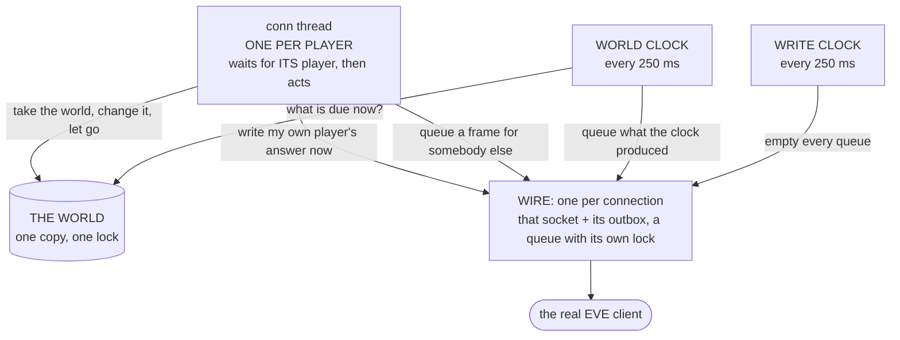
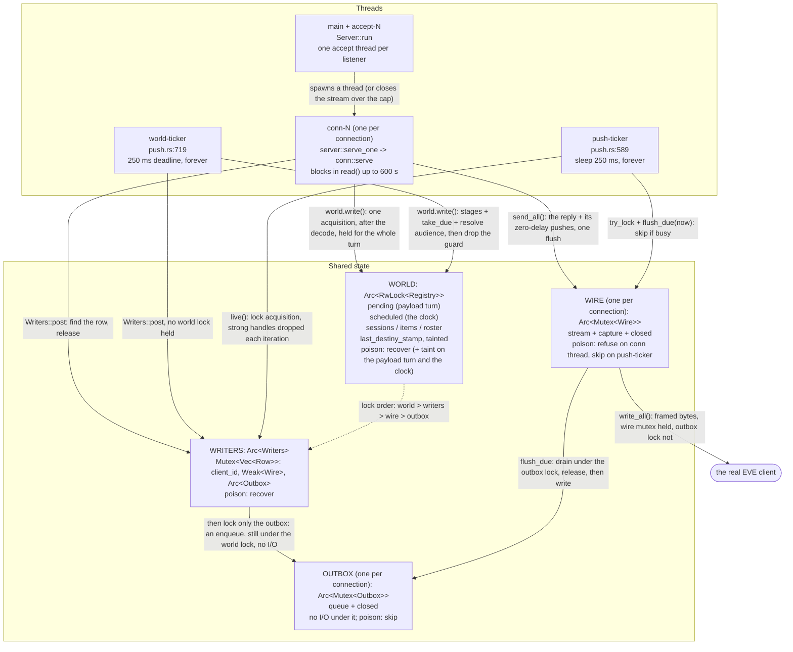

# The short version, before the precise one

**Read this first if you have never read this file.** It is the smallest picture
that still makes the rest of the page make sense — simplified, but there is
nothing in it you will have to unlearn later. Three indented notes below mark
where a simplification stops being safe; those are the pointers to follow. The
rest of this page is the precise version.

## The whole shape, in one picture

### ASCII — reads correctly under `cat`

```
 ==================  ONE eve-server PROCESS  ==================

   player 1 -->  conn thread 1  --,
   player 2 -->  conn thread 2  --+-->  +----------------+
   player 3 -->  conn thread 3  --'     |   THE WORLD    |
                                        |  one copy of   |
   ONE THREAD PER PLAYER. It waits      |  it, one lock  |
   for ITS player to say something,     |  over it       |
   takes the world, changes it,         +----------------+
   LETS GO, then answers.                        ^
                                                 |
   WORLD CLOCK, every 250 ms: -------------------'
   whatever the world says is due
   now, do it -- nobody asked

        |                                    |
        | a conn thread WRITES its           | either of them QUEUES
        | own player's answer, with          | a frame for somebody
        | no lock but that wire's            | else, or one due later
        v                                    v
   +----------------------------------------------------------+
   |  WIRE -- one per connection                              |
   |  that connection's socket, and beside it a queue of      |
   |  frames (the OUTBOX) behind a small lock of its own      |
   +----------------------------------------------------------+
        ^                                    |
        |                                    v
   WRITE CLOCK, every 250 ms:           the real EVE client
   empty every queue

   lock order, outermost first:  world > writers > wire > outbox  (§0)
```

### Mermaid — renders on the git host



## Five things, and that is all of it

**1. There is one world, and everybody shares it.** One `Registry`, in one
process, behind one lock (§3.1). It used to be one per connection, and that
meant two players were two universes and a reconnect threw away everything you
had done. Every other decision on this page is an arrangement around that one
shared thing.

**2. There is one thread per connected player, and it mostly waits.** It sits in
`read()` waiting for its own player to say something — for up to ten minutes,
which is normal rather than a hang: the real client legitimately sends nothing
between keepalives (§8.1). It holds **no lock at all** while it waits, and that
is the single most important property in the file. When its player does speak,
the thread takes the world, changes it, lets go, and answers.

> Where that stops being simple: "takes the world, lets go" is one whole
> request, not a moment. The lock is taken once at the top of the turn and held
> through every handler *and* through the save to disk, so one player's save
> blocks every other player's turn for the length of an fsync. That is
> deliberate, and §8.2 is the argument for it.

**3. There are two clocks, and they are background threads.** Both wake every
250 ms, for ever; neither has any path that could stop it, and process exit is
what ends them (§2.3, §2.4).

- the **write clock** (`push-ticker`, §2.3) empties the queues — it is the thing
  that actually puts bytes on sockets on everybody else's behalf. Its whole
  safety argument rests on it taking no lock but one connection's wire, so work
  that needs the world does not belong in it.
- the **world clock** (`world-ticker`, §2.4) lets the world act when nobody has
  said anything — a ship arriving from warp is the one live example (§5).
  Without it the server could only ever *reply*, and a universe that only
  replies is not a universe.

**4. A lock is "only one thread at a time may touch this".** There are four
kinds on the game path (§3): the world; the list of where-do-I-write handles
(`writers`); one per connection over that connection's socket (`wire`); and one
per connection over its queue of outgoing frames (`outbox`). Chat and the save
file add one small lock each, only ever taken last (§3.5). You acquire them in
one order only, **`world > writers > wire > outbox`** (§0). The order is a rule
rather than a preference because two threads taking two locks in opposite
orders can each end up holding what the other waits for — for ever, with no
timeout, nothing in either log, and a black screen on the client. Today the
order is obeyed everywhere and no thread holds more than two, so there is no
such cycle in the tree (§0, §8.6).

> One piece of vocabulary that misleads: `writers` answers *where do I write*,
> not *who is online*. "Who is online" is the session table, a separate thing
> with separate semantics (§3.2). The two meet at exactly one value, a
> `client_id`.

**5. The one rule you could break without noticing: never make the world wait on
the network.** If a thread holds the world lock while writing to a socket, one
player whose connection has stalled freezes the game for everybody else. The
design keeps the two apart by giving every outbound frame two distinct steps:
**queue it** (`Writers::post` — an in-memory push onto that connection's
outbox, under a lock nothing does I/O under) and **write it**
(`Wire::send_all` — touches the socket, only ever with no lock but that
connection's own wire). Code running under the world lock only ever queues
(§8.3). A dispatch arm cannot even reach a socket: it is handed the world and
nothing else, so the rule holds by construction rather than by discipline (§7).

> Where that stops being simple: **the rule used to be defeated in two
> places.** `deliver_elsewhere` and `post_session_change` took a connection's
> *wire* lock while holding the world, and the wire lock is the one held across
> a socket write, so a peer whose TCP window had closed could freeze every
> other player for up to the 30 s write timeout. Since `5b7a178` they queue
> through `Writers::post`, which never touches a wire, and the rule holds by
> construction. F2 in §10 is the history. Read it before you add anything that
> locks a `Wire` while the world is held.

---

**The rest of this page is the precise version**: every thread and every lock
with its poisoning policy (§2, §3), the step-by-step life of one request (§4)
and of one scheduled push (§5), what cannot happen and why (§8.6), the
invariants a careless change breaks (§9), an audit (§10) to read before you
change `push.rs`, `dispatch.rs`, `server.rs` or `chat.rs`, and the measured
cost of the world lock (§12).

---

# Threads and locks

**What this is.** The whole concurrency story of `eve-server` in one place: every
thread in the process, every shared thing and the lock over it, the one lock
order, and the two paths a frame can take out. Written for an agent or a person
about to change something in the push path, the dispatcher or the world.

It was written by reading the code, not the other documents, and the audit in
§10 is the result — nine findings. **Read §10 before you change `push.rs`,
`dispatch.rs`, `server.rs` or `chat.rs`.**

**The current state:**

- **fixed: F1, F2, F3, F4, F5.** Each one is kept below, marked, with the fix
  and its test named, and with the failure mode left described, because the
  next person to reintroduce it needs to recognise the shape. F2 and F3 were
  fixed together by the outbox split (`5b7a178`);
- **open, but reasoning gaps and traps rather than defects: F6, F7, F9.** F8
  is superseded: its branch went away with F3's fix, and §10 says what
  replaced it;
- **no live defect in the lock design that this audit knows of.** §12 has the
  measured numbers (V3): at 100 bots the world lock is about 4% occupied, and
  its tail was one call, which RIDX has since cut by a factor of three.

**This page has drifted from the tree twice, and both times it was the §10
failure mode landing inside §10.** First, the audit was committed together
with the fixes for F1, F4 and F5 without the two being reconciled, and this
header said "nothing in this document was fixed; that is deliberate". Second,
the outbox split fixed F2 and F3 while this page went on calling them live,
until `docs/review/V3-runtime.md` F6 said so. Both are recorded rather than
tidied away, for the same reason every other finding is.

Refreshed 2026-10-25 (lane IP26) at `60c5768`, after IP8 (`1130103`: one
accept thread per listener, caps, a drop guard on every exit path), IP9
(`8d98e35`: decode before the world lock, a recovered poison taints the
world) and CP15 (`756ab56`: the clock saves every 30 s and taints too; tick
health times wait apart from hold). Current as of `dispatch.rs` 2159 lines,
`push.rs` 1397, `server.rs` 1315, `conn.rs` 238, `chat.rs` 2103. Paths are under
`server/crates/eve-server/src/` unless they say otherwise. **Every `file:line`
below was re-checked at that commit.** Line numbers rot: if one does not land
on the thing its sentence names, grep for the name and fix the number here.

---

## 0. The lock order, which is the one thing to memorise

```
             world  >  writers  >  wire  >  outbox

             world  >  chat hub          (a leaf, taken last)
             world  >  chat directory    (write; a leaf)     chat hub  >  chat directory (read)
             world  >  store guard       (a leaf, taken last)
```

Acquire in that order, release in the reverse, and **never acquire a lock to the
left of one you already hold.** There are four kinds of lock on the game path,
plus two leaves that are only ever taken last (§3.5). No code path holds more
than two at once.

What a violation would do, concretely: the connection thread holds the world
write lock for the whole of a payload turn (`dispatch.rs:1828`), and from inside
it reaches an outbox through `Writers::post` (`dispatch.rs:1039`, `:1664`) and
the chat hub through the service arms. A thread that took them the other way
round — held an outbox, a wire or the hub and then asked for the world — closes
the cycle. The deadlock lands on the connection thread, which the client shows
as a black screen with nothing in either log (`docs/guides/debugging-the-client.md`
§1). There is no watchdog and no timeout on a `Mutex`; it would hang until the
process is killed.

**The audit result, in one line: the order is obeyed everywhere, and no thread
ever holds more than two locks. There is no deadlock cycle in the tree today.**
See §3 for the per-call-site evidence and §8.6 for the inventory. `push.rs`'s
own header states the order at `push.rs:23-24`, still as three locks without
the outbox, and carries F1's correction at `push.rs:26-40`. That correction
has itself gone stale since the outbox split; see the stale list in §10.

---

## 1. The flowchart

### ASCII — reads correctly under `cat`

```
 =============================  ONE eve-server PROCESS  =============================

   main + accept-N                                   push-ticker     world-ticker
   Server::run: one accept                           push.rs:589     push.rs:719
   thread per listener                               sleep 250 ms    250 ms deadline
        |                                            forever         forever
        | (A)                                             |               |
        v                                                 |               |
  +------------------------------------------+            |               |
  | conn-N   ONE THREAD PER CONNECTION       |            |               |
  |   server::serve_one -> conn::serve       |            |               |
  |   read() blocks up to 600 s holding      |            |               |
  |   NO lock at all -- by design            |            |               |
  +------------------------------------------+            |               |
     |              |                                     |               |
     |              | (B)                                 |               |
     |              v                                     |               |
  +------------------------------------------+            |               |
  | WORLD   Arc<RwLock<Registry>>            |<-----------|---------------+   (E)
  |   ONE PER PROCESS                        |            |               |
  |   pending    <- the payload turn, ONLY   |            |               |
  |   scheduled  <- the clock, ONLY          |            |               |
  |   sessions / items / roster / fleets     |            |               |
  |   last_destiny_stamp, tainted            |            |               |
  |   poison: RECOVER; the payload turn      |            |               |
  |           and the clock also TAINT       |            |               |
  +------------------------------------------+            |               |
     |              |                                     |               |
     |              | (C)  Writers::post                  |               |
     |              v                                     |               |
  +------------------------------------------+            |               |
  | WRITERS   Arc<Writers>                   |<-----------+               |   (D)
  |   Mutex<Vec<Row>>, one Row per conn:     |<-----------|---------------+   (F)
  |   client_id, Weak<Wire>, Arc<Outbox>     |            |
  |   answers "where do I write";            |            |
  |   NOT "who is online"                    |            |
  |   poison: RECOVER                        |            |
  |   releases its mutex BEFORE it locks an  |            |
  |   outbox or hands a wire back            |            |
  +------------------------------------------+            |
     |              |                                     |
     |              | (C, continued)                      |
     |              v                                     |
  +------------------------------------------+            |
  | OUTBOX  Arc<Mutex<Outbox>>  ONE PER CONN |            |
  |   queue   VecDeque<(Instant, frame)>     |            |
  |   closed  a post after close is refused  |            |
  |   NOTHING does I/O under this lock       |            |
  |   poison: SKIP                           |            |
  +------------------------------------------+            |
     |              ^                                     |
     | (J)          | (I) drain, RELEASE, then write      |
     v              |                                     |
  +------------------------------------------+            |
  | WIRE   Arc<Mutex<Wire>>   ONE PER CONN   |<-----------+   (G)
  |   stream    the try_clone'd write half   |
  |   capture   under the SAME mutex         |
  |   closed    bool                         |
  |   outbox    a handle to the box above    |
  |   poison: REFUSE on the conn thread,     |
  |           SKIP on push-ticker            |
  +------------------------------------------+
                    |
                    | write_all(): one framed buffer per frame, with the
                    | WIRE mutex held across the whole syscall loop and
                    | the OUTBOX lock NOT held
                    v
             the real EVE client

 WHAT CROSSES EACH ARROW
 (A) a thread      an accept thread spawns conn-N and never joins it; over
                   the listener's cap the stream is closed instead
 (B) a lock        world.write(), ONE acquisition for the whole payload turn,
                   AFTER the payload is decoded with no lock held, and held
                   across the arms, the push drain and the fsync
 (C) an enqueue    a frame for SOMEBODY ELSE: Writers::post(client_id, due,
                   frame) -- the writers mutex to find the row, released,
                   then the outbox lock. Still under the world lock, and
                   harmless: nothing does I/O under either. (This used to
                   lock the WIRE, which was finding F2.)
 (D) a lock        live(): every live wire, dead slots swept, strong handles
                   dropped before the next sleep
 (E) a lock        world.write(): the clock stages, take_due(now), resolve
                   each audience to client ids, THEN drop the guard
 (F) an enqueue    Writers::post(client_id, now, frame), with NO world lock
                   held, and no wire lock either (this was finding F3)
 (G) a lock        try_lock + flush_due(now) -- SKIP, never wait
 (I) a lock        inside the wire: flush_due drains the outbox under its
                   own lock, releases it, then writes. Wire::post and
                   Wire::close also take it, so wire > outbox
 (J) frames        send_all(): the reply's payloads, then its zero-delay
                   pushes, in ONE flush under ONE wire guard
```

### Mermaid — renders on the git host



---

## 2. Every thread in the process

Six kinds on the game path and four more for chat, and **none of the
long-lived ones ends on purpose.** Process exit is what ends them.

| thread | spawned at | how many |
|---|---|---|
| `main` (accepting on the first listener) | the caller of `Server::run` | one |
| `accept-{i}` | `server.rs:648-650` | one per further listener |
| `conn-{ordinal}` | `server.rs:678-686` | one per live game connection |
| `push-ticker` | `push.rs:590-591` | one |
| `world-ticker` | `push.rs:739-740` | one |
| `world-saver` | `store::Saver::spawn` | one, with `--world`; ends at `Server` drop (CP52) |
| `chat-reconcile` | `server.rs:543-550` | one, when chat is on |
| `chat-accept` | `server.rs:757-758` | one per chat listener |
| `chat-conn` | `server.rs:773-774` | one per chat connection |
| `chat-write` | gone (PA-5) | chat writes go through the `push-writer-K` pool (`chat::ChatOut`, `push::Drain`) |

### 2.1 `main` and `accept-N` — the accept loops

`Server::run` (`server.rs:645`) accepts on the first listener on the calling
thread and starts one `accept-{i}` thread for each further listener, inside a
`thread::scope` (`server.rs:646-654`). Each runs `accept_on`
(`server.rs:660`), which drives `accept_loop` (`server.rs:191`): an accept
error is logged, anything but an interrupt or a reset backs off first
(`EMFILE` and `ENFILE` included), and the loop continues. Since IP8 one bad
`accept` no longer ends the server, and a full bot listener does not refuse
the friends' one.

Over a listener's cap the stream is closed at once rather than queued
(`server.rs:667-671`). The cap is a `Slot` (`server.rs:215`) released on drop,
so a connection thread that panics or returns early gives its place back.

Owns its `TcpListener`. Shares the accept ordinal (`AtomicU64`, `Relaxed`; it
only has to be unique), from which `client_id` is derived
(`server.rs:672`, `:743-745`). Connections are **detached rather than
joined**: a dead client must not hold up the next one, and there is nothing to
join for.

**The clean stop** (lane shutdown, `crate::shutdown`): every accept loop
watches the server's `Stop` (an `AtomicBool`, `SeqCst`; no world lock).
`Stop::request` sets it and then dials each listener once, so a thread
blocked in `accept` wakes, drops that connection and ends; `run` returns,
and from then on nothing is accepted. `main` then calls `Server::hang_up`
(every live wire shut in both directions, so each `conn-N` reads
end-of-stream and its session ends through `SessionGuard`; then up to
`SESSION_DRAIN` = 5 s for the live counts to reach zero), drops the
`Server` -- `Drop` runs `dispatch::flush_world` (§8.2) -- and returns, exit
0. The request comes from `world-ticker` (§2.4): the `/shutdown` countdown
running out, or the stop file appearing.

`Server::run_once` (`server.rs:699`) is the single-connection variant: it
serves on the caller's thread. Most loopback tests use it, which is why the
suite exercises the tickers but rarely two connection threads unless a test
spawns them itself.

### 2.2 `conn-N` — one per connection

Spawned by `accept_on` at `server.rs:678-686`, named `conn-{ordinal}`, with a
stack of `CONN_STACK` (`server.rs:741`), sized for the decoder's recursion.
As many as there are live connections, up to the listener's cap. Ends when
`conn::serve` returns a `ConnEnd`, which covers every outcome: a 600 s idle
timeout (`conn.rs:36`), the dispatch's shorter pre-auth timeout until login
(`conn.rs:194`, IP9), a framing error, and a refused payload.

**Owns exclusively:** the read half of the socket, the `GpsSession` (and so the
handshake state, the bound-object table and the `unanswered` census), and the
single strong `Arc<Mutex<Wire>>` (`server.rs:889`). *That* is the lifetime
design, and §3.2 is why.

**Shares:** the world, the writers registry, the `Store`, and its own wire and
outbox.

**What it does on the way out, on every exit path, a panic included:**
`SessionGuard` (`server.rs:793-816`), built at `server.rs:928` and dropped at
`:939`. Its `Drop` takes the world through `service::world_write`, calls
`session_closed` and the chat hub's `forget_client`, **releases the world**,
and only then calls `Wire::close`. A `Drop` guard since IP8, so an unwinding
panic runs it too; before that, a panicking dispatch left a ghost that other
players saw online (V2 F3). Explicit rather than left to the `Arc`, because
"the ticker cannot write to a dead connection" should be a statement about a
function and not about reference-count timing.

### 2.3 `push-ticker` — the write clock

`push::spawn_ticker` (`push.rs:589`), called from `Server::bind`
(`server.rs:456`). **One for the process**, started before the world is even
built.

**Never ends, and no path exists that could tell it to.** That is the choice:
`docs/reference/push-path.md` §1.3 and §1.4 argue it, and the short form is that a
per-connection ticker is a second lifetime that must be stopped on a path which
includes a *panicking* connection thread. A process-lifetime daemon has no such
path.

**Owns:** nothing. **Shares:** `Arc<Writers>`, and transiently one wire at a
time.

Its loop is a few lines and the point is that it stays that way
(`push.rs:593-618`): sleep, `writers.live()`, and for each live wire
`try_lock` + `flush_due`. **It takes no lock but the wire's** (and, inside
`flush_due`, that connection's outbox for the length of a drain). `live()`
releases the writers mutex before it returns, and every other safety argument
in `push.rs` rests on that. See §8.4.

### 2.4 `world-ticker` — the world's own clock

`push::spawn_world_ticker` (`push.rs:719`), called from `Server::bind`
(`server.rs:558`), after the world exists because it needs a handle to it.
**One for the process. Never ends, same reasoning.** It runs on a deadline
rather than a sleep (`push.rs:742-768`), so lateness is measurable.

A *second* thread rather than work added to `push-ticker`, and that is load
bearing: `push-ticker` must keep the property that it holds no lock but the
wire's, and this one must take the world lock. Keeping them apart means an edit
here cannot quietly weaken the argument there.

Its loop is two halves that **do not overlap** (`push.rs:769-911`):

1. take the world write lock (recovering, and tainting a poisoned world,
   `push.rs:790-804`); run `targeting::sweep_out_of_range` and the
   `tick::STAGES` table (`push.rs:816-823`); `take_due(now)`; resolve each
   push's audience to client ids *while still holding it*; drain the queued
   session changes; **every `SAVE_EVERY` = 5 s, render the world if it is
   dirty and hand the text to `world-saver`** (CP15, CP52); run
   `shutdown::tick` (schedules a due countdown notice, decides whether the
   countdown ran out, clones the `Stop` handle); drop the guard;
2. with no world lock at all, `shutdown::Due::act` (stat the stop file;
   `Stop::request` dials the listeners, so it is never under the world
   lock), then encode each frame and `Writers::post` it
   (`push.rs:897`, `:910`).

Half one resolves the audience inside the lock because the session table lives
in the world, and a second acquisition to look it up is exactly the re-entry
that becomes a cycle. Half two only ever posts to an outbox, so the
`write_all` happens on `push-ticker`'s thread within one `TICK`.

### 2.5 Chat

With `--chat`, or a listener that names `chat=`, `Server::bind` starts the
XMPP side (`server.rs:523-551`): a `chat-accept` thread per chat listener, a
`chat-conn` thread per chat connection, and one `chat-reconcile` thread. Since
PA-5 a chat connection has no writer thread: it owns a queue (`chat::ChatOut`)
and the `push-writer-K` shard `conn % writers` drains it (`push::Writers::wake`,
`Drain`), woken at once rather than on the tick, with the same bounded write
and stall hang-up as machoNet frames. **Nothing in chat writes a socket under a
lock**: a stanza is enqueued under the hub's lock and written by the shard with
no lock held (`chat.rs:13-17`). The chat threads touch the
world only through `world.read()` (§3.1) and drop it before they take the hub;
the module header (`chat.rs:22-28`) is the authority on that order.

### 2.6 Not in this process

`eve-dns` is a separate binary with its own threads; nothing in this document
applies to it. The only thing worth carrying across is that it has set *both*
socket timeouts since it was written and this crate had to be caught up
(`conn.rs:58-59`).

---

## 3. Every shared thing, its lock, and its poisoning policy

**Two poisoning policies, and the difference between them is on purpose. A
reader who assumes one of them is a bug will "fix" it in the wrong
direction.** The distinction is: *does the protected value have an invariant a
panic could have broken, and what is the cost of refusing?* The world, the
writers registry, the chat hub and the store guard **recover**; a `Wire`
**refuses** (on its owner) or is skipped (by the ticker). An outbox is
skipped: a post to a poisoned one is refused, a flush of it does nothing.

There used to be a third policy: `serve_one` logged and skipped its
session-table work on a poisoned world. That was not a policy, it was F4, and
it is fixed. The recovering policy has one place that *states* it,
`service::world_write` (`service.rs:4335-4365`), whose doc comment is the
argument in full. `dispatch` and `world-ticker` spell the same recovery out
inline, and **both copies also taint the world** (IP9 for the payload turn,
CP15 for the clock; §3.1). So: **two policies, one helper, eight acquisitions of the world** —
four `write()` and four `read()`. If you are grepping for a third policy you are
hunting a ghost.

| Thing | Lock | Held by | For how long | On poison |
|---|---|---|---|---|
| the world | `RwLock<Registry>` (`server.rs:515`) | every conn thread and the world-ticker (`write`); no chat thread (PA-11) | one whole payload turn; the clock's tick, incl. a render every 5 s | **recover**, at all eight; the payload turn and the world ticker also **taint** (`dispatch.rs:1828-1842`, `push.rs:790-804`) |
| the writers registry | `Mutex<Vec<Row>>` (`push.rs:288`) | every conn thread, both tickers | microseconds; released before any outbox or wire is locked | **recover** (`push.rs:384-386`) |
| one connection's wire + its capture | `Mutex<Wire>` (`server.rs:889`) | that conn thread, `push-ticker`, `SessionGuard` | across `write_all`, so up to 30 s | **refuse** (conn thread) / **skip** (`push-ticker`, `SessionGuard`) |
| one connection's outbox | `Mutex<Outbox>` (`push.rs:152`) | anyone queueing; `push-ticker` inside `flush_due` | one `VecDeque` operation, never across I/O | **skip**: `Writers::post` returns `false` (`push.rs:342-345`), `flush_due` does nothing (`push.rs:227-230`) |
| the chat hub | `Mutex<Hub>` (`chat.rs:600`) | conn threads under the world; chat threads with no world | one stanza's work | **recover** (`chat.rs:884-889`) |
| the store's guard | `Mutex<Guard>` (`store.rs`) | `world-saver`, with no world lock (CP52) | one disk write | **recover** |
| the saver's sender and thread | `Mutex<Option<..>>` (`store::Saver`) | the world ticker (clone the sender), shutdown (take it) | a clone or a take, never across I/O | **recover** |
| the saver's write tally | `Mutex<SaveWrites>` (`store::Saver`, E1b) | `world-saver` (add one write, no world lock), the world ticker (take it once a report, under the world lock) | one add or one take, never across I/O or another lock | **recover** |

### 3.1 The world — recover, and taint where a save can follow

`Arc<RwLock<Registry>>`, built once in `Server::bind` (`server.rs:470-515`) and
handed to every connection. It used to be per-connection, so two clients were
two universes and a reconnect threw away everything the player had done.

Taken **exactly once per payload**, in `dispatch::on_payload`
(`dispatch.rs:1828`), and passed down to the arms as `&mut Registry`. Since IP9
the payload is decoded **before** that, with no lock held
(`dispatch.rs:1815-1818`), so a large payload's inflate and decode is no longer
every player's wait; `decode` is an associated function with no `self` and no
world, so that it cannot take the lock is a property of its signature
(`dispatch.rs:1717-1725`). Pinned by
`dispatch::tests::loads_runs_with_the_world_lock_free` (`dispatch.rs:2060`).

One acquisition is not style. `std::sync::RwLock` is not reentrant, so a second
acquisition inside an arm is an instant self-deadlock on that connection's own
thread; the handlers taking `w: &mut Registry` makes "one acquisition" a
property of the types rather than a rule to remember.

Poisoning is **recovered**: `world.write()`'s `Err` is unwrapped with
`into_inner()` on the payload turn (`dispatch.rs:1828-1842`) and in the world
ticker (`push.rs:790-804`). The reasoning, from `docs/reference/world-state.md` §4 rule 5:
with one world behind one lock, propagating a poison lets a single panic in a
cosmetic arm end the universe for every connected player, including the ones
who were nowhere near that arm. The accepted risk is serving state a panicking
thread left half-written.

**Since IP9 that risk is fenced off from the disk.** When the payload turn
or the world ticker finds the lock poisoned it calls `Registry::taint`
(sticky; logged once), and a tainted world's saves go to `<world>.tainted`
instead of over the good file (`store.rs:544-558`). `service::world_write` and
chat's reads recover without tainting, and that is enough: the two places that
save — the payload turn (`dispatch.rs:1881-1887`) and the clock's 30 s save
(`push.rs:858-867`) — are the two that taint, and the poison flag never
clears, so whichever of them runs first after any panic anywhere taints before
it saves. Pinned by
`dispatch::tests::a_recovered_poison_taints_the_world` (`dispatch.rs:2130`).

**PA-11 update: chat no longer takes the world at all.** The paragraph below
describes the state before PA-11; since then every chat read goes to the
published `chat_dir::ChatDirectory` (§3.5) and `chat.rs` never names the world
lock (a source-scan test pins it).

**Note two things a reader will get wrong.** First, **the read lock was taken
before PA-11**, and only by chat: `ChatHub::reconcile` (`chat.rs:943`), the presence
path (`:1257`), the login check (`:1297`) and the user-data query (`:1445`).
Each runs on a chat thread that never holds the write lock, reads, drops the
guard, and only then takes the hub. The four `write()` acquisitions are
`dispatch.rs:1828`, `push.rs:790`, and `server.rs:910` (`session_opened`) and
`server.rs:802` (`SessionGuard::drop`), the last two through
`service::world_write`. That is F9, a narrower trap than it was. Second,
`serve_one` used *not* to follow the recover policy, and that was the most
serious finding in this document; it is fixed (F4). Read F4 anyway before you
add an acquisition with a policy of its own: the whole content of that finding
is why a divergent policy on *this* lock was so expensive.

### 3.2 The writers registry — recover

`Writers` (`push.rs:283`, the keyed field at `push.rs:288`) is a
`Mutex<Vec<Row>>`, and a `Row` (`push.rs:299-303`) is a `client_id`, a
`Weak<Mutex<Wire>>` and a **strong** `Arc<Mutex<Outbox>>`. It answers
**"where do I write"**, and that is all. It is *not* the session table, which
answers "who is online" and owns identity (`crate::session_table`); the two
meet at exactly one point, a `client_id`.

The `Weak` wire is the whole lifetime design: the single strong handle lives
in `serve_one`'s frame (`server.rs:889`), so a connection that ended cannot be
written to and nothing has to be told that it ended. `register`, `wire_for`
and `live` each sweep dead slots on the way past. The outbox handle is strong
on purpose (`push.rs:291-298`): a pusher must be able to queue without first
proving the socket is alive, and the outbox's own `closed` flag turns a post to
a departed connection into a refusal rather than a leak. The `Weak` wire is
still the liveness authority.

Poisoning is **recovered**, at `push.rs:384-386`, and the comment there says it
is "the opposite policy from `conn::guard`, and for the opposite reason": there
is no invariant here, the value is a list of handles and every operation on it
is total. Refusing would let one panicking connection take the push path away
from every other player.

**The property every caller depends on:** `wire_for` and `live` release the
writers mutex *before* returning the `Arc` they found, and `post`
(`push.rs:334-346`) clones the outbox handle under it, releases it, and only
then locks the outbox. So nobody ever holds `writers` and a `wire`, or
`writers` and an outbox, at the same time; those edges of the order carry no
live traffic at all. `register` (`push.rs:306-322`) locks the wire first, to
read its outbox handle, and releases it before it takes the writers mutex.

### 3.3 One connection's wire — refuse on the owner, skip on the ticker

`Wire` (`push.rs:125`) holds the `try_clone`'d write half of the socket, the
capture, a `closed` flag, and a handle to the connection's outbox (§3.4), all
behind one mutex.

**The capture is under the same mutex as the socket and that is not tidiness.**
A capture's whole value is its claim that frame *n* left the socket before frame
*n+1* — it is the instrument used to arbitrate a disagreement with the client.
Behind a second lock, two writing threads could record in one order and write in
the other, and the instrument would be the thing lying.

`closed` is **not redundant with the `Arc` being dropped**. Two file descriptors
refer to this socket; the kernel closes it when the second goes, and a ticker can
hold a transient strong handle across a write. Without the flag, an fd closed and
its *number* reused by a later `accept` could take a pushed Destiny update into
somebody else's session. A bool makes that unrepresentable rather than unlikely.

**One policy — do not write to it again — in three shapes**, one per caller:

- **`conn::guard` refuses** (`conn.rs:236-238`, returns `ConnEnd::Poisoned`). A
  poisoned wire means a thread panicked while holding the socket, so the stream
  may be mid-frame: there is no byte we can write after that which the client can
  parse, and pretending otherwise produces a framing error on the client with
  nothing in it that names us.
- **`push-ticker` skips, permanently** (`push.rs:610`; `try_lock` returns `Err`
  for a poisoned mutex too). Same reason, from the other side.
- **`SessionGuard` skips the close** (`server.rs:812-814`): a poisoned wire is a
  panic mid-write, and there is nothing to close safely.

Nobody else locks a wire any more. The world ticker and `deliver_elsewhere`
used to, and that was F2 and F3; both now go through `Writers::post` to the
outbox.

So: **the world and the registry recover because their values have no invariant
and refusing would hurt bystanders; the wire refuses because its value has an
invariant — the frame boundary — that a panic may already have broken, and
because the only party hurt is the connection that panicked.** That sentence is
the distinction, and it is the one a future reader needs.

### 3.4 One connection's outbox — its own lock, and nothing does I/O under it

`Outbox` (`push.rs:57-115`) is the queue of frames waiting for their due time,
plus a `closed` flag, behind a mutex of its own. It was a field of `Wire` until
`5b7a178`, and that was the root of F2: every pusher had to take the mutex that
`write_all` holds, so a peer with a full receive window made a queueing thread
wait for up to 30 s, and two of those threads held the world.

The rule the split makes structural: **nothing does I/O under an outbox
lock.** `Outbox::post` (`push.rs:89-95`) is a `push_back`, refused once closed;
`Wire::flush_due` (`push.rs:226-235`) drains everything due under the small
lock, **releases it**, and only then calls `send_all`. So a `write_all` blocked
on a slow peer holds that peer's wire and never its outbox, and every pusher
gets through.

It sits last in the order, `wire > outbox`: `Wire::post` (`push.rs:214-218`),
`flush_due`, `Wire::close` (`push.rs:257-265`) and `Wire::queued` take it while
holding the wire, and nothing takes a wire, the writers mutex or the world
while holding an outbox.

**It is bounded (IP30, V3 R6).** A post that would take it past
`OUTBOX_FRAMES` or `OUTBOX_BYTES` [A] is refused, the outbox is closed and
emptied, and the socket is shut down through a second handle the outbox keeps
for that alone, taken out under the lock and shut after it is released. The
connection's own read then returns, and `SessionGuard` ends the session like
any other disconnect. `push-ticker` prints `[push] outbox peak` when the
high-water mark rises.

### 3.5 The two leaves: the chat hub and the store guard

Both are taken only with the world already held or with nothing held, and
neither is ever held while asking for anything else.

- **The chat hub**, `Mutex<Hub>` (`chat.rs:600`). The service arms take it
  inside the world write lock; the chat threads read the world, drop it, then
  take the hub; nothing that holds the hub touches the world (`chat.rs:22-28`,
  and the `chat` field's note at `service.rs:535-541`). Since PA-11 the chat
  threads do not read the world at all (see the directory below). `SessionGuard::drop`
  calls `forget_client` under the world (`server.rs:804-806`), which is the
  same direction. Recovers from poison (`chat.rs:884-889`).
- **The chat directory** (PA-11), `RwLock<Arc<ChatDirectory>>` inside
  `chat_dir::Published`, held by the hub. Built by the world side (stage
  `chat_dir` every 1 s, the `ON_LOGIN`/`ON_LOGOFF` rows, `set_chat`, and
  `ResyncSystemChannelAccess` through `chat_dir::refresh`) under the world lock;
  read by chat (auth poll, presence, user-data iq, the reconcile pass) as an
  `Arc` clone. A leaf: nothing is acquired while holding it. **Ordering rule:**
  the world side updates the directory before it touches the hub, and the
  reconcile pass reads the directory *inside* the hub critical section, so an
  older directory can never undo a newer `sync_character`.
- **The store's guard**, `Mutex<Guard>` (`store.rs:379`), taken by
  `FileStore::save` (`store.rs:541-543`) inside the world lock, on the payload
  turn or in the clock's 30 s save.
  It serialises the save's bookkeeping (taint and downgrade refusals); the
  world lock already serialises the saves themselves. Recovers from poison
  (`store.rs:428-431`).

### 3.6 The things that are *not* locked, and why that is fine

- `NEXT_OBJECT_ID` (`dispatch.rs:207`): a `static AtomicI64`, `Relaxed`. The
  property wanted is "unique in this process", which is what a static says.
- `Server::accepted` (`server.rs:404`): `AtomicU64`, `Relaxed`, same.
- Each listener's live count: an `AtomicUsize` behind `Slot`
  (`server.rs:215-231`), `AcqRel`. The cap is a `fetch_update`, so two accepts
  cannot both take the last place.
- `Arc<dyn Store>` (`server.rs:409`): `Store: Send + Sync` (`store.rs:352`) and
  `FileStore::save` takes `&self`. The saves are serialised by the world write
  lock the caller already holds (§8.2); the store's own guard (§3.5) covers
  only its bookkeeping.
- The `GpsSession`, the handshake, the bound-object map: per connection, touched
  by one thread, never shared.

---

## 4. The life of one payload

This is the path every future change touches. `conn-N`'s thread, start to
finish. Line references are `conn.rs` unless noted.

1. **`read()` blocks** (`conn.rs:196`). Up to `IDLE_TIMEOUT` = 600 s (`conn.rs:36`), which is
   deliberately longer than the client's 240 s keepalive — the client is
   *entitled* to be silent for minutes. Before login the leash is the
   dispatch's shorter pre-auth timeout instead, re-read before every read
   (`conn.rs:194`, IP9). No lock is held. §8.1.
2. **Split frames** with `try_split_frame` (`conn.rs:140`), the client's own splitter
   reimplemented from disassembly. An OOB flag ends the connection: machoNet
   never sets it.
3. **Record inbound** (`conn.rs:158`): `guard(wire)` → `record_inbound`. **One wire
   lock, held across a capture file write**, no world lock. The inbound
   direction goes through the same mutex so the capture has one serialisation
   point in both directions. Costs one uncontended lock per inbound frame.
> **PA-12a: read turns.** After the decode and before the write acquisition,
> `on_payload` asks `try_read_turn` (`dispatch.rs`). A payload that is a
> ping, a client notification, a handle-getter mint (`skillMgr2.GetMySkillHandler`,
> `invbroker.GetInventory[FromId]`, service or bound) or one of the calls in
> `service::READS` (`config.GetAverageMarketPrices`, the seven
> `dungeonInstanceCacheMgr` lists and counts) is classified with **no lock**,
> then served under `world.read()`: `Registry::dispatch_ro(&self, Caller, ..)`
> is a `&Registry` twin of the write arm, so it cannot mutate or push. It
> requires `!turn_output_pending()` (no queued pushes, session changes or
> fleet session changes: the write path would have drained them into this
> reply); otherwise it falls back to the write path from unchanged session
> state. Interior state a read touches is memoisation behind leaf mutexes
> (`econ_prices::PriceCache`, `signal_tracker::Tracker.cold`) and the
> `live_status::TurnSlot` mutex that `record_turn(&Registry, ..)` uses (lock
> order: world, then that leaf). `EVE_READ_TURNS=0` forces the old path.
> Read turns overlap each other and are exclusive against the clock and
> write turns; they are counted apart (`prof::Sec::PayloadRead*`) so the
> `payload held` occupancy stays the exclusive one.

4. **`dispatch.on_payload(&payload)`** (`conn.rs:162`) — *no wire lock held*; the
   temporary guard from step 3 is gone. Inside it (`dispatch.rs:1798-1899`):
   - **the payload is decoded first, with no lock** (`dispatch.rs:1815-1818`,
     IP9): `loads`, the packet, and a `CallReq`'s inner `CallPayload`.
   - **`world.write()` is taken, once** (`dispatch.rs:1828`), recovering from
     poison and tainting the world if it was poisoned (§3.1). **It stays held
     for every remaining sub-step.**
   - `handle_inbound` → `observe` → `handle_packet` → the arm. The arm sees
     `w: &mut Registry` and no socket, no session and no node id. **It can only
     *ask* for a push**, via `Registry::push` / `push_later` / `schedule`.
     That is the type system enforcing `docs/reference/world-state.md` §4 rule 4 —
     never hold a lock across a socket write — rather than discipline doing it.
   - `with_session_change` (`dispatch.rs:910`) puts any session change in front
     of the answer, and posts changes belonging to *other* characters through
     `post_session_change` (`dispatch.rs:1007`), which queues with
     `Writers::post` (`dispatch.rs:1039`): an outbox enqueue with the world
     lock held, and harmless, because nothing does I/O under an outbox lock.
     This site used to lock the target's wire — F2.
   - `pending_pushes` (`dispatch.rs:1549`) drains `Registry::pending`. For each
     push: `audience() == None` or our own character → encoded here and appended
     to `reply.pushes`; every *other* connection of that character →
     `deliver_elsewhere` (`dispatch.rs:1620`), which encodes and queues with
     `Writers::post` (`dispatch.rs:1664`). Same reasoning, same history.
   - If the world is dirty, `store.save(&w.to_snapshot())` — **an fsync, inside
     the write lock** (`dispatch.rs:1881-1887`). Deliberate: `docs/reference/world-state.md`
     §4 rule 3 wants the RAM mutation and the disk write to happen together. §8.2.
   - **The guard drops when `on_payload` returns.** Everything after this point
     runs with no world lock.
5. **One flush, under one wire lock** (`conn.rs:170-183`). This is the ordering
   guarantee, and it is a guarantee rather than an accident of how the code
   reads:

   ```rust
   let mut out: Vec<Vec<u8>> = reply.payloads.clone();
   for (after, payload) in &reply.pushes {
       if after.is_zero() { out.push(payload.clone()); }
       else { w.post(now + *after, payload.clone()); }
   }
   w.send_all(&out)
   ```

   So the order on the wire is: **the session change (if the arm put one in
   `payloads`), then the `CallRsp`, then every zero-delay push the arm queued,
   in the order it queued them — all inside one `Wire` guard, so no other
   thread's frame can land between any two of them.** Pinned by
   `a_zero_delay_push_is_sent_after_the_payloads_in_one_flush`
   (`server/crates/eve-server/tests/loopback.rs:3402`).

   **Why `destiny::on_ballpark_bind` depends on it.** Some client handlers
   *silently drop* a change for an item that is not yet in a cache which the
   in-flight call's own response fills: `clientDogmaLocation.OnModuleAttributeChanges`
   skips any item where `IsItemLoaded` is false, in one branch with no log at
   all, and godma's `ApplyAttributeChange` returns after a single `LogInfo`. A
   push that arrives before the response it depends on is not an ordering nit —
   it is a change that never happened and left nothing to find. For the ballpark
   bind specifically, the `SetState` has to land *after* the `CallRsp` to the
   `beyonce` bind that asked for it; that is the whole reason the scheduled
   queue is a second queue (§6).

   A push that must come *before* a response is not expressible as a
   `Reply::push` at all: an arm that needs that puts the notification in
   `payloads` itself, which is what `with_session_change` and
   `handle_select_character` do.
6. **`Wire::send_all`** (`push.rs:173-187`): for each payload, build the whole
   framed buffer first, then one `write_all`. **The unit of exclusion is the
   frame, not the byte** — the length word is prepended before any I/O, so two
   writers cannot interleave at byte granularity and produce a stream whose
   declared lengths do not match its contents. Pinned by
   `a_push_cannot_interleave_a_reply` (`push.rs:1178`), which writes a 100 KB
   payload the kernel cannot take in one go against a small one and asserts
   every frame read back is byte-for-byte one of the two.
7. **Repeat from step 2** until the buffer holds no complete frame, then back to
   step 1.

---

## 5. The life of one scheduled push

Different in kind from the above: **nobody's payload turn drains it, and its
Destiny stamp is chosen when it leaves rather than when it is built.**
Commit history (maintainer record) has the increment that added it.

1. **Something schedules it**, from inside a payload turn or the clock's own
   stages, holding the world write lock: `Registry::schedule(after, push)`
   (`service.rs:2152`) pushes `(Instant::now() + after, Box<dyn Push>)` onto
   `Registry::scheduled`. The first production caller was the warp arrival
   reconciliation (`service/space.rs:945`), which schedules an `ActionUpdate`
   of `SetBallPosition`, `SetBallVelocity`, `Stop` for the arrival tick. There
   are many now — combat, targeting, modules, drones, mining, jump, NPCs and
   more (`grep -rn 'schedule(' server/crates/eve-server/src`) — and the clock
   stages schedule with `Duration::ZERO` so that what they produce leaves in
   the same tick.
2. **It is built with stamp zero.** `service/space.rs:941-943` says so out
   loud: "Stamp zero, and it never reaches the wire." Passing the *current*
   stamp instead would be a value that looks meaningful and is not.
3. **The turn ends and the world lock is released.** The push sits in
   `scheduled` for however long — seconds for a warp, minutes in principle.
4. **`world-ticker` wakes** (`push.rs:754-758`), takes the world **write** lock
   (recovering from poison and tainting, `push.rs:790-804`), runs the clock
   stages (`push.rs:816-823`), and calls `take_due(now)` (`push.rs:827`;
   `service.rs:2177`):
   - a fast path first: if nothing is due, return without touching the stamp.
     That matters — `next_destiny_stamp` *moves the floor*, and a clock that
     nudged it four times a second forever would make the floor a function of
     uptime rather than of what we have sent;
   - otherwise partition into due and keep, restore `keep` in order, then take
     **one** stamp for the whole drain and `restamp` every due push with it.
     One stamp and not one per batch: two batches leaving in the same tick are
     two notifications in the same second, and `next_destiny_stamp`
     (`service.rs:738-742`) returns whole Unix seconds from `destiny::tick()`
     (`destiny.rs:1116-1120`) anyway, so taking it once says so.
5. **Why that solves a problem §30.4 thought needed an allocator.** A Destiny
   stamp must be monotonic non-decreasing *for ever*: a batch below the last
   `SetState`'s stamp is dropped with `Michelle discarded a state that was too
   old`; a batch below the park's clock needs a snapshot to rewind to, and the
   snapshot ring is wiped on the first command; a failed rewind is
   `OnRecoverableDesync` + `RequestReset`, after which **every** later batch is
   silently ignored until a fresh `SetState` (`last_destiny_stamp`'s comment,
   `service.rs:374-393`). So a batch built now and sent in sixty seconds can be
   neither stamped now (in the past when it lands) nor stamped in the future
   (that value becomes the floor and drags every push in between up to it).
   Both horns rest on the stamp being chosen *at build time*.
   `Push::restamp` (`notify.rs:107`) moves the choice to send time, and the value
   wanted is just `next_destiny_stamp()` — now, monotonic by construction, floor
   moving exactly as it always does. **No allocator, no future arithmetic, one
   trait method with a no-op default** (right for every push with no simulation
   time in it, which is most of them). Pinned by
   `a_scheduled_push_is_stamped_when_it_leaves_not_when_it_is_built`
   (`service/tests.rs:107`), which asserts the *ordering property* rather than a
   number.
   **Every stamped push overrides it** — ten of them now (F5's table) — and
   the two that carry a second clock in the blob header move both. Three of the
   original five did not, which was F5; it is fixed. Read F5 for the caveat:
   the test that guards this is a hand-kept list, not the exhaustive `match`
   this page used to say it was.
6. **The audience is resolved while the lock is still held**, because the session
   table lives in the world and a second acquisition to look it up is the
   re-entry that becomes a cycle. `audience() == None` has no meaning here: a
   push from the clock is not a reply to anybody, so there is no acting
   connection to address it to. Such a push is dropped **with a log line**
   (`push.rs:875-877`) — a notification that silently goes nowhere is the
   failure this whole path exists to remove.
7. **The guard drops. Half two runs with no world lock**: encode the
   `MachoPacket::notification` (needs only the node id besides the client id),
   then `writers.post(client_id, now, payload)` (`push.rs:897`). A `false` from
   `post` means the player closed the client between the schedule and the due
   time — normal, and correctly not an error (but see F8).
8. **`push-ticker` writes it**, within one `TICK` = 250 ms, on its own thread:
   it drains the outbox under the outbox lock, releases it, and writes under
   the wire mutex and no other.

---

## 6. The two queues, and why they must stay two

`Registry::pending` (`service.rs:365`) and `Registry::scheduled`
(`service.rs:372`). **One owner each, and the separation is the design rather
than tidiness.**

| | `pending` | `scheduled` |
|---|---|---|
| element | `(Duration, Box<dyn Push>)` | `(Instant, Box<dyn Push>)` |
| filled by | `Registry::push` / `push_later` | `Registry::schedule` |
| **drained by** | the payload turn, `dispatch::pending_pushes` | **the clock**, `world-ticker` |
| drained with | `take_pending` (`service.rs:2108`) | `take_due(now)` (`service.rs:2177`) |
| stamp bound | at build | **at release**, by `take_due` |
| audience `None` | means the acting session | has nobody; dropped with a log |

**Do not merge them, and do not express `scheduled` as a longer `Duration` on
`pending`.** The reason is the ordering guarantee of §4 step 5:
`destiny::on_ballpark_bind` needs its `SetState` to land *after* the `CallRsp`
in the same flush, so a clock that could take a fresh entry out of `pending`
could reorder a ballpark bootstrap ahead of the answer to the bind that asked
for it — a `SetState` the client's `IsItemLoaded`-style guards would then drop
in a branch with no log. **Two queues with one owner each cannot interact**;
`pending` is drained by the payload turn, `scheduled` by the clock, and neither
ever sees the other's entries. The maintainer record has the attempt that
got this wrong the first time. It is pinned:
`a_scheduled_push_is_stamped_when_it_leaves_not_when_it_is_built` asserts
`take_pending().is_empty()` after a `schedule` (`service/tests.rs:119`).

Note the near-miss in the naming: `push_later(after, n)` puts a *delayed* entry
on `pending`, not on `scheduled`. The delay there is applied by
`conn::serve`'s `w.post(now + after, ...)` (`conn.rs:177`) on the acting
connection's own outbox — same queue, same owner, just a later due time. If you
want the world to speak when nobody has sent a payload, `schedule` is the only
door.

The clock does drain two *other* queues: the session changes
(`Registry::take_session_changes` and `Fleets::take_session_changes`), through
`push::session_changes_due` (`push.rs:683-703`, called at `push.rs:853`). That
is safe for the reason the comment there gives (`push.rs:840-852`): a payload
turn holds the world write lock from the mutation through its own drain, so the
clock can never take a change queued inside a call before that call's reply is
built.

---

## 7. `Registry::pending` is not reachable from a socket, by construction

Worth stating separately because it is the invariant everything else rests on.
An arm has, in scope: `w: &mut Registry`, and the arguments to the call. It has
no socket, no `Writers`, no node id and no session. The *only* thing it can do
about a notification is record that one is owed. Turning that record into a
frame needs the session and the node id, which live in `GpsSession`; performing
the write needs a socket, which lives further out still, in `conn::serve`.

That is `docs/reference/world-state.md` §4 rule 4 holding **by construction**, and it is
why `Reply::pushes` is a `Vec<(Duration, Vec<u8>)>` returned upward rather than
a method that sends. The two functions that *do* reach another connection from
inside the world lock — `deliver_elsewhere` and `post_session_change`, which
live on `GpsSession` — reach only its outbox, through `Writers::post`. Until
`5b7a178` they locked its wire, and were the two sites of F2.

---

## 8. Where a thread can block, and what happens when it does

### 8.1 The read loop blocks for minutes, by design

`conn::serve`'s `stream.read` (`conn.rs:196`) blocks up to `IDLE_TIMEOUT` =
600 s once the player is logged in. That is correct and not a tunable to
shorten casually: machoNet's keepalive is 240 s and the client legitimately
sends **nothing** between pings (`docs/archive/destiny-and-the-ballpark.md` §5.3), so a
timeout anywhere near that would disconnect a healthy player sitting in a
station. What the 600 s catches is a peer that has gone away without closing — a
killed client, a jail torn down under it — whose thread *and whose write half*
would otherwise be held forever. Before login the dispatch sets a much shorter
leash (`dispatch.rs:1907-1910`, applied at `conn.rs:194`), so a peer that never
speaks cannot hold a connection slot for ten minutes (IP9, V2 F5).

**No lock is held while it blocks.** That is the single most important property
in this file.

### 8.2 The world lock is no longer held across an fsync (CP52)

**Until CP52** `dispatch::on_payload` saved the whole world, with an fsync,
under the world write lock after every dirty payload, and the clock did the
same every 30 s (CP15). Measured (§12): 1-4 saves a second at 50-100 bots,
10.5 ms each on the owner's disk (max 20 ms), 1-2.5% of the lock, growing
with the world file.

**Since CP52** (owner decision O1, `docs/reference/world-state.md` §4 rule 3 as revised):

- a payload turn never saves; it marks the world dirty;
- every `SAVE_EVERY` = 5 s **[A]**, `world-ticker` renders the snapshot to text
  under the lock (CPU only) and sends it to the `world-saver` thread
  (`store::Saver`) over an `mpsc` channel;
- `world-saver` writes it through `FileStore`'s diverts and `write_atomic`
  (tmp + `sync_all()` + rename + directory fsync) with **no** lock but the
  store's own guard. Texts queued faster than the disk takes them are
  coalesced: only the newest is written. Each write is added to the
  saver's tally, which the ticker takes once a report window into the one
  `[save]` line (E1b): bytes, snapshot and render under the lock, writes,
  write time, coalesced and generation;
- `world-saver` owns the `--world` file's lock (`<file>.lock`, ACC2) and drops
  it only after its last write. `Server`'s `Drop` runs
  `dispatch::flush_world`: render the last dirty world, then `Store::close`,
  which writes what is queued and joins the thread. A save after that is
  dropped (logged once), never written unlocked.

In production that `Drop` runs on a clean stop (§2.1): `/shutdown` or the
stop file (`--stop-file`, default `<world>.stop`), which `tools/up.sh`,
`serve.sh` and `soak.sh` touch instead of sending SIGTERM
(`tools/stop-server.sh`; SIGTERM only after a timeout).

RAM may lead disk by up to `SAVE_EVERY`; a kill loses at most that, and the
allocator leap on load keeps the lost window's ids from being reissued. The
`[turns]` line's `save_max` is now the render's time under the lock, not the
disk's.

`Capture::write` also flushes per frame under the *wire* mutex
(`capture.rs:95-105`) — a `write` syscall, not an fsync, and worth it: if the
client crashes us, the frames up to that point are the most interesting ones we
will have.

### 8.3 A socket write under a lock would stall the world — and the structural reason it cannot

The rule is `docs/reference/world-state.md` §4 rule 4. The structural reason a *dispatch
arm* cannot break it is §7: there is no handle in scope that would let it.

The *mechanism* is `Writers::post` versus `Wire::send_all`. `post`
(`push.rs:334-346`) finds the row under the writers mutex, releases it, and
does a `VecDeque::push_back` under the outbox lock; `send_all` touches the
socket. Every path that runs with the world lock held queues through `post`,
and only `post`. The `write_all` then happens on `push-ticker`'s thread, or on
the owner's connection thread in its own flush, holding the wire mutex — and
`flush_due` releases the outbox lock before it writes (`push.rs:226-235`). **So
no thread that holds the world can wait on a socket, by construction.**

**It held in letter and not in effect until `5b7a178`, and that was F2.** The
old `post` was a method on `Wire`, reached through a *blocking* `wire.lock()`,
and `conn::serve` and the ticker hold that same mutex across `send_all` — a
socket write bounded by `WRITE_TIMEOUT` = 30 s (`conn.rs:60`). So a peer whose
TCP window had closed made its own `send_all` block; that held its wire mutex;
the next push addressed to it blocked on that mutex; and because the pusher held
the **world write lock**, every other player stopped until the write gave up.
Nothing had to be wrong for this to bite. A laptop lid closing was enough.

What the 30 s now bounds is one connection's own stall: its conn thread blocked
in `send_all`, and `push-ticker` skipping it meanwhile (§8.4). Frames for it
keep queueing in its outbox, up to its cap (§3.4).

### 8.4 One ticker uses `try_lock` and skips — and the argument for that, carefully

`push-ticker` does `let Ok(mut w) = wire.try_lock() else { continue };`
(`push.rs:610`). One connection stuck in `write_all` against a client whose
receive window is full must not stop every *other* connection's tick.

**Why a skipped tick is acceptable**, in the order the argument actually runs:

1. **Nothing is dropped.** `flush_due` is not called at all, so the outbox is
   untouched (`push.rs:226-235`) and the next tick retries. "Skipped" means
   *delayed by 250 ms*, not lost.
2. **250 ms is below the resolution of the thing at risk.** A Destiny stamp is
   whole Unix seconds (`destiny::tick()`, `destiny.rs:1116-1120`), so a one-tick
   slip usually does not change the stamp at all. `TICK` is 250 ms
   (`push.rs:395`) precisely because Destiny runs at 1 Hz and a clock that wakes
   at the rate it must emit at has no slack.
3. **The client is built to tolerate it.** Its own ballpark *extrapolates*
   between Destiny updates by design — that is why the client can fall silent
   for minutes and still draw a moving ship. A position correction that is a
   quarter-second late is invisible; the next `SetBallPosition` reconciles it.
4. **Anything that *must* be delivered does not come through this path at all.**
   It goes out on the connection's own thread, in the reply that caused it (§4
   step 5). The ticker only ever carries things whose lateness is cheap.
5. **The only way the skip becomes permanent is a wire that is poisoned or held
   forever — i.e. a connection that is already dead**, where delivering is not
   an option anyway. A poisoned `Wire` lands here as a permanent skip, which is
   the right outcome: that stream may be mid-frame.

**Where that argument has a hole, and it is worth knowing before you lean on
it.** Step 1 and step 2 are about *one* tick. The case the comment itself names
— "a client whose receive window is full" — is a wire held for up to
`WRITE_TIMEOUT` = 30 s without ever being poisoned, and a client whose window
reopens at 25 s is a live connection that then receives a Destiny batch stamped
25 s in the past. That is precisely the condition `last_destiny_stamp`'s own
comment says the client either drops (`Michelle discarded a state that was too
old`) or tries to rewind from, with a failed rewind ending in
`OnRecoverableDesync` and every later batch silently ignored. So: **the skip is
cheap, the stall is not, and the written justification uses the stall to justify
the skip.** This is F6; it is a gap in reasoning rather than a bug, and the
honest form of the claim is "a tick's delay is free; a multi-second delay of a
*stamped* frame is not, and nothing in this design bounds it below 30 s." The
outbox split did not change this: it freed the *pushers* from the stall, not the
stalled connection's own frames.

### 8.5 The world ticker no longer blocks on a wire

It used to: half two did a blocking `wire.lock()` per frame, so one stuck peer
stalled the world-ticker *thread* for up to 30 s, and every other player's
scheduled push later in the same tick waited behind it, as did the next
`take_due`. That was F3. Half two now calls `Writers::post` (`push.rs:897`,
`:910`), which takes only the outbox lock, so the clock cannot be held by any
peer. The world lock was never held there, before or after.

### 8.6 What cannot happen

- **No deadlock cycle.** For a cycle you need a thread holding a lock to the
  right in the order and waiting on one to the left. Inventory of every thread
  that holds a wire: `conn::serve` (wants only its outbox, inside `Wire::post`),
  `push-ticker` (only the outbox, inside `flush_due`), `SessionGuard::drop`
  (takes the wire only after it has released the world; the outbox inside
  `close`), `Writers::register` (releases the wire before taking the writers
  mutex) and the dev-only `probe` (`server.rs:960-986`, wire then outbox).
  Nothing takes the world, the writers mutex or the hub while holding a wire or
  an outbox. Every thread that holds the world takes the others in order:
  `writers` then, after releasing it, an outbox (`Writers::post`), and the hub
  or the store guard as leaves. The chat threads take the world for reading,
  drop it, and only then take the hub. §3.2's property (the writers mutex is
  released before anything else is locked) removes the `writers`↔`wire` and
  `writers`↔`outbox` edges entirely.
- **No reentrant world acquisition on a connection thread**, because there is
  exactly one `world.write()` per payload and the arms are handed `&mut Registry`.
  Adding a `self.world.read()` anywhere inside an arm is an instant self-deadlock;
  there is no second acquisition on a connection thread in the tree today. The
  four `read()`s are all on chat threads (§3.1).
- **No `Arc` upgrade held across a sleep.** The warning at `push.rs:370-372`
  — "drop the result before sleeping", because a strong handle held across a
  sleep keeps a finished connection's write fd open for a tick — **is still
  true.** `push-ticker` consumes `writers.live()`'s `Vec` in the `for` loop
  (`push.rs:598`) and the `Vec` dies at the end of the iteration, before the
  next `sleep`; `world-ticker` holds no wire handle at all since F3's fix.
  Checked, not assumed.

---

## 9. The invariants a careless change would break

Check your change against these. Each one has a section above, and each one has
already been got wrong once. They are numbered, and §10 refers to them as
*invariant N of §9* — a bare "§14" would read as a section this document does
not have.

1. **Lock order is `world > writers > wire > outbox`, with the chat hub and the
   store guard taken last under the world.** Never take the world while holding
   anything else; never take a wire while holding an outbox. (§0, §8.6)
2. **Exactly one `world.write()` per payload, in `on_payload`, after the
   decode.** An arm takes `&mut Registry`; it does not reach for `self.world`. A
   second acquisition is a self-deadlock the client shows as a black screen.
   (§3.1)
3. **An arm may only *ask* for a push.** If your change gives an arm something
   that can reach a socket, you have deleted the structural enforcement of "no
   socket write under a lock". (§7)
4. **Under the world lock, queue only with `Writers::post`, and never lock a
   `Wire`. `send_all` only with no lock but the wire's, and nothing does I/O
   under an outbox lock.** (§3.4, §8.3; F2 is what breaking it looks like)
5. **The reply and its zero-delay pushes go out in one `send_all`, under one
   wire guard, response first.** A push that overtakes its response is a change
   that never happened. (§4 step 5)
6. **`pending` is the payload turn's; `scheduled` is the clock's. Do not merge
   them and do not add a second drainer to either.** (§6)
7. **A Destiny push that can be *scheduled* must override `restamp`** — and if
   it writes its stamp anywhere else at construction (as `BallsAdded` and
   `StateUpdate` both do, into `park.current_time`), `restamp` must write it
   there too, or the envelope and the blob disagree. All ten stamped pushes do
   this today. **Add a new one to `destiny::every_stamped_push_can_be_restamped`
   (`destiny.rs:4012`) by hand**: that test is a list, not an exhaustive
   `match`, so a stamped push that is left out still compiles. (§5, F5)
8. **`push-ticker` takes no lock but the wire's** (and the outbox's, inside
   `flush_due`). Every `try_lock`-and-skip argument rests on it. Work that needs
   the world goes in `world-ticker` or in a third thread, not in that loop.
   (§2.3)
9. **The single strong `Arc<Mutex<Wire>>` lives in `serve_one`'s frame and
   nowhere else**; the registry holds `Weak`. Storing a wire `Arc` anywhere
   durable makes "a connection that ended cannot be written to" false. (The
   registry holds the *outbox* strong, on purpose; its `closed` flag is what
   makes that safe.) (§3.2)
10. **Never hold a strong wire handle across a sleep.** (§8.6)
11. **`Wire::close` and `session_closed` are called on every exit path, a panic
    included** — by `SessionGuard`'s `Drop`, which also releases the world
    before it touches the wire. A connection left in the session table is a
    character the station lobby says is standing there. (§2.2)
12. **The capture stays under the same mutex as the socket.** Two locks make the
    instrument the thing that lies. (§3.3)
13. **Poisoning policies differ on purpose: recover the world (and taint it
    wherever a save can follow: the payload turn and the clock), the registry, the hub and the store guard; skip an
    outbox; refuse the wire.** Do not "tidy" them into one. (§3)
14. **A notification that goes nowhere gets a log line.** Silent drops are the
    failure the whole push path exists to remove. (§5 step 6, F8)

---

## 10. The audit: what reading all of this at once found

Nine findings, plus stale claims elsewhere. Severity is my judgement. **F1 to F5
are fixed** and are marked so, with the fix and its test named. **F6, F7 and F9
are open**, and are reasoning gaps and traps rather than defects. **F8 is
superseded**: the branch it named is gone.

Nothing is deleted. A finding that has stopped being true is more useful marked
than removed, because the next person to reintroduce it needs to recognise the
shape — and because the gap between this section and the tree was itself a
defect, twice (see the header).

### F1 — `push.rs`'s own header named the wrong function as the risky one. **Fixed.** Was: stale, high consequence.

The header used to read: *"Acquired in that order, never the reverse, and
nothing holds more than two. The only code that ever holds two is the ticker,
and its shape is six lines you can read in one go."*

Both halves were wrong.

- **Neither ticker ever holds two of `world`, `writers` and `wire`.**
  `Writers::live()` (`push.rs:373-377`) and `Writers::wire_for`
  (`push.rs:360-366`) both release the writers mutex before returning — the
  guard is a local and the returned `Arc` borrows nothing. So `push-ticker`
  holds one wire at a time, and `world-ticker` holds one lock at a time in each
  half.
- **The code that did hold two was `dispatch::deliver_elsewhere` and
  `dispatch::post_session_change`**, each of which took a `wire` mutex with the
  world write lock held. Since `5b7a178` they take an outbox through
  `Writers::post` instead (`dispatch.rs:1664`, `:1039`), which is still two
  locks and is now harmless (F2).

It mattered because it pointed a future reader at the harmless function and made
the one genuinely dangerous pair look like it had been considered and cleared.
It is the same sentence a reader would have used to convince themselves F2 is
not a problem.

**The fix.** `push.rs:23-24` states the order and nothing more, and
`push.rs:26-40` carries the correction out loud — it quotes the wrong sentence,
says which half failed, and names `deliver_elsewhere` and
`post_session_change` as the two sites that do hold two, with F2's consequence
spelled out. It was corrected in place rather than rewritten silently for
exactly the reason above. **That correction has now gone stale in its turn**:
it still says the two sites take a wire mutex and that the inversion is live,
and the order at `:23-24` does not name the outbox. See the stale list below.

### F2 — the §26 inversion had two call sites, not one. **Fixed** (`5b7a178`). Was: live, high.

the maintainer record (§26.3) ended: *"The inversion above is the only place the
rule is defeated, and it is one line."* There were two:

- `deliver_elsewhere`, a blocking `wire.lock()` under the world write lock;
- `post_session_change`, the same, added later by the fleet lane and not
  covered by §26's audit.

The chain was §26.1's: `conn::serve` held the wire mutex across `send_all`, so
one peer with a closed TCP window froze the world for every other player for up
to `WRITE_TIMEOUT` = 30 s. Bounded, known, and for a while not fixed.

**The fix** was §26.2's design, about 90 lines in `push.rs` and `dispatch.rs`.
The outbox came out of `Wire` into its own `Arc<Mutex<Outbox>>`
(`push.rs:57-115`), held by both the wire and the writers registry;
`Writers::post` (`push.rs:334-346`) locks only that, and both sites call it
(`dispatch.rs:1039`, `:1664`); `flush_due` drains under the small lock and
releases it before writing (`push.rs:226-235`). §3.4 has the resulting rule.
Pinned by `push::tests::a_push_does_not_wait_on_a_socket_that_is_mid_write`
(`push.rs:1247`), a test that asserts a *non*-event, and
`posting_to_an_unknown_or_closed_connection_is_refused` (`push.rs:1271`).
Tracker §57.3 has the standalone probe that showed the old form blocking.

**What it did not change:** a stalled peer still stalls its own connection
thread and its own flushes for up to 30 s (F6), and its outbox grows
meanwhile, unbounded (§3.4, V3 F5).

### F3 — `world-ticker` blocked where `push-ticker` would skip. **Fixed** (same commit). Was: live, medium.

Half two of the world ticker did `if let Ok(mut wire) = wire.lock()`, where
`push-ticker` does `try_lock`. The world lock was already dropped there, so the
world did not freeze, but the world-ticker thread did, for up to 30 s, and every
scheduled push later in the same tick (a different player's warp arrival
reconciliation, say) waited behind it, as did the next `take_due`.

This page said the fix was **not** one line, because `take_due` had already
consumed the push and bound its stamp, and that the cheap correct version was
"post into a per-client outbox that is not behind the socket mutex — §26.2's
fix, again". That is what landed: half two calls `Writers::post`
(`push.rs:897`, `:910`), and the comment at `push.rs:891-896` says why.

### F4 — `serve_one` did not recover from world poisoning, and the poison flag is sticky. **Fixed.** Was: live, high — the most serious finding here.

`serve_one`'s two session-table acquisitions used to read:

```rust
match world.write() {
    Ok(mut w) => w.session_opened(...),
    Err(_) => eprintln!("[conn {id}] world lock poisoned; not registering the session"),
}
```

Everywhere else the policy was to recover: the payload turn and the world
ticker both did `into_inner()`. `std::sync::RwLock`'s poison flag is
**sticky** — once a thread panics holding the write lock, every later `write()`
returns `Err` forever, and `into_inner()` does not clear it. Nothing in the tree
calls `clear_poison` (checked, and still true).

So after the *first* panic anywhere under the world lock, for the rest of the
process's life:

- `dispatch::on_payload` kept working (recovers), so calls were answered
  normally;
- `world-ticker` kept working (recovers);
- **every new connection failed to enter the session table**, and every ending
  connection failed to leave it.

A connection absent from the session table is one that `SessionTable::of_character`
never returns, so **every addressed push to that player — `deliver_elsewhere`,
`post_session_change`, and the world ticker's whole audience resolution — was
silently dropped**, while the player's own calls were answered: a player in a
world where nobody else's ship exists and nothing they are told about arrives,
with two `eprintln` lines as the only evidence, and invariant 14 of §9 ("a
notification that goes nowhere gets a log line") broken wholesale. **That is the
shape to recognise** — answered calls, empty world — because it is what a
divergent policy on this lock looks like from the outside, and it names nothing
in any log.

It also inverted the comment's own stated reasoning: *"A poisoned lock is not a
reason to refuse the connection: the client can still handshake and will simply
not appear in anyone's lobby, which is a smaller failure than a refused
login."* That trade was priced before the push path existed. "Not in anyone's
lobby" now also means "receives no notification of any kind, forever". That
sentence survives only as a quotation inside its own retraction
(`server.rs:898-908`), which is where to read it.

**Reachability was never established, and no longer has to be.** At the time I
did not audit the ~100 panic-capable sites across the arms
(`unwrap`/`expect`/`panic!`/`[0]` indexing) to decide whether any is reachable
with client-supplied input. The number is not zero, and
`unsafe_code = "forbid"` does not help here. The point of the finding was that
*if* one panic ever happened, the consequence above was certain and permanent.

**The fix.** Both acquisitions go through `service::world_write`
(`service.rs:4361-4365`) — `world.write().unwrap_or_else(|e| e.into_inner())`,
the same recovery the rest of the tree uses — at `server.rs:910`
(`session_opened`) and `server.rs:802` (`session_closed`, inside
`SessionGuard::drop` since IP8). The old comment that priced the trade wrongly is
retained and retracted in place at `server.rs:898-908`: *"This used to skip its
work on a poisoned lock, and that was a worse trade than the comment it carried
claimed."*

Pinned by `service::tests::the_world_survives_a_panic_under_its_own_lock`
(`service/tests.rs:51`), which poisons the lock the only way it can be poisoned
— it spawns a thread, takes the write guard, panics while holding it, and joins
— then asserts **both** that the thread really panicked and that
`world.is_poisoned()` is true, before asserting `session_opened` and
`session_closed` still work through `world_write`. The `is_poisoned()` assertion
is the load-bearing one: without it the test would pass just as happily if the
panic never landed.

**What has changed since, and what has not.** The poison flag is still sticky
and nothing calls `clear_poison`; recovery means every acquisition steps over
the flag for the rest of the process's life. What IP9 added is that the payload
turn now **taints** the world when it steps over it, and CP15 made the clock do
the same, so a half-written world is served but never saved over the good file
(§3.1). An acquisition added anywhere
with a policy other than recover reintroduces this finding exactly, and the
symptom is a player whose own calls are answered perfectly while nothing anyone
else does reaches them.

### F5 — only three of the five stamped Destiny pushes overrode `restamp`. **Fixed.** Was: latent, medium; high if hit.

Overriding at the time: `ActionUpdate`, `BallsRemoved`, `SpecialFx`. Carrying a
stamp and **not** overriding: `BallsAdded` and `StateUpdate` (the latter
wrapping `Bootstrap`, whose `stamp` is at `destiny.rs:1369`).

It was latent because the only production `schedule` call site then was the warp
arrival, and it schedules an `ActionUpdate`. But `notify.rs` said *"Only the
Destiny batches override it"* and the maintainer record (§36.2) says
*"overridden by the three Destiny pushes"*, and both read as "all of them". The
next lane that wanted a delayed `AddBalls2` — an NPC that spawns on a timer,
which is this project's stated end goal — would have got a batch stamped at
build time, minutes in the past by arrival: dropped (`Michelle discarded a state
that was too old`) or, worse, a failed rewind, `OnRecoverableDesync`, and every
later batch silently ignored until a fresh `SetState`
(`service.rs:374-393`).

**And the obvious one-line fix is a half-fix** — this is the part to keep hold
of. `BallsAdded::new` writes its stamp into `park.current_time` as well
(`destiny.rs:3301`), because the entry's stamp decides when the client flushes
the batch while the blob's header decides what the client's clock *becomes* when
it does. A `restamp` that set only `self.stamp` would send a batch whose
envelope and blob disagree, which starts the park out of step with every action
after it — the failure `Bootstrap::stamp` (`destiny.rs:1364-1369`) warns about,
arriving through a method that looks like a one-liner.

**The fix.** All five override, and the two with two clocks move both. Five
more stamped pushes have been added since, and each overrides too:

| push | `restamp` | moves | in the `destiny.rs` test |
|---|---|---|---|
| `StateUpdate` | `destiny.rs:2613` | `state.stamp` **and** `state.park.current_time` | yes |
| `ActionUpdate` | `destiny.rs:3190` | `stamp` | yes |
| `BallsAdded` | `destiny.rs:3336` | `stamp` **and** `park.current_time` | yes |
| `BallsRemoved` | `destiny.rs:3433` | `stamp` | yes |
| `SpecialFx` | `destiny.rs:3557` | `stamp` | yes |
| `DamageStateChange` | `destiny.rs:3637` | `stamp` | yes |
| `Kill` | `destiny.rs:3819` | `stamp` | yes |
| `SlimItemChange` | `destiny.rs:3907` | `stamp` | yes |
| `JumpFx` | `jump.rs:443` | `stamp` | **no**, and no test of its own |
| `RockRadius` | `mining.rs:413` | `stamp` | no; `mining.rs:902` tests it |

`notify::Addressed` forwards `restamp` to the push it wraps (`notify.rs:244-246`).

Pinned by `destiny::push::tests::every_stamped_push_can_be_restamped`
(`destiny.rs:4012`), which asserts the blob header as well as the envelope,
because an envelope-only test passes the half-fix. **This page used to call it
exhaustive by construction — "its `match` must name every variant of the
stamped set, so a sixth stamped push without a `restamp` does not compile".
That is false.** The test builds a `Vec` of one of each (`destiny.rs:4041-4122`);
there is no `match` and no enum of stamped pushes, so a new stamped push that is
left out of the list compiles and is untested. Its own doc comment
(`destiny.rs:4008-4010`) and `notify.rs:99-106` make the same claim. The
default no-op `restamp` is what makes forgetting silent. `JumpFx` is the live
example: it overrides correctly, and nothing would notice if it did not.

the maintainer record (§36.2) still says "the three Destiny pushes"; see the
list below.

### F6 — the `try_lock`-and-skip justification covers one tick, and the code permits thirty seconds. Reasoning gap.

Fully set out in §8.4. In short: the comment at `push.rs:599-609` justifies
skipping a tick by pointing at a client whose receive window is full, but a
skipped *tick* costs 250 ms (below the 1 s stamp resolution, nothing dropped)
while a full receive window costs up to `WRITE_TIMEOUT` = 30 s, and a stamped
frame flushed 25 s late is exactly what `last_destiny_stamp`'s comment says the
client drops or tries to rewind from. The conclusion is right; the stated
premise does not reach it. Worth a sentence in the comment rather than a change
in the code.

### F7 — the capture records a frame before it is written. Low; the comment overclaims.

`Wire::send_all` (`push.rs:180-184`) calls `capture.write` and *then*
`stream.write_all`. The `Wire` doc comment (`push.rs:117-124`) stakes the
capture's whole value on its claim that "frame *n* left the socket before frame
*n+1*". Relative order between frames is still guaranteed; *existence* is not —
a capture can hold a final frame that never reached the peer, which is the frame
a reader of a crash capture would most want to trust. Arguably the right trade
(recording a frame we tried to send is informative), but the comment should say
"was issued" rather than "left".

### F8 — one silent drop, in the module whose purpose is to have none. **Superseded.** Was: cosmetic.

It was a poisoned wire in `world-ticker`'s half two dropping a frame with no
log, while the two adjacent failure cases logged. That branch went with F3's
fix. What replaced it is quieter in the same way: `Writers::post` returns
`false` both for a departed connection (normal, and the comment at
`push.rs:891-896` says so) and for a poisoned outbox (not normal), and every
caller ignores the `bool` — the world ticker (`push.rs:897`, `:910`) and both
dispatch sites (`dispatch.rs:1039`, `:1664`). The orphan (`push.rs:875-877`)
and encode-failure (`push.rs:888`, `:907`) cases still log. If invariant 14 is
to hold strictly, `Outbox` poisoning wants a line; it is cosmetic either way,
since a poisoned outbox needs a panic inside a `VecDeque` operation.

### F9 — the world is an `RwLock`, and only chat read-locks it. Not a bug; a trap, narrower than it was.

This finding used to say the `RwLock` was never read-locked. Since chat landed
it is, at four production sites, all in `chat.rs` (`chat.rs:943`, `:1257`, `:1297`,
`:1445`) and all on chat threads that never hold the write lock (§3.1). Those
are correct. What is left of the trap:

- **A read inside a write is still a self-deadlock.** The first `world.read()`
  added inside a call chain that already holds `write()` on the same thread —
  a service arm, a clock stage, anything under `on_payload` or the world
  ticker's half one — hangs that thread for good, the exact failure invariant 2
  of §9 exists to prevent, arriving under a different method name. Chat's
  reads look like a pattern to copy; they are safe only because of the thread
  they run on.
- **Readers now contend with the payload turn.** A chat thread waiting for
  `read()` waits behind every payload turn and save, and the measured tail of
  the world lock (§12) is theirs too. The "read lock is cheap" intuition has
  still not been measured here.
- **`docs/reference/world-state.md` §4** describes a read path for the game itself
  ("Reads take the read lock and never touch the store") that still does not
  exist: every payload turn takes `write()`, reads included.

### Stale documents and comments

Found by this audit and its refreshes. Each is a claim a reader would trust.

- **`push.rs:23-45`** (the module header): states the order as
  `world > writers > wire` with no outbox, and its F1 correction still says
  `deliver_elsewhere` and `post_session_change` "take a wire mutex under the
  world write lock" and that §26's inversion "now has two call sites", and that
  rule 4 "is not enforced for the two sites above". All three stopped being true
  at `5b7a178`; the `Outbox` doc comment ten lines below (`push.rs:57-71`) says
  so.
- **`conn.rs:38-59`** (`WRITE_TIMEOUT`): "This bounds a freeze of the whole
  world" because `deliver_elsewhere` "posts a frame to another connection's
  wire while holding the world write lock", and "This is a bound, not the fix."
  The fix has landed; the timeout now bounds one connection's own stall.
- **`server.rs:880-887`**: "this handle is the one the ticker and
  `deliver_elsewhere` write through". `deliver_elsewhere` no longer reaches the
  handle at all.
- **`dispatch.rs:1599-1606`** (`deliver_elsewhere`'s doc): "`Wire::post` is an
  in-memory enqueue" — it is `Writers::post` now, and the difference is F2.
- **`dispatch.rs:1864-1868`**: "A mutation, today, only ever arrives through a
  slash command." With bots playing, V3 measured 1-4 saves a second (§12).
- **`notify.rs:99-106`, `destiny.rs:4001` and `destiny.rs:4008-4010`**: "two of
  the five", and "exhaustive ... a sixth stamped push without a `restamp` stops
  this compiling". There are ten, and the test is a hand-kept list (F5).
- **`server.rs:631-633`** still has the half-finished edit this audit found:
  *"The dispatch and the registry are still per-connection, which is **And the
  registry is no longer per-connection either**, which closes the 'its own
  problem' this comment used to end on."* The *content* is right (the registry
  is shared); the paragraph is unreadable. The same comment block is the
  project's deliberate record of its own expiry, which is a good pattern,
  half-applied.
- **The push-path design doc** (maintainer record) showed `Writers` as
  `Mutex<Vec<Weak<Mutex<Wire>>>>` with `register(&self, wire)` and no key. The
  shipped type is keyed by `client_id` and now carries the outbox
  (`push.rs:288`, `:299-303`), and neither `wire_for` nor `post` appears in that
  document.
- **The same doc** closed: *"when step A lands, the ticker becomes
  **two-phase**"*. It did not. The original ticker stayed one-phase (and its
  safety argument now depends on staying that way), and a *second* thread took
  the two-phase shape (`push.rs:719`). A reader following that doc would edit the
  wrong loop.
- **the maintainer record (§26.3)** — "the only place the rule is defeated, and
  it is one line". It was two; §57 fixed both.
- **the maintainer record (§36.2)** — "overridden by the three Destiny pushes".
  Ten override now (F5); a reader who trusts that sentence builds the next
  stamped push without a `restamp`, and the test will not stop them.

---

## 11. What I could not determine

- **Whether a dispatch arm can be made to panic at all.** This was asked
  because F4 needed one panic under the world lock to bite; F4 is fixed, and
  since IP9 a recovered panic also taints the world so it is never saved over
  the good file. The question is still open and still matters: the poisoned
  flag is permanent, and some arm mutated the world halfway. I did not audit
  the panic-capable expressions across the dispatch arms for reachability from
  client-supplied input. `docs/review/V2-wire.md`'s proposal 9 (a dispatch fuzz
  test under `catch_unwind`) is the way to answer it.
- **Whether `tools/gate.sh`'s suite would catch a reintroduced F2 or F3.**
  `a_push_does_not_wait_on_a_socket_that_is_mid_write` (`push.rs:1247`) pins
  `Writers::post`. Nothing I found stops a new call site from locking a `Wire`
  under the world instead; that is a review question (invariant 4 of §9), not a
  test.
- **Whether the 30 s `WRITE_TIMEOUT` actually fires on every platform the server
  is run on.** `server.rs:888` and `conn.rs:124` set it best-effort (`let _ =`)
  and `server.rs:880-887` argues that `try_clone` shares it because the timeout
  is a socket property rather than a descriptor property "on every platform we
  target". I did not verify that claim. Since the outbox split it bounds only one
  connection's own stall, so if it is wrong somewhere, that connection's
  threads hang there, not the world.
- **Whether a long `write_all` can be interrupted such that `send_all` returns
  `Err` with a partial frame already on the wire.** It can in principle
  (`write_all` on a timeout returns after a partial write); `flush_due`
  (`push.rs:226-235`) has already drained the batch, so the rest of it is
  discarded. The connection is ending anyway, so the stream being unusable is
  the documented and correct outcome — but I did not establish what the
  *client* does with a truncated frame followed by a FIN, versus a clean FIN.

---

## 12. Measured, not argued: the world lock under load

Everything above is about *whether* a thread can wait. This is *how long* it
does. From `docs/review/V3-runtime.md` §2.1: measured on 2026-10-25 at
`3f2741d`, with a timing patch in an exported copy, the full content bundle,
the default `--pace human` bots with chat on, and 10 s steady-state windows.
Two runs shared a 32-thread host, so absolute timings carry noise; the ratios
and the tails were consistent across runs. **[V]** in every cell.

| | rel50 | dbg50 | rel100 |
|---|---|---|---|
| payload turns/s | 9-29 | 9-24 | 26-30 |
| hold mean | 0.5-1.8 ms | 1.1-5.3 ms | 0.6-2.1 ms |
| hold max, non-saving turn | **39-46 ms** | **157-196 ms** | **40-47 ms** |
| wait mean / max | 0.0-0.6 / 9-40 ms | 0.0-5.2 / 10-208 ms | 0.0-6.0 / 0.5-41 ms |
| saves/s | 0.7-3.6 | 0.7-3.0 | similar |
| save write+fsync max | 10.5-19.5 ms | 10.4-20.4 ms | 10.5-13 ms |
| snapshot render max | 0.3 ms | 1.0 ms | 0.3 ms |
| world file | 18 KB to 34 KB in 10 min | same | 61 KB |
| clock: all stages mean/max | 0.1/0.3 ms | 1.2/4.6 ms | 0.45/1.6 ms |
| clock: lock wait max | 0-40 ms | 0-140 ms | 0-39 ms |

`rel` is the release build, `dbg` the debug one; 50 is 40 miners and 10
escorts, 100 is 80 and 20.

What it says, for anyone about to change the locking:

- **The world lock is not the bottleneck.** At 100 bots it is held about 4% of
  the time, and the mean wait is under 1 ms.
- **The tail was one call, and it has since been cut.** Every turn over 20 ms
  in V3's payload dump was `beyonce.MachoBindObject`, whose ballpark build
  filtered all 2.12M rocks to find one system's. RIDX (`ee8070c`) indexed the
  rocks by system: the bind went from a median 38.3 ms to 11.4 ms on release,
  and from 160-200 ms to 52.3 ms on debug (maintainer record). The table
  above is from **before** RIDX; the hold max and wait max rows are the ones it
  changes.
- **Saves cost 1-2.5% of the lock** and put an 11 ms floor under the max of
  every mutating turn (§8.2).
- **The tick's health line used to overstate its hold**: it measured from
  before `world.write()`, so it was wait plus hold, and showed up to 300 ms
  where the clock's stages took 4.6 ms (V3 F3). CP15 (`756ab56`) split it:
  `lock_wait` runs from asking to acquiring and `lock_held` from acquiring
  (`push.rs:805-808`, `:873`), the per-stage timings `tick::run_all` returns
  are kept (`push.rs:823`, `:918`), and every payload turn records its own wait,
  hold and save into a `[turns]` line, under the lock it already holds
  (`dispatch.rs:1888-1897`). Those lines are the way to re-measure this table.
- **Debug costs 4x on the bind tail and 8x on the tick.** Friends should play
  on release (V3 F2); the debug build is where the index cross-checks run.
