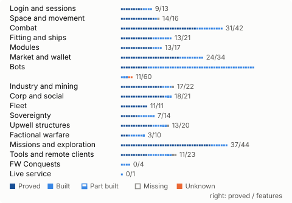
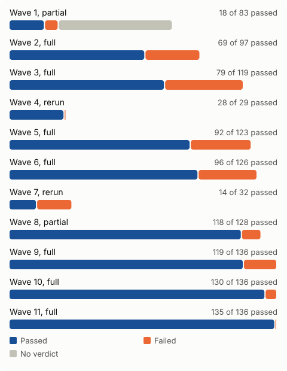

# Status of the reimplementation

How far the EVE server has come, feature by feature. Generated by `tools/status-page.py` from
`docs/status/progress.tsv`, last checked against the code at `b3830f8`.

**71% proved** (165 of 232 features passed on the real client or were proved another way).
**84% built** (194 of 232 have landed code, proved or not).
3 more are parked by the owner and not counted. See [how to read the numbers](#how-to-read-the-numbers).

## By system

| system | proved | built, not proved | part built | missing | unknown |
|---|---|---|---|---|---|
| Login and sessions | 9 | 0 | 0 | 0 | 0 |
| Space and movement | 13 | 1 | 0 | 1 | 0 |
| Combat | 26 | 3 | 0 | 0 | 0 |
| Fitting and ships | 9 | 1 | 1 | 1 | 0 |
| Modules | 11 | 2 | 0 | 0 | 0 |
| Market and wallet | 16 | 0 | 0 | 0 | 0 |
| Industry and mining | 13 | 3 | 0 | 3 | 0 |
| Corp and social | 18 | 0 | 2 | 0 | 0 |
| Fleet | 7 | 1 | 0 | 0 | 1 |
| Sovereignty | 2 | 1 | 3 | 2 | 0 |
| Upwell structures | 9 | 1 | 2 | 4 | 0 |
| Factional warfare | 1 | 2 | 0 | 3 | 0 |
| Missions and exploration | 17 | 1 | 0 | 3 | 0 |
| Bots | 7 | 10 | 1 | 3 | 2 |
| Tools and the friends path | 7 | 3 | 2 | 4 | 0 |

## What is left, by theme

### 3.1 Prove what landed

- [ ] A landing keeps a viewer's orbit, follow or lock: *built-unproved*, unit tests only
- [ ] Base payout and split on a stolen hull: *built-unproved*, unit tests only
- [ ] The server refuses a module the hull cannot fit: *built-unproved*, unit tests; scenario fci_fit_refuse written 2026-11-03 (w23-fit), not yet run
- [ ] Script-capable modules run with nothing loaded: *built-unproved*, unit tests; scenario fci_script_empty 2026-11-03 (w23-fit): regress-w23a 38/39, bare Sensor Booster lock range not pushed; fixed w23-srv-reds (lock range, scan resolution, signature and sensor strengths pushed on module start/end), rerun pending
- [ ] ECM burst: *built-unproved*, unit tests; scenario fci_ecm_burst written 2026-11-03 (w23-fit), not yet run
- [ ] Fleet hangar: a fleet miner compresses at a fleet compressor: *built-unproved*, commit da307d8; unit tests
- [ ] Gas clouds use the client's linear radius law: *built-unproved*, commit d7b0892; unit tests
- [ ] Belts sized from ore-anomaly rooms, full reset at downtime: *built-unproved*, commits 1139ad9, 4e57d0d; unit tests
- [ ] Fleet kept across a reconnect: *built-unproved*, fci_fleet_reconnect written (w23-pve; a fleet of one logs off and on inside the window: session.fleetid, fleet service, server composition), not yet run on a client; unit tests; two-minute window by owner decision
- [ ] Kills pay LP: *built-unproved*, unit tests only; ratio and split are assumptions
- [ ] Stats, standing rule, bots enlisting at a militia station: *built-unproved*, unit tests only
- [ ] Epic arcs: *built-unproved*, epic_arc.rs; no scenario
- [ ] Bots use filaments: *built-unproved*, commit 7bbc445; unit tests
- [ ] Low-status bots avoid the police: *built-unproved*, unit tests (hunt.rs, travel.rs); no client scenario. Hunters only
- [ ] PyValue::Long, a pinned integer tag: *built-unproved*, commit 868864d; unit tests
- [ ] Admin web page: status, pilots, systems, map; bot, broadcast and save actions (token, off by default): *built-unproved*, admin_web.rs tests; deployed on the test server 11-03; no scenario or human check yet

### 3.2 The 11-09 port

- [ ] The 2026-11-09 client port: *missing*, cards P0 to P7; waits on the client. Issues 10 to 20

### 3.3 PvP

- [ ] Smartbombs hit ships and drones: *built-unproved*, fci_smartbomb written (w21-neut-smart; ship and drones hurt in the field, none outside); regress-w23a: B's drones hurt by A's volley, A's drone wait fixed to categoryDrone (Mining Drone I is group 101, w23-srv-reds), rerun pending; unit tests; rules are assumptions
- [ ] Doomsdays (legacy targeted, the Lance, the Reaper, Disruptive Lance and Bosonic): *built-unproved*, unit tests; superweapon.rs, superWeaponMgr; the Reaper is a slice with the Lance's gates and holds; the beam FX push (OnSpecialFX with a graphicInfo KeyVal) uses the race-keyed effects.fsdbinary guids SWDamageBeam<Race> / SWSlashBeam<Race> picked by damage type (w23-srv-reds, after regress-w23a's unknown-guid traceback); the Disruptive Lance (siege gate, 5412 debuff as no warp/jump/dock/cloak holds, unit-tested 2026-11-03) and the Bosonic cone (angle [A]) are built-unproved (w22-nw9c), the Oscillator is 9d; scenario fci_doomsday written 2026-11-03 (w21-dd-inv; two titans in null-sec, empire refusal, fuel and cap, immobility, the second click, OnSpecialFX SWDamageBeam and damage on B); no verdict yet
- [ ] A far fleet member does not show as on grid: *unknown*, owner play test 11-03; the distance is not known
- [ ] Bots read mobile-bubble zones and do not warp into a known bubble; a gate camp launches, anchors and scoops its own mobile disruptor: *built-unproved*, unit tests (warp_bubble guard; camp.rs unit_deploy/unit_retrieve); the bot camp scenario does not cover it yet. Only a camper that owns one (dev-granted or built); ANCHOR_WAIT, LINE_SLACK and the sphere radius are [A]
- [ ] Rosters and gates: *missing*, issue open
- [ ] Capitals fight: *missing*, capital.rs only ferries; lane NW-10

### 3.4 Upwell

- [ ] Moon drills: *missing*, no moonExtractions service
- [ ] Metenox moon mining: *missing*, no autoMoonMining service
- [ ] Industry in structures: *missing*, research report r-upwell-war; a docked pilot may get a station's facility instead
- [ ] State machine, timers, upkeep rules: *built-unproved*, structure.rs unit tests; nothing shoots a structure yet
- [ ] Fuel and deed bays: *partial*, listed for the controller; nothing fills them
- [ ] Service modules: *missing*, env still claims a module; research report r-upwell-war
- [ ] Structure combat: *missing*, a structure has no hit points and cannot be locked
- [ ] Asset safety: *partial*, evacuate moves items at once with no fee or timer
- [ ] War headquarters: *missing*, no war HQ code

### 3.5 PvE

- [ ] Mutaplasmids: *missing*, item.rs only names them; research comes after ABYSS-3
- [ ] Abyss depth: later rooms and rules: *missing*, cards abyss-2, abyss-3, abyss-4
- [ ] Proving Grounds: *missing*, owner: after abyss
- [ ] Pochven: *missing*, research report r-wormhole; reachable in small steps
- [ ] Bots use ESS: *missing*, no ESS code in the bot crate

### 3.6 Factional warfare and sov

- [ ] Sov hub upgrades: *stubbed*, gateway.rs gives typed answers
- [ ] Mercenary dens: *stubbed*, gateway.rs gives typed answers
- [ ] Skyhooks: *missing*, only a ledger label exists
- [ ] Ansiblex jump gates: *missing*, needs service modules
- [ ] Cyno jammers: *stubbed*, beyonce.GetCynoJammerState answers not jammed
- [ ] Capture points: *missing*, card fw-7
- [ ] Scoreboard: *missing*, card fw-7
- [ ] Battlefields: *missing*, server spawns none; owner put these after the port

### 3.7 Society, economy and bots

- [ ] Hubs, entosis, command nodes, campaigns: *built-unproved*, sov_campaign.rs, entosis.rs; no soak
- [ ] Live 200 against 200 battle: *partial*, one run, commit f5177ea fixed its stalls; no fresh run found
- [ ] Doctrines and counters: *built-unproved*, doctrine*.rs, counter.rs; unit tests only
- [ ] Prices move with demand: *built-unproved*, demand.rs; unit tests only
- [ ] Four-level relations: *built-unproved*, relations.rs; unit tests only
- [ ] One difficulty setting: *built-unproved*, difficulty.rs; unit tests only
- [ ] Bot economy: haul, geodes, PLEX, SKINs, injectors, industry, PI: *built-unproved*, bot soaks only
- [ ] Doctrine fits seeded from real killmails; fitter budget and part kinds: *built-unproved*, commits 1429a91, 9eb39fa, 01f0d6a; unit tests
- [ ] Miners leave dry belts; offline mining spreads; rare-ore value per system: *built-unproved*, commits 4e57d0d, f6f7924; unit tests
- [ ] Society gates GC and GD and doctrine gates G1 to G10 pass in a soak: *unknown*, no record found; tools/doctrine-report.py exists
- [ ] Bots feel like players: *unknown*, no record found; only people can judge this

### 3.8 The friends path

- [ ] Friend kit and hosted server tools: *built-unproved*, tools/friend-kit.sh, tools/friend-setup.sh; no dry run. Hosting is issue 141
- [ ] Friend kit dry run end to end: *missing*, no end-to-end run recorded
- [ ] No-jail route for Windows friends: *missing*, the always-jailed rule stands until a census proves it
- [ ] Human check card brought up to date: *partial*, results stop at 2026-10-25

### 3.9 Corp and social depth

- [ ] Recruitment adverts and corp finder: *stubbed*, service/corp_rec.rs answers empty lists; fci_social_answers (green W9-W11) proves only the empty answers. The panels no longer fail
- [ ] Voting: *stubbed*, voteManager answers no votes on purpose. Research report r-corp-social says keep it last

### 3.10 Structure and debt

- [ ] Dragging a module onto a slot redraws the window: *partial*, fci_fit_drag 11-03 (regress-w14b) proves the fit lands; the owner's play test 11-03 saw no redraw
- [ ] Args reader for service arms: *missing*, no Args reader; arms parse by hand
- [ ] Hand-kept extracted values moved to the bundle: *partial*, CONCORD done in lane concord-ids; others remain

### 3.12 Not planned

- [ ] Time dilation: *missing*, advised against at this scale. Not planned
- [ ] POS (old starbases): *missing*, no posMgr arm. Not planned

## Client regression waves

| wave | date | commit | rows | passed | failed | no verdict | what ran |
|---|---|---|---|---|---|---|---|
| 1 | 2026-10-31 | `` | 83 | 18 | 7 | 58 | partial. Stopped at the mining drone row; later rows have no verdict |
| 2 | 2026-11-01 | `` | 97 | 69 | 28 | 0 | full. Found most of the first fixes |
| 3 | 2026-11-01 | `1fec773` | 119 | 79 | 40 | 0 | full. The first full rerun, near this commit |
| 4 | 2026-11-01 | `` | 29 | 28 | 1 | 0 | rerun |
| 5 | 2026-11-01 | `0785599` | 123 | 92 | 31 | 0 | full. On a box also compiling; the first bot half really ran |
| 6 | 2026-11-01 | `37b8558` | 126 | 96 | 30 | 0 | full. The first client verdict on the tracker §90 work |
| 7 | 2026-11-01 | `d247f86` | 32 | 14 | 18 | 0 | rerun. Rows that were red |
| 8 | 2026-11-01 | `a013ad7` | 128 | 118 | 10 | 0 | partial. Still running at this reading; started near this commit |
| 9 |  | `` | 136 | 119 | 17 | 0 | full |
| 10 |  | `` | 136 | 130 | 6 | 0 | full |
| 11 |  | `` | 136 | 135 | 1 | 0 | full |

A wave is one run of `tools/client-ci/regress.list` against real clients. Compare whole runs with whole runs: a rerun holds only the rows that were red.

## Every feature, by system

### Login and sessions

- [x] Log in and reach space; every scenario depends on this: *client-proved*, fci_reads W10; ballpark_smoke W11
- [x] Two clients at once, each seen in the station guest list: *client-proved*, lobby_guests W8
- [x] Log off in space and come back where you were: *client-proved*, fci_logoff_space W10
- [x] The client sends nothing to CCP on the current build: *client-proved*, census of build 3662168
- [x] Dev world for testing: *client-proved*, fci_dev_mode W10
- [x] World settings chosen at first launch; training speed changeable: *client-proved*, fci_world_training W10
- [x] Character settings saved between sessions: *client-proved*, fci_settings_bulletins W10
- [x] The Randomize name button on character creation: *client-proved*, fci_social_answers W10. Landed after wave 8 started
- [x] Delete a character: *client-proved*, fci_char_delete W10. Wait is a world setting (1 hour default, 0 in CI); deleted characters keep assets, orders and name

### Space and movement

- [x] Undock, throttle, warp: *client-proved*, undock_distance W8, throttle_and_warp W8
- [x] The sun and warping to it: *client-proved*, fci_sun W10
- [x] Shield, armour and hull on the HUD: *client-proved*, hud_health W8
- [x] The list of objects near you: *client-proved*, park_census W8
- [x] Warp state as the client writes it: *client-proved*, warp_blob W8
- [x] Refuse a dock from out of range: *client-proved*, fci_dock_range W10
- [x] Refuse a wormhole entry from out of range: *client-proved*, fci_wh_range W10
- [x] The cloak you get arriving through a gate: *client-proved*, fci_gate_cloak W10
- [x] Ship mass and agility follow propulsion modules: *client-proved*, fci_mjd W10
- [ ] A landing keeps a viewer's orbit, follow or lock: *built-unproved*, unit tests only
- [x] Destiny coalescing (grouping movement updates): *client-proved*, fci_pa10_coalesce@on W8. On by default since wave 14 (destiny-batch); --no-coalesce-destiny turns it off
- [x] Stargate jumps: *client-proved*, fci_gate_jump 11-03
- [x] Autopilot: *client-proved*, fci_autopilot 11-03
- [ ] Time dilation: *missing*, advised against at this scale. Not planned
- [x] NPC warp-in effects: *client-proved*, fci_npc_warpin 11-03 (regress-w21b); npc::spawn_warping_in; commit 728a25c

### Combat

- [x] Turrets hit and miss by the client's formula: *client-proved*, fci_doc_0 W10
- [x] A gun stops when its target is gone: *client-proved*, fci_engine_fix W10
- [x] Ammo counts on the HUD: *client-proved*, fci_ammo_count W10
- [x] Combat log names the weapon and damage: *client-proved*, fci_doc_3 W10
- [x] Capacitor: *client-proved*, capacitor W8
- [x] Overheating, burnt modules, nanite repair, weapon banks: *client-proved*, fci_k_overheat W10
- [x] Command bursts: *client-proved*, fci_bursts W10
- [x] Fighters: *client-proved*, fci_fighters W10
- [x] Belt rats, bounty, wreck, loot and salvage: *client-proved*, fci_belt_combat W10
- [x] Multi-room combat sites: *client-proved*, fci_combat_site W10. Green in the rerun at head after wave 10
- [x] Two-client PvP in high-sec through to CONCORD: *client-proved*, fci_pvp_concord W10
- [x] Two-client kill, wreck loot and pod: *client-proved*, fci_pvp_kill W10
- [x] CONCORD answers shooting the law: *client-proved*, fci_concord W10
- [x] Implants: *client-proved*, fci_implants W10
- [x] Kill reports: *client-proved*, fci_c6b W10, fci_rel_fix W10, fci_review_fix W10
- [x] Security status and the outlaw's dock refusal: *client-proved*, fci_secstatus W10
- [x] Cloaking modules: *client-proved*, fci_cloak W10. Cloak mode values are still assumptions
- [x] Insuring a ship: *client-proved*, fci_notifications W10
- [ ] Base payout and split on a stolen hull: *built-unproved*, unit tests only
- [x] Killmail for a shot abandoned ship: *client-proved*, fci_abandon_kill 2026-11-04 (two clients, 37 and 24 checks: one report on both sides with victim, final blow, ship types and system, the client's own drawing and hash lookup, the pod untouched); unit tests
- [x] The drone window shows each drone's health in the bay: *client-proved*, fci_drone_bay_damage 11-03 (regress-w14)
- [ ] Smartbombs hit ships and drones: *built-unproved*, fci_smartbomb written (w21-neut-smart; ship and drones hurt in the field, none outside); regress-w23a: B's drones hurt by A's volley, A's drone wait fixed to categoryDrone (Mining Drone I is group 101, w23-srv-reds), rerun pending; unit tests; rules are assumptions
- [x] Faction police squads for outlaws: *client-proved*, fci_faction_police W10. Landed after wave 8 started
- [x] Sentry guns at low-sec gates and stations fire on the flagged: *client-proved*, fci_sentry 11-03. Placement and targeting are [A]; no client rule
- [x] Siege, triage and core modules burn fuel and hold the ship: *client-proved*, fci_siege W10. Green in the rerun at head after wave 10
- [x] Capital jump drives and cynos: *client-proved*, fci_jump_drive 2026-11-03 (regress-w20b); jump_drive.rs, cyno.rs, jump_fatigue.rs
- [x] Titan and black ops jump portals: *client-proved*, fci_jump_portal 2026-11-03 (regress-w23a): the portal opens, the bridge reaches the fleet, the bridging ship is held still; no passenger step (needs a third client); jump_portal.rs
- [ ] Doomsdays (legacy targeted, the Lance, the Reaper, Disruptive Lance and Bosonic): *built-unproved*, unit tests; superweapon.rs, superWeaponMgr; the Reaper is a slice with the Lance's gates and holds; the beam FX push (OnSpecialFX with a graphicInfo KeyVal) uses the race-keyed effects.fsdbinary guids SWDamageBeam<Race> / SWSlashBeam<Race> picked by damage type (w23-srv-reds, after regress-w23a's unknown-guid traceback); the Disruptive Lance (siege gate, 5412 debuff as no warp/jump/dock/cloak holds, unit-tested 2026-11-03) and the Bosonic cone (angle [A]) are built-unproved (w22-nw9c), the Oscillator is 9d; scenario fci_doomsday written 2026-11-03 (w21-dd-inv; two titans in null-sec, empire refusal, fuel and cap, immobility, the second click, OnSpecialFX SWDamageBeam and damage on B); no verdict yet
- [x] A lost or killed target ends the module at its cycle boundary; any of the four chargeGroup attributes loads: *client-proved*, fci_gun_cycle, fci_advanced_ammo (regress-w14)

### Fitting and ships

- [x] Fit and online modules: *client-proved*, fci_t3_d W10, fci_x_rig W10
- [x] Rigs: *client-proved*, fci_x_rig W10
- [x] Tech 3 cruisers and subsystems: *client-proved*, fci_t3_d W10
- [x] Tactical destroyer stances: *client-proved*, fci_t3_e W10
- [x] Ship sheet and ship tree: *client-proved*, fci_ship_sheet W10, fci_ship_tree W10
- [x] Skill gates on boarding, fitting and onlining: *client-proved*, fci_skillgate W10
- [x] Eject and board; an abandoned ship stays in space: *client-proved*, fci_board_eject W10
- [x] Rename a ship, notes, jettison: *client-proved*, fci_gaps2 W10
- [x] Multi-fit window: fit N ships from the hangar or a container: *client-proved*, fci_fitfix 11-02
- [ ] The server refuses a module the hull cannot fit: *built-unproved*, unit tests; scenario fci_fit_refuse written 2026-11-03 (w23-fit), not yet run
- [ ] Mutaplasmids: *missing*, item.rs only names them; research comes after ABYSS-3
- [ ] Dragging a module onto a slot redraws the window: *partial*, fci_fit_drag 11-03 (regress-w14b) proves the fit lands; the owner's play test 11-03 saw no redraw

### Modules

- [x] Webs, scramblers and points: *client-proved*, fci_tackle 2026-11-03 (regress-w20b); tackle.rs
- [x] ECM, sensor dampeners and target painters: *client-proved*, fci_ewar 2026-11-03 (regress-w21a); ewar.rs
- [x] Energy neutralizers and nosferatus: *client-proved*, fci_neut 11-03 (regress-w21b); ewar.rs tests
- [x] Tracking and guidance disruptors, remote sensor boost, remote tracking, ship and cargo scanners: *client-proved*, fci_ewar_2 W10
- [x] Micro Jump Drive: *client-proved*, fci_mjd W10
- [x] Warp disrupt probes and bubbles: *client-proved*, fci_bubble W10. Bubble rules are still assumptions
- [x] Mobile Warp Disruptor: launch, anchor, lift, scoop: *client-proved*, fci_anchor_small 11-03. Needs the typedata section regenerated into a new bundle
- [x] Mobile Warp Disruptor as a bubble that can be shot dead: *client-proved*, fci_mobile_bubble 11-03 (regress-w14); unit tests. Hull points come from the type; no resists
- [x] Heavy interdictor script: *client-proved*, fci_hic_script W10
- [ ] Script-capable modules run with nothing loaded: *built-unproved*, unit tests; scenario fci_script_empty 2026-11-03 (w23-fit): regress-w23a 38/39, bare Sensor Booster lock range not pushed; fixed w23-srv-reds (lock range, scan resolution, signature and sensor strengths pushed on module start/end), rerun pending
- [ ] ECM burst: *built-unproved*, unit tests; scenario fci_ecm_burst written 2026-11-03 (w23-fit), not yet run
- [x] Disruptors work on rats: *client-proved*, fci_rat_point 2026-11-03 (regress-w23a): a warp disruptor, a scrambler and a tracking disruptor run on a belt rat
- [x] Cyno inhibitors: *client-proved*, fci_cyno_inhibit 11-03 (regress-w14c); unit tests. Covert fields are not affected; 100 km, one minute to activate, one hour to live (all from the bundle); the industrial cyno is refused [A]

### Market and wallet

- [x] Market trade between two clients: *client-proved*, fci_market_trade W10
- [x] Buying with the corporation wallet: *client-proved*, fci_corp_buy W10
- [x] Contracts: *client-proved*, fci_contracts W10
- [x] Regional market: a far seller in the book: *client-proved*, fci_prog_null W10
- [x] Economy tape and report: *client-proved*, fci_x_econreport W10, fci_x_econtape W10
- [x] PLEX vault: *client-proved*, fci_plex_vault W10
- [x] New Eden Store: *client-proved*, fci_nes_buy W10
- [x] SKINs applied to a ship: *client-proved*, fci_skin_apply W10
- [x] Another pilot sees your SKIN: *client-proved*, fci_skin_viewer W10
- [x] Skill injectors and extractors: *client-proved*, fci_inject W10
- [x] Free skill points: *client-proved*, fci_free_sp W10
- [x] Skill queue: *client-proved*, fci_skill_queue W10
- [x] Skill books at schools: *client-proved*, fci_school_books W10
- [x] Geodes open docked only: *client-proved*, fci_geode_open W10
- [x] A market buy badges the Item hangar: *client-proved*, fci_new_items W10
- [x] The corporation market log: *client-proved*, fci_corp_transactions W10. Landed after wave 8 started

### Industry and mining

- [x] Mining and the mining hold: *client-proved*, fci_mining_hold W10
- [x] Ice: *client-proved*, fci_x_ice W10
- [x] Mining drones: *client-proved*, fci_drone_mining W10
- [x] Mining crits and residue: *client-proved*, fci_mine_crit W10
- [x] Moon survey: *client-proved*, fci_mn_d W10
- [x] Compression in space: *client-proved*, fci_prog_mine W10
- [ ] Fleet hangar: a fleet miner compresses at a fleet compressor: *built-unproved*, commit da307d8; unit tests
- [ ] Gas clouds use the client's linear radius law: *built-unproved*, commit d7b0892; unit tests
- [ ] Belts sized from ore-anomaly rooms, full reset at downtime: *built-unproved*, commits 1139ad9, 4e57d0d; unit tests
- [x] Reprocessing: *client-proved*, fci_reprocess W10
- [x] Ancient salvage: *client-proved*, fci_t3_salvage W10
- [x] Motherlode announced to the pilot: *client-proved*, fci_motherlode W10
- [x] Installing an industry job: *client-proved*, fci_industry_job W10. Red in wave 8
- [x] A planetary colony: *client-proved*, fci_pi_colony W10
- [x] Invention: *client-proved*, fci_invention 2026-11-04 (40 checks, 8 runs at 60x: the job carries the requested runs, T2 copies with the quoted ME, TE and runs, the source copy used up, a second CompleteJob refused); unit tests
- [x] Reactions: *client-proved*, fci_reactions 11-03
- [ ] Moon drills: *missing*, no moonExtractions service
- [ ] Metenox moon mining: *missing*, no autoMoonMining service
- [ ] Industry in structures: *missing*, research report r-upwell-war; a docked pilot may get a station's facility instead

### Corp and social

- [x] Found a corp and an alliance: *client-proved*, fci_corp_alliance W10
- [x] Corporation assets window: *client-proved*, fci_corp_assets W10
- [x] Notifications: *client-proved*, fci_notifications W10
- [x] Corp bulletins: *client-proved*, fci_settings_bulletins W10
- [x] Share links: *client-proved*, fci_share_links W10
- [x] Local chat and private conversations: *client-proved*, fci_chat_two W10
- [x] Contacts and standings shown: *client-proved*, fci_r_rel_3 W10, fci_rel_fix W10
- [x] Mail from bots parsed and shown: *client-proved*, fci_doc_6 W10, fci_r_rel_4 W10
- [x] Coalitions and wars set by bot alliances: *client-proved*, fci_r_rel_5 W10
- [x] Mail between players: *client-proved*, fci_mail 11-03
- [x] Calendar: *client-proved*, fci_calendar 11-03
- [x] War declarations by players: *client-proved*, fci_war 11-03
- [x] Player bounties: *client-proved*, fci_bounty 11-03 (kill payout not covered)
- [ ] Recruitment adverts and corp finder: *stubbed*, service/corp_rec.rs answers empty lists; fci_social_answers (green W9-W11) proves only the empty answers. The panels no longer fail
- [x] Shares: *client-proved*, fci_dividend 11-03 (regress-w14c); corp_shares.rs, service/corp_shares.rs. Founding grant to the CEO (1000 is an assumption); move and give; voting still absent
- [x] Medals: *client-proved*, fci_medals W10. Free for now (owner decision pending); ISK fees would be a later change
- [ ] Voting: *stubbed*, voteManager answers no votes on purpose. Research report r-corp-social says keep it last
- [x] Dividends: *client-proved*, fci_dividend 11-03 (regress-w14c); service/corp_shares.rs. Shareholders by weight or members evenly, whole cents, type-23 notification
- [x] Player chat channels: *client-proved*, fci_chat_channels W10
- [x] Channel passwords, invites, mute, kick and ban: *client-proved*, fci_chat_moderation 11-03 (regress-w14c). GM-roled pilots go through GrantChannelOwnership; the settings form, timed bans and mutes are stored with the channel

### Fleet

- [x] Fleet composition with live locations: *client-proved*, fci_fleet_comp W10
- [x] Bots join your wing and follow: *client-proved*, fci_wing_follow W10
- [x] Following a commander who warps off grid: *client-proved*, fci_wing_offgrid W10
- [x] Fleet tags reach the wing: *client-proved*, fci_wing_tags W10. An early green here ran without its bot half; that was fixed before W5
- [x] Typed wing orders: *client-proved*, fci_wing_words W10
- [x] Warp Fleet to a mission bookmark: *client-proved*, fci_fleet_mission W10
- [x] Bots summoned to you: *client-proved*, fci_gang_summon W10
- [ ] Fleet kept across a reconnect: *built-unproved*, fci_fleet_reconnect written (w23-pve; a fleet of one logs off and on inside the window: session.fleetid, fleet service, server composition), not yet run on a client; unit tests; two-minute window by owner decision
- [ ] A far fleet member does not show as on grid: *unknown*, owner play test 11-03; the distance is not known

### Sovereignty

- [x] Sov claim, cache, indices, capital, lapse: *client-proved*, fci_sov W10
- [x] Sov icon on the location panel: *client-proved*, fci_sov_panel W10
- [ ] Hubs, entosis, command nodes, campaigns: *built-unproved*, sov_campaign.rs, entosis.rs; no soak
- [ ] Sov hub upgrades: *stubbed*, gateway.rs gives typed answers
- [ ] Mercenary dens: *stubbed*, gateway.rs gives typed answers
- [ ] Skyhooks: *missing*, only a ledger label exists
- [ ] Ansiblex jump gates: *missing*, needs service modules
- [ ] Cyno jammers: *stubbed*, beyonce.GetCynoJammerState answers not jammed

### Upwell structures

- [x] Structure browser and profiles: *client-proved*, fci_upwell_profiles W10
- [x] Anchor, see, warp to, rename, decommission: *client-proved*, fci_upwell_anchor W10. Green in the rerun at head after wave 10
- [x] Dock, hangar, undock: *client-proved*, fci_upwell_dock W10, fci_upwell_view W10
- [x] Log off docked and return: *client-proved*, fci_upwell_relog W10
- [x] Repair in a structure: *client-proved*, fci_upwell_repair W10
- [x] Insure in a structure: *client-proved*, fci_upwell_insure W10
- [x] Jump clone and home station in a structure: *client-proved*, fci_upwell_clone W10
- [x] Pod revive in a structure: *client-proved*, fci_upwell_revive W10
- [x] Take and release structure controls: *client-proved*, fci_upwell_control W10. The review still lists this as missing
- [ ] State machine, timers, upkeep rules: *built-unproved*, structure.rs unit tests; nothing shoots a structure yet
- [ ] Fuel and deed bays: *partial*, listed for the controller; nothing fills them
- [ ] Service modules: *missing*, env still claims a module; research report r-upwell-war
- [ ] Structure combat: *missing*, a structure has no hit points and cannot be locked
- [ ] Asset safety: *partial*, evacuate moves items at once with no fee or timer
- [ ] War headquarters: *missing*, no war HQ code
- [ ] POS (old starbases): *missing*, no posMgr arm. Not planned

### Factional warfare

- [x] Enlist, read state, retire, cooldown: *client-proved*, fci_fw_enlist W10
- [ ] Kills pay LP: *built-unproved*, unit tests only; ratio and split are assumptions
- [ ] Stats, standing rule, bots enlisting at a militia station: *built-unproved*, unit tests only
- [ ] Capture points: *missing*, card fw-7
- [ ] Scoreboard: *missing*, card fw-7
- [ ] Battlefields: *missing*, server spawns none; owner put these after the port

### Missions and exploration

- [x] Missions and which agents a standing opens: *client-proved*, fci_prog_pve W10, fci_prog_pve2 W10
- [x] LP store: *client-proved*, fci_lpstore W10
- [x] Escalations: *client-proved*, fci_y_escal W10
- [x] Hacking: *client-proved*, fci_hacking_board W10, fci_hacking_can W10
- [x] Probing a signature and warping to it: *client-proved*, fci_probe_site W10
- [x] Wormhole space as the client shows it: *client-proved*, fci_y_wh W10. Research said this green once proved little; lane WH-0 tightened it
- [ ] Epic arcs: *built-unproved*, epic_arc.rs; no scenario
- [x] A wormhole below half mass keeps its model: *client-proved*, fci_wh_mass W10. Landed after wave 8 started
- [x] Boosters: *client-proved*, fci_boosters W10
- [x] Containers with passwords: *client-proved*, fci_containers W10
- [x] Launched containers, Mobile Depot, Mobile Tractor Unit: *client-proved*, fci_mtu W10
- [x] Needlejack filament, one pilot: *client-proved*, fci_needlejack W10
- [x] Needlejack filament, a fleet: *client-proved*, fci_needlejack_fleet W10
- [x] ESS bank and panel: *client-proved*, fci_ess_panel W10
- [x] ESS link and theft: *client-proved*, fci_ess_link W10
- [x] Abyss entry and exit: *client-proved*, fci_abyss_enter W10. Green in the rerun at head after wave 10
- [x] Abyss run: filament, three rooms, the way out: *client-proved*, fci_abyss_run W10
- [ ] Abyss depth: later rooms and rules: *missing*, cards abyss-2, abyss-3, abyss-4
- [ ] Proving Grounds: *missing*, owner: after abyss
- [x] Wormhole system effects: *client-proved*, fci_wh_effects, fci_sys4 11-03. The bundle has the beacon table
- [ ] Pochven: *missing*, research report r-wormhole; reachable in small steps

### Bots

- [x] 300 mining bots in one system at about 7 ms per tick: *done*, var/bench/seam3
- [ ] Live 200 against 200 battle: *partial*, one run, commit f5177ea fixed its stalls; no fresh run found
- [ ] Bots read mobile-bubble zones and do not warp into a known bubble; a gate camp launches, anchors and scoops its own mobile disruptor: *built-unproved*, unit tests (warp_bubble guard; camp.rs unit_deploy/unit_retrieve); the bot camp scenario does not cover it yet. Only a camper that owns one (dev-granted or built); ANCHOR_WAIT, LINE_SLACK and the sphere radius are [A]
- [x] A real client beside live bots: *client-proved*, fci_wing_follow W10. The first bot half really ran in wave 5
- [x] Hostile bots use smartbombs: *client-proved*, fci_bot_smartbomb W10
- [x] Hostile bots use a Micro Jump Drive: *client-proved*, fci_bot_mjd W10
- [x] Bots aim EWAR by kind and reach: *client-proved*, fci_bot_ewar_aim W10
- [x] Gate camps: *client-proved*, fci_bot_camp W10
- [ ] Rosters and gates: *missing*, issue open
- [ ] Doctrines and counters: *built-unproved*, doctrine*.rs, counter.rs; unit tests only
- [ ] Prices move with demand: *built-unproved*, demand.rs; unit tests only
- [ ] Four-level relations: *built-unproved*, relations.rs; unit tests only
- [ ] One difficulty setting: *built-unproved*, difficulty.rs; unit tests only
- [ ] Bot economy: haul, geodes, PLEX, SKINs, injectors, industry, PI: *built-unproved*, bot soaks only
- [ ] Bots use ESS: *missing*, no ESS code in the bot crate
- [ ] Bots use filaments: *built-unproved*, commit 7bbc445; unit tests
- [ ] Doctrine fits seeded from real killmails; fitter budget and part kinds: *built-unproved*, commits 1429a91, 9eb39fa, 01f0d6a; unit tests
- [ ] Miners leave dry belts; offline mining spreads; rare-ore value per system: *built-unproved*, commits 4e57d0d, f6f7924; unit tests
- [ ] Capitals fight: *missing*, capital.rs only ferries; lane NW-10
- [x] Hunter bots find and engage: *client-proved*, fci_hunter_bot 2026-11-03 (regress-w20b): the hunter finds and engages; hunt.rs, travel.rs. Hunters only
- [ ] Low-status bots avoid the police: *built-unproved*, unit tests (hunt.rs, travel.rs); no client scenario. Hunters only
- [ ] Society gates GC and GD and doctrine gates G1 to G10 pass in a soak: *unknown*, no record found; tools/doctrine-report.py exists
- [ ] Bots feel like players: *unknown*, no record found; only people can judge this

### Tools and the friends path

- [x] The gate: lint, tests, clippy, push only on pass: *done*, tools/land.sh, tools/gate.sh
- [x] The client regression runner, three clients at once: *done*, tools/client-ci-regress.sh
- [x] World saved and restored: *done*, docs/reference/world-state.md, snapshot format tests
- [x] Content bundle regeneration: *done*, out/content regenerated 2026-11-01 with J-space tables; tools/content.py. The review lists this as owed
- [x] Port tools for the next build: *done*, tools/re-pin.sh, tools/port-surface.sh, tools/port-recheck.py, tools/bundle-diff.py
- [x] Packet registry brought up to the tree: *done*, docs/packets.tsv at bce802a
- [ ] The 2026-11-09 client port: *missing*, cards P0 to P7; waits on the client. Issues 10 to 20
- [ ] Friend kit and hosted server tools: *built-unproved*, tools/friend-kit.sh, tools/friend-setup.sh; no dry run. Hosting is issue 141
- [ ] Friend kit dry run end to end: *missing*, no end-to-end run recorded
- [ ] No-jail route for Windows friends: *missing*, the always-jailed rule stands until a census proves it
- [ ] Human check card brought up to date: *partial*, results stop at 2026-10-25
- [ ] PyValue::Long, a pinned integer tag: *built-unproved*, commit 868864d; unit tests
- [ ] Args reader for service arms: *missing*, no Args reader; arms parse by hand
- [ ] Hand-kept extracted values moved to the bundle: *partial*, CONCORD done in lane concord-ids; others remain
- [ ] Admin web page: status, pilots, systems, map; bot, broadcast and save actions (token, off by default): *built-unproved*, admin_web.rs tests; deployed on the test server 11-03; no scenario or human check yet
- [x] Fleet clean-room rewrite: *done*, b4150be (fleet.rs), aea9611 (service/fleet.rs); fleet and wing scenarios green (regress-fleet 2026-11-03)

## Parked by the owner

- Incursions: deferred by the owner, card pve-owner
- Public release: owner paused
- Tier H client patches: owner paused

## What the states mean

| state | meaning |
|---|---|
| client-proved | A regression scenario passed on the real client in the newest wave that ran it. It proves what the scenario asserts and no more. |
| done | Finished, and proved some other way than a client scenario: a tool that runs, a measured result. |
| built-unproved | The code landed and unit tests pass, but no client has passed it: its scenario was red last time, has never run, or does not exist. |
| partial | Some of it works, and the row says what is not there. |
| stubbed | The server gives a correctly shaped empty answer so the client does not fail. No real feature behind it. |
| missing | Nothing yet. |
| unknown | Could not be placed from the evidence. Never a guess. |
| parked | The owner has said not now. Left out of every percentage. |

The graphs group these: **Proved** is client-proved plus done, **Built, not proved** is
built-unproved, **Part built** is partial plus stubbed.

## How to read the numbers

- **Each percentage counts rows, and rows are not equal.** One row may be a window and the next a
  whole game system. Treat the figures as a direction, not a measure of effort.
- **The table lists what the reviews and plans name**, not all of EVE, so 100% would mean this
  list is finished, not the game.
- **Proved** is rows proved divided by all rows except parked ones. **Built** adds the rows with
  landed code and no client pass. Partial, stubbed, missing and unknown rows count against both.
- **A green scenario proves what it asserts and no more.** A row is about a feature; its scenario
  may touch only the main path.
- **Red does not mean broken.** Many reds have been scenario bugs. A row with a red scenario is
  built-unproved until it passes.

## Words used here

- **Scenario** (`fci_cloak`): a scripted test that drives the real client against the server.
- **Wave** (`W8` is wave 8): one run of the scenarios. Rows name the wave that last ran them.
- **Soak**: a long run of many bots. **Gate**: the checks every change passes before it lands.
- **Lane**: one parallel piece of work.
- **`ABYSS-3`, `NW-10`**: names of planned pieces of work.

## How to update this page

Do not edit this file or the SVGs: they are generated, and the gate fails if they drift.

1. Edit `docs/status/progress.tsv`. Columns, separated by tabs: `system`, `feature`, `state`,
   `evidence` (code, a commit or a scenario), `issue` (`#N`, or `#N, #M`), `theme` (a `3.N` row of
   `docs/status/themes.tsv`; required while the row is open, empty when it is finished), `note`.
2. A lane that implements or changes a feature updates its rows or adds new ones. It uses
   `built-unproved` until its scenario has passed; only a regression result may say `client-proved`.
3. Run `python3 -I tools/status-page.py`.
4. After a wave, run `python3 -I tools/status-page.py --waves`, then `--audit`, on the machine
   that holds `var/`. The audit lists rows that disagree with the newest verdicts; fix those by hand.
   A clean audit stamps the table's `# checked-at` line.
5. Evidence names a scenario with its wave (`fci_cloak W8`), or a file. Names of features only:
   no client ids and no extracted data.
