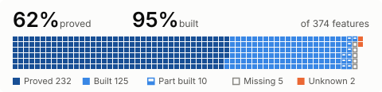
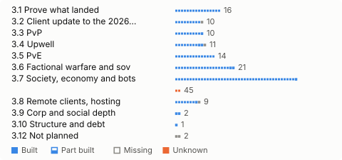

# Status of the reimplementation

**62% proved** (232 of 372) · **95% built** (355 of 372) · 1 parked, not counted.

Latest client wave: **11**, 135 of 136 passed (full).

Generated by `tools/status-page.py` from `docs/status/progress.tsv`, checked against `b3830f8`. [How to read the numbers](#how-to-read-the-numbers) · [what the states mean](#what-the-states-mean).

## What is left, by theme

### 3.1 Prove what landed

- [ ] Rig sets: a synchronizer's bonus scales with the faction modules fitted beside it: *built-unproved*, no server code: the engine takes the chain from the bundle; dogma.rs tests a_rig_set_counts_faction_modules_and_scales_the_synchronizer, a_rig_set_counter_is_passive_and_its_bonus_needs_the_rig_online; fci_rig_set (written, not yet run on 3707965: the client's gun damageMultiplier rises with the rig and with a third faction module; the client's dogma top speed against the ego ball during an Aberrant burst); [I] the chain is exact against the client, falsified by fci_rig_set or the fitting window showing another damage figure; the scenario's item names are [A]
- [ ] A GM /giveskill all [level] raises every skill to a level (default 5, 1 to 5) on any world, not only a --dev one: *built-unproved*, slash.rs giveskill_all: the bundle's whole skill table (the set /devskills all5 uses), never lowers a trained level, told as a bulk change (forced refresh and an empty skills-changed dict, as /givestarterskills) and to dogma by a brain update; level clamped 1..5; tests giveskill_all_puts_every_skill_at_five_on_a_normal_world, giveskill_all_takes_a_level_and_never_lowers_one, giveskill_all_with_nothing_to_raise_pushes_nothing, giveskill_all_clamps_its_level_to_one_through_five, giveskill_all_refuses_a_bad_level; no client run yet
- [ ] Info-window calls answered: employment history pair, pending auto-kicks, agent solar system, alpha injection time, GetWarsByOwners with a set, single-item open check: *built-unproved*, service/corp.rs, base.rs, agents.rs, inventory.rs, war.rs owner_ids_arg; fci_wire_calls written, not yet run
- [ ] Bots enlist at a militia office: *built-unproved*, socket tests in tests/bots/fwlp.rs: a plexer (stepped and driver-spawned) flies through a gate to a militia office, docks and enlists; a bot with no office is refused (#7); not yet seen on a client
- [ ] Militia on drone and fighter slims: *built-unproved*, facwar_mgr::slim_extras resolves a drone's or squadron's owner; the drone launch AddBalls2 carries the extras; unit tests; fci_fw_kill_lp: A (Incursus) launches a Hobgoblin; B checks its slim's warFactionID and CheckAtWarMilitia; [I] TQ sends it, from CATEGORIES_WITH_WARFACTIONID; fci_fw_kill_lp green 11-16 (A 60/60, B 32/32): B sees A's Hobgoblin slim carry A's militia and CheckAtWarMilitia is true; fighters unit-tested only
- [ ] Bots use filaments: *built-unproved*, commit 7bbc445; unit tests; socket test tests/bots/hunt.rs a_hunter_with_a_filament_jumps_hunts_the_new_space_and_flies_home (stock, jump through randomJumpMgr, scan, roam home); escort.rs no longer unloads a stocked filament as loot (it kept the hunter docked)
- [ ] Filament drops: abyssal and random-jump filaments from NPC kills and hacked sites: *built-unproved*, filament_drops.rs, content/pve/filament-drops.tsv; wired by #121: combat::npc_wreck rolls once per kill (class name) and hacking_loot::on_won once per can (relic/data) via combat::roll_filament, candidates in a world slot; unit tests in combat and hacking_loot; Triglavian filaments too: trig_in/trig_out, band p, roll_where (#228); no client run yet
- [ ] Low-status bots avoid the police: *built-unproved*, unit tests (hunt.rs, travel.rs); bot-over-socket test a_low_status_hunter_flies_round_the_police_net (tests/bots/travel.rs); soak pending. Hunters only
- [ ] Bots run co-op abyss: *built-unproved*, abyss_run.rs, socket test tests/bots/abyss_run.rs; the bot-abyss client scenario is pending. keys only from drops or the market
- [ ] Bots run co-op abyss: entrance threat, short gangs, key stacks, stale board: *built-unproved*, abyss_run.rs entrance_verdict (threat = an NPC shooting the leader, or a homing), book_short_gang (a short run and its death are one loss), needs_stack + Op::Stack (StackAll at the dock), Board::purge (OFFER_TTL, GANG_TTL [A]); driver.rs: a no-gate try does not count as a failure; abyss::WaveTable (a test's own wave table in the bundle); socket tests in tests/bots/abyss_run.rs (stack then deploy, waves fought before each gate, no-gate try fails); not yet seen on a client. GANG_TTL and shooting-only threat [A]
- [ ] Bot corps anchor and live in an Upwell structure (BOT-UPWELL-HOME): *built-unproved*, eve-bot upwell_home.rs (planner, gate, unit tests); tests/bots/upwell_home.rs (socket: board a hauler, warp to a planet, anchor, wait, dock, control; refusal words); brain gate test; soak later
- [ ] Admin web page: status, pilots, systems, map; bot, broadcast, save and kick actions (token, off by default): *built-unproved*, admin_web.rs tests; no scenario or human check yet; kick (admin_actions.rs tests, evicts like a second login); tools/test_admin_web.py live check (EVE_ADMIN_WEB_LIVE=1): page, every API path and action, 401 without the token; tick p50/p95/max per minute, per-system loads, slowest calls, /api/metrics (admin_web.rs, live_status.rs prof tests)
- [ ] Admin metrics: per-minute tick quantiles, per-system balls and pilots, slowest handlers, Prometheus text endpoint (token or bearer): *built-unproved*, admin_web.rs and live_status.rs prof tests; tools/metrics_sample.py; no live run yet (tools/metrics_sample.py can run against the admin page). snapshot cost budget [A] < 1 ms at 400 pilots
- [ ] Drone limits follow the sheet: the active drone count and the control range: *built-unproved*, drone_skills.rs max_active and control_range read attributes 352 and 458 off the sheet's character node (dogma.rs CHARACTER_READS), so a hull's assigned drone count and a rig's range penalty count and the augmentor is no longer added by hand; drones/restat_tests.rs the_active_drone_count_comes_off_the_sheets_character_node, the_control_range_comes_off_the_sheets_character_node; the drones test fixture gains the Drones skill and Drone Avionics effects on 352 and 458; no client scenario yet
- [ ] Aberrant modules burst: an active module that changes the top speed refreshes the ball: *built-unproved*, modules.rs activate, the clock's cycle end and stop compare the hull and call motion_changed for every effect (the hand list is_propulsion is gone); modules.rs reanchor_capacitor stores the capacitor before activate, a cycle boundary, stop and set_online change the sheet; drones.rs restat works a launched drone's stats out again and sends SetMaxSpeed, once to each viewer, whenever a module of a ship that controls drones starts, ends, goes on or offline (no module-group gate); modules/aberrant_tests.rs an_active_burst_refreshes_the_balls_top_speed_and_so_does_its_end, a_burst_that_leaves_the_speed_alone_sends_no_speed, the_capacitor_is_anchored_before_a_recharge_change, a_full_capacitor_gets_no_anchor; drones/restat_tests.rs a_launched_drone_follows_a_navigation_computers_burst; [A] a drone's stats depend on nothing but its pilot's sheet, falsified by a client drone window showing a different figure than the drone flies; fci_rig_set checks the ball's top speed against the client's dogma during a burst (written, not yet run on 3707965)
- [ ] Community-track lookups (the Vanguard/Nemesis progress bar) answer "no track instance" as a (None, None) pair, so the client logs and returns instead of raising a TypeError; no community track is run: *built-unproved*, service/live.rs communityTrackMgr get_instance_attributes_public; unit test a_community_track_instance_lookup_answers_no_instance_as_a_pair; seen in fci_tow_conquest_dormant on 3707965, not yet re-run

### 3.2 Client update to the 2026-11-09 build

- [ ] Ship death drop chance by area of space, as the client's rule (wormhole, Pochven, null, low, else): *built-unproved*, combat.rs drop_area/drop_chance; tests the_drop_area_follows_the_clients_branch_order, the_extreme_chances_are_certain; killmail items use the same roll
- [ ] The 2026-11-09 client port: *missing*, cards P0 to P7; waits on the client. Named by card and docs: the 11-09 port report; the re-pin procedure is docs/guides/build-compat.md
- [ ] Module cycle timers on the new HUD (startTime): *built-unproved*, modules.rs ShipEffect::to_push and ship_info_entries send the cycle anchor as startTime on a cycling start; three unit tests; off by default, opt-in via Esc > Feature Previews
- [ ] Remote repair shows in the combat log and the new HUD's ring: *built-unproved*, remote_rep.rs cycle sends OnRemote{ShieldBoost,ArmorRepair,HullRepair}{Target,Source} combat messages (amount restored, specialObject, type) after a heal that restored HP and the capacitor transmitter pair; the line reaches the target before its ring change; unit tests
- [ ] Community-track lookups answer no track instance: *built-unproved*, service/live.rs communityTrackMgr get_instance_attributes_public; unit test a_community_track_instance_lookup_answers_no_instance_as_a_pair; seen in fci_tow_conquest_dormant on 3707965, not yet re-run
- [ ] An in-space reload tells godma when the module is free (nextActivationTime): *built-unproved*, modules.rs start_reload pushes attribute 2729 = the reload end per reloaded module, so IsModuleReloading and GetReloadTimes report it and a rebuilt HUD resumes the ring; never in the static attributes; unit test; fci_hud_new step 6 and step 2 are the falsifiers of the clock [A]
- [ ] A lost lock tells the old HUD the module is winding down (OnModulesDeactivating): *built-unproved*, modules.rs advance sends OnModulesDeactivating once when a running targeted module loses its lock mid-cycle, so the old button blinks (the new HUD draws nothing from it); a re-lock before the boundary sends a fresh start; none on a player stop; unit tests; [A] TQ sends it
- [ ] The new ship HUD works on our server when a player opts in (off by default): *built-unproved*, tools/client-ci/scenarios/fci_hud_new.py (two clients, regress.list): turns the preview on in-client and off again in finally; cycle timer and clock, charge counts, consumption gauge, stop window, reload, overload, remote repair, jam, stance; round f on 3707965: 78 of 81 checks passed, the three misses were the scenario's own expectations and are fixed, rerun pending
- [ ] Turret, drone and remote-repair range, falloff and hit chance count the gap between ball surfaces (both radii off the centre distance, never below 0) against ships, NPCs, deployables and structures: *built-unproved*, combat.rs surface_gap_between and ship_radius feed turret_aim, the deployable aim and the structure aim; drones.rs aim_of and remote_rep.rs strength use them too; tests a_large_target_is_in_range_by_surface_not_by_centre, surface_gap_matches_the_structure_reading, surface_gap_clamps_at_zero, turret_aim_counts_both_hulls_and_the_fallback, a_drones_aim_is_the_surface_gap, range_and_falloff_scale_the_amount; ewar.rs falloff and the NPC brain still use centre distance; no client scenario yet

### 3.3 PvP

- [ ] Shooting a CONCORD ship in low sec is a criminal act (no CONCORD response there); free in null: *built-unproved*, concord.rs illegal_on_law / attack_on_law low-sec CONCORD-owned arm (crimewatchSvc.py:600-601 [V]); tests incl. a null-sec negative and yellow safety refused
- [ ] Shooting a station or gate in low sec is a suspect act (no status charge [A], no CONCORD response); criminal in high sec, free in null: *built-unproved*, concord.rs law_verdict / attack_on_law low-sec AttackFacility arm, crimewatch.rs flag_suspect and attack_refusal suspect key (crimewatchSvc.py:603-606 [V], null gated at :382-383 [V]); tests shooting_a_station_or_gate_in_low_sec_makes_a_suspect, a_station_or_gate_is_criminal_in_high_sec_and_free_in_null_sec, a_faction_police_ship_in_low_sec_stays_free
- [ ] A gun cannot fire on a lock still being acquired: Activate on a pending lock is refused, a re-lock answers "not yet" (also on a full computer), and bots await the add: *built-unproved*, targeting.rs is_pending and the held branch before the limit; modules.rs activate on targets_of; Conn::lock_and_wait; arena Wait turn; tests a_relock_of_a_pending_pair_answers_not_yet, a_relock_of_a_held_pair_on_a_full_computer_is_not_refused, activate_on_a_pending_lock_is_refused_until_the_add, a_pending_lock_is_a_wait_not_a_fire_and_not_a_close_in, and the socket tests
- [ ] Target painters and flown signature shorten or lengthen lock time: *built-unproved*, targeting.rs acquisition_delay (signature from dogma::hull, fallback table row * ewar::signature_factor); ewar tests a_painter_shortens_the_lock_on_a_ship, a_drones_lock_uses_its_flown_signature_and_its_paint; the client lock bar uses the type signature [I], so it may finish later than the actual lock; client run on a painted target not done
- [ ] A camping HIC loads the focused script and points a prey no bubble holds: *built-unproved*, server/crates/eve-bot/tests/hic_point_socket.rs: camp::acts on live sockets locks a warpBubbleImmune hull past a nearer bubbleable decoy, loads the Focused Warp Disruption Script and runs the generator as a point on it, and the prey's warp is refused WarpScrambled; mutation-checked (nearest-prey and no-immunity mutants go red); camp.rs immune_target/load_script_now/point_now, pvp_kit.rs FieldPoint/ScriptOut. No client can fly a super here; the 60 s script hold, LEARN_TURNS and the cloak/logoff misfire of learned immunity are [A]
- [ ] Rosters and gates: *built-unproved*, tools/soak.sh --hunters/--society-pvp and --dictors/--hics/--foes (a dev roster that buys bubblers), tools/pvp-report.py; every behaviour logs its decision (counter.rs, camp.rs, #136); soak B 2026-11-05 (dictors, HICs, hunters, foes in null sec): probes, fields and bubble holds PASS; it found dictor-held logged by the bubbling side and 459 re-locks of warping targets, fixed in counter.rs (held needs a hostile bubbler on grid) and hunt.rs (LockBackoff, 1 s per target, only the lock act waits) [A] at most 5 cancels per warp burst; drill soak (smartbomb, MJD, gate camp) still to run
- [ ] Capitals fight: *partial*, capital_fight.rs: bot dreads and FAXes siege/triage on a fight grid and stock the fuel (#34); a sieged pilot locks and fires its guns at the nearest hostile off high sec (#37); they fit the siege or triage module from their own stock or buy it (#140); sov_bot guards launch an owned cyno inhibitor at an enemy capital pair and forget it at expiry (#36); the theatre machine commits our capital pilots against enemy capitals and disengages with none (doctrine_theatre.rs, doctrine::Role::Capital, no seat without a hull seen on sale or held; #35); unit tests; a pair forms in dev rosters and in society play from a held or bought hull; Readiness.capital from a held, paired hull (#35); a pilot logs `[cap] NAME hull=TYPE from=hangar|market` when it boards or buys its hull, and pvp-report checks capital sourced (#35); scenario and titans open
- [ ] A dev roster or a run of /bots spawns pairs a capital pilot with the cyno alt after it: *built-unproved*, dev.rs roster_pairs, DevHall link/partner_of, driver dev_turn sets Policy::partner, the alt's dev kit carries a generator; unit tests. dev only: the dev market supplies the hull, generator and fuel; the alt boards a hull its generator fits on before fitting it (the standard generator's hulls when the generators share none; it fits only a generator that hull allows)
- [ ] A corp pairs its capital pilot with a member it picks, only once the pilot holds a jumper or can buy a listed one; the alt fits its own generator: *built-unproved*, capital/pair.rs match_corp, corpmind cap_pairs (cpair rows), driver social_turn sets Policy::partner, capital_fight::fit_effect; unit tests
- [ ] Piloted ships bump each other: massive balls and the client's own collision response on the server (NPCs, drones, fighters, pilotless hulls, stations, gates, rocks and wrecks not yet): *built-unproved*, collision.rs unit tests (time of impact, elastic and static response, overlap push, damping, broad phase and gate against brute force, one and four threads); space_state tests (read-alone path, aligning gate, ghost and cloaked samples, followers at range 0, STOP vy damping before the step, applied commanded velocity); fci_bump_pair (agreement at rest against the server's /where, an undock leg) written, not run. Carbon Potential diffed against the compiled client; [A] 2 km cell, whole-span catch-up of a colliding system (3,600 ticks at most), 10 s rest-hull cache keyed by pilot and entry, NPC warp-in landing told not massive, bumped aligning warp arrival predicted unbumped; undock_distance prints useIterativeCollision

### 3.4 Upwell

- [ ] Compression in a structure: *built-unproved*, structureCompressionMgr answers its three methods: compress and gas decompression work in a structure that has an online Standup Reprocessing Facility (the structure share is the module's 3262 plus the hull's 3261, the pilot's the skill's 3260), and refuse with the client's own keys without one; compression.rs tests; fci_upwell_compress written, not yet run
- [ ] Structure hull industry bonuses: *built-unproved*, industry/modifier-sources.tsv and industry/target-filters.tsv are two optional bundle files (content_econ.py; absent from a bundle until the coordinator regenerates it, and the server loads without them): the hull's time, material and cost multipliers are read from the type's attributes and sent as HULL 5-tuples; structure_industry::hull_terms; no rig modifiers yet (#59)
- [ ] Moon drills: *built-unproved*, moon_extract.rs world part and moonExtractions (schedule, cancel, resources, corp list): the extraction row, notices 202-204 (oreVolumeByType an integer-keyed dict), the corporation calendar event, the crater on the moon slim, /extraction advance, /world moonyield (default 1, retail); the drill going offline ends it; unit tests only, fci_moon_schedule written, not yet run on a client. Not built: the chunk, the fracture and the field (#54); FractureChunkWithStructure refuses with ExtractionNotAvailableForFracture
- [ ] Metenox moon mining: *missing*, no autoMoonMining service
- [ ] Industry in structures: *built-unproved*, structure_industry.rs, fci_upwell_industry (written, not yet run): a pilot docked in a structure with an online industry service module (Standup Manufacturing Plant, laboratory, reactor) gets a facility row whose typeID is the structure's type, tax None and serviceAccess {service: rate}; only the online services' activities are listed, FACILITY_ACTIVITY (33) and FACILITY_DENIED (41) refuse the rest; the owner corp pays 0 and a guest the lowest profile rate of its groups [A] A11, credited to the owner corp's Master Wallet as a transfer (the rest of the fee is a sink); a finished job is never cancelled by an unfit; a job pauses when its service goes offline and resumes with the lost time added, and is cancelled when its module is unfitted [A] A12 (paused-job notifications 210/211 wait on the structure notification module); a structure with no online industry module has no facility, as before (#56)
- [ ] State machine, timers, upkeep rules: *built-unproved*, fci_upwell_timers (regress-w27d): the deploy timer, onlining, full-power upkeep and the unanchor timer and its cancel, read by the client; structure.rs unit tests; repair pauses on Env::under_fire (#43); structure_combat sets it from the Fire window; per-structure Env (under_fire, 5770, 5771); reinforce lengths by size, class and Triglavian space (structure_space::reinforce_secs); structureVulnerability incl. the client's weekday 255; notifications 182, 183, 185, 186, 187, 209 (structure_notify.rs); /upwell timer; fci_upwell_timers steps 6-8 (green 110/110 on 11-15, steps 6-8 included; notifications 182, 183, 185 and 187, the repair pause and the Triglavian reinforce lengths are not in the scenario); slim, add and remove pushes from the clock go on the clock's queue, not `pending` (structure_space.rs, #44); a player-anchored structure leaves 102 with its core (structure_bays.rs, #42). has_service_module is real behind /world freeupkeep (default on), #41
- [ ] Fuel and deed bays: *built-unproved*, structure_bays.rs: at the controls the deed bay takes exactly the hull's own quantum core (dogma 3101, in the structure's dogma row through structure_services::hull_attributes) and the fuel bay takes fuel blocks, Liquid Ozone (lava for the Metenox); the director, CEO or station manager of the owning corp only [A]; contents are the corp's [V invControllers StructureBay], fuel taken out goes to the pilot's hangar; the core finishes onlining (state 102 -> shield vulnerable) and cannot be taken out; Rules::structure_core_required (/world corerule, default on = today's behaviour: no core, no onlining [A] owner decision D4) waives it when off, for every hull alike (a hull with no attribute 3101 waits for ever with it on, as before); a core of another hull is refused with WrongDeedTypeForStructure; the waive is reacted to on the clock; bay, slot and rig items die with a destroyed hull, and an unanchor wraps bay and slot items at the hangar flag and destroys rigs; structure_fuel.rs (#42 part b) behind Rules::structure_fuel_burn (/world fuelburn, default off = today's free behaviour [A] owner decision D2): each UTC hour, once per missed hour, the online fuel-using modules burn the dogma-modified 2109 (the hull's 2339 role bonus comes from the server's dogma engine, which reads a structure hull's structureID domain as the hull; [I] that the real hull rows carry the effect until fci_upwell_fuel compares it with the client's GetFuelUsagePerHour) from the fuel bay, fuel blocks only, oldest stack first [A]; a bay that cannot pay an hour takes nothing, takes every fuel-using module offline and mails 198 with their type ids; onlining pays the modified 2110 and a short bay refuses with ServiceRequiresFuel; fuelExpires and liquidOzoneQty in the directory and info answers (the client's expiry formula with the burn on, blank with it off; the Metenox drill counts in it as in the client's sum); 181 low fuel once per crossing below 24 hours [A]; 207/208/249 follow the upkeep state machine with the burn on or off; /strfuel <id> hours <n> is the GM seam; no NPC core seller (D4); fci_upwell_core and fci_upwell_fuel are written, not yet run
- [ ] Service modules: *built-unproved*, structure_services.rs: fit, online, offline and unfit at the controls (inventory Add to slots 164-171, dogmaIM SetModuleOnline/TakeModuleOffline on the structure); services from the online modules (client table), hull services with the hull; upkeep from online modules behind /world freeupkeep (default on), clone bay behind /world freeclone (default on); fuel not charged (pay_online is a stub, #42b), and a player-anchored structure leaves state 102 only with its core in the deed bay (structure_bays.rs, #42a) or with /world corerule off; fci_upwell_modules written, not yet run
- [ ] Structure destruction: wreck, killmail with a corporation victim, docked pilots put out, 188 and 141 notices, locks dropped: *built-unproved*, structure_combat::destroy; killmail::on_kill_structure; notifications::on_structure_kill; fci_upwell_kill run 77/79 on 11-13, the wreck was absent because Wrecks::parse skipped category 65; it now keeps ship and structure rows (built-unproved, #50: unit tests market_rows_give_each_ship_its_wreck, a_structure_row_parsed_from_the_bundle_leaves_a_wreck_ball_on_a_kill; [I] the bundle's category-65 rows carry wreck_type_id, falsifier: a bundle where they are empty; fci_upwell_kill rerun needed)
- [ ] Asset safety: *partial*, asset_safety.rs: one wrap per owner at unanchor, the Assets tab, delivery after the manual wait, the auto-move after the long wait, the fee (waits and fee [A] world settings); wormhole space keeps the harbour move on an unanchor, but a structure killed there or in Pochven drops its hangar into the wreck at the ship-death roll (built-unproved, unit-tested); the wrap sends its owner the 190 (built-unproved; fci_upwell_kill checks 6-7 green (11-13); the WH/Pochven drop now has its wreck in a bundle world (Wrecks::parse keeps category 65, #50, unit-tested, not run on a client)); fci_upwell_safety green on the old shape (regress-w28a); a structure killed in known space wraps through evacuate; V24.02 shape (built-unproved, unit-tested, fci_upwell_safety updated and not yet run on 3707965): rows carry daysUntilCanDeliver, daysUntilAutoMove, defaultDestinationInfo and structureTypeID, the wrap has an origin_type column (old rows load as 0), GetStructuresICanDeliverTo(system, type) answers one flat list tagged with solarSystemID, GetDefaultAssetSafetyDestination, and an Insurgency FOB wrap may also go to Zarzakh, and its default (row and auto-move) is a station of its system, else a Zarzakh one [A order; falsifier: TQ's dialog naming Zarzakh for a FOB in a system with stations]
- [ ] War headquarters: *partial*, war.rs stand-in: a virtual HQ per owner at the director's station, high-sec only, the permit [A]; fci_war declares from it

### 3.5 PvE

- [ ] Ship wrecks for every hull (bundle wreck types as items): *built-unproved*, typedata.rs: group-186 wreck types are singleton items, never grantable by id or name; before this, a hull whose bundle wreck type had no hand row logged "wreck refused" and left no wreck (combat::wreck_type_in); unit tests a_bundle_only_wreck_type_is_found_by_item_lookup, a_wreck_is_not_grantable, a_hand_wreck_row_wins_over_the_bundle_row; bundle regen needed
- [ ] A rig over its max-group or max-type count is refused, by the check the rack path uses: *built-unproved*, fitting.rs check_caps shared by plan_fit_in and rigs::plan_fit; rigs.rs tests a_second_rig_of_a_group_with_a_group_cap_is_refused, a_second_rig_of_a_type_with_a_type_cap_is_refused (with an uncapped sibling), a_rig_with_no_cap_fits_twice_and_another_group_is_unaffected
- [ ] A module stack sitting in a slot is not fitted, so it cannot go online: *built-unproved*, modules.rs fitted() requires a singleton; modules::fit_new creates and assembles in place; tests modules/online_slot_tests.rs a_module_stack_in_a_slot_is_not_fitted_to_set_online_either and the fit_new test
- [ ] Overload and repair refuse a module stack or a loaded charge in a slot: *built-unproved*, overheat.rs fitted() refuses !singleton and is_loaded_charge; test overheat/tests.rs an_unassembled_stack_or_a_loaded_charge_is_not_a_fitted_module; one check since #178: overheat calls modules::fitted, which also refuses a loaded charge, and burn-out skips charges (tests a_singleton_charge_in_a_slot_is_not_fitted_to_set_online, a_singleton_charge_is_never_a_burn_out_candidate)
- [ ] Mutaplasmids: *built-unproved*, dynamic_item.rs create/roll (result-id seeded, uniform [A]); econ_ledger goods_of counts CreateAssembled; fci_mutaplasmid_fit green 26/26 11-15; fci_dynamic_info green 22/22 on 11-15; fci_mutaplasmid green 36/36 on 11-10, its 11-15 rerun red on a known push-order race, fix pending; drones::kind_of, drone_skills::stats rolled phantom, dogma rowless-module charge override (#224); fci_mutated_drone green 48/48 on 11-15; mutaplasmids drop only from #5; data: tools/content_mutators.py, mutator_data.rs
- [ ] Applying a mutaplasmid in the crafting window: *built-unproved*, dynamic_item.rs create (service/dynamic_item.rs arm); scenario fci_mutaplasmid green 36/36 on 11-10; the 11-15 rerun is red, 3 of 36 checks (a second craft from the same source stack, the rolled attributes of craft 2, a mutated item as the mutaplasmid); a known push-order race, diagnosed, fix pending
- [ ] Mutated item Show Info and inventory tooltip: *built-unproved*, fci_dynamic_info green 22/22 on 11-15: Show Info, GetDynamicItemInfo and the rolled attributes; the inventory tooltip is not in the scenario; GetDynamicItemInfo carries characterID (creator, None when 0) for the Show Info header (ci-1110)
- [ ] A module fits from the active ship's cargo hold, skill-gated and onlined like one from the hangar: *built-unproved*, fitting.rs plan_fit_with accepts a cargo module (test a_module_fits_from_the_ships_cargo_hold, a_hull_restricted_module_in_cargo_is_refused_on_the_wrong_hull); service/inventory.rs fit_one_as counts it as not yet fitted (same ship AND a fitting slot, the client's isFitted rule), tests from_cargo:: an_unskilled_module_from_cargo_is_refused_like_one_from_the_hangar, a_module_from_cargo_over_the_cpu_goes_on_offline, a_module_from_cargo_that_fits_the_budget_comes_up_online, a_stack_in_cargo_leaves_the_rest_in_cargo; no client scenario yet. a rig or a subsystem in cargo is still refused (rigs::plan_fit, subsystems::plan_fit have their own source checks)
- [ ] An ore type that leaves its max radius to the attribute default still has an asteroid law, so its rocks are ore and can be locked and mined: *built-unproved*, site.rs law_for reads unit size and max radius with the attribute defaults once the type has its own growth factor; test an_ore_law_takes_an_unstated_max_radius_from_its_default; seen by hand on 3707965 (18NOV2026): the AIR tutorial site's ore locked and was mined. 156 asteroid types in 3707965 leave the max radius at its default [V-data]
- [ ] Kill missions spawn their own dungeon (rooms, squads, gates) as a per-mission instance at the bookmark, with the 3-rat ring only as a logged fallback; the squads are the fixed fill the reward prices, with no respawn: *built-unproved*, mission.rs own_dungeon tests (squad count equals npc_gen::dungeon_squads, fallbacks, completion over the spawned set, cleanup on turn-in and expiry, no vacant despawn); fci_mission_dungeon written, not yet run. Eden not used (our client, dungeon model and mission_rewards are the evidence); mission site band carved from the top of the abyss band; no cache, escalation roll or LP on a mission pocket [A]
- [ ] A placed wreck in a site shows as empty in the overview and brackets: *built-unproved*, site.rs slim_extras: a placed wreck's slim carries isEmpty from its contents; unit test a_placed_wreck_says_whether_it_is_empty; nothing fills a placed wreck yet, so all show empty. Filling and opening tutorial wrecks stays open under #205
- [ ] Proving Grounds: *built-unproved*, PG-1b (#64): proving.rs calendar (active downtime to downtime, over, most recent, next date, by filament) from content/pve/proving-events.tsv, one hidden QA row always active [A]; service/proving.rs answers pvpFilamentMgr's six reads, OnPVPFilaments* pushes with empty boards and zero stats for a known event, PG-1c (#64): proving/queue.rs queue (join checks in the client's order then the server's, 0 estimate, idempotent leave, sweep of docked, moved, key-lost and ended-event pilots with OnMatchMakingFailure); slot, tick stage and logoff hook registered; fci_proving_queue.py written, not yet run on a client and not in regress.list; PG-1a (#64): tools/content_proving.py `proving` section writes proving/match_types.tsv and match_rewards.tsv from the client's pvpfilamentmatchtypes (check: every filament type is group 4050), unit tests in test_content_proving.py; rows without a match type are not served; PG-1d: proving::TABLE reads proving/match_types.tsv and match_rewards.tsv (MatchType::parse_rows); a name_has row is unserved (no type names); unit tests in proving/tests.rs; PG-2a (#65): proving/matchmaker.rs (pure: complete teams by fleet, oldest first, composition caps 36/37) and queue.rs match_round (hull and fleet-size refusals 4/24 at join, match-time re-check, a failing pilot told why and the teammates 31, one key per pilot taken at the match, OnMatchFound and OnProvingGroundsMatchFound; no arena yet, a formed match stays queued); unit tests in matchmaker.rs and queue/tests.rs; PG-2b (#65): proving/arena.rs (a formed match opens an arena in the highest free void system on a room of archetype 51 with a ring or fence, the pilots jump in at entry locators 2i mod n; arrival pushes OnAbyssalLocationEntered and OnAddExpiryDurationForAbyssalPvpContent; ring slim startTime, endTime, kill, eventComplete; ship and capsule kills put pilots out, one standing team wins, two at the clock's end draw; conduit 49563 at the lowest exit locator, AbyssalPVPEndGateActivation sends the pilot home with OnAbyssalContentFinished(.., 14); a loser's capsule goes home after 3 s; at the clock's end everyone inside dies; ON_FINISHED hand-off for PG-3; /pg status, expire, decide); registered: slot, tick stage before site, kill hook, slim source, logoff guard, abyss next_site and taken lines; unit tests in arena/tests.rs; no boundary, stalemate or fit rules yet (PG-2c, PG-2d); PG-2 review fixes (#65): the arena a pilot stands in answers their conduit and /pg (a loser who queued again), the timer 14 ends when a loser goes home, a late lander after the clock is killed, the clock-end kill matches the Abyss's (other hull, pod row), a logged-off fighter's ship is held, a new session is told again, pruned once out and home; fci_proving_duel.py (#65) written: two clients queue a 2x1 match, land in one arena, A kills B, B's capsule goes home, A leaves by the conduit; in regress.list, not yet run on a client; PG-3 (#66): proving/results.rs per-event statistics (wins, losses, draws; rank by wins, then fewer losses, then first to reach; everyone who played is ranked [A]) persisted as delta kind pgstat with a capped match history; GetCharacterStatistics and GetLeaderboard push real values (top 100 plus the caller); both pushed to every participant after a match; rewards at event end (rollover step) or by /pg award: the match type's list once to each pilot with a win [A], ISK (typeKredits) to the wallet with ref 147, items as redeem tokens, skill point tokens to the free pool once a points table exists (PG-3b not built: until then they are skipped and logged, as is any reward type the world cannot make); AWARDED_REWARDS flag per pilot; /pg stats, board, history, award; unit tests in proving/results/tests.rs; fci_proving_results.py written, not yet run on a client; left: matches (#63, #67)
- [ ] Triglavian NPC types in the NPC table: class, owner and wreck per type: *built-unproved*, tools/content_pochven.py (the pochven section, 176 types in the bundle), pochven/npc.rs merged by npc_data; tests; fci_abyss_waves, fci_abyss_loot, fci_abyss_run and fci_pochven_gate green on the new bundle (ci-1108j); no scenario of its own yet
- [ ] NPC logistics repair only their own side (same owner corporation; an abyss room as one side): *built-unproved*, npc.rs allies_of filters wards by owner_corp_id; test allies_are_of_the_repairers_own_faction_only
- [ ] Mission bots earn Evermarks and fly their corp logo: *built-unproved*, bot missioner.rs heraldry pass (packaged items it holds, at most 5e6 ISK), lp_spend.rs keeps Evermarks out of ISK conversion, emblem_use.rs buys the hull's corp-logo licence and sends Display; pure tests; no scenario yet

### 3.6 Factional warfare and sov

- [ ] Sov hub upgrades: *built-unproved*, sov_upgrade.rs: install from the hold, the client's power-state rule, startup and per-hour burn through sov_hub_fuel's bay, resimulate hook, allocated share, skyhook switch, /sov upgrade; upgrade_online gates sites, jammer, Ansiblex (population.rs, sov_jammer.rs, jump_bridge.rs); threat arrays: one site per attributeDistributionID* of the system's pirate (read from the bundle), tier sets respawn; Stability Generators: an Online generator holds its SovSystemModifier dbuffs on every pilot's ship in space in the system (sov_effect.rs), values [A] in upgrades.tsv; lapse clears the row; item pushes of an install leave on the clock; 403s log their reason; /sov go beside the hub; fci_sov_upgrade green 37/37 on 11-15, including the threat array and the Stability Generator buff bar; jammer and Ansiblex gating and lapse are not in the scenario
- [ ] Sov hub reagent bay: *built-unproved*, sov_hub_fuel.rs: hub.fuel Get/Add from the pilot's hold, continuous wall-clock burn; the hold change of a deposit leaves on the clock; 403s log their reason; the fuel-block stand-in still keeps the claim [A]
- [ ] Mercenary dens: *built-unproved*, merc_den.rs: launch by a skyhook with the client's refusal reasons, ownership, evolution and infomorphs by the client's rule, extraction, removal; content/sov/merc_dens.tsv [A]; fci_merc_den; workforce_use off the hub's workforce; tell_hub on launch/remove/enable/stage change; completed_at true when the template is gone; upgrades yield to dens [A]; the success push and every keyed refusal carry typeID (skillTypeID, level, minDistance where the text reads them) [A]; fci_merc_den green 64/64 on 11-15; removal, enable and tell_hub are not in the scenario
- [ ] Skyhooks: *built-unproved*, skyhook.rs launch, activation, wall-clock harvest by the client's rule, held-system rule, Get/GetAllLocal/ByCorp, Activate/Deactivate, extract to ship clipped to the hold, acquire and destroy by the hub owner corp with the claim fee; fci_skyhook (green 33/33 on 11-15; acquire, destroy and the claim fee are not in the scenario); clamps on claim_time and the corp's join time (Rust tests); slim carries dunRotation [A]; /skyhook age credits cycles now (ci-1110) and re-sends the system snapshot then the stocks notice [I] (ci-1111)
- [ ] Skyhook theft windows and raids: *built-unproved*, skyhook_theft.rs: scheduled windows and notices, the silo ball (typedata.rs admits the celestial silo group as a singleton item), InitiateLink, the unsecured stock to the thief [A]; fci_skyhook_raid (green 31/31 and 19/19 on 11-15; the scheduled windows and notices are not in the scenario)
- [ ] Space-component call seam (beyonce.CallComponentFromClient): the dispatch table the skyhook and merc-den handlers plug into: *built-unproved*, space_component.rs CALLS routes four components: the skyhook (authorisation, extract), the reagent silo link (#82), the mercenary den extract (#83) and the Ansiblex info (#86); space_component.rs tests
- [ ] Ansiblex jump gates: link two gates and jump through: *partial*, fci_ansiblex (regress-w30a): two linked gates, the jump through and back with the session change, the slim jumps row; jump_bridge.rs; the gate's capacitor (recharge curve, zone cost from the capital, GM /jbridge charge), holder-alliance and profile access, hull list seam (jump-bridges.tsv, absent until ANSI-2b); fci_ansiblex green 47/47 including steps 6-9 (11-15); the Stargate Engine service rule is ANSI-2c
- [ ] Capture points: *partial*, fci_fw_capture (regress-w30a): an FW complex found by the Agency, the victory-point score rises while held and stops after leaving; fw_capture.rs; params come from facwar/capture_points.tsv when the bundle has it (seconds, range, point value, looping, the capturing and blocking typelist ids; the client reads seconds, range and the lists, not value or looping), else [A] assumed; the range is a strict surface distance like the client's GetBallsInRange; a row's looping counts only at a battlefield [A] (complexes keep the assumed behaviour until a client run proves it); /fwcapture seconds overrides the cycle only, on top of the row; the extraction is proved on invented rows only, not run against a client; the point slim only where the complex has a capture point; bots hold the point (#76), built-unproved
- [ ] Scoreboard: *built-unproved*, fw_scoreboard.rs: the score is the scoreboard ball's slim key component_fwScoreboard_score; capture points (a looping award, a taken point) and militia pilot kills on the board's grid score it; a filled gauge is the win: OnFwScoreboardWon(system, item, winner) to the system, the system's victory points move, the slot completes (once), no LP; GetFactionWarfareBattlefieldInstances lists the battlefields; the score is saved (delta fwsb) and survives a restart; /fwscore; fci_fw_scoreboard is written and not yet run; win thresholds are read from facwar/scoreboards.tsv when the bundle has it; [A] assumed thresholds 20 and 20 without a row, 1 point a kill, NPC kills and capsules do not score, the win moves VP and sends the fanfare to the system, the score negates when the system changes hands, the win is the gauge's two ends; falsifiers are in fw_scoreboard.rs
- [ ] Battlefields spawn in warzone systems: *built-unproved*, content/population.tsv row fw_battlefield_low: archetype 68 anomalies, kept to warzone systems and the warzone's two militias' dungeons like the complexes; the battlefield's pocket is not completed by clearing it (site_spawn); unit tests; [A] about one in ten systems, respawn an hour after a win; not yet seen on a client
- [ ] Bots send public-gateway requests: *built-unproved*, eve-bot gateway_client.rs (h2c, std-only): broken-connection guard, correlation check, flow control, frame and response caps; in-process tests against gateway::spawn (pilot context, licence body); callers: emblem_use.rs, sov_bot/extras (#221)
- [ ] Builders build skyhooks, hub upgrades and mercenary dens while a steward wants one: *built-unproved*, eve-bot sov_bot/extras/kit.rs: a want board, the kit rungs at the end of the builder ladder (NPC-sold originals, D-HUB's creatable rule), one line in builder::climb; extras/gw.rs: the bots' gateway seam (address, backoff, codec, component calls, ship.Drop)
- [ ] Bot stewards launch skyhooks for the corp and haul their reagents to the hub's reagent bay: *built-unproved*, eve-bot sov_bot/extras/steward.rs: one steward per hub, the plan (a skyhook per yield planet, activate, extract when worth it, deposit up to the days of burn), ship.Drop and the component call as the client sends them, items only from builders' asks; BT sov_steward.rs (socket)
- [ ] Bot stewards install the hub upgrades the client's power rule would bring online: *built-unproved*, eve-bot sov_bot/extras/upgrades.rs: definitions, hub upgrades and resources over the gateway, sov_upgrade::simulate as the gate, producers first, never one that knocks another low, ProcessConfiguration as the client sends it; BT sov_upgrade_bot.rs
- [ ] Bot den runners keep mercenary dens, sell the infomorphs and run the den activities: *built-unproved*, eve-bot sov_bot/extras/den.rs: a den beside an own workforce skyhook (skill in the sov skill plan), infomorph extraction and listing (no NPC buyer), Start when capacity allows, the activity's site run as a guard post; BT sov_den.rs
- [ ] Bot raiders steal the unsecured reagents of an enemy's skyhook in its theft window, and stewards raise the alarm for a link on an own silo: *built-unproved*, eve-bot sov_bot/extras/raid.rs: the planner's Raid candidate (open or opening window with time for a link, owner at war or R <= ATTACK_R, never blue, own or unowned), guards by the existing Duty::Guard, a raid is worth less than a claim or an attack; at the silo the raider re-checks the skyhook's own corp (never our corp's, the corp's alliance where the slim names it) and the window's time left, then calls InitiateLink only in range in a frigate-class hull, holds range until the silo's slim says the link is over, hauls what the hold gained into an own hub's bay or sells it; the steward-side watch reads the silo slim (park.rs link state) and the planner defends first (Kind::Rescue); pure unit tests; no socket test of a raid yet
- [ ] FW plexers hold a capture point of their militia for a set time or until it is gone: *built-unproved*, plexer.rs point_step; tests
- [ ] Bots attack war targets' Upwell structures in their vulnerable windows and defend their corp's: *built-unproved*, structure_war.rs (a submodule of hunt.rs); /bots siege, /bots unsiege; fci_bot_str_siege written; unit tests; SIEGE_RANGE, the war-or-order rule and the defence trigger are [A]
- [ ] Theaters of War opens with the dormant conquest pages absent: *built-unproved*, tools/client-ci/scenarios/fci_tow_conquest_dormant.py (CQ-0, not yet run on a client): the Conquest nodes and panels are absent, open_conquest_overview_window falls back to the landing page, no traceback
- [ ] Conquest client data in the bundle: *built-unproved*, tools/content_conquest.py: conquest/ emitters, traders, recipes, texts, textures and npcs written from the 3707965 client data, check() re-derives them; content/conquest/season.tsv holds the design numbers, each [A]; tools/test_content_conquest.py
- [ ] Item traders trade recipes: *built-unproved*, server item_trader.rs: the four PTC traders stand at the War HQ systems (an [A] placement), ProcessTrade(recipeID=, multiplier=) answers (success, items) and a refusal is (False, []), militia-only by default [A, an open question]; the Beacons beside the traders (97927-97930) are not placed yet; tools/client-ci/scenarios/fci_item_trader.py (3707965 run: 17 of 18 checks; the one traceback was a teleport out of the login station, fixed by undocking first, not yet re-run)

### 3.7 Society, economy and bots

- [ ] A rat drops loot sized to it: no capital guns, XL ammo or capital modules in sub-capital pools: *built-unproved*, tools/content_npc_regions.py loot_rows skips a charge size outside 1-3 and capital-named modules, check() bounds base kit and ammo prices by size [A]; loot.tsv 5644 -> 5076 rows, dearest size-1 base item ~122.6M -> ~117k; tests LootSizeBounds; #176: modules of CAPITAL_VOLUME or more leave every pool, a scriptable module is no longer sized by its script, faction and officer named modules sized by launcher group, Heavy or module_size (deadspace stays size-free, as the server gives it to size-3 rats only); loot.tsv 5076 -> 4649, dearest named drop at sizes 1-2 ~1.04B -> ~27M; #127: each equipment piece draws a kind uniformly among the non-empty kinds (weapon, tank, prop, ewar, utility) then a type, a type in two kinds drops once [A kinds equally likely]; tests in npc/loot.rs; #128: a launcher in a weapon pool sits at its launcher group's size (LAUNCHER_SIZE [I]), an unsized group stays size-free, turrets keep their charge size, and check() names the one faction with no ammo_groups (no weapon rows; documented in C6); this alone left the counts unmoved; #128 follow-up: factions.tsv gains missile_groups (format 1.8), voted from the rats' entityMissileTypeID per class size, so a T1 launcher of the voted group is a weapon row at its group size and its T1 charge an ammo row; loot.tsv 4649 -> 4781 rows, weapon 475 -> 544, ammo 144 -> 207, Mordu's Legion 0 -> 13 weapon rows; tests in test_content_npc.py and test_content_npc_regions.py [A a T2 missile votes its own group; falsifier a voted group with no T1 type]; #129: a utility pool (damage control, capacitor battery, and the faction's tank-key resist groups: shield hardener and resistance amplifier, or armor hardener and energized membrane; Tech I only, unsized at all three sizes, capital none; group ids [I], by the client's group names) in loot_rows, check() requires utility rows and bounds their price; npc/loot.tsv 4782 -> 5421 rows; tests in test_content_npc_regions.py
- [ ] A geode or crate that pays nothing is kept, and an empty role is redrawn: *built-unproved*, eve-mod-econ geode.rs redraw; service/crate_svc.rs open_one consumes only if paid, CustomNotify on a nothing-open, [crate] LOST on a failed take; tests a_geode_that_cannot_pay_is_kept, an_empty_role_is_redrawn_so_the_tier_gets_its_prizes, a_stack_that_pays_then_cannot_keeps_the_rest
- [ ] World income multipliers (bounties, missions, NPC buy orders, insurance, a master): *built-unproved*, economy scale module and the --isk-scale family of flags with unit tests; a scaled NPC bid never passes the retail ask, Tier B loot bids stay unscaled, insurance is capped at a full policy, the refine guard follows the dial; the client still shows unscaled quotes
- [ ] Built items priced above their materials (recipe markup, so building pays): *built-unproved*, content/econ/recipe-markup.tsv (the authored [A] markup, an input: an edit re-extracts) read by content_econ.py; econ/prices.tsv's build_min column (format 1.6) and insurance.rs BUILD_COVER x build_min cap full, so a payout is at most BUILD_COVER of the self-build cost at reference or NPC prices at any dial or markup (#143: the cap reads the self-build cost at the materials' live trading index, econ_prices::build_live cached per mktidx revision, so build, insure and lose never beats selling the materials at the index at any dial; left: trades below CLAMP.0 and the index's lag after a crash; tests: insurance build_insure_lose_never_beats_selling_the_materials_at_the_index, a_built_component_is_valued_by_its_cheaper_route); the markup and the cap take effect only after a re-extract (and, on a hosted server, a copy of the new bundle); a 1.6 server reads a 1.5 bundle with no build_min (econ_prices PRICES_HEADER_1_5); tests: tools/test_content_econ.py Markup and BuildMin, econ_prices the_build_min_column_is_optional_and_checked, insurance a_payout_never_exceeds_the_self_build_cost, econ_exchange a_recipe_markup_opens_no_buy_build_sell_to_the_npc_loop; no soak has shown builders earning yet
- [ ] Processed planetary goods priced above their inputs (PI markup, so processing pays): *built-unproved*, content/econ/pi-markup.tsv (the authored [A] markup, an input: an edit re-extracts) read by content_econ.py Oracle pi branch, each tier compounds; tests: tools/test_content_econ.py PiMarkup; no NPC bids on PI goods; takes effect after a re-extract; no soak has shown PI bots processing at a margin yet
- [ ] Tier-1 planetary goods anchored at the client's per-tier import-tax multiplier (so a PI chain is worth something): *built-unproved*, content/econ/pi-anchor.tsv (the authored [A] scale, an input) times the bundle's taxmult rows, read by content_econ.py Oracle step 1b; the econ section now depends on planets; tests: tools/test_content_econ.py PiAnchor; ripples into every recipe using a PI good (owner accepted); takes effect after a re-extract; no soak has shown the PI economy at the new prices yet
- [ ] The economy ledger counts ISK paid to or from an NPC corporation as leaving or entering the supply: *built-unproved*, econ_ledger.rs classify (#156): a market row with an NPC order or an NPC-corporation party is a sink or faucet, so stored NPC asks and live exchange fills both count (soak C read +12.7 % net without it); test a_fill_against_an_npc_corporation_is_a_sink_or_faucet_whatever_the_order_id
- [ ] A multi-stack sell is all or nothing on the wallet: a short fee refuses the batch with nothing placed: *built-unproved*, service/market.rs plan_sell/ensure_sell_wallet/apply_sell (single sells and settle_sell/settle_list through sell_one); tests a_multisell_short_on_its_second_fee_places_nothing, a_corp_multisell_short_on_its_second_fee_places_nothing, earlier_proceeds_pay_a_later_fee_and_a_lines_own_do_not, two_lines_of_one_type_share_a_bid_as_if_sold_one_by_one
- [ ] Bot corps found: the closing pledge lands the founder on the line and a founder holding pledges takes its turn every 30 s: *built-unproved*, cofound.rs pledge_amount (ceil, a small gap paid whole) and step, corpmind.rs turn_due (FOUNDER_EVERY [A] 30 s), founder_first, reserved_for, driver.rs social_turn (#155); a re-trace of soak C finds a corp in session 4 under these rules; the founder's buy budgets honour the reserve (#159, row: A pool founder's buy and bid budgets); doctrine-report reads "layer on, no leaders" when no corp exists
- [ ] Builders value jobs at the server's fee and their own trade skills, drop jobs that lose, respect the order cap and never buy their own asks: *built-unproved*, build_choice install_fee_share (the server's cost index + SCC + tax; cost_lines comparison test), run_profit shared by appraise and signal::margin_index (demand from bids and fills), jobs_that_pay with dropped bids moved down to break-even, orders_left/list_slots/order_cap_refused, plan_excluding, earnings game hours with the offline gap booked only for settled careers (#158); no soak yet
- [ ] A pool founder's buy and bid budgets set aside the pledges it holds: *built-unproved*, acquire::budget/hold_back/spendable from corpmind reserved_for, at every builder and acquire buy site (#159), and since #160 in reactor, t3, trader, hull_choice part bids, travel, skill_plan and drone_use's hull buy (own asks excluded at t3 and reactor too); and since #159 rest contracts (bargains, copies), insurance premiums and doctrine bids; listing fees (builder, loot, hulls) and station repair spend the raw wallet on purpose, so a founder can still sell and stay safe
- [ ] Live 200 against 200 battle: *partial*, one run, commit f5177ea fixed its stalls; #100 tools: tools/client-ci.sh --release and --bots-args, tools/client-ci/scenarios/fci_battle.py (a cloaked client on the brawl's grid, stepped to N a side), tools/battle_summary.py (PASS/STALLS/INCOMPLETE per the clock budgets); fci_battle PASS 31/31 at 20 a side (debug build) on 11-10; 200 a side not run
- [ ] Bots roll the mutaplasmids they hold, fly a good roll in place of its source and sell the rest by contract: *built-unproved*, server/crates/eve-bot/src/contracts/mutate.rs unit tests (plan, score, verdict, info read); driver Act::SellLoot calls roll_held; no soak yet; the fit-refusal refit path (wire) has no test. supply: abyss caches (row 245); every number [A] (MAX_PER_DOCK, KEEP_SCORE, ASK_SPAN)
- [ ] Bots run HyperNet offers with surplus loot, buy tickets with surplus ISK and claim wins: *built-unproved*, server/crates/eve-bot/src/nes_use/hypernet.rs (Act::HyperNet; surplus_item, offer_shape, ticket_budget, pick_raffles unit tests) and tests/bots/hypernet_bots.rs on a live socket: a loot-holding bot offers with cores it holds or buys from an ask, a second bot buys every ticket, the seller is paid less the fee and the winner claims; only single non-charge items are offered; no GM grants and no cores from nowhere; no soak or client run yet. RECHECK, MIN_ITEM_ISK, MIN_TICKET_ISK, RESERVE, SPEND, CORE_MAX_ISK and MAX_OPEN are [A] (falsifiers beside each constant)
- [ ] /bots despawn takes a dev bot's anchored units out of space with it; the bot's ship leaves by the log-off rule: *built-unproved*, bot_control.rs remove_bot_units/remove_doomed (only after eve-bots answers despawned; only provision-made bots; exact group match, rebuilt from bot accounts after a restart), crimewatch.rs release_holds logs every kept or dropped hold, tests/bot_despawn_socket.rs (a closed socket's ship leaves the roster after the hold), eve-bot tests/bots/bot_ctl.rs drives /bots despawn through the real driver to the log-off hold, and the hull leaves when the hold's end is ticked (crimewatch::tick by hand). A group of 11+ next to its namesake-plus-digit group is ambiguous after a restart [A]; the exact fix is a delta kind (hot)
- [ ] Doctrines and counters: *built-unproved*, doctrine*.rs, counter.rs; unit tests only
- [ ] Prices move with demand: *built-unproved*, demand.rs; unit tests only
- [ ] Four-level relations: *built-unproved*, relations.rs; unit tests only; judge: society-report relations section
- [ ] One difficulty setting: *built-unproved*, difficulty.rs; unit tests only
- [ ] Bot economy: haul, geodes, PLEX, SKINs, injectors, industry, PI: *built-unproved*, eve-bot geode_haul.rs, plex_trade.rs, nes_use.rs, escort_board.rs; unit tests; econ_report/nes.rs prints `[econ] plex` / `[econ] nes` per day by career, and econ_report infers hauler and pi careers (#2); no soak
- [ ] A PI bot whose home sells no command centre fetches one from a reachable market: *built-unproved*, eve-bot pi.rs bring_centre/pick_source/hull_for_centre, travel.rs units_of (a blueprint row is one unit); tests/bots/pi.rs mod away (3 socket tests), owned_stock_counts_a_blueprint_row_as_one_unit; #187: a centre the bot owns at another station is collected with no ask (pi.rs owned_elsewhere/owned_sources/collect_centre, falls back to the market if the collect fails), tests an_owned_centre_elsewhere_is_a_source_without_an_ask, an_owned_centre_at_another_station_is_fetched_with_no_ask_anywhere
- [ ] Bots list loot, hulls and builds only when the wallet pays the listing fee and refine tax: *built-unproved*, eve-bot pricing.rs listing_fee (the server new_order_fee), escort::plan budget with a worst-standing margin, builder::list can_list and wallet re-read after reprices, hull_sale soft wallet; tests the_plan_lists_and_refines_only_what_the_wallet_pays_for, listing_fee_is_the_servers_new_order_fee, a_listing_waits_when_the_fee_is_over_the_wallet, the_builder_lists_only_what_its_wallet_pays_the_fee_for (socket); #172: a part of a stack is listed when the wallet pays its fee and it is worth LIST_MIN_VALUE (escort::part_units/part_to_list, used by escort::plan, builder::list and hull sales), with socket tests for the part and for the wallet re-read after a reprice
- [ ] A hunter at its system's only belt keeps scanning and goes home when the system is empty: *built-unproved*, eve-bot hunt.rs scan_step skips the scan only with no belt at all; tests a_hunter_at_the_only_belt_still_scans_and_goes_home_when_empty, a_hunter_off_every_celestial_reaches_the_lone_belt
- [ ] Capital, rig, tank, travel, hull and trade buys skip the bot's own asks and keep the founder reserve: *built-unproved*, eve-bot capital.rs, tank.rs, rig.rs, travel.rs, hull_choice.rs, trader.rs on plan_excluding + acquire::spendable (soft own-order reads on trips); six helper tests; the buy path itself and the server filling own asks first are #188, the other raw-wallet spenders #189; #189: sov fuel and link shop, PI founding, centre and P3 stock, LP offers, capital fight, mining hull and the injector budget also spend only acquire::spendable and skip own asks (link_price, centre_ask, stock_plan); #194: the PLEX market gets the spendable wallet, PLEX and injector buys skip own asks (capital::cheapest_ask), capital buys read own ids softly (own_ids_soft); Conn test a_held_back_wallet_spends_no_lp fails on a revert to cash_balance; #159 rest: Conn tests a_held_back_wallet_takes_no_bargain, a_held_back_builder_collects_no_copies, a_held_back_wallet_buys_no_insurance and the driver source test replace_by_bid_budgets_the_spendable_wallet
- [ ] A bot never buys its own ask: it takes only asks strictly cheaper than its cheapest own ask at that station, in every buy path: *built-unproved*, eve-bot acquire.rs own_floors/takable/drop_own, plan_excluding and capital::cheapest_ask, Shop::own_ids read once per run; builder rung pick and reactor formula buy on plan_excluding; tests the_plan_takes_only_asks_strictly_below_the_bots_own, buy_more_never_fills_the_bots_own_ask (socket)
- [ ] Daily goals: the day's goals, progress from play, the completion bonus: *built-unproved*, daily_goals.rs (gateway arm, generation, kill/mine/jump/salvage/LP progress, the completion bonus); fci_daily_goals; Progressed/Completed/Redeemed notices nest the goal Identifier as a message (unit-tested against the descriptor); fci_daily_goals green 16/16 on 11-15: jump progress, completion, redeem and the bonus goal's progress; kill, mine, salvage and LP progress and the completion-bonus payout are not in the scenario
- [ ] Doctrine fits seeded from real killmails; fitter budget and part kinds: *built-unproved*, commits 1429a91, 9eb39fa, 01f0d6a; #97 dropped set = npc::droppable (mirrors loot_from's draws, tests hold both ways; real fits usable 20.9% once #123's pools are in the bundle, 6.1% before); DOC-REAL-LAUNCHERS: rocket launchers (T2 and faction once meta_max admits them), drone-only fits and the drones column (doctrine_real::try_build); unit tests; #21 fit check: eve-bot real_fits::check mirrors the server rules (racks, hardpoints, hull_allows, size, max counts, rigs by rigs::plan_fit, subsystem hulls), bin eve-fitcheck and tools/killfits.py --check: the server refuses 15 of 58578 real fits (CPU/power only keep modules offline); #99 DOC-REAL-RIGS: real_fits::usable_trimmable keeps a fit whose only unmakeable parts are rigs, doctrine_real::trim_rigs swaps a makeable rig of the same group, size and calibration (cheapest, lowest id) or drops it, an unmakeable gun still drops the fit; a fit landing on another seeded shape is skipped; unit tests; #129: real fits usable 21.2% -> 26.6% of rows on the 3670638 bundle once the utility pools are in (12452 -> 15634 of 58760; row text above says 20.9% from an earlier bundle), eve-bots prints which groups block the rest (real_fits::first_blocker, fit_blocker)
- [ ] Miners leave dry belts; offline mining spreads; rare-ore value per system: *built-unproved*, commits 4e57d0d, f6f7924; unit tests; miner ISK/h by security band in econ.tsv (#23) [A] the band is the system the bot is in at the rollover, not where it earned
- [ ] The econ report prints the day's PLEX held and moved, geodes, SKINs, injectors and extractions by career, and ISK/h by security band: *built-unproved*, econ_report/nes.rs, econ_report.rs band groups, tools/econ-report.py, tools/bot-econ-report.py
- [ ] Society gates GC and GD and doctrine gates G1 to G10 pass in a soak: *unknown*, no soak record yet; judges: tools/society-report.py (GC, GD; tools/test_society_report.py), tools/doctrine-report.py (G1-G10); SOC-WIRE: HallState::record_kill_line prints society::loss_line, summary ends with society::day_field (unit tests in corpmind.rs)
- [ ] Bots feel like players: *unknown*, no record found; only people can judge this
- [ ] A bot short of what it lists takes its own ask back: cancels its own asks there (an hour old at least, cheapest first) and uses the goods, else says blocked by own listing: *built-unproved*, eve-bot acquire reclaim_plan/reclaim_own in acquire::buy (Shop caches own orders), verbs Conn::cancel_order (CancelCharOrder); pure tests and socket tests (cancel and use, floor gone then buy, station guard)
- [ ] Bot logins at a process rate (token bucket) instead of a serial stagger; GM spawns exempt: *built-unproved*, eve-bot/src/login_gate.rs (Bucket, reserve_now; unit tests), eve-bots --login-rate (default 2/s [A], 0 = old stagger), driver Bot::queue_with (stop or release during the queue exits cleanly); measurable with bench-ramp.sh --login-rate; not yet run at 1,000
- [ ] Bots online budget: --max-online with an hour-of-day profile; bots leased to a human's system first, then fleets: *built-unproved*, eve-bot budget.rs (budget::tests incl. a turnover day with a dropping limit), bubble::is_busy shared with the bubble's shed, driver await_budget and the Slot guard. proof: tools/soak.sh --society --day-secs 3600, 1000 personas, --max-online 300: [soc] online never above 300
- [ ] Each bot keeps a short decision log under --state (career switch, goal push/pop, corp join/leave, budget wait, release, park, bubble lease, shed and wake); /bots inspect shows the last 20: *built-unproved*, eve-bot persona_log.rs (rotates at 256 kB [A], keeps one .1; never blocks a turn on disk errors), state::log_path_for (safe file names), control.rs inspect; every scale-1000 L7 kind is wired in driver.rs (#273); a soak must show the Wallet-key rule holds (no goal line per pass)
- [ ] Bot temperament: escort repair and retreat thresholds follow the risk trait; bots greet known pilots as a regular, a killer or a helper: *built-unproved*, eve-bot mind.rs Temperament::of (median traits when no seed), escort.rs thresholds (shown in dock_reason, not chat), dwell follows diligence (brain::dwell_then_undock scales the dwell by linger), greeting categories (Scene.known filled from the acquaintance book on a Local arrival); past fights named once a pilot a day, never in an arrival's first minute (O4 default [A]); tests escort::tests::a_timid_escort_leaves_where_a_reckless_one_stays, brain::tests::a_diligent_bot_dwells_less; needs an owner-watched escort fight and a Local chat check
- [ ] Offline careers at the rollover: a slice of parked agents (gatherers first) settles before the day closes; the sweep settles the rest up to the rollover, one span per open rollover capped against its own day, and books their flows and goods to the closed day's econ rows (an [econ] late line counts them): *built-unproved*, eve-server econ_agents.rs on_rollover, ROLLOVER_SLICE, Target per rollover; econ_ledger book_late/window; tests: one slice per rollover, gatherers first, late bounty and ore booked, closed day's cap, two rollovers settle apart, login mid-sweep; proof: a [world] rollover timing with parked ratters under 25 ms
- [ ] Each bot keeps an acquaintance book: up to KNOW_KEEP pilots it met as killer, victim or helper, plus a human's Local arrival noted as Seen once an hour (SEEN_EVERY [A]), with first and last time and system, saved beside its mind: *built-unproved*, eve-bot know.rs (note, recall, attach, flush; temp-and-rename, torn file reads empty), observe::fold_row hooks, state load/save; know, observe and state tests (a_seen_note_keeps_the_last_fight, seen_is_due_once_an_hour, a_book_with_a_seen_row_round_trips); read by chat on a Local arrival (chatter::known_of)
- [ ] HyperCores drop from elite and heavy NPCs, the only source: *built-unproved*, eve-mod-econ hypercores.rs (kill and settled rows, day budget)
- [ ] The sales tax and the broker commission are halved at the one station the 3707965 client gives a fee modifier: *built-unproved*, market_fees.rs station_fee_factor, applied in service/market.rs sales_tax_due and broker_rate_at; unit test on an invented station; applies to every client line [A]
- [ ] The bookmark editor's eight-argument update sets or keeps the expiry as the 3707965 client does: *built-unproved*, service/world.rs UpdateBookmark arm; test editing_a_bookmarks_expiry_sets_the_new_date (eight arguments only, clean cut); no client step yet
- [ ] An FW complex pocket with no squad, rock or can never counts as cleared; a complex with no squad and no capture-point object is taken after one held capture cycle and pays militia LP (3707965 complexes carry no static spawns): *built-unproved*, site_spawn.rs step guard and is_empty_pocket; fw_capture.rs interim_params; tests an_empty_fw_complex_pocket_is_never_cleared_and_pays_no_lp, an_empty_complex_is_judged_as_a_non_looping_point, an_empty_complex_is_taken_by_holding_it_and_pays_militia_lp (enlisted pilot paid, invented rows); the capture rule is an interim [A] until the Conquests lane authors defenders. falsifier: Conquests defender spawns landing
- [ ] A trader watches only published minerals: *built-unproved*, eve-bot trader.rs watch_set; test watch_set_skips_an_unpublished_mineral (invented rows)
- [ ] The Amarr militia headquarters is a system the 3707965 map still holds for Amarr: *built-unproved*, content/facwar/warzones.tsv hq_a; chosen by rule (nearest warzone-1 system still Amarr-held), not named by the client [A]. falsifier: the FW dashboard or Agency naming another Amarr HQ
- [ ] marketProxy GetOldPriceHistory and GetNewPriceHistory are read turns: answered under the world read lock with the write arm bytes: *built-unproved*, service/market.rs READ_METHODS and dispatch_ro (price_history_half shared with the write arm), registered in service.rs READS; dispatch.rs price_history_halves_are_read_turns_with_the_same_bytes (byte-identical replies, read_turns_served +1); live_status.rs [turns] ro_max (the longest read turn, judged by doctrine-report G10); no soak yet. [A] a world-lock hold from these calls was the ticker queueing behind writers; falsifier: read_turns_served stays 0 for them in a soak

### 3.8 Remote clients, hosting

- [ ] The public gateway (h2c) holds up against a slow or hostile peer: *built-unproved*, gateway.rs: frames split at the peer's max frame size, flow-control windows with held-DATA caps, at most 100 streams (#226); writes run against a deadline, a failed write drops the connection from the hub, publish drops the hub lock before writing (#229); in-process tests; publish only enqueues to a bounded per-connection outbox drained by the connection's own writer thread, joined when the connection ends (#233); at most 64 connections, 4 per address off loopback (an IPv6 /64 counts as one), and a connection with no served request yet is PINGed and closed when it answers none (#296)
- [ ] The public gateway serves a pilot only while the owning account has that pilot selected in a live session: *built-unproved*, gateway_auth.rs (a pilot is answered only while a live session of the account that may play it exists, only when the account the request claims is that session's, only to a peer at the address that session's game connection came from (loopback addresses count as one, a global IPv6 address by its /64), and only to the client process that asked first, which another process at that address claiming the account may replace only once the first has no gateway connection open and has been silent for 30 s, unbinding the old connection's notices; a pilot-less request only from the client process pinned to a live pilot of the account it claims; else 403; a connection's notice binding ends with its session; every refusal is decided under the world read lock); in-process tests; fci_plex_vault checks the server log; no credential or encryption on the gateway, the rule is stated in the unpublished remote-clients note
- [ ] Client kit and hosted server tools: *built-unproved*, tools/client-kit.sh, tools/client-setup.sh; no dry run. Hosting is issue 141
- [ ] Client kit dry run end to end: *built-unproved*, #180 dry run in --network none containers on a synthetic install: kit built, unpacked, check and copy, remote listener up, probe login and sign-up; fixed the tunnel script mode, the recovery order (never advising rm of the only pinned copy) and the pin-failure output (the unpublished remote-clients note "Dry run (#180)"); the real client patch, tunnel, jail relay and a real client connecting are left for the owner
- [ ] No-jail route for Windows remote players: *missing*, the always-jailed rule stands until a census proves it
- [ ] Human check card brought up to date: *partial*, results stop at 2026-10-25
- [ ] Operator safeguards: a public GM-ceiling listener is refused in an accounts mode unless gm-public=on, a plaintext warning for any non-loopback listener, sign-ups capped per hour (server-wide and per source) and in human accounts, failed logins locked per source address with a per-name backstop, chat tokens from the OS random source, a tainted world shown on the admin page and the [live] line: *built-unproved*, server.rs tests (accounts_relax_fail_closed_and_check_names_at_bind), account_book.rs tests (signups_are_rate_limited_and_capped, a_strangers_failures_do_not_lock_the_owner), chat.rs minted_tokens_are_distinct_32_hex, admin_web.rs status_says_when_the_world_is_tainted; defaults SIGNUPS_PER_HOUR 10, SIGNUPS_PER_SOURCE_PER_HOUR 3, MAX_ACCOUNTS 500 and FREE_FAILURES_NAME_BACKSTOP 50 are [A] (falsified by a real group turned away or an owner locked out); no live run
- [ ] The server, the bots and the image read the content bundle from /content/<reference build>/ when it holds a MANIFEST.tsv, else the flat /content; --reference-build prints the build; a connection that sends nothing after our first handshake message is logged as such, by address; a note names the expected /content/<build>/MANIFEST.tsv when a per-build directory is unusable: *built-unproved*, content.rs Bundle::resolve_dir tests, cli.rs reference_build_flag_ends_the_command_line, conn.rs a_peer_that_hangs_up_after_the_greeting_is_named, the deploy entrypoint test (maintainer side only); no deploy on a host yet
- [ ] The friends' kit follows the served build: client-setup.sh check says up to date, refresh or wait, refresh swaps only tq-offline in both prefixes (old one kept as tq-<oldbuild>, own prefix settings kept, every refusal before the first write), pin-client.sh reads tools/pins/<build>.sha256: *built-unproved*, tools/test_client_setup.py on an invented install with stub helpers; tools/test_client_kit.py; no real refresh by a friend yet

### 3.9 Corp and social depth

- [ ] Recruitment adverts and corp finder: *partial*, fci_corp_ads (regress-w30a, two clients): A posts an advert, B finds it in the corp finder and applies, A sees the application; corp_rec.rs; the bot side is built-unproved (#152: bot CEOs post an advert while their corp has room and remove it when full; corpless bots search the finder and apply to an advertising bot corp, else the old pick; eve-bot corp_ads.rs, corpmind.rs Plan::Adverts/Plan::Find; open offers count toward a full corp; tests/bots/corp_ads.rs drives tend and find over a socket, including an open offer taking the advert down; society-report counts adverts and finder applications); no soak has shown it yet. The panels no longer fail
- [ ] Voting: *partial*, fci_corp_votes (regress-w28a, two clients): a Director proposes, two shareholders vote by snapshot weight, a repeat vote and a member's proposal are refused; corp_votes.rs (expiry and result unit-tested); a won CEO vote whose yes holds more than half the issued shares hands over the CEO seat ([A] quorum; corp_votes.rs take_due/ceo_quorum_met, service/corp_votes.rs settle, unit tests; fci_corp_votes step 6 green 11-15: a GM /vote close ends the vote inside the run and the seat changes hands); a won kick vote is a sanctioned action the CEO puts in effect: fci_corp_votes step 7 (CreateVote, vote, /vote close, GetCorpSanctionedActions, ActivateSanctionedAction expels the member, a second Activate refused) green 11-16 through CreateVote (A 32/32, B 36/36); the expelled pilot's own sight of the open case is not proved; a won share-issue vote the CEO puts in effect raises the issued shares and credits them to the corporation's own holding ([A] new shares go to the corp itself; corp_shares.rs create, service/corp_votes.rs activate_sanctioned, unit tests, built-unproved); the CEO quorum counts only shares that can vote, issued less the corp's own holding ([A]; corp_votes.rs ceo_quorum_met); a share vote naming under one share is refused at creation; blueprint lock or unlock refused until built. Research report r-corp-social says keep it last

### 3.10 Structure and debt

- [ ] Hand-kept extracted values moved to the bundle: *partial*, CONCORD done in the concord-ids work; others remain; inventory: tools/hand-data.py (tools/test_hand_data.py); the issue is closed, a new one is needed

### 3.12 Not planned

- [ ] Time dilation: *missing*, advised against at this scale. Not planned
- [ ] POS (old starbases): *missing*, posMgr answers without towers (#204); anchoring, fuel, shields and moon cycles not built. Not planned

## By system

The same as a table

| system | proved | built | part | missing | unknown |
|---|--:|--:|--:|--:|--:|
| Login and sessions | 9 | 2 | 0 | 0 | 0 |
| Space and movement | 14 | 1 | 0 | 1 | 0 |
| Combat | 31 | 11 | 0 | 0 | 0 |
| Fitting and ships | 13 | 8 | 0 | 0 | 0 |
| Modules | 13 | 4 | 0 | 0 | 0 |
| Market and wallet | 24 | 11 | 0 | 0 | 0 |
| Bots | 11 | 45 | 2 | 0 | 2 |
| Industry and mining | 17 | 5 | 0 | 1 | 0 |
| Corp and social | 18 | 1 | 2 | 0 | 0 |
| Fleet | 11 | 0 | 0 | 0 | 0 |
| Sovereignty | 7 | 6 | 1 | 0 | 0 |
| Upwell structures | 13 | 4 | 2 | 1 | 0 |
| Factional warfare | 3 | 6 | 1 | 0 | 0 |
| Missions and exploration | 37 | 7 | 0 | 0 | 0 |
| Tools and remote clients | 11 | 8 | 2 | 2 | 0 |
| FW Conquests | 0 | 4 | 0 | 0 | 0 |
| Live service | 0 | 1 | 0 | 0 | 0 |

## Tracking TQ

TQ build **3739102 (V24.02)** · served **3720952 (V24.02)** · pinned **3720952 (V24.02)**.

| build | tier | login lag (h) | build lag (h) |
|---|---|--:|--:|
| 3739102 | T3 | 0.5 | - |
| 3731714 | T1 | 0.3 | - |
| 3720952 | T2 | 2.3 | 2.3 |
| 3707965 | T2 | - | - |
| 3670638 | T0 | 0.2 | 0.2 |

Median build lag per tier: T0 0.2 h (1), T2 2.3 h (1).
Pin drift: 0 builds served since the last re-pin.

Times that are assumptions, not proved (see `note` in `docs/status/tq-builds.tsv`): 3670638, 3707965, 3720952, 3731714, 3739102.

## Client regression waves

Every wave as a table

| wave | date | commit | rows | passed | failed | no verdict | what ran |
|--:|---|---|--:|--:|--:|--:|---|
| 1 | 2026-10-31 |  | 83 | 18 | 7 | 58 | partial. Stopped at the mining drone row; later rows have no verdict |
| 2 | 2026-11-01 |  | 97 | 69 | 28 | 0 | full. Found most of the first fixes |
| 3 | 2026-11-01 | `1fec773` | 119 | 79 | 40 | 0 | full. The first full rerun, near this commit |
| 4 | 2026-11-01 |  | 29 | 28 | 1 | 0 | rerun |
| 5 | 2026-11-01 | `0785599` | 123 | 92 | 31 | 0 | full. On a box also compiling; the first bot half really ran |
| 6 | 2026-11-01 | `37b8558` | 126 | 96 | 30 | 0 | full. The first client verdict on the tracker §90 work |
| 7 | 2026-11-01 | `d247f86` | 32 | 14 | 18 | 0 | rerun. Rows that were red |
| 8 | 2026-11-01 | `a013ad7` | 128 | 118 | 10 | 0 | partial. Still running at this reading; started near this commit |
| 9 |  |  | 136 | 119 | 17 | 0 | full |
| 10 |  |  | 136 | 130 | 6 | 0 | full |
| 11 |  |  | 136 | 135 | 1 | 0 | full |

A wave is one run of `tools/client-ci/regress.list` against real clients. Compare whole runs with whole runs: a rerun holds only the rows that were red.

## Every feature, by system

Closed by default; each line says how much of the system is proved.

<b>Login and sessions</b>: 9 of 11 proved, 2 open

- [x] Log in and reach space; every scenario depends on this: *client-proved*, fci_reads W10; ballpark_smoke W11
- [x] Two clients at once, each seen in the station guest list: *client-proved*, lobby_guests W8
- [x] Log off in space and come back where you were: *client-proved*, fci_logoff_space W10
- [x] The client sends nothing to CCP on the current build: *client-proved*, census of build 3662168
- [x] Dev world for testing: *client-proved*, fci_dev_mode W10
- [x] World settings chosen at first launch; training speed changeable: *client-proved*, fci_world_training W10
- [x] Character settings saved between sessions: *client-proved*, fci_settings_bulletins W10
- [x] The Randomize name button on character creation: *client-proved*, fci_social_answers W10. Landed after wave 8 started
- [x] Delete a character: *client-proved*, fci_char_delete W10. Wait is a world setting (1 hour default, 0 in CI); deleted characters keep assets, orders and name
- [ ] The public gateway (h2c) holds up against a slow or hostile peer: *built-unproved*, gateway.rs: frames split at the peer's max frame size, flow-control windows with held-DATA caps, at most 100 streams (#226); writes run against a deadline, a failed write drops the connection from the hub, publish drops the hub lock before writing (#229); in-process tests; publish only enqueues to a bounded per-connection outbox drained by the connection's own writer thread, joined when the connection ends (#233); at most 64 connections, 4 per address off loopback (an IPv6 /64 counts as one), and a connection with no served request yet is PINGed and closed when it answers none (#296)
- [ ] The public gateway serves a pilot only while the owning account has that pilot selected in a live session: *built-unproved*, gateway_auth.rs (a pilot is answered only while a live session of the account that may play it exists, only when the account the request claims is that session's, only to a peer at the address that session's game connection came from (loopback addresses count as one, a global IPv6 address by its /64), and only to the client process that asked first, which another process at that address claiming the account may replace only once the first has no gateway connection open and has been silent for 30 s, unbinding the old connection's notices; a pilot-less request only from the client process pinned to a live pilot of the account it claims; else 403; a connection's notice binding ends with its session; every refusal is decided under the world read lock); in-process tests; fci_plex_vault checks the server log; no credential or encryption on the gateway, the rule is stated in the unpublished remote-clients note

<b>Space and movement</b>: 14 of 16 proved, 2 open

- [x] Undock, throttle, warp: *client-proved*, undock_distance W8, throttle_and_warp W8. A follow or orbit from a shut throttle (0, however set) now opens it to full, as align and warp do; our choice [A], built-unproved: service::space a_follow_from_a_shut_throttle_opens_it, no scenario yet (#205)
- [x] The sun and warping to it: *client-proved*, fci_sun W10
- [x] Shield, armour and hull on the HUD: *client-proved*, hud_health W8
- [x] The list of objects near you: *client-proved*, park_census W8
- [x] Warp state as the client writes it: *client-proved*, warp_blob W8
- [x] Refuse a dock from out of range: *client-proved*, fci_dock_range W10
- [x] Refuse a wormhole entry from out of range: *client-proved*, fci_wh_range W10
- [x] The cloak you get arriving through a gate: *client-proved*, fci_gate_cloak W10
- [x] Ship mass and agility follow propulsion modules: *client-proved*, fci_mjd W10
- [x] A landing keeps a viewer's orbit, follow or lock: *client-proved*, fci_landing_orbit (regress-w28a, two clients): A's orbit and lock on B, then a follow, survive B's landing on A's grid; the ball is never removed
- [x] Destiny coalescing (grouping movement updates): *client-proved*, fci_pa10_coalesce@on W8. On by default since wave 14 (destiny-batch); --no-coalesce-destiny turns it off
- [x] Stargate jumps: *client-proved*, fci_gate_jump 11-03
- [x] Autopilot: *client-proved*, fci_autopilot 11-03
- [ ] Time dilation: *missing*, advised against at this scale. Not planned
- [x] NPC warp-in effects: *client-proved*, fci_npc_warpin 11-03 (regress-w21b); npc::spawn_warping_in; commit 728a25c
- [ ] Piloted ships bump each other: massive balls and the client's own collision response on the server (NPCs, drones, fighters, pilotless hulls, stations, gates, rocks and wrecks not yet): *built-unproved*, collision.rs unit tests (time of impact, elastic and static response, overlap push, damping, broad phase and gate against brute force, one and four threads); space_state tests (read-alone path, aligning gate, ghost and cloaked samples, followers at range 0, STOP vy damping before the step, applied commanded velocity); fci_bump_pair (agreement at rest against the server's /where, an undock leg) written, not run. Carbon Potential diffed against the compiled client; [A] 2 km cell, whole-span catch-up of a colliding system (3,600 ticks at most), 10 s rest-hull cache keyed by pilot and entry, NPC warp-in landing told not massive, bumped aligning warp arrival predicted unbumped; undock_distance prints useIterativeCollision

<b>Combat</b>: 31 of 42 proved, 11 open

- [x] Turrets hit and miss by the client's formula: *client-proved*, fci_doc_0 W10
- [x] A gun stops when its target is gone: *client-proved*, fci_engine_fix W10
- [x] Ammo counts on the HUD: *client-proved*, fci_ammo_count W10
- [x] Combat log names the weapon and damage: *client-proved*, fci_doc_3 W10
- [x] Capacitor: *client-proved*, capacitor W8
- [x] Overheating, burnt modules, nanite repair, weapon banks: *client-proved*, fci_k_overheat W10
- [x] Command bursts: *client-proved*, fci_bursts W10
- [x] Fighters: *client-proved*, fci_fighters W10
- [x] Belt rats, bounty, wreck, loot and salvage: *client-proved*, fci_belt_combat W10
- [ ] A rat drops loot sized to it: no capital guns, XL ammo or capital modules in sub-capital pools: *built-unproved*, tools/content_npc_regions.py loot_rows skips a charge size outside 1-3 and capital-named modules, check() bounds base kit and ammo prices by size [A]; loot.tsv 5644 -> 5076 rows, dearest size-1 base item ~122.6M -> ~117k; tests LootSizeBounds; #176: modules of CAPITAL_VOLUME or more leave every pool, a scriptable module is no longer sized by its script, faction and officer named modules sized by launcher group, Heavy or module_size (deadspace stays size-free, as the server gives it to size-3 rats only); loot.tsv 5076 -> 4649, dearest named drop at sizes 1-2 ~1.04B -> ~27M; #127: each equipment piece draws a kind uniformly among the non-empty kinds (weapon, tank, prop, ewar, utility) then a type, a type in two kinds drops once [A kinds equally likely]; tests in npc/loot.rs; #128: a launcher in a weapon pool sits at its launcher group's size (LAUNCHER_SIZE [I]), an unsized group stays size-free, turrets keep their charge size, and check() names the one faction with no ammo_groups (no weapon rows; documented in C6); this alone left the counts unmoved; #128 follow-up: factions.tsv gains missile_groups (format 1.8), voted from the rats' entityMissileTypeID per class size, so a T1 launcher of the voted group is a weapon row at its group size and its T1 charge an ammo row; loot.tsv 4649 -> 4781 rows, weapon 475 -> 544, ammo 144 -> 207, Mordu's Legion 0 -> 13 weapon rows; tests in test_content_npc.py and test_content_npc_regions.py [A a T2 missile votes its own group; falsifier a voted group with no T1 type]; #129: a utility pool (damage control, capacitor battery, and the faction's tank-key resist groups: shield hardener and resistance amplifier, or armor hardener and energized membrane; Tech I only, unsized at all three sizes, capital none; group ids [I], by the client's group names) in loot_rows, check() requires utility rows and bounds their price; npc/loot.tsv 4782 -> 5421 rows; tests in test_content_npc_regions.py
- [x] Multi-room combat sites: *client-proved*, fci_combat_site W10. Green in the rerun at head after wave 10
- [x] Two-client PvP in high-sec through to CONCORD: *client-proved*, fci_pvp_concord W10
- [x] Two-client kill, wreck loot and pod: *client-proved*, fci_pvp_kill W10
- [ ] Ship wrecks for every hull (bundle wreck types as items): *built-unproved*, typedata.rs: group-186 wreck types are singleton items, never grantable by id or name; before this, a hull whose bundle wreck type had no hand row logged "wreck refused" and left no wreck (combat::wreck_type_in); unit tests a_bundle_only_wreck_type_is_found_by_item_lookup, a_wreck_is_not_grantable, a_hand_wreck_row_wins_over_the_bundle_row; bundle regen needed
- [ ] Ship death drop chance by area of space, as the client's rule (wormhole, Pochven, null, low, else): *built-unproved*, combat.rs drop_area/drop_chance; tests the_drop_area_follows_the_clients_branch_order, the_extreme_chances_are_certain; killmail items use the same roll
- [x] CONCORD answers shooting the law: *client-proved*, fci_concord W10
- [ ] Shooting a CONCORD ship in low sec is a criminal act (no CONCORD response there); free in null: *built-unproved*, concord.rs illegal_on_law / attack_on_law low-sec CONCORD-owned arm (crimewatchSvc.py:600-601 [V]); tests incl. a null-sec negative and yellow safety refused
- [ ] Shooting a station or gate in low sec is a suspect act (no status charge [A], no CONCORD response); criminal in high sec, free in null: *built-unproved*, concord.rs law_verdict / attack_on_law low-sec AttackFacility arm, crimewatch.rs flag_suspect and attack_refusal suspect key (crimewatchSvc.py:603-606 [V], null gated at :382-383 [V]); tests shooting_a_station_or_gate_in_low_sec_makes_a_suspect, a_station_or_gate_is_criminal_in_high_sec_and_free_in_null_sec, a_faction_police_ship_in_low_sec_stays_free
- [x] Implants: *client-proved*, fci_implants W10
- [x] Kill reports: *client-proved*, fci_c6b W10, fci_rel_fix W10, fci_review_fix W10
- [x] Security status and the outlaw's dock refusal: *client-proved*, fci_secstatus W10
- [x] Cloaking modules: *client-proved*, fci_cloak W10; mode values read from the client by fci_cloak step 0 (regress-w27d). Cloak mode values are verified
- [x] Insuring a ship: *client-proved*, fci_notifications W10
- [x] Base payout and split on a stolen hull: *client-proved*, fci_stolen_hull (w27b, two clients): A insures and ejects, B boards and loses the hull: B gets the base, A the rest, together the whole policy, once; unit tests only
- [x] Killmail for a shot abandoned ship: *client-proved*, fci_abandon_kill 2026-11-04 (two clients, 37 and 24 checks: one report on both sides with victim, final blow, ship types and system, the client's own drawing and hash lookup, the pod untouched); unit tests
- [x] The drone window shows each drone's health in the bay: *client-proved*, fci_drone_bay_damage 11-03 (regress-w14)
- [x] Smartbombs hit ships and drones: *client-proved*, fci_smartbomb green 2026-11-04 (regress-batch1, two clients: ships and drones in the field hurt, none outside); unit tests; the open rules stay [A]
- [x] Faction police squads for outlaws: *client-proved*, fci_faction_police W10. Landed after wave 8 started
- [x] Sentry guns at low-sec gates and stations fire on the flagged: *client-proved*, fci_sentry 11-03. Placement and targeting are [A]; no client rule
- [x] Siege, triage and core modules burn fuel and hold the ship: *client-proved*, fci_siege W10. Green in the rerun at head after wave 10
- [x] Capital jump drives and cynos: *client-proved*, fci_jump_drive 2026-11-03 (regress-w20b); jump_drive.rs, cyno.rs, jump_fatigue.rs
- [x] Titan and black ops jump portals: *client-proved*, fci_jump_portal 2026-11-03 (regress-w23a): the portal opens, the bridge reaches the fleet, the bridging ship is held still; no passenger step (needs a third client); jump_portal.rs
- [x] Doomsdays: the Lance and the legacy targeted doomsday: *client-proved*, fci_doomsday (regress-w30a, two titans): the Lance beam start and stop reach the target, damage, fuel, capacitor and the hold; the legacy targeted doomsday from B at A; service::super_weapon beam test
- [x] Doomsdays: the Reaper, the Disruptive Lance and the Bosonic: *client-proved*, unit tests; superweapon.rs, superWeaponMgr; the Reaper is a slice with the Lance's gates and holds; the beam FX push (OnSpecialFX with a graphicInfo KeyVal) uses the race-keyed effects.fsdbinary guids SWDamageBeam<Race> / SWSlashBeam<Race> picked by damage type (w23-srv-reds, after regress-w23a's unknown-guid traceback); the Disruptive Lance (siege gate, 5412 debuff as no warp/jump/dock/cloak holds, unit-tested 2026-11-03) and the Bosonic cone (angle [A]) are client-proved by fci_doomsday_2 below; the Oscillator (projected sphere) is refused before fuel (#33 b, unit-tested; firing it is the owner's #33 a); scenario fci_doomsday is green (row 62) and covers the Lance and the legacy targeted doomsday (two titans in null-sec, empire refusal, fuel and cap, immobility, the second click, OnSpecialFX SWDamageBeam and damage on B); the beam FX is scheduled on the clock (leaves in its tick); fci_doomsday_2 green 11-16 (A 93/93, B 72/72): the Reaper slice hits B and a turned slice misses, the Bosonic cone hits on axis and misses 90 degrees off, the Lance is refused unsieged and fires sieged, B's warp, jump, dock and cloak are refused inside the debuff and allowed after it, fuel falls by the fitted module's live consumption
- [x] A lost or killed target ends the module at its cycle boundary; any of the four chargeGroup attributes loads: *client-proved*, fci_gun_cycle, fci_advanced_ammo (regress-w14)
- [x] A lock still being acquired is not a lock at a gun's cycle boundary; a jam, a cloak, CONCORD's cap, a clear or leaving space drops a lock in progress with its completion recalled: *client-proved*, targeting.rs: a lock completes when its add is delivered (Completes, Delivered flag); targets_of (completed) and held_of (with pending); modules, ewar, cloak, concord and targeting tests; fci_engine_fix, fci_ess_panel, fci_ecm_burst, fci_cloak, fci_concord, fci_hacking_can and fci_t3_salvage green on 11-08 (ci-1108f)
- [ ] A gun cannot fire on a lock still being acquired: Activate on a pending lock is refused, a re-lock answers "not yet" (also on a full computer), and bots await the add: *built-unproved*, targeting.rs is_pending and the held branch before the limit; modules.rs activate on targets_of; Conn::lock_and_wait; arena Wait turn; tests a_relock_of_a_pending_pair_answers_not_yet, a_relock_of_a_held_pair_on_a_full_computer_is_not_refused, activate_on_a_pending_lock_is_refused_until_the_add, a_pending_lock_is_a_wait_not_a_fire_and_not_a_close_in, and the socket tests
- [ ] Target painters and flown signature shorten or lengthen lock time: *built-unproved*, targeting.rs acquisition_delay (signature from dogma::hull, fallback table row * ewar::signature_factor); ewar tests a_painter_shortens_the_lock_on_a_ship, a_drones_lock_uses_its_flown_signature_and_its_paint; the client lock bar uses the type signature [I], so it may finish later than the actual lock; client run on a painted target not done
- [ ] Module cycle timers on the new HUD (startTime): *built-unproved*, modules.rs ShipEffect::to_push and ship_info_entries send the cycle anchor as startTime on a cycling start; three unit tests; off by default, opt-in via Esc > Feature Previews
- [ ] Drone limits follow the sheet: the active drone count and the control range: *built-unproved*, drone_skills.rs max_active and control_range read attributes 352 and 458 off the sheet's character node (dogma.rs CHARACTER_READS), so a hull's assigned drone count and a rig's range penalty count and the augmentor is no longer added by hand; drones/restat_tests.rs the_active_drone_count_comes_off_the_sheets_character_node, the_control_range_comes_off_the_sheets_character_node; the drones test fixture gains the Drones skill and Drone Avionics effects on 352 and 458; no client scenario yet
- [ ] The new ship HUD works on our server when a player opts in (off by default): *built-unproved*, tools/client-ci/scenarios/fci_hud_new.py (two clients, regress.list): turns the preview on in-client and off again in finally; cycle timer and clock, charge counts, consumption gauge, stop window, reload, overload, remote repair, jam, stance; round f on 3707965: 78 of 81 checks passed, the three misses were the scenario's own expectations and are fixed, rerun pending
- [ ] Turret, drone and remote-repair range, falloff and hit chance count the gap between ball surfaces (both radii off the centre distance, never below 0) against ships, NPCs, deployables and structures: *built-unproved*, combat.rs surface_gap_between and ship_radius feed turret_aim, the deployable aim and the structure aim; drones.rs aim_of and remote_rep.rs strength use them too; tests a_large_target_is_in_range_by_surface_not_by_centre, surface_gap_matches_the_structure_reading, surface_gap_clamps_at_zero, turret_aim_counts_both_hulls_and_the_fallback, a_drones_aim_is_the_surface_gap, range_and_falloff_scale_the_amount; ewar.rs falloff and the NPC brain still use centre distance; no client scenario yet

<b>Fitting and ships</b>: 13 of 21 proved, 8 open

- [x] Fit and online modules: *client-proved*, fci_t3_d W10, fci_x_rig W10
- [x] Rigs: *client-proved*, fci_x_rig W10
- [ ] A rig over its max-group or max-type count is refused, by the check the rack path uses: *built-unproved*, fitting.rs check_caps shared by plan_fit_in and rigs::plan_fit; rigs.rs tests a_second_rig_of_a_group_with_a_group_cap_is_refused, a_second_rig_of_a_type_with_a_type_cap_is_refused (with an uncapped sibling), a_rig_with_no_cap_fits_twice_and_another_group_is_unaffected
- [x] Tech 3 cruisers and subsystems: *client-proved*, fci_t3_d W10
- [x] Tactical destroyer stances: *client-proved*, fci_t3_e W10
- [x] Ship sheet and ship tree: *client-proved*, fci_ship_sheet W10, fci_ship_tree W10
- [x] Skill gates on boarding, fitting and onlining: *client-proved*, fci_skillgate W10
- [x] Eject and board; an abandoned ship stays in space: *client-proved*, fci_board_eject W10
- [x] Rename a ship, notes, jettison: *client-proved*, fci_gaps2 W10
- [x] Multi-fit window: fit N ships from the hangar or a container: *client-proved*, fci_fitfix 11-02
- [x] The server refuses a module the hull cannot fit: *client-proved*, fci_fit_refuse 2026-11-04 (43 checks: a second Damage Control refused with CantFitTooManyByGroup and left in the hangar; a power-hungry module fits offline and its online is refused with NotEnoughPower); unit tests
- [ ] A module stack sitting in a slot is not fitted, so it cannot go online: *built-unproved*, modules.rs fitted() requires a singleton; modules::fit_new creates and assembles in place; tests modules/online_slot_tests.rs a_module_stack_in_a_slot_is_not_fitted_to_set_online_either and the fit_new test
- [ ] Overload and repair refuse a module stack or a loaded charge in a slot: *built-unproved*, overheat.rs fitted() refuses !singleton and is_loaded_charge; test overheat/tests.rs an_unassembled_stack_or_a_loaded_charge_is_not_a_fitted_module; one check since #178: overheat calls modules::fitted, which also refuses a loaded charge, and burn-out skips charges (tests a_singleton_charge_in_a_slot_is_not_fitted_to_set_online, a_singleton_charge_is_never_a_burn_out_candidate)
- [ ] Mutaplasmids: *built-unproved*, dynamic_item.rs create/roll (result-id seeded, uniform [A]); econ_ledger goods_of counts CreateAssembled; fci_mutaplasmid_fit green 26/26 11-15; fci_dynamic_info green 22/22 on 11-15; fci_mutaplasmid green 36/36 on 11-10, its 11-15 rerun red on a known push-order race, fix pending; drones::kind_of, drone_skills::stats rolled phantom, dogma rowless-module charge override (#224); fci_mutated_drone green 48/48 on 11-15; mutaplasmids drop only from #5; data: tools/content_mutators.py, mutator_data.rs
- [x] Mutated drones fly their roll: *client-proved*, drones::kind_of (roll at launch, ball from kind.hull, resonances from the roll), drone_skills::stats with fitted mutated modules, mining drone_cycle_item; fci_mutated_drone green 48/48 on 11-15
- [ ] Applying a mutaplasmid in the crafting window: *built-unproved*, dynamic_item.rs create (service/dynamic_item.rs arm); scenario fci_mutaplasmid green 36/36 on 11-10; the 11-15 rerun is red, 3 of 36 checks (a second craft from the same source stack, the rolled attributes of craft 2, a mutated item as the mutaplasmid); a known push-order race, diagnosed, fix pending
- [ ] Mutated item Show Info and inventory tooltip: *built-unproved*, fci_dynamic_info green 22/22 on 11-15: Show Info, GetDynamicItemInfo and the rolled attributes; the inventory tooltip is not in the scenario; GetDynamicItemInfo carries characterID (creator, None when 0) for the Show Info header (ci-1110)
- [x] Fitted mutated module stats agree with the fitting window: *client-proved*, dogma::Overrides, dynamic_item::fitted, fci_mutaplasmid_fit green 26/26 11-15; the readers that skipped the roll read it first: overheat::module_hp_of, modules::rolled (reload time, repeat limit, no-sheet cycle, capacitor need and online cpu/power), tackle::Live::module_attr, ewar::turret_base, dbuff::attribute_changes_rolled (system_effect, buff pushes, booster pushes: boosters::after_change (unit-tested)), latent [I] arms in mining (Take::of_module, reach) and salvage (module_value, tractor_seconds): no mutated laser or salvager exists today; required skills stay the static type's; repair quotes divide by the item's own hit points; module_attr, spool_pair and chargeRate no-sheet fallbacks read it too
- [x] Dragging a module onto a slot redraws the window: *client-proved*, fci_fit_drag (w24f) checks the slot widgets, not only the controllers: green for a slot drop, a ship-centre drop and a recorded sequence (a hovered singleton dragged out of the hangar window and back, on a Merlin); the owner's 11-03 play test (a Vargur) saw no redraw, so a person must re-check; #13 cause [V] (11-06): right after boarding, _MakeShipActive holds scatterAttributeChanges False, so a module dogma fits in that window gets no OnDogmaItemChange/_UpdateSlots (fci_fit_drag case (f) reproduced it in 2 of 4 runs). fitstate.rs now pushes one plural OnModuleAttributeChanges (hi/med/low slots) when the fitted set changes, which re-runs _UpdateSlots via OnAttributes; case (f) stage taps; cost-guard test; with the fix (724d9d3), fci_fit_drag passed 4 of 4 runs, 435/435 checks each (regress-w33fd1-4), against 2 of 4 red before
- [ ] Rig sets: a synchronizer's bonus scales with the faction modules fitted beside it: *built-unproved*, no server code: the engine takes the chain from the bundle; dogma.rs tests a_rig_set_counts_faction_modules_and_scales_the_synchronizer, a_rig_set_counter_is_passive_and_its_bonus_needs_the_rig_online; fci_rig_set (written, not yet run on 3707965: the client's gun damageMultiplier rises with the rig and with a third faction module; the client's dogma top speed against the ego ball during an Aberrant burst); [I] the chain is exact against the client, falsified by fci_rig_set or the fitting window showing another damage figure; the scenario's item names are [A]
- [ ] A module fits from the active ship's cargo hold, skill-gated and onlined like one from the hangar: *built-unproved*, fitting.rs plan_fit_with accepts a cargo module (test a_module_fits_from_the_ships_cargo_hold, a_hull_restricted_module_in_cargo_is_refused_on_the_wrong_hull); service/inventory.rs fit_one_as counts it as not yet fitted (same ship AND a fitting slot, the client's isFitted rule), tests from_cargo:: an_unskilled_module_from_cargo_is_refused_like_one_from_the_hangar, a_module_from_cargo_over_the_cpu_goes_on_offline, a_module_from_cargo_that_fits_the_budget_comes_up_online, a_stack_in_cargo_leaves_the_rest_in_cargo; no client scenario yet. a rig or a subsystem in cargo is still refused (rigs::plan_fit, subsystems::plan_fit have their own source checks)

<b>Modules</b>: 13 of 17 proved, 4 open

- [x] Webs, scramblers and points: *client-proved*, fci_tackle 2026-11-03 (regress-w20b); tackle.rs; webs hold drones (#264)
- [x] ECM, sensor dampeners and target painters: *client-proved*, fci_ewar 2026-11-03 (regress-w21a); ewar.rs
- [x] Energy neutralizers and nosferatus: *client-proved*, fci_neut 11-03 (regress-w21b); ewar.rs tests
- [x] Tracking and guidance disruptors, remote sensor boost, remote tracking, ship and cargo scanners: *client-proved*, fci_ewar_2 W10
- [x] Micro Jump Drive: *client-proved*, fci_mjd W10
- [x] Warp disrupt probes and bubbles: *client-proved*, fci_bubble W10. Bubble rules are still assumptions
- [x] Mobile Warp Disruptor: launch, anchor, lift, scoop: *client-proved*, fci_anchor_small 11-03. Needs the typedata section regenerated into a new bundle
- [x] Mobile Warp Disruptor as a bubble that can be shot dead: *client-proved*, fci_mobile_bubble 11-03 (regress-w14); unit tests. Hull points come from the type; no resists
- [x] Heavy interdictor script: *client-proved*, fci_hic_script W10
- [x] Script-capable modules run with nothing loaded: *client-proved*, fci_script_empty green 2026-11-04 (regress-batch1, after the w23-srv-reds lock-range fix); unit tests
- [x] ECM burst: *client-proved*, fci_ecm_burst green 2026-11-04 (regress-batch1, two clients); unit tests
- [x] Disruptors work on rats: *client-proved*, fci_rat_point 2026-11-03 (regress-w23a): a warp disruptor, a scrambler and a tracking disruptor run on a belt rat
- [x] Cyno inhibitors: *client-proved*, fci_cyno_inhibit 11-03 (regress-w14c); unit tests. Covert fields are not affected; 100 km, one minute to activate, one hour to live (all from the bundle); the industrial cyno is refused [A]
- [ ] Remote repair shows in the combat log and the new HUD's ring: *built-unproved*, remote_rep.rs cycle sends OnRemote{ShieldBoost,ArmorRepair,HullRepair}{Target,Source} combat messages (amount restored, specialObject, type) after a heal that restored HP and the capacitor transmitter pair; the line reaches the target before its ring change; unit tests
- [ ] Aberrant modules burst: an active module that changes the top speed refreshes the ball: *built-unproved*, modules.rs activate, the clock's cycle end and stop compare the hull and call motion_changed for every effect (the hand list is_propulsion is gone); modules.rs reanchor_capacitor stores the capacitor before activate, a cycle boundary, stop and set_online change the sheet; drones.rs restat works a launched drone's stats out again and sends SetMaxSpeed, once to each viewer, whenever a module of a ship that controls drones starts, ends, goes on or offline (no module-group gate); modules/aberrant_tests.rs an_active_burst_refreshes_the_balls_top_speed_and_so_does_its_end, a_burst_that_leaves_the_speed_alone_sends_no_speed, the_capacitor_is_anchored_before_a_recharge_change, a_full_capacitor_gets_no_anchor; drones/restat_tests.rs a_launched_drone_follows_a_navigation_computers_burst; [A] a drone's stats depend on nothing but its pilot's sheet, falsified by a client drone window showing a different figure than the drone flies; fci_rig_set checks the ball's top speed against the client's dogma during a burst (written, not yet run on 3707965)
- [ ] An in-space reload tells godma when the module is free (nextActivationTime): *built-unproved*, modules.rs start_reload pushes attribute 2729 = the reload end per reloaded module, so IsModuleReloading and GetReloadTimes report it and a rebuilt HUD resumes the ring; never in the static attributes; unit test; fci_hud_new step 6 and step 2 are the falsifiers of the clock [A]
- [ ] A lost lock tells the old HUD the module is winding down (OnModulesDeactivating): *built-unproved*, modules.rs advance sends OnModulesDeactivating once when a running targeted module loses its lock mid-cycle, so the old button blinks (the new HUD draws nothing from it); a re-lock before the boundary sends a fresh start; none on a player stop; unit tests; [A] TQ sends it

<b>Market and wallet</b>: 24 of 35 proved, 11 open

- [x] Market trade between two clients: *client-proved*, fci_market_trade W10
- [x] The wallet journal's Type column names every entry type, from the content bundle's table: *client-proved*, ledger.rs EntryTypes + content_wallet.py (wallet/entry-types.tsv) with unit tests; a bundle without the file answers by the formula run alone (an empty Type cell past the run); fci_market_trade checks the Type text of two entry types: green 32/32 on 11-15
- [x] Buying with the corporation wallet: *client-proved*, fci_corp_buy W10
- [x] Contracts: *client-proved*, fci_contracts W10
- [x] Regional market: a far seller in the book: *client-proved*, fci_prog_null W10
- [x] Economy tape and report: *client-proved*, fci_x_econreport W10, fci_x_econtape W10
- [x] PLEX vault: *client-proved*, fci_plex_vault W10
- [x] New Eden Store: *client-proved*, fci_nes_buy W10
- [x] SKINs applied to a ship: *client-proved*, fci_skin_apply W10
- [x] Another pilot sees your SKIN: *client-proved*, fci_skin_viewer W10
- [x] Skill injectors and extractors: *client-proved*, fci_inject W10
- [x] Free skill points: *client-proved*, fci_free_sp W10
- [x] Skill queue: *client-proved*, fci_skill_queue W10
- [x] Skill books at schools: *client-proved*, fci_school_books W10
- [x] Geodes open docked only: *client-proved*, fci_geode_open W10
- [ ] A geode or crate that pays nothing is kept, and an empty role is redrawn: *built-unproved*, eve-mod-econ geode.rs redraw; service/crate_svc.rs open_one consumes only if paid, CustomNotify on a nothing-open, [crate] LOST on a failed take; tests a_geode_that_cannot_pay_is_kept, an_empty_role_is_redrawn_so_the_tier_gets_its_prizes, a_stack_that_pays_then_cannot_keeps_the_rest
- [x] A market buy badges the Item hangar: *client-proved*, fci_new_items W10
- [x] The corporation market log: *client-proved*, fci_corp_transactions W10. Landed after wave 8 started
- [ ] World income multipliers (bounties, missions, NPC buy orders, insurance, a master): *built-unproved*, economy scale module and the --isk-scale family of flags with unit tests; a scaled NPC bid never passes the retail ask, Tier B loot bids stay unscaled, insurance is capped at a full policy, the refine guard follows the dial; the client still shows unscaled quotes
- [ ] Built items priced above their materials (recipe markup, so building pays): *built-unproved*, content/econ/recipe-markup.tsv (the authored [A] markup, an input: an edit re-extracts) read by content_econ.py; econ/prices.tsv's build_min column (format 1.6) and insurance.rs BUILD_COVER x build_min cap full, so a payout is at most BUILD_COVER of the self-build cost at reference or NPC prices at any dial or markup (#143: the cap reads the self-build cost at the materials' live trading index, econ_prices::build_live cached per mktidx revision, so build, insure and lose never beats selling the materials at the index at any dial; left: trades below CLAMP.0 and the index's lag after a crash; tests: insurance build_insure_lose_never_beats_selling_the_materials_at_the_index, a_built_component_is_valued_by_its_cheaper_route); the markup and the cap take effect only after a re-extract (and, on a hosted server, a copy of the new bundle); a 1.6 server reads a 1.5 bundle with no build_min (econ_prices PRICES_HEADER_1_5); tests: tools/test_content_econ.py Markup and BuildMin, econ_prices the_build_min_column_is_optional_and_checked, insurance a_payout_never_exceeds_the_self_build_cost, econ_exchange a_recipe_markup_opens_no_buy_build_sell_to_the_npc_loop; no soak has shown builders earning yet
- [ ] Processed planetary goods priced above their inputs (PI markup, so processing pays): *built-unproved*, content/econ/pi-markup.tsv (the authored [A] markup, an input: an edit re-extracts) read by content_econ.py Oracle pi branch, each tier compounds; tests: tools/test_content_econ.py PiMarkup; no NPC bids on PI goods; takes effect after a re-extract; no soak has shown PI bots processing at a margin yet
- [ ] Tier-1 planetary goods anchored at the client's per-tier import-tax multiplier (so a PI chain is worth something): *built-unproved*, content/econ/pi-anchor.tsv (the authored [A] scale, an input) times the bundle's taxmult rows, read by content_econ.py Oracle step 1b; the econ section now depends on planets; tests: tools/test_content_econ.py PiAnchor; ripples into every recipe using a PI good (owner accepted); takes effect after a re-extract; no soak has shown the PI economy at the new prices yet
- [ ] The economy ledger counts ISK paid to or from an NPC corporation as leaving or entering the supply: *built-unproved*, econ_ledger.rs classify (#156): a market row with an NPC order or an NPC-corporation party is a sink or faucet, so stored NPC asks and live exchange fills both count (soak C read +12.7 % net without it); test a_fill_against_an_npc_corporation_is_a_sink_or_faucet_whatever_the_order_id
- [x] An authored system cost index sets industry job cost (TQ-like, not 100 % of EIV): *client-proved*, content/econ/cost-index.tsv ([A] 0.04 default for manufacturing, reactions, research, copying, invention) read by industry::CostIndex; plan_install multiplies the cost line (SCC and tax on the base, as the client); the facility row globalModifiers and map.GetIndustryCostModifier carry it so the client preview agrees (#157); tests an_install_charges_the_system_cost_index, a_facility_row_carries_the_system_cost_index; offline settlement uses the same plan_install; fci_industry_job, fci_reactions and fci_invention green on regress-w31a (the client's quote equals the charge)
- [ ] A multi-stack sell is all or nothing on the wallet: a short fee refuses the batch with nothing placed: *built-unproved*, service/market.rs plan_sell/ensure_sell_wallet/apply_sell (single sells and settle_sell/settle_list through sell_one); tests a_multisell_short_on_its_second_fee_places_nothing, a_corp_multisell_short_on_its_second_fee_places_nothing, earlier_proceeds_pay_a_later_fee_and_a_lines_own_do_not, two_lines_of_one_type_share_a_bid_as_if_sold_one_by_one
- [x] Certificates and ship masteries: *client-proved*, no server code: the client computes them from its own certificates.static and skillMgr2.GetSkills (certificateSvc.py); fci_char_certs; fci_char_certs green 11-07 (regress-1107s1)
- [x] A GM giveskill, removeskill and givestarterskills make the client refresh its certificates: *client-proved*, giveskill schedules OnServerSkillsChanged with its entry and no forced refresh (the pair raced the client's pooled Reset, fci_upwell_shoot 11-15); removeskill and givestarterskills keep the forced refresh with an empty dict; tests a_giveskill_schedules_its_entry_and_no_forced_refresh, two_quick_giveskills_send_two_entries_and_no_reset, a_removeskill_and_a_starter_reset_schedule_an_empty_skills_changed, the_gm_skill_commands_change_the_map_and_tell_the_client; fci_upwell_shoot green 74/74 and fci_char_certs green 14/14 on the rerun 11-15; fci_char_certs green 11-16 (26/26; 27/27 with the skill granted back before the reset, so the reset moves the certificate): a GM grant lifts a certificate to level 1, /removeskill drops the skill from the client cache and the certificate to 0 with no handler call, /givestarterskills leaves the cache with the count the reply names
- [ ] A GM /giveskill all [level] raises every skill to a level (default 5, 1 to 5) on any world, not only a --dev one: *built-unproved*, slash.rs giveskill_all: the bundle's whole skill table (the set /devskills all5 uses), never lowers a trained level, told as a bulk change (forced refresh and an empty skills-changed dict, as /givestarterskills) and to dogma by a brain update; level clamped 1..5; tests giveskill_all_puts_every_skill_at_five_on_a_normal_world, giveskill_all_takes_a_level_and_never_lowers_one, giveskill_all_with_nothing_to_raise_pushes_nothing, giveskill_all_clamps_its_level_to_one_through_five, giveskill_all_refuses_a_bad_level; no client run yet
- [x] Paragon store (Evermarks) sells ship emblem licences: *client-proved*, tools/content_lp.py heraldry class; content/agents/emblem-prices.tsv (prices by hull group [A]); test_content_lp.py; the bundle sells every licence; fci_emblem buys from lpstore.GetOffers(1000419) and passes 28/28 and 8/8 on 11-15
- [x] Ship emblem licences owned and shown on the hull: *client-proved*, server emblem.rs (a licence purchase grants an entitlement, gateway GetAll/Display/Clear, GetEnabledCosmetics, slim cosmeticsItems); content_lp.py writes cosmetics/ship-licences.tsv; fci_emblem ran 27/28 on 11-13, GetEnabledCosmetics the one fail (slot and type swapped), fixed; green 28/28 and 8/8 on 11-15
- [x] Another pilot sees your emblem: *client-proved*, emblem.rs slim source re-sends the flown ship's slim on Display and Clear; fci_emblem's second client reads it; fci_emblem ran 27/28 on 11-13, the one fail fixed; green 28/28 and 8/8 on 11-15
- [ ] HyperCores drop from elite and heavy NPCs, the only source: *built-unproved*, eve-mod-econ hypercores.rs (kill and settled rows, day budget)
- [x] HyperNet offers: create with HyperCores, buy tickets, draw, claim, expire: *client-proved*, hypernet.rs + service/hypernet.rs (raffleProxy), escrow band 3e12, 5 % fee as a sink, draw salted with process entropy, running ids kept in the slot; fci_hypernet green 33/33 11-15: create, buy, the taken-number refusal and expiry through the real client; fci_hypernet --with-second green 11-17 (A 55/55, B 26/26): a second pilot sells the offer out, both hear the draw, the winner claims and the loser is refused, the compacted rows still answer; finished offers compacted, 8/9 pruned after 30 days [A] (#276)
- [ ] The sales tax and the broker commission are halved at the one station the 3707965 client gives a fee modifier: *built-unproved*, market_fees.rs station_fee_factor, applied in service/market.rs sales_tax_due and broker_rate_at; unit test on an invented station; applies to every client line [A]
- [ ] marketProxy GetOldPriceHistory and GetNewPriceHistory are read turns: answered under the world read lock with the write arm bytes: *built-unproved*, service/market.rs READ_METHODS and dispatch_ro (price_history_half shared with the write arm), registered in service.rs READS; dispatch.rs price_history_halves_are_read_turns_with_the_same_bytes (byte-identical replies, read_turns_served +1); live_status.rs [turns] ro_max (the longest read turn, judged by doctrine-report G10); no soak yet. [A] a world-lock hold from these calls was the ticker queueing behind writers; falsifier: read_turns_served stays 0 for them in a soak

<b>Bots</b>: 11 of 60 proved, 49 open

- [ ] Bot corps found: the closing pledge lands the founder on the line and a founder holding pledges takes its turn every 30 s: *built-unproved*, cofound.rs pledge_amount (ceil, a small gap paid whole) and step, corpmind.rs turn_due (FOUNDER_EVERY [A] 30 s), founder_first, reserved_for, driver.rs social_turn (#155); a re-trace of soak C finds a corp in session 4 under these rules; the founder's buy budgets honour the reserve (#159, row: A pool founder's buy and bid budgets); doctrine-report reads "layer on, no leaders" when no corp exists
- [ ] Builders value jobs at the server's fee and their own trade skills, drop jobs that lose, respect the order cap and never buy their own asks: *built-unproved*, build_choice install_fee_share (the server's cost index + SCC + tax; cost_lines comparison test), run_profit shared by appraise and signal::margin_index (demand from bids and fills), jobs_that_pay with dropped bids moved down to break-even, orders_left/list_slots/order_cap_refused, plan_excluding, earnings game hours with the offline gap booked only for settled careers (#158); no soak yet
- [ ] A pool founder's buy and bid budgets set aside the pledges it holds: *built-unproved*, acquire::budget/hold_back/spendable from corpmind reserved_for, at every builder and acquire buy site (#159), and since #160 in reactor, t3, trader, hull_choice part bids, travel, skill_plan and drone_use's hull buy (own asks excluded at t3 and reactor too); and since #159 rest contracts (bargains, copies), insurance premiums and doctrine bids; listing fees (builder, loot, hulls) and station repair spend the raw wallet on purpose, so a founder can still sell and stay safe
- [x] 300 mining bots in one system at about 7 ms per tick: *done*, bench run of the seam rework
- [ ] Live 200 against 200 battle: *partial*, one run, commit f5177ea fixed its stalls; #100 tools: tools/client-ci.sh --release and --bots-args, tools/client-ci/scenarios/fci_battle.py (a cloaked client on the brawl's grid, stepped to N a side), tools/battle_summary.py (PASS/STALLS/INCOMPLETE per the clock budgets); fci_battle PASS 31/31 at 20 a side (debug build) on 11-10; 200 a side not run
- [x] Bots read mobile-bubble zones and do not warp into a known bubble; a gate camp's unit carrier (never an interdictor) launches, anchors and scoops its mobile disruptor: *client-proved*, fci_bot_bubble (regress-w32e, 30/30): a Stabber unit carrier (kind unitcamper, never an interdictor) and a Sabre dictor camp a gate; the carrier is granted the Mobile Medium Warp Disruptor, loads it into its hold, launches, anchors, lifts and scoops it, and the unit is owned by the carrier; camp.rs unit_duty/unit_deploy/unit_retrieve; the avoidance half stays unit-tested in warp_bubble.rs because a client cannot see a bot's route choice. Interdictors never carry a unit (owner 11-06: they make their own bubble); ANCHOR_WAIT, LINE_SLACK and the sphere radius are [A]
- [x] A camping dictor bubbles its gate with a warp disrupt probe on a hostile in reach: *client-proved*, fci_bot_dictor_camp (regress-w32b): a hostile Sabre camps a gate (GM /bots camp); the client hops out past the 150 km warp minimum and lands 3 km off the gate, 17 km from the dictor, and a NEW warp disrupt probe owned by the dictor appears with warpDisruptionStartTime and a 20 km warpScrambleRange; none goes out while the client sits 90 km off; camp.rs launch_now/launch_verdict, roam_gang test a_posted_dictor_launches_at_a_hostile_in_reach_and_does_not_move. LAUNCH_REACH and BUBBLE_EVERY are [A]
- [x] A camping HIC runs its warp disruption field on a bubbleable prey: *client-proved*, fci_bot_hic_camp (regress-w32e, 23/23): two Onyx camp a gate; the client sees the field start (OnSpecialFX) and a warp inside it raises WarpScrambledByWarpDisruptionFieldGenerator; camp.rs generator_acts/field_now/hic_standoff. FIELD_MARGIN is [A]
- [ ] A camping HIC loads the focused script and points a prey no bubble holds: *built-unproved*, server/crates/eve-bot/tests/hic_point_socket.rs: camp::acts on live sockets locks a warpBubbleImmune hull past a nearer bubbleable decoy, loads the Focused Warp Disruption Script and runs the generator as a point on it, and the prey's warp is refused WarpScrambled; mutation-checked (nearest-prey and no-immunity mutants go red); camp.rs immune_target/load_script_now/point_now, pvp_kit.rs FieldPoint/ScriptOut. No client can fly a super here; the 60 s script hold, LEARN_TURNS and the cloak/logoff misfire of learned immunity are [A]
- [ ] Bots roll the mutaplasmids they hold, fly a good roll in place of its source and sell the rest by contract: *built-unproved*, server/crates/eve-bot/src/contracts/mutate.rs unit tests (plan, score, verdict, info read); driver Act::SellLoot calls roll_held; no soak yet; the fit-refusal refit path (wire) has no test. supply: abyss caches (row 245); every number [A] (MAX_PER_DOCK, KEEP_SCORE, ASK_SPAN)
- [ ] Bots run HyperNet offers with surplus loot, buy tickets with surplus ISK and claim wins: *built-unproved*, server/crates/eve-bot/src/nes_use/hypernet.rs (Act::HyperNet; surplus_item, offer_shape, ticket_budget, pick_raffles unit tests) and tests/bots/hypernet_bots.rs on a live socket: a loot-holding bot offers with cores it holds or buys from an ask, a second bot buys every ticket, the seller is paid less the fee and the winner claims; only single non-charge items are offered; no GM grants and no cores from nowhere; no soak or client run yet. RECHECK, MIN_ITEM_ISK, MIN_TICKET_ISK, RESERVE, SPEND, CORE_MAX_ISK and MAX_OPEN are [A] (falsifiers beside each constant)
- [ ] /bots despawn takes a dev bot's anchored units out of space with it; the bot's ship leaves by the log-off rule: *built-unproved*, bot_control.rs remove_bot_units/remove_doomed (only after eve-bots answers despawned; only provision-made bots; exact group match, rebuilt from bot accounts after a restart), crimewatch.rs release_holds logs every kept or dropped hold, tests/bot_despawn_socket.rs (a closed socket's ship leaves the roster after the hold), eve-bot tests/bots/bot_ctl.rs drives /bots despawn through the real driver to the log-off hold, and the hull leaves when the hold's end is ticked (crimewatch::tick by hand). A group of 11+ next to its namesake-plus-digit group is ambiguous after a restart [A]; the exact fix is a delta kind (hot)
- [x] A real client beside live bots: *client-proved*, fci_wing_follow W10. The first bot half really ran in wave 5
- [x] Hostile bots use smartbombs: *client-proved*, fci_bot_smartbomb W10
- [x] Hostile bots use a Micro Jump Drive: *client-proved*, fci_bot_mjd W10
- [x] Bots aim EWAR by kind and reach: *client-proved*, fci_bot_ewar_aim W10
- [x] Gate camps: *client-proved*, fci_bot_camp W10
- [ ] Rosters and gates: *built-unproved*, tools/soak.sh --hunters/--society-pvp and --dictors/--hics/--foes (a dev roster that buys bubblers), tools/pvp-report.py; every behaviour logs its decision (counter.rs, camp.rs, #136); soak B 2026-11-05 (dictors, HICs, hunters, foes in null sec): probes, fields and bubble holds PASS; it found dictor-held logged by the bubbling side and 459 re-locks of warping targets, fixed in counter.rs (held needs a hostile bubbler on grid) and hunt.rs (LockBackoff, 1 s per target, only the lock act waits) [A] at most 5 cancels per warp burst; drill soak (smartbomb, MJD, gate camp) still to run
- [ ] Doctrines and counters: *built-unproved*, doctrine*.rs, counter.rs; unit tests only
- [ ] Prices move with demand: *built-unproved*, demand.rs; unit tests only
- [ ] Four-level relations: *built-unproved*, relations.rs; unit tests only; judge: society-report relations section
- [ ] One difficulty setting: *built-unproved*, difficulty.rs; unit tests only
- [ ] Bot economy: haul, geodes, PLEX, SKINs, injectors, industry, PI: *built-unproved*, eve-bot geode_haul.rs, plex_trade.rs, nes_use.rs, escort_board.rs; unit tests; econ_report/nes.rs prints `[econ] plex` / `[econ] nes` per day by career, and econ_report infers hauler and pi careers (#2); no soak
- [ ] A PI bot whose home sells no command centre fetches one from a reachable market: *built-unproved*, eve-bot pi.rs bring_centre/pick_source/hull_for_centre, travel.rs units_of (a blueprint row is one unit); tests/bots/pi.rs mod away (3 socket tests), owned_stock_counts_a_blueprint_row_as_one_unit; #187: a centre the bot owns at another station is collected with no ask (pi.rs owned_elsewhere/owned_sources/collect_centre, falls back to the market if the collect fails), tests an_owned_centre_elsewhere_is_a_source_without_an_ask, an_owned_centre_at_another_station_is_fetched_with_no_ask_anywhere
- [ ] Bots list loot, hulls and builds only when the wallet pays the listing fee and refine tax: *built-unproved*, eve-bot pricing.rs listing_fee (the server new_order_fee), escort::plan budget with a worst-standing margin, builder::list can_list and wallet re-read after reprices, hull_sale soft wallet; tests the_plan_lists_and_refines_only_what_the_wallet_pays_for, listing_fee_is_the_servers_new_order_fee, a_listing_waits_when_the_fee_is_over_the_wallet, the_builder_lists_only_what_its_wallet_pays_the_fee_for (socket); #172: a part of a stack is listed when the wallet pays its fee and it is worth LIST_MIN_VALUE (escort::part_units/part_to_list, used by escort::plan, builder::list and hull sales), with socket tests for the part and for the wallet re-read after a reprice
- [ ] A hunter at its system's only belt keeps scanning and goes home when the system is empty: *built-unproved*, eve-bot hunt.rs scan_step skips the scan only with no belt at all; tests a_hunter_at_the_only_belt_still_scans_and_goes_home_when_empty, a_hunter_off_every_celestial_reaches_the_lone_belt
- [ ] Capital, rig, tank, travel, hull and trade buys skip the bot's own asks and keep the founder reserve: *built-unproved*, eve-bot capital.rs, tank.rs, rig.rs, travel.rs, hull_choice.rs, trader.rs on plan_excluding + acquire::spendable (soft own-order reads on trips); six helper tests; the buy path itself and the server filling own asks first are #188, the other raw-wallet spenders #189; #189: sov fuel and link shop, PI founding, centre and P3 stock, LP offers, capital fight, mining hull and the injector budget also spend only acquire::spendable and skip own asks (link_price, centre_ask, stock_plan); #194: the PLEX market gets the spendable wallet, PLEX and injector buys skip own asks (capital::cheapest_ask), capital buys read own ids softly (own_ids_soft); Conn test a_held_back_wallet_spends_no_lp fails on a revert to cash_balance; #159 rest: Conn tests a_held_back_wallet_takes_no_bargain, a_held_back_builder_collects_no_copies, a_held_back_wallet_buys_no_insurance and the driver source test replace_by_bid_budgets_the_spendable_wallet
- [ ] A bot never buys its own ask: it takes only asks strictly cheaper than its cheapest own ask at that station, in every buy path: *built-unproved*, eve-bot acquire.rs own_floors/takable/drop_own, plan_excluding and capital::cheapest_ask, Shop::own_ids read once per run; builder rung pick and reactor formula buy on plan_excluding; tests the_plan_takes_only_asks_strictly_below_the_bots_own, buy_more_never_fills_the_bots_own_ask (socket)
- [x] Bots use ESS: *client-proved*, fci_bot_ess (regress-w31l): a /bots hunter in a Rupture, seated at a station near an ESS system and called there, links the undefended main bank while the client waits cloaked; the client sees mainBankLink name the bot and gets OnESSMainBankLinkNotification; ess_raid.rs (hull check from typelist 231, [ess] decision lines), hunt.rs (homeless rule); #199: an unbound bot binds before the warp wait (brain.rs choose) and refresh drops the park view when unbound or in transit (driver.rs); the regress-base-3670638 red was that stall; 3 green runs pending; fci_bot_ess green 3/3 11-07 (regress-1107s1..s3)
- [ ] Bots use filaments: *built-unproved*, commit 7bbc445; unit tests; socket test tests/bots/hunt.rs a_hunter_with_a_filament_jumps_hunts_the_new_space_and_flies_home (stock, jump through randomJumpMgr, scan, roam home); escort.rs no longer unloads a stocked filament as loot (it kept the hunter docked)
- [ ] Doctrine fits seeded from real killmails; fitter budget and part kinds: *built-unproved*, commits 1429a91, 9eb39fa, 01f0d6a; #97 dropped set = npc::droppable (mirrors loot_from's draws, tests hold both ways; real fits usable 20.9% once #123's pools are in the bundle, 6.1% before); DOC-REAL-LAUNCHERS: rocket launchers (T2 and faction once meta_max admits them), drone-only fits and the drones column (doctrine_real::try_build); unit tests; #21 fit check: eve-bot real_fits::check mirrors the server rules (racks, hardpoints, hull_allows, size, max counts, rigs by rigs::plan_fit, subsystem hulls), bin eve-fitcheck and tools/killfits.py --check: the server refuses 15 of 58578 real fits (CPU/power only keep modules offline); #99 DOC-REAL-RIGS: real_fits::usable_trimmable keeps a fit whose only unmakeable parts are rigs, doctrine_real::trim_rigs swaps a makeable rig of the same group, size and calibration (cheapest, lowest id) or drops it, an unmakeable gun still drops the fit; a fit landing on another seeded shape is skipped; unit tests; #129: real fits usable 21.2% -> 26.6% of rows on the 3670638 bundle once the utility pools are in (12452 -> 15634 of 58760; row text above says 20.9% from an earlier bundle), eve-bots prints which groups block the rest (real_fits::first_blocker, fit_blocker)
- [ ] Miners leave dry belts; offline mining spreads; rare-ore value per system: *built-unproved*, commits 4e57d0d, f6f7924; unit tests; miner ISK/h by security band in econ.tsv (#23) [A] the band is the system the bot is in at the rollover, not where it earned
- [ ] The econ report prints the day's PLEX held and moved, geodes, SKINs, injectors and extractions by career, and ISK/h by security band: *built-unproved*, econ_report/nes.rs, econ_report.rs band groups, tools/econ-report.py, tools/bot-econ-report.py
- [ ] Capitals fight: *partial*, capital_fight.rs: bot dreads and FAXes siege/triage on a fight grid and stock the fuel (#34); a sieged pilot locks and fires its guns at the nearest hostile off high sec (#37); they fit the siege or triage module from their own stock or buy it (#140); sov_bot guards launch an owned cyno inhibitor at an enemy capital pair and forget it at expiry (#36); the theatre machine commits our capital pilots against enemy capitals and disengages with none (doctrine_theatre.rs, doctrine::Role::Capital, no seat without a hull seen on sale or held; #35); unit tests; a pair forms in dev rosters and in society play from a held or bought hull; Readiness.capital from a held, paired hull (#35); a pilot logs `[cap] NAME hull=TYPE from=hangar|market` when it boards or buys its hull, and pvp-report checks capital sourced (#35); scenario and titans open
- [ ] A dev roster or a run of /bots spawns pairs a capital pilot with the cyno alt after it: *built-unproved*, dev.rs roster_pairs, DevHall link/partner_of, driver dev_turn sets Policy::partner, the alt's dev kit carries a generator; unit tests. dev only: the dev market supplies the hull, generator and fuel; the alt boards a hull its generator fits on before fitting it (the standard generator's hulls when the generators share none; it fits only a generator that hull allows)
- [ ] A corp pairs its capital pilot with a member it picks, only once the pilot holds a jumper or can buy a listed one; the alt fits its own generator: *built-unproved*, capital/pair.rs match_corp, corpmind cap_pairs (cpair rows), driver social_turn sets Policy::partner, capital_fight::fit_effect; unit tests
- [x] Hunter bots find and engage: *client-proved*, fci_hunter_bot 2026-11-03 (regress-w20b): the hunter finds and engages; hunt.rs, travel.rs. Hunters only
- [ ] Low-status bots avoid the police: *built-unproved*, unit tests (hunt.rs, travel.rs); bot-over-socket test a_low_status_hunter_flies_round_the_police_net (tests/bots/travel.rs); soak pending. Hunters only
- [ ] Society gates GC and GD and doctrine gates G1 to G10 pass in a soak: *unknown*, no soak record yet; judges: tools/society-report.py (GC, GD; tools/test_society_report.py), tools/doctrine-report.py (G1-G10); SOC-WIRE: HallState::record_kill_line prints society::loss_line, summary ends with society::day_field (unit tests in corpmind.rs)
- [ ] Bots feel like players: *unknown*, no record found; only people can judge this
- [ ] A bot short of what it lists takes its own ask back: cancels its own asks there (an hour old at least, cheapest first) and uses the goods, else says blocked by own listing: *built-unproved*, eve-bot acquire reclaim_plan/reclaim_own in acquire::buy (Shop caches own orders), verbs Conn::cancel_order (CancelCharOrder); pure tests and socket tests (cancel and use, floor gone then buy, station guard)
- [ ] Bots send public-gateway requests: *built-unproved*, eve-bot gateway_client.rs (h2c, std-only): broken-connection guard, correlation check, flow control, frame and response caps; in-process tests against gateway::spawn (pilot context, licence body); callers: emblem_use.rs, sov_bot/extras (#221)
- [ ] Builders build skyhooks, hub upgrades and mercenary dens while a steward wants one: *built-unproved*, eve-bot sov_bot/extras/kit.rs: a want board, the kit rungs at the end of the builder ladder (NPC-sold originals, D-HUB's creatable rule), one line in builder::climb; extras/gw.rs: the bots' gateway seam (address, backoff, codec, component calls, ship.Drop)
- [ ] Bot stewards launch skyhooks for the corp and haul their reagents to the hub's reagent bay: *built-unproved*, eve-bot sov_bot/extras/steward.rs: one steward per hub, the plan (a skyhook per yield planet, activate, extract when worth it, deposit up to the days of burn), ship.Drop and the component call as the client sends them, items only from builders' asks; BT sov_steward.rs (socket)
- [ ] Bot stewards install the hub upgrades the client's power rule would bring online: *built-unproved*, eve-bot sov_bot/extras/upgrades.rs: definitions, hub upgrades and resources over the gateway, sov_upgrade::simulate as the gate, producers first, never one that knocks another low, ProcessConfiguration as the client sends it; BT sov_upgrade_bot.rs
- [ ] Bot den runners keep mercenary dens, sell the infomorphs and run the den activities: *built-unproved*, eve-bot sov_bot/extras/den.rs: a den beside an own workforce skyhook (skill in the sov skill plan), infomorph extraction and listing (no NPC buyer), Start when capacity allows, the activity's site run as a guard post; BT sov_den.rs
- [ ] Bot raiders steal the unsecured reagents of an enemy's skyhook in its theft window, and stewards raise the alarm for a link on an own silo: *built-unproved*, eve-bot sov_bot/extras/raid.rs: the planner's Raid candidate (open or opening window with time for a link, owner at war or R <= ATTACK_R, never blue, own or unowned), guards by the existing Duty::Guard, a raid is worth less than a claim or an attack; at the silo the raider re-checks the skyhook's own corp (never our corp's, the corp's alliance where the slim names it) and the window's time left, then calls InitiateLink only in range in a frigate-class hull, holds range until the silo's slim says the link is over, hauls what the hold gained into an own hub's bay or sells it; the steward-side watch reads the silo slim (park.rs link state) and the planner defends first (Kind::Rescue); pure unit tests; no socket test of a raid yet
- [ ] Bot logins at a process rate (token bucket) instead of a serial stagger; GM spawns exempt: *built-unproved*, eve-bot/src/login_gate.rs (Bucket, reserve_now; unit tests), eve-bots --login-rate (default 2/s [A], 0 = old stagger), driver Bot::queue_with (stop or release during the queue exits cleanly); measurable with bench-ramp.sh --login-rate; not yet run at 1,000
- [ ] Bots online budget: --max-online with an hour-of-day profile; bots leased to a human's system first, then fleets: *built-unproved*, eve-bot budget.rs (budget::tests incl. a turnover day with a dropping limit), bubble::is_busy shared with the bubble's shed, driver await_budget and the Slot guard. proof: tools/soak.sh --society --day-secs 3600, 1000 personas, --max-online 300: [soc] online never above 300
- [ ] Each bot keeps a short decision log under --state (career switch, goal push/pop, corp join/leave, budget wait, release, park, bubble lease, shed and wake); /bots inspect shows the last 20: *built-unproved*, eve-bot persona_log.rs (rotates at 256 kB [A], keeps one .1; never blocks a turn on disk errors), state::log_path_for (safe file names), control.rs inspect; every scale-1000 L7 kind is wired in driver.rs (#273); a soak must show the Wallet-key rule holds (no goal line per pass)
- [ ] Bots run co-op abyss: *built-unproved*, abyss_run.rs, socket test tests/bots/abyss_run.rs; the bot-abyss client scenario is pending. keys only from drops or the market
- [ ] Bots run co-op abyss: entrance threat, short gangs, key stacks, stale board: *built-unproved*, abyss_run.rs entrance_verdict (threat = an NPC shooting the leader, or a homing), book_short_gang (a short run and its death are one loss), needs_stack + Op::Stack (StackAll at the dock), Board::purge (OFFER_TTL, GANG_TTL [A]); driver.rs: a no-gate try does not count as a failure; abyss::WaveTable (a test's own wave table in the bundle); socket tests in tests/bots/abyss_run.rs (stack then deploy, waves fought before each gate, no-gate try fails); not yet seen on a client. GANG_TTL and shooting-only threat [A]
- [ ] Bot corps anchor and live in an Upwell structure (BOT-UPWELL-HOME): *built-unproved*, eve-bot upwell_home.rs (planner, gate, unit tests); tests/bots/upwell_home.rs (socket: board a hauler, warp to a planet, anchor, wait, dock, control; refusal words); brain gate test; soak later
- [ ] Mission bots earn Evermarks and fly their corp logo: *built-unproved*, bot missioner.rs heraldry pass (packaged items it holds, at most 5e6 ISK), lp_spend.rs keeps Evermarks out of ISK conversion, emblem_use.rs buys the hull's corp-logo licence and sends Display; pure tests; no scenario yet
- [ ] Bot temperament: escort repair and retreat thresholds follow the risk trait; bots greet known pilots as a regular, a killer or a helper: *built-unproved*, eve-bot mind.rs Temperament::of (median traits when no seed), escort.rs thresholds (shown in dock_reason, not chat), dwell follows diligence (brain::dwell_then_undock scales the dwell by linger), greeting categories (Scene.known filled from the acquaintance book on a Local arrival); past fights named once a pilot a day, never in an arrival's first minute (O4 default [A]); tests escort::tests::a_timid_escort_leaves_where_a_reckless_one_stays, brain::tests::a_diligent_bot_dwells_less; needs an owner-watched escort fight and a Local chat check
- [ ] Offline careers at the rollover: a slice of parked agents (gatherers first) settles before the day closes; the sweep settles the rest up to the rollover, one span per open rollover capped against its own day, and books their flows and goods to the closed day's econ rows (an [econ] late line counts them): *built-unproved*, eve-server econ_agents.rs on_rollover, ROLLOVER_SLICE, Target per rollover; econ_ledger book_late/window; tests: one slice per rollover, gatherers first, late bounty and ore booked, closed day's cap, two rollovers settle apart, login mid-sweep; proof: a [world] rollover timing with parked ratters under 25 ms
- [ ] Each bot keeps an acquaintance book: up to KNOW_KEEP pilots it met as killer, victim or helper, plus a human's Local arrival noted as Seen once an hour (SEEN_EVERY [A]), with first and last time and system, saved beside its mind: *built-unproved*, eve-bot know.rs (note, recall, attach, flush; temp-and-rename, torn file reads empty), observe::fold_row hooks, state load/save; know, observe and state tests (a_seen_note_keeps_the_last_fight, seen_is_due_once_an_hour, a_book_with_a_seen_row_round_trips); read by chat on a Local arrival (chatter::known_of)
- [ ] FW plexers hold a capture point of their militia for a set time or until it is gone: *built-unproved*, plexer.rs point_step; tests
- [ ] Bots attack war targets' Upwell structures in their vulnerable windows and defend their corp's: *built-unproved*, structure_war.rs (a submodule of hunt.rs); /bots siege, /bots unsiege; fci_bot_str_siege written; unit tests; SIEGE_RANGE, the war-or-order rule and the defence trigger are [A]
- [ ] A trader watches only published minerals: *built-unproved*, eve-bot trader.rs watch_set; test watch_set_skips_an_unpublished_mineral (invented rows)

<b>Industry and mining</b>: 17 of 23 proved, 6 open

- [x] Mining and the mining hold: *client-proved*, fci_mining_hold W10
- [x] Ice: *client-proved*, fci_x_ice W10
- [x] Mining drones: *client-proved*, fci_drone_mining W10
- [x] Mining crits and residue: *client-proved*, fci_mine_crit W10
- [x] Moon survey: *client-proved*, fci_mn_d W10
- [x] Compression in space: *client-proved*, fci_prog_mine W10
- [ ] Compression in a structure: *built-unproved*, structureCompressionMgr answers its three methods: compress and gas decompression work in a structure that has an online Standup Reprocessing Facility (the structure share is the module's 3262 plus the hull's 3261, the pilot's the skill's 3260), and refuse with the client's own keys without one; compression.rs tests; fci_upwell_compress written, not yet run
- [x] Fleet hangar: a fleet miner compresses at a fleet compressor: *client-proved*, fci_fleet_hangar (regress-w30a, --with-bots): the client's Orca opens its fleet hangar and a spawned fleet miner fills it with ore; tests/bots/fleet_hangar.rs
- [x] Gas clouds use the client's linear radius law: *client-proved*, fci_gas_cloud (w27b): a gas site by signature, each cloud's radius equals the client's law of its SURVEYED quantity (Venture with a survey chipset); commit d7b0892; unit tests
- [ ] An ore type that leaves its max radius to the attribute default still has an asteroid law, so its rocks are ore and can be locked and mined: *built-unproved*, site.rs law_for reads unit size and max radius with the attribute defaults once the type has its own growth factor; test an_ore_law_takes_an_unstated_max_radius_from_its_default; seen by hand on 3707965 (18NOV2026): the AIR tutorial site's ore locked and was mined. 156 asteroid types in 3707965 leave the max radius at its default [V-data]
- [x] Belts sized from ore-anomaly rooms, full reset at downtime: *client-proved*, fci_belt_rocks: 136 rocks each on the client's radius law at a whole quantity, an offset field; survey: an online Mining Survey Chipset raises the ship's scanner tier, now served to the client, and perform_scan answers from tier 1 (#138; fci_belt_rocks w25a: 136 of 136 rocks surveyed, each quantity gives its rock's radius by the client's law); downtime reset stays a unit test
- [x] Reprocessing: *client-proved*, fci_reprocess W10
- [x] Ancient salvage: *client-proved*, fci_t3_salvage W10
- [x] Motherlode announced to the pilot: *client-proved*, fci_motherlode W10
- [x] Installing an industry job: *client-proved*, fci_industry_job W10. Red in wave 8
- [ ] Structure hull industry bonuses: *built-unproved*, industry/modifier-sources.tsv and industry/target-filters.tsv are two optional bundle files (content_econ.py; absent from a bundle until the coordinator regenerates it, and the server loads without them): the hull's time, material and cost multipliers are read from the type's attributes and sent as HULL 5-tuples; structure_industry::hull_terms; no rig modifiers yet (#59)
- [x] A planetary colony: *client-proved*, fci_pi_colony W10
- [x] Invention: *client-proved*, fci_invention 2026-11-04 (40 checks, 8 runs at 60x: the job carries the requested runs, T2 copies with the quoted ME, TE and runs, the source copy used up, a second CompleteJob refused); unit tests
- [x] Reactions: *client-proved*, fci_reactions 11-03
- [ ] Moon drills: *built-unproved*, moon_extract.rs world part and moonExtractions (schedule, cancel, resources, corp list): the extraction row, notices 202-204 (oreVolumeByType an integer-keyed dict), the corporation calendar event, the crater on the moon slim, /extraction advance, /world moonyield (default 1, retail); the drill going offline ends it; unit tests only, fci_moon_schedule written, not yet run on a client. Not built: the chunk, the fracture and the field (#54); FractureChunkWithStructure refuses with ExtractionNotAvailableForFracture
- [x] Moon mining beacons: a refinery anchors by a moon, warp to the mining point: *client-proved*, moon/beacons.tsv (content_moon.py); structure::find_deployment_conflict ports the drill exemption; moon_beacon::warp_target; fci_moon_beacon green on 11-08 (ci-1108b)
- [ ] Metenox moon mining: *missing*, no autoMoonMining service
- [ ] Industry in structures: *built-unproved*, structure_industry.rs, fci_upwell_industry (written, not yet run): a pilot docked in a structure with an online industry service module (Standup Manufacturing Plant, laboratory, reactor) gets a facility row whose typeID is the structure's type, tax None and serviceAccess {service: rate}; only the online services' activities are listed, FACILITY_ACTIVITY (33) and FACILITY_DENIED (41) refuse the rest; the owner corp pays 0 and a guest the lowest profile rate of its groups [A] A11, credited to the owner corp's Master Wallet as a transfer (the rest of the fee is a sink); a finished job is never cancelled by an unfit; a job pauses when its service goes offline and resumes with the lost time added, and is cancelled when its module is unfitted [A] A12 (paused-job notifications 210/211 wait on the structure notification module); a structure with no online industry module has no facility, as before (#56)

<b>Corp and social</b>: 18 of 21 proved, 3 open

- [x] Found a corp and an alliance: *client-proved*, fci_corp_alliance W10
- [x] Corporation assets window: *client-proved*, fci_corp_assets W10
- [x] Notifications: *client-proved*, fci_notifications W10
- [x] Corp bulletins: *client-proved*, fci_settings_bulletins W10
- [x] Share links: *client-proved*, fci_share_links W10
- [x] Local chat and private conversations: *client-proved*, fci_chat_two W10
- [x] Contacts and standings shown: *client-proved*, fci_r_rel_3 W10, fci_rel_fix W10
- [x] Mail from bots parsed and shown: *client-proved*, fci_doc_6 W10, fci_r_rel_4 W10
- [x] Coalitions and wars set by bot alliances: *client-proved*, fci_r_rel_5 W10
- [x] Mail between players: *client-proved*, fci_mail 11-03
- [x] Calendar: *client-proved*, fci_calendar 11-03
- [x] War declarations by players: *client-proved*, fci_war 11-03
- [x] Player bounties: *client-proved*, fci_bounty 11-03 (kill payout not covered)
- [ ] Recruitment adverts and corp finder: *partial*, fci_corp_ads (regress-w30a, two clients): A posts an advert, B finds it in the corp finder and applies, A sees the application; corp_rec.rs; the bot side is built-unproved (#152: bot CEOs post an advert while their corp has room and remove it when full; corpless bots search the finder and apply to an advertising bot corp, else the old pick; eve-bot corp_ads.rs, corpmind.rs Plan::Adverts/Plan::Find; open offers count toward a full corp; tests/bots/corp_ads.rs drives tend and find over a socket, including an open offer taking the advert down; society-report counts adverts and finder applications); no soak has shown it yet. The panels no longer fail
- [x] Shares: *client-proved*, fci_dividend 11-03 (regress-w14c); corp_shares.rs, service/corp_shares.rs. Founding grant to the CEO (1000 is an assumption); move and give; a won share-issue vote adds shares to the corporation's own holding (see Voting)
- [x] Medals: *client-proved*, fci_medals W10. Free for now (undecided); ISK fees would be a later change
- [ ] Info-window calls answered: employment history pair, pending auto-kicks, agent solar system, alpha injection time, GetWarsByOwners with a set, single-item open check: *built-unproved*, service/corp.rs, base.rs, agents.rs, inventory.rs, war.rs owner_ids_arg; fci_wire_calls written, not yet run
- [ ] Voting: *partial*, fci_corp_votes (regress-w28a, two clients): a Director proposes, two shareholders vote by snapshot weight, a repeat vote and a member's proposal are refused; corp_votes.rs (expiry and result unit-tested); a won CEO vote whose yes holds more than half the issued shares hands over the CEO seat ([A] quorum; corp_votes.rs take_due/ceo_quorum_met, service/corp_votes.rs settle, unit tests; fci_corp_votes step 6 green 11-15: a GM /vote close ends the vote inside the run and the seat changes hands); a won kick vote is a sanctioned action the CEO puts in effect: fci_corp_votes step 7 (CreateVote, vote, /vote close, GetCorpSanctionedActions, ActivateSanctionedAction expels the member, a second Activate refused) green 11-16 through CreateVote (A 32/32, B 36/36); the expelled pilot's own sight of the open case is not proved; a won share-issue vote the CEO puts in effect raises the issued shares and credits them to the corporation's own holding ([A] new shares go to the corp itself; corp_shares.rs create, service/corp_votes.rs activate_sanctioned, unit tests, built-unproved); the CEO quorum counts only shares that can vote, issued less the corp's own holding ([A]; corp_votes.rs ceo_quorum_met); a share vote naming under one share is refused at creation; blueprint lock or unlock refused until built. Research report r-corp-social says keep it last
- [x] Dividends: *client-proved*, fci_dividend 11-03 (regress-w14c); service/corp_shares.rs. Shareholders by weight or members evenly, whole cents, type-23 notification
- [x] Player chat channels: *client-proved*, fci_chat_channels W10
- [x] Channel passwords, invites, mute, kick and ban: *client-proved*, fci_chat_moderation 11-03 (regress-w14c). GM-roled pilots go through GrantChannelOwnership; the settings form, timed bans and mutes are stored with the channel

<b>Fleet</b>: all 11 proved

- [x] Fleet composition with live locations: *client-proved*, fci_fleet_comp W10; green 22/22 11-15
- [x] Bots join your wing and follow: *client-proved*, fci_wing_follow W10
- [x] Following a commander who warps off grid: *client-proved*, fci_wing_offgrid W10
- [x] Fleet tags reach the wing: *client-proved*, fci_wing_tags W10. An early green here ran without its bot half; that was fixed before W5
- [x] Typed wing orders: *client-proved*, fci_wing_words W10
- [x] Warp Fleet to a mission bookmark: *client-proved*, fci_fleet_mission W10
- [x] Bots summoned to you: *client-proved*, fci_gang_summon W10
- [x] A bot summoned by a cloaked pilot never lands within decloak range of him: *client-proved*, eve-bot summon.rs (every summon warp at MIN_CLOAKING_DISTANCE + both radii; settles only on the server's too-short refusal; settle ends on a grid change, the caller in sight or 60 s [A]), driver.rs summon_turn, verbs.rs warp_to_member passes the notify text; unit tests; fci_summon_cloaked green 11-17: the cloak stayed on for 180 s, the bot's closest approach about 2.6 km, every warp asked for 3031 m. the bot re-warps to the unseen caller every 30 s (the server accepts the short warp, so it never settles); harmless to the cloak, noted on #162
- [x] Fleet kept across a reconnect: *client-proved*, fleet.rs offer_rejoins: a held pilot who logs back in inside the window gets an auto-accepted rejoin invite and is re-seated (#195); fci_fleet_reconnect green 11-07, fci_fleet_comp and fci_wing_follow green beside it; fci_fleet_reconnect now checks the re-seat in a second wing and squad (#1; first run 11-15 red on a scenario race, MoveMember inside the fleet panel's first second, the scenario now waits for the panel; rerun green 11-15), and fleet/tests.rs a_held_pilot_in_a_second_wing_is_reseated_in_that_wing_and_squad, a_held_squad_commander_keeps_his_seat_and_nobody_takes_it_meanwhile, a_held_members_squad_and_wing_cannot_be_deleted_under_him and a_lazy_reconnect_reseats_in_the_second_wing_too pin it in the state machine; two-minute window by owner decision
- [x] Fleet kept across a client quit: *client-proved*, fleet.rs reconnect_lazy: the client's own Reconnect after a quit keeps the held seat and makes the auto-accepted rejoin invite due at once (#200); fci_fleet_lazy green 18/18 on its first run 11-15, fci_fleet_reconnect and fci_wing_follow green beside it 11-15; fci_fleet_comp green 22/22 beside them 11-15
- [x] A far fleet member does not show as on grid: *client-proved*, fci_fleet_comp grid ladder (regress-w28a): the fleet window's on-grid equals park membership; a mate is on grid to ~3.7 Mm and off past ~4.3 Mm (the server's GRID_ENTER/LEAVE [A]), never past GRIDSIZE; a TQ-like radius is an owner decision

<b>Sovereignty</b>: 7 of 14 proved, 7 open

- [x] Sov claim, cache, indices, capital, lapse: *client-proved*, fci_sov W10
- [x] Sov icon on the location panel: *client-proved*, fci_sov_panel W10
- [x] Hubs, entosis, command nodes, campaigns: *client-proved*, fci_sov_campaign regress-w30i (69 checks): link, reinforcement, campaign bar, command nodes, node captures, the hub falls; sov_campaign.rs, entosis.rs; the bot soak is #91
- [ ] Sov hub upgrades: *built-unproved*, sov_upgrade.rs: install from the hold, the client's power-state rule, startup and per-hour burn through sov_hub_fuel's bay, resimulate hook, allocated share, skyhook switch, /sov upgrade; upgrade_online gates sites, jammer, Ansiblex (population.rs, sov_jammer.rs, jump_bridge.rs); threat arrays: one site per attributeDistributionID* of the system's pirate (read from the bundle), tier sets respawn; Stability Generators: an Online generator holds its SovSystemModifier dbuffs on every pilot's ship in space in the system (sov_effect.rs), values [A] in upgrades.tsv; lapse clears the row; item pushes of an install leave on the clock; 403s log their reason; /sov go beside the hub; fci_sov_upgrade green 37/37 on 11-15, including the threat array and the Stability Generator buff bar; jammer and Ansiblex gating and lapse are not in the scenario
- [ ] Sov hub reagent bay: *built-unproved*, sov_hub_fuel.rs: hub.fuel Get/Add from the pilot's hold, continuous wall-clock burn; the hold change of a deposit leaves on the clock; 403s log their reason; the fuel-block stand-in still keeps the claim [A]
- [ ] Mercenary dens: *built-unproved*, merc_den.rs: launch by a skyhook with the client's refusal reasons, ownership, evolution and infomorphs by the client's rule, extraction, removal; content/sov/merc_dens.tsv [A]; fci_merc_den; workforce_use off the hub's workforce; tell_hub on launch/remove/enable/stage change; completed_at true when the template is gone; upgrades yield to dens [A]; the success push and every keyed refusal carry typeID (skillTypeID, level, minDistance where the text reads them) [A]; fci_merc_den green 64/64 on 11-15; removal, enable and tell_hub are not in the scenario
- [x] Mercenary den activities (MTOs): *client-proved*, merc_den/activity.rs: generated activities, Start (409/403), a personal site, completion moves the den's levels; fci_merc_den steps 6-9 (green 64/64 on 11-15)
- [ ] Skyhooks: *built-unproved*, skyhook.rs launch, activation, wall-clock harvest by the client's rule, held-system rule, Get/GetAllLocal/ByCorp, Activate/Deactivate, extract to ship clipped to the hold, acquire and destroy by the hub owner corp with the claim fee; fci_skyhook (green 33/33 on 11-15; acquire, destroy and the claim fee are not in the scenario); clamps on claim_time and the corp's join time (Rust tests); slim carries dunRotation [A]; /skyhook age credits cycles now (ci-1110) and re-sends the system snapshot then the stocks notice [I] (ci-1111)
- [ ] Skyhook theft windows and raids: *built-unproved*, skyhook_theft.rs: scheduled windows and notices, the silo ball (typedata.rs admits the celestial silo group as a singleton item), InitiateLink, the unsecured stock to the thief [A]; fci_skyhook_raid (green 31/31 and 19/19 on 11-15; the scheduled windows and notices are not in the scenario)
- [x] Sov system power and workforce: *client-proved*, sov_resources.rs: planet and star definitions, hub GetResources, content/sov tables [A]; fci_sov_resources green on 11-08 (ci-1108b); since #81 available = active held skyhooks + star (Rust tests and fci_skyhook, not run); (Rust tests only, #256:) StateChangedNotice from skyhook changes incl. the own hub; upgrade budget net of den draw; claim callers pending (#270); (Rust tests only, #270:) StateChangedNotice from the claim (entosis claim, /sov set, lapse peers), alliance join/leave (snapshot before save) and skyhook budget paths; a score tick sends none; the client refreshes from ResourcesSimulatedNotice, not this notice
- [x] Sov workforce transfer between hubs: *client-proved*, sov_workforce.rs (configure, state, net_workforce, gateway arm), sov_resources::harvested, scenario fci_sov_workforce (green 22/22 on 11-15)
- [ ] Space-component call seam (beyonce.CallComponentFromClient): the dispatch table the skyhook and merc-den handlers plug into: *built-unproved*, space_component.rs CALLS routes four components: the skyhook (authorisation, extract), the reagent silo link (#82), the mercenary den extract (#83) and the Ansiblex info (#86); space_component.rs tests
- [x] Cyno jammers: *client-proved*, sov_jammer.rs: an online Tenebrex marks its system jammed (pending/on); GetCynoJammerState and the OnCynoJammerChanged push; fci_cyno_jammer green (regress-w29a): the client's jammer state None, then 0 and the icon ON by the push alone; the upgrade requirement is behind JAMMER_NEEDS_UPGRADE, false by default, so a jammer runs without the cyno_jammer upgrade; cyno.rs refuses a non-covert cyno in a jammed system (CynosuralGenerationJammed) and ends a lit one at its next cycle; one jammer per system at anchor; fci_cyno_jam green 35/35 on 11-15: the fuelled generator is refused with CynosuralGenerationJammed in a jammed system with its ozone untouched, and lights in a jammer-free one
- [ ] Ansiblex jump gates: link two gates and jump through: *partial*, fci_ansiblex (regress-w30a): two linked gates, the jump through and back with the session change, the slim jumps row; jump_bridge.rs; the gate's capacitor (recharge curve, zone cost from the capital, GM /jbridge charge), holder-alliance and profile access, hull list seam (jump-bridges.tsv, absent until ANSI-2b); fci_ansiblex green 47/47 including steps 6-9 (11-15); the Stargate Engine service rule is ANSI-2c

<b>Upwell structures</b>: 13 of 20 proved, 7 open

- [x] Structure browser and profiles: *client-proved*, fci_upwell_profiles W10
- [x] Anchor, see, warp to, rename, decommission: *client-proved*, fci_upwell_anchor W10. Green in the rerun at head after wave 10
- [x] Dock, hangar, undock: *client-proved*, fci_upwell_dock W10, fci_upwell_view W10
- [x] Log off docked and return: *client-proved*, fci_upwell_relog W10
- [x] Repair in a structure: *client-proved*, fci_upwell_repair W10
- [x] Insure in a structure: *client-proved*, fci_upwell_insure W10
- [x] Jump clone and home station in a structure: *client-proved*, fci_upwell_clone W10
- [x] Pod revive in a structure: *client-proved*, fci_upwell_revive W10
- [x] Take and release structure controls: *client-proved*, fci_upwell_control W10. The review still lists this as missing
- [ ] State machine, timers, upkeep rules: *built-unproved*, fci_upwell_timers (regress-w27d): the deploy timer, onlining, full-power upkeep and the unanchor timer and its cancel, read by the client; structure.rs unit tests; repair pauses on Env::under_fire (#43); structure_combat sets it from the Fire window; per-structure Env (under_fire, 5770, 5771); reinforce lengths by size, class and Triglavian space (structure_space::reinforce_secs); structureVulnerability incl. the client's weekday 255; notifications 182, 183, 185, 186, 187, 209 (structure_notify.rs); /upwell timer; fci_upwell_timers steps 6-8 (green 110/110 on 11-15, steps 6-8 included; notifications 182, 183, 185 and 187, the repair pause and the Triglavian reinforce lengths are not in the scenario); slim, add and remove pushes from the clock go on the clock's queue, not `pending` (structure_space.rs, #44); a player-anchored structure leaves 102 with its core (structure_bays.rs, #42). has_service_module is real behind /world freeupkeep (default on), #41
- [ ] Fuel and deed bays: *built-unproved*, structure_bays.rs: at the controls the deed bay takes exactly the hull's own quantum core (dogma 3101, in the structure's dogma row through structure_services::hull_attributes) and the fuel bay takes fuel blocks, Liquid Ozone (lava for the Metenox); the director, CEO or station manager of the owning corp only [A]; contents are the corp's [V invControllers StructureBay], fuel taken out goes to the pilot's hangar; the core finishes onlining (state 102 -> shield vulnerable) and cannot be taken out; Rules::structure_core_required (/world corerule, default on = today's behaviour: no core, no onlining [A] owner decision D4) waives it when off, for every hull alike (a hull with no attribute 3101 waits for ever with it on, as before); a core of another hull is refused with WrongDeedTypeForStructure; the waive is reacted to on the clock; bay, slot and rig items die with a destroyed hull, and an unanchor wraps bay and slot items at the hangar flag and destroys rigs; structure_fuel.rs (#42 part b) behind Rules::structure_fuel_burn (/world fuelburn, default off = today's free behaviour [A] owner decision D2): each UTC hour, once per missed hour, the online fuel-using modules burn the dogma-modified 2109 (the hull's 2339 role bonus comes from the server's dogma engine, which reads a structure hull's structureID domain as the hull; [I] that the real hull rows carry the effect until fci_upwell_fuel compares it with the client's GetFuelUsagePerHour) from the fuel bay, fuel blocks only, oldest stack first [A]; a bay that cannot pay an hour takes nothing, takes every fuel-using module offline and mails 198 with their type ids; onlining pays the modified 2110 and a short bay refuses with ServiceRequiresFuel; fuelExpires and liquidOzoneQty in the directory and info answers (the client's expiry formula with the burn on, blank with it off; the Metenox drill counts in it as in the client's sum); 181 low fuel once per crossing below 24 hours [A]; 207/208/249 follow the upkeep state machine with the burn on or off; /strfuel <id> hours <n> is the GM seam; no NPC core seller (D4); fci_upwell_core and fci_upwell_fuel are written, not yet run
- [ ] Service modules: *built-unproved*, structure_services.rs: fit, online, offline and unfit at the controls (inventory Add to slots 164-171, dogmaIM SetModuleOnline/TakeModuleOffline on the structure); services from the online modules (client table), hull services with the hull; upkeep from online modules behind /world freeupkeep (default on), clone bay behind /world freeclone (default on); fuel not charged (pay_online is a stub, #42b), and a player-anchored structure leaves state 102 only with its core in the deed bay (structure_bays.rs, #42a) or with /world corerule off; fci_upwell_modules written, not yet run
- [x] Structure combat: *client-proved*, structure_combat::hit takes turret (combat.rs UnitPlan::Structure), missile (missile.rs) and drone (drones.rs) volleys; crimewatch::aggression_on_structure and attack_refusal by the client's CanAttackFreely (crimewatchSvc.py:419-453); killmail::on_structure_volley; layers, damage limit, overflow, under-fire window [A]; hits in low power or abandoned use the bare layers (full_power(s)); fci_upwell_shoot green 74/74 11-15; drone engage range is measured to the structure's surface (drones.rs, #45)
- [ ] Structure destruction: wreck, killmail with a corporation victim, docked pilots put out, 188 and 141 notices, locks dropped: *built-unproved*, structure_combat::destroy; killmail::on_kill_structure; notifications::on_structure_kill; fci_upwell_kill run 77/79 on 11-13, the wreck was absent because Wrecks::parse skipped category 65; it now keeps ship and structure rows (built-unproved, #50: unit tests market_rows_give_each_ship_its_wreck, a_structure_row_parsed_from_the_bundle_leaves_a_wreck_ball_on_a_kill; [I] the bundle's category-65 rows carry wreck_type_id, falsifier: a bundle where they are empty; fci_upwell_kill rerun needed)
- [x] Under-attack notification (184) with the shooter: *client-proved*, structure_notify::under_attack; Fire::note_shooter; fci_upwell_timers step 5 green on 11-15 (110/110: 184 arrives with the shooter's charID, formatted); no 184 when no pilot fired (a GM /upwell damage), because charID None raises in the client formatter (#47)
- [x] GM-ordered NPCs besiege a structure: /entity siege <structureID>|off sends the GM-deployed NPCs in the system to shoot it, and the owner gets the 184 naming the NPC's corporation: *client-proved*, npc.rs Npcs::sieges, with_siege (a besieger sees the ships that hit it and the structure), entity_slash siege; npc/brain.rs shoot routes a structure to structure_combat::hit, Follow and reaim steer at structure_combat::surface_point, Scram/Web/Neut skip a structure; npc/siege_tests.rs; fci_npc_siege green 26/26 on 11-15; a besieger turns on a ship that shoots it, whatever its type; a besieger ignores bystanders until hit, fires full volleys with no tracking, engages from 20 km of the surface, and structures are immune to NPC ewar [A]; ordinary rats never attack structures. Follow-up of the NPC-shooter 184; an order outlives its structure as a passive one
- [ ] Asset safety: *partial*, asset_safety.rs: one wrap per owner at unanchor, the Assets tab, delivery after the manual wait, the auto-move after the long wait, the fee (waits and fee [A] world settings); wormhole space keeps the harbour move on an unanchor, but a structure killed there or in Pochven drops its hangar into the wreck at the ship-death roll (built-unproved, unit-tested); the wrap sends its owner the 190 (built-unproved; fci_upwell_kill checks 6-7 green (11-13); the WH/Pochven drop now has its wreck in a bundle world (Wrecks::parse keeps category 65, #50, unit-tested, not run on a client)); fci_upwell_safety green on the old shape (regress-w28a); a structure killed in known space wraps through evacuate; V24.02 shape (built-unproved, unit-tested, fci_upwell_safety updated and not yet run on 3707965): rows carry daysUntilCanDeliver, daysUntilAutoMove, defaultDestinationInfo and structureTypeID, the wrap has an origin_type column (old rows load as 0), GetStructuresICanDeliverTo(system, type) answers one flat list tagged with solarSystemID, GetDefaultAssetSafetyDestination, and an Insurgency FOB wrap may also go to Zarzakh, and its default (row and auto-move) is a station of its system, else a Zarzakh one [A order; falsifier: TQ's dialog naming Zarzakh for a FOB in a system with stations]
- [ ] War headquarters: *partial*, war.rs stand-in: a virtual HQ per owner at the director's station, high-sec only, the permit [A]; fci_war declares from it
- [ ] POS (old starbases): *missing*, posMgr answers without towers (#204); anchoring, fuel, shields and moon cycles not built. Not planned
- [x] Old starbase calls answered with no towers: *client-proved*, service/live_misc.rs: posMgr GetControlTowers an empty list, GetSiloCapacityByItemID None, the 19 tower and orbital calls refused with CustomNotify (unit tests); fci_pos_answers; fci_pos_answers green 11-07 (regress-1107s1). No tower can exist yet

<b>Factional warfare</b>: 3 of 10 proved, 7 open

- [x] Enlist, read state, retire, cooldown: *client-proved*, fci_fw_enlist W10; GetMyDirectEnlistmentDate (service/facwar_mgr.rs, unit test a_direct_enlistment_answers_the_date_it_began) and the Memberships-tab checks in fci_fw_enlist are built-unproved until a 3707965 run; the post-retire cooldown-timestamp check waits for the client's cache refresh (unit test a_retired_pilot_reads_the_cooldown_timestamp_and_gets_the_state_push), unproved until a 3707965 rerun
- [x] Kills pay LP: *client-proved*, fci_fw_kill_lp (regress-w27d, two clients): A kills B in a warzone, A is paid LP with his militia (LPSvc and the wallet service agree), the stats kill count rises, B earns nothing; ratio and split [A]
- [x] Stats and the enlistment rules (player refusals): *client-proved*, fci_fw_refuse (regress-w27d): enlisting at another militia's station or below the standing bar is refused and changes nothing, then the same enlistment succeeds
- [ ] Bots enlist at a militia office: *built-unproved*, socket tests in tests/bots/fwlp.rs: a plexer (stepped and driver-spawned) flies through a gate to a militia office, docks and enlists; a bot with no office is refused (#7); not yet seen on a client
- [ ] Militia on drone and fighter slims: *built-unproved*, facwar_mgr::slim_extras resolves a drone's or squadron's owner; the drone launch AddBalls2 carries the extras; unit tests; fci_fw_kill_lp: A (Incursus) launches a Hobgoblin; B checks its slim's warFactionID and CheckAtWarMilitia; [I] TQ sends it, from CATEGORIES_WITH_WARFACTIONID; fci_fw_kill_lp green 11-16 (A 60/60, B 32/32): B sees A's Hobgoblin slim carry A's militia and CheckAtWarMilitia is true; fighters unit-tested only
- [ ] Capture points: *partial*, fci_fw_capture (regress-w30a): an FW complex found by the Agency, the victory-point score rises while held and stops after leaving; fw_capture.rs; params come from facwar/capture_points.tsv when the bundle has it (seconds, range, point value, looping, the capturing and blocking typelist ids; the client reads seconds, range and the lists, not value or looping), else [A] assumed; the range is a strict surface distance like the client's GetBallsInRange; a row's looping counts only at a battlefield [A] (complexes keep the assumed behaviour until a client run proves it); /fwcapture seconds overrides the cycle only, on top of the row; the extraction is proved on invented rows only, not run against a client; the point slim only where the complex has a capture point; bots hold the point (#76), built-unproved
- [ ] Scoreboard: *built-unproved*, fw_scoreboard.rs: the score is the scoreboard ball's slim key component_fwScoreboard_score; capture points (a looping award, a taken point) and militia pilot kills on the board's grid score it; a filled gauge is the win: OnFwScoreboardWon(system, item, winner) to the system, the system's victory points move, the slot completes (once), no LP; GetFactionWarfareBattlefieldInstances lists the battlefields; the score is saved (delta fwsb) and survives a restart; /fwscore; fci_fw_scoreboard is written and not yet run; win thresholds are read from facwar/scoreboards.tsv when the bundle has it; [A] assumed thresholds 20 and 20 without a row, 1 point a kill, NPC kills and capsules do not score, the win moves VP and sends the fanfare to the system, the score negates when the system changes hands, the win is the gauge's two ends; falsifiers are in fw_scoreboard.rs
- [ ] Battlefields spawn in warzone systems: *built-unproved*, content/population.tsv row fw_battlefield_low: archetype 68 anomalies, kept to warzone systems and the warzone's two militias' dungeons like the complexes; the battlefield's pocket is not completed by clearing it (site_spawn); unit tests; [A] about one in ten systems, respawn an hour after a win; not yet seen on a client
- [ ] An FW complex pocket with no squad, rock or can never counts as cleared; a complex with no squad and no capture-point object is taken after one held capture cycle and pays militia LP (3707965 complexes carry no static spawns): *built-unproved*, site_spawn.rs step guard and is_empty_pocket; fw_capture.rs interim_params; tests an_empty_fw_complex_pocket_is_never_cleared_and_pays_no_lp, an_empty_complex_is_judged_as_a_non_looping_point, an_empty_complex_is_taken_by_holding_it_and_pays_militia_lp (enlisted pilot paid, invented rows); the capture rule is an interim [A] until the Conquests lane authors defenders. falsifier: Conquests defender spawns landing
- [ ] The Amarr militia headquarters is a system the 3707965 map still holds for Amarr: *built-unproved*, content/facwar/warzones.tsv hq_a; chosen by rule (nearest warzone-1 system still Amarr-held), not named by the client [A]. falsifier: the FW dashboard or Agency naming another Amarr HQ

<b>Missions and exploration</b>: 37 of 44 proved, 7 open

- [x] Missions and which agents a standing opens: *client-proved*, fci_prog_pve W10, fci_prog_pve2 W10
- [x] LP store: *client-proved*, fci_lpstore W10
- [x] Heraldry agents: deliver built items for Evermarks: *client-proved*, mission_pool.rs heraldry kind; mission.rs consume test; fci_em_heraldry green on 11-08 (ci-1108b)
- [ ] Kill missions spawn their own dungeon (rooms, squads, gates) as a per-mission instance at the bookmark, with the 3-rat ring only as a logged fallback; the squads are the fixed fill the reward prices, with no respawn: *built-unproved*, mission.rs own_dungeon tests (squad count equals npc_gen::dungeon_squads, fallbacks, completion over the spawned set, cleanup on turn-in and expiry, no vacant despawn); fci_mission_dungeon written, not yet run. Eden not used (our client, dungeon model and mission_rewards are the evidence); mission site band carved from the top of the abyss band; no cache, escalation roll or LP on a mission pocket [A]
- [x] Escalations: *client-proved*, fci_y_escal W10
- [x] Hacking: *client-proved*, fci_hacking_board W10, fci_hacking_can W10
- [ ] A placed wreck in a site shows as empty in the overview and brackets: *built-unproved*, site.rs slim_extras: a placed wreck's slim carries isEmpty from its contents; unit test a_placed_wreck_says_whether_it_is_empty; nothing fills a placed wreck yet, so all show empty. Filling and opening tutorial wrecks stays open under #205
- [x] Probing a signature and warping to it: *client-proved*, fci_probe_site W10
- [x] Wormhole space as the client shows it: *client-proved*, fci_y_wh W10. An earlier green proved little; the scenario was tightened since
- [x] Epic arcs: *client-proved*, fci_epic_arc (regress-w28a): a talk-start arc offered, accepted, completed, and the next missions offered, read through the client's journal; epic_arc.rs
- [x] A wormhole below half mass keeps its model: *client-proved*, fci_wh_mass W10. Landed after wave 8 started
- [x] Boosters: *client-proved*, fci_boosters W10
- [x] Containers with passwords: *client-proved*, fci_containers W10
- [x] Launched containers, Mobile Depot, Mobile Tractor Unit: *client-proved*, fci_mtu W10
- [x] Needlejack filament, one pilot: *client-proved*, fci_needlejack W10
- [x] Needlejack filament, a fleet: *client-proved*, fci_needlejack_fleet W10
- [x] ESS bank and panel: *client-proved*, fci_ess_panel W10
- [x] ESS link and theft: *client-proved*, fci_ess_link W10
- [x] Abyss entry and exit: *client-proved*, fci_abyss_enter W10. Green in the rerun at head after wave 10
- [x] Abyss run: filament, three rooms, the way out: *client-proved*, fci_abyss_run W10; the encounter gate takes an id past the highest kept object (site.rs next_index, #196); green 3 of 3 on 11-07, with fci_abyss_waves and fci_abyss_enter; the clock kills the ship at expiry and the pod a moment later (#241, abyss.rs kill_due_pods; an offline pilot loses both at once), fci_abyss_collapse green 34 checks on 11-08 (ci-ad6c)
- [x] Abyss co-op: two destroyers or three frigates through one pocket: *client-proved*, abyss.rs modes and entrance gate (unit tests; the gate slim carries its key, mode and open flag on first sight, #241); fci_abyss_pair green on 11-08 (ci-ad6b, 61 + 46 checks: one fleet, a mode-3 deploy from a two-key stack, both seats into one room, rooms in turn, both home), fci_abyss_run and fci_abyss_waves green beside it; restore_sweep + pending-pod logoffspot row (abyss.rs, #243: Rust tests only); tests a_reload_inside_the_delay_kills_the_pod_at_the_next_tick, a_reload_after_boarding_kills_the_hull_and_then_the_pod. three frigates by unit tests only (CI runs two clients)
- [x] Abyss depth: later rooms and rules: *client-proved*, fci_abyss_waves (#4), fci_abyss_loot (#5), fci_abyss_weather and fci_abyss_clouds (#6), fci_abyss_suspect (#62), each green on 11-08
- [x] Abyss loot: a cache per room, its wreck and drop table: *client-proved*, abyss/loot.rs, content/pve/abyss-loot.tsv [A]; econ_abyss_cache_loot kill row; the brain leaves the cache group alone; fci_abyss_loot green on 11-08 (ci-1108d), fci_abyss_run, fci_abyss_waves and fci_belt_combat green beside it
- [x] Abyss weather: every ship in the pocket holds the filament's weather, by tier, until it leaves: *client-proved*, abyss/weather.rs (five weathers, stage table content/pve/abyss-weather.tsv [A], held dbuffs released on leave or collapse); weather and dbuff tests; fci_abyss_weather green on 11-08 (ci-1108h), fci_abyss_run, fci_abyss_waves and fci_abyss_loot green beside it (ci-1108g)
- [x] Abyss clouds: each AOE locator may hold a cloud whose buffs a ship holds while inside its reach: *client-proved*, abyss/weather.rs clouds (family by locator from content/pve/abyss-weather.tsv [A], reach attribute 54 [V-data from the effects' range attribute]); /abyss cloud; the abyss site band moved below the instance band (const asserts); fci_abyss_clouds green on 11-08 (ci-1108k), fci_abyss_weather, fci_abyss_run and fci_abyss_loot green beside it
- [x] Abyss suspect flag, the trace and the departure: a filament above the system's tier limit makes the pilot a suspect; a trace marks the way in; the client plays its own departure: *client-proved*, abyss.rs suspect after the key is paid; abyss/trace.rs (solo at the origin, fleet at the gate); jump_drive.rs depart_abyssal (the trace's ball first, removed with the ship); void space, Zarzakh and POCKET_COLLAPSING refusals; /abyss expire; fci_abyss_suspect green on 11-08 (ci-1108s), fci_abyss_enter, fci_abyss_run and fci_abyss_clouds green beside it
- [x] NPC guns reach their own gun range when they carry no attack-range attribute: *client-proved*, npc.rs attack_range_of and its two tests; fci_abyss_waves and fci_abyss_run green on 11-08
- [x] Abyss waves: hostiles per room, the gate after the clear: *client-proved*, fci_abyss_waves (regress-w28a): room 1 has hostiles and no gate, a second wave follows, the gate after the last; fci_abyss_run and fci_abyss_enter green; authored waves [A]
- [ ] Proving Grounds: *built-unproved*, PG-1b (#64): proving.rs calendar (active downtime to downtime, over, most recent, next date, by filament) from content/pve/proving-events.tsv, one hidden QA row always active [A]; service/proving.rs answers pvpFilamentMgr's six reads, OnPVPFilaments* pushes with empty boards and zero stats for a known event, PG-1c (#64): proving/queue.rs queue (join checks in the client's order then the server's, 0 estimate, idempotent leave, sweep of docked, moved, key-lost and ended-event pilots with OnMatchMakingFailure); slot, tick stage and logoff hook registered; fci_proving_queue.py written, not yet run on a client and not in regress.list; PG-1a (#64): tools/content_proving.py `proving` section writes proving/match_types.tsv and match_rewards.tsv from the client's pvpfilamentmatchtypes (check: every filament type is group 4050), unit tests in test_content_proving.py; rows without a match type are not served; PG-1d: proving::TABLE reads proving/match_types.tsv and match_rewards.tsv (MatchType::parse_rows); a name_has row is unserved (no type names); unit tests in proving/tests.rs; PG-2a (#65): proving/matchmaker.rs (pure: complete teams by fleet, oldest first, composition caps 36/37) and queue.rs match_round (hull and fleet-size refusals 4/24 at join, match-time re-check, a failing pilot told why and the teammates 31, one key per pilot taken at the match, OnMatchFound and OnProvingGroundsMatchFound; no arena yet, a formed match stays queued); unit tests in matchmaker.rs and queue/tests.rs; PG-2b (#65): proving/arena.rs (a formed match opens an arena in the highest free void system on a room of archetype 51 with a ring or fence, the pilots jump in at entry locators 2i mod n; arrival pushes OnAbyssalLocationEntered and OnAddExpiryDurationForAbyssalPvpContent; ring slim startTime, endTime, kill, eventComplete; ship and capsule kills put pilots out, one standing team wins, two at the clock's end draw; conduit 49563 at the lowest exit locator, AbyssalPVPEndGateActivation sends the pilot home with OnAbyssalContentFinished(.., 14); a loser's capsule goes home after 3 s; at the clock's end everyone inside dies; ON_FINISHED hand-off for PG-3; /pg status, expire, decide); registered: slot, tick stage before site, kill hook, slim source, logoff guard, abyss next_site and taken lines; unit tests in arena/tests.rs; no boundary, stalemate or fit rules yet (PG-2c, PG-2d); PG-2 review fixes (#65): the arena a pilot stands in answers their conduit and /pg (a loser who queued again), the timer 14 ends when a loser goes home, a late lander after the clock is killed, the clock-end kill matches the Abyss's (other hull, pod row), a logged-off fighter's ship is held, a new session is told again, pruned once out and home; fci_proving_duel.py (#65) written: two clients queue a 2x1 match, land in one arena, A kills B, B's capsule goes home, A leaves by the conduit; in regress.list, not yet run on a client; PG-3 (#66): proving/results.rs per-event statistics (wins, losses, draws; rank by wins, then fewer losses, then first to reach; everyone who played is ranked [A]) persisted as delta kind pgstat with a capped match history; GetCharacterStatistics and GetLeaderboard push real values (top 100 plus the caller); both pushed to every participant after a match; rewards at event end (rollover step) or by /pg award: the match type's list once to each pilot with a win [A], ISK (typeKredits) to the wallet with ref 147, items as redeem tokens, skill point tokens to the free pool once a points table exists (PG-3b not built: until then they are skipped and logged, as is any reward type the world cannot make); AWARDED_REWARDS flag per pilot; /pg stats, board, history, award; unit tests in proving/results/tests.rs; fci_proving_results.py written, not yet run on a client; left: matches (#63, #67)
- [x] Wormhole system effects: *client-proved*, fci_wh_effects, fci_sys4 11-03. The bundle has the beacon table
- [x] Pochven: *client-proved*, pochven.rs (region model: membership from the bundle, Krai, Home/Internal/Border, k-space reach) with pochven/tests.rs; fci_pochven_gate green 17/17 on 11-15. Lanes PV-1..PV-12 follow (rules the client shows, wormholes, filaments, NPCs, disintegrator, sites, loot, guards, bots, Drifters); see parity-pochven.md
- [ ] Triglavian NPC types in the NPC table: class, owner and wreck per type: *built-unproved*, tools/content_pochven.py (the pochven section, 176 types in the bundle), pochven/npc.rs merged by npc_data; tests; fci_abyss_waves, fci_abyss_loot, fci_abyss_run and fci_pochven_gate green on the new bundle (ci-1108j); no scenario of its own yet
- [x] Pochven rules: Local, cyno, home station, jump clone, deploy, asset safety: *client-proved*, chat.rs triglavian_ Local channel; cyno.rs CFGInTriglavianSystem; clones.rs home-station error 6 and no jump clone into Pochven [I]; deploy.rs and asset_safety.rs Pochven refusals; tests; fci_pochven_rules green on 11-08 (ci-1108m), fci_pochven_gate beside it. bots track only local_ rooms: PV-11
- [x] Triglavian filaments: Krai, class and Pochven keys take a fleet into Pochven; Extraction and Devana keys take it back out: *client-proved*, random_jump.rs triglavian_type and the Needlejack path; content/pochven/filaments.tsv (family by type name, landing sets [A]); refusals 30 outside and 31 inside; fci_pochven_filament green on 11-08 (ci-1108t), fci_pochven_gate beside it
- [x] Triglavian NPC disintegrator: the beam spools up per cycle on one target and resets on a new one; the client draws the beam: *client-proved*, pochven/spool.rs (ramp to 1 + max, reset on target change or stop); npc.rs beam_effect (beam guid only for types with the disintegrator effect; reach unchanged); npc/brain.rs Behaviour::of; modules.rs graphicInfo; fci_trig_spool green on 11-08 (ci-pv5b, 22 checks: beam FX with both spool keys, six hits climbing, an ewar NPC draws no beam). [A] first cycle unspooled; beam types without their own 416 orbit at 0.7 of reach (223 of 225)
- [x] Entropic Disintegrators: the player's beam spools its damage: *client-proved*, pochven/spool.rs (Spools by cycle index, factor, max_timestamp, world tests), modules.rs (spool_step, start_fx, stop_pushes), scenario fci_trig_player green 26/26 on 11-15 (the repair beam 7166 is excluded from the ramp by effect id)
- [x] NPC remote-repair beams: a repairing NPC draws one continuous beam to its ally and stops it when the repairs end: *client-proved*, npc/brain.rs assist_fx, AssistEnd, running_assist_fx (late-arrival replay via modules.rs active_fx_all); scenario fci_npc_rr_fx; fci_npc_rr_fx PASS 34/34 (2026-11-09)
- [ ] NPC logistics repair only their own side (same owner corporation; an abyss room as one side): *built-unproved*, npc.rs allies_of filters wards by owner_corp_id; test allies_are_of_the_repairers_own_faction_only
- [x] Pochven sites, ores and the Agency's Triglavian list: Pochven systems draw only their own combat, invasion and ore sites, with Triglavian squads: *client-proved*, population.rs pochven rows (in_region_by, class 25); content/population.tsv; pochven/squads.rs (mixes [A]); npc_gen.rs; site_spawn.rs groups_of for spawnless squads; signal_tracker.rs + service/sites.rs GetTriglavianSiteInstances answers rows; fci_pochven_sites green on 11-08 (ci-pv8a, 16 checks), fci_combat_site and fci_probe_site green beside it. [A] the squad mixes and sizes; ore sites get no squad
- [ ] Filament drops: abyssal and random-jump filaments from NPC kills and hacked sites: *built-unproved*, filament_drops.rs, content/pve/filament-drops.tsv; wired by #121: combat::npc_wreck rolls once per kill (class name) and hacking_loot::on_won once per can (relic/data) via combat::roll_filament, candidates in a world slot; unit tests in combat and hacking_loot; Triglavian filaments too: trig_in/trig_out, band p, roll_where (#228); no client run yet
- [x] Triglavian and Drifter loot: *client-proved*, server/crates/eve-server/src/pochven/loot.rs, content/pochven/loot.tsv, tools/client-ci/scenarios/fci_pochven_loot.py; fci_pochven_loot 72/72 on 2026-11-15 (after the follow-tether fix, #228)
- [x] Character energy gauge (Mobile Analysis Beacon tooltip): *client-proved*, service/live_misc.rs character_energy_state: characterEnergyMgr.GetMyEnergyState, a full CharacterEnergyState (unit tests); fci_char_certs; nothing spends energy yet; fci_char_certs green 11-07 (regress-1107s1)
- [ ] Daily goals: the day's goals, progress from play, the completion bonus: *built-unproved*, daily_goals.rs (gateway arm, generation, kill/mine/jump/salvage/LP progress, the completion bonus); fci_daily_goals; Progressed/Completed/Redeemed notices nest the goal Identifier as a message (unit-tested against the descriptor); fci_daily_goals green 16/16 on 11-15: jump progress, completion, redeem and the bonus goal's progress; kill, mine, salvage and LP progress and the completion-bonus payout are not in the scenario
- [x] Daily-goal ISK rewards granted by the daily-goals system (ref 174): *client-proved*, daily_goals.rs credit/redeem, econ_ledger REFS 174 and 175; fci_daily_goals (green 16/16 on 11-15)

<b>Tools and remote clients</b>: 11 of 23 proved, 12 open

- [x] The gate: lint, tests, clippy, push only on pass: *done*, tools/land.sh, tools/gate.sh
- [x] The client regression runner, three clients at once: *done*, tools/client-ci-regress.sh
- [x] World saved and restored: *done*, docs/reference/world-state.md, snapshot format tests
- [x] Content bundle regeneration: *done*, out/content regenerated 2026-11-01 with J-space tables; tools/content.py. The review lists this as owed
- [x] Port tools for the next build: *done*, tools/re-pin.sh, tools/port-surface.sh, tools/port-recheck.py, tools/bundle-diff.py
- [x] Packet registry brought up to the tree: *done*, the unpublished packet table at bce802a
- [ ] The 2026-11-09 client port: *missing*, cards P0 to P7; waits on the client. Named by card and docs: the 11-09 port report; the re-pin procedure is docs/guides/build-compat.md
- [ ] Client kit and hosted server tools: *built-unproved*, tools/client-kit.sh, tools/client-setup.sh; no dry run. Hosting is issue 141
- [ ] Client kit dry run end to end: *built-unproved*, #180 dry run in --network none containers on a synthetic install: kit built, unpacked, check and copy, remote listener up, probe login and sign-up; fixed the tunnel script mode, the recovery order (never advising rm of the only pinned copy) and the pin-failure output (the unpublished remote-clients note "Dry run (#180)"); the real client patch, tunnel, jail relay and a real client connecting are left for the owner
- [ ] No-jail route for Windows remote players: *missing*, the always-jailed rule stands until a census proves it
- [x] GM world tools: /cwatch status and clear (clear refuses bot targets without --dev), /npcclear (spawned, wrecks; rats dev-only), /missioncomplete (dev-only): *client-proved*, crimewatch.rs and cw1_tests.rs (/cwatch), npc.rs and mission.rs tests, mtu/tests.rs jet can, launched container, MTU and unit kept; fci_gm_npcclear 10/10, fci_gm_cwatch 12/12 and fci_gm_missioncomplete 13/13 green on 11-15. /cwatch reply layout is our own text
- [x] GM pilot tools: /who, /where, /heal, /hurt, /suicide (reset commands refuse bots without --dev): *client-proved*, gm_tools.rs tests; fci_gm_pilot green 19/19 on 11-15. visible reply via CustomInfo [A]
- [ ] Human check card brought up to date: *partial*, results stop at 2026-10-25
- [x] PyValue::Long, a pinned integer tag: *client-proved*, fci_reads PYVALUE-LONG checks (GetTime, GetSubscriptionTime, GetDirtTimestamp arrive as long); fci_pi_colony green; value.rs unit tests (small values)
- [x] Args reader for service arms: *done*, service/args.rs (Args, ArgError, unit tests); every service arm and every callee that took a raw argument slice reads through Args (#139, pinning tests unchanged): the fifteen forwarders (scan, space_state command, self_destruct, killmarks, alliance short names, sov_index capital, map_stats history, corp titles, corp_standings, fit_apply decode) take an Args; Args::rest(from) feeds fighters ability movement and activation and space_component's CompCall; need_int, need_float, need_text and need_list have callers and the unused strict accessors are gone; raw reads left on purpose: the Request built in fleet_warp.rs and one arm in the hot file service.rs (machoNet.GetClusterGameStatisticsForClient), documented in args.rs; unit tests only, no client scenario reads it by itself
- [ ] Hand-kept extracted values moved to the bundle: *partial*, CONCORD done in the concord-ids work; others remain; inventory: tools/hand-data.py (tools/test_hand_data.py); the issue is closed, a new one is needed
- [ ] Admin web page: status, pilots, systems, map; bot, broadcast, save and kick actions (token, off by default): *built-unproved*, admin_web.rs tests; no scenario or human check yet; kick (admin_actions.rs tests, evicts like a second login); tools/test_admin_web.py live check (EVE_ADMIN_WEB_LIVE=1): page, every API path and action, 401 without the token; tick p50/p95/max per minute, per-system loads, slowest calls, /api/metrics (admin_web.rs, live_status.rs prof tests)
- [ ] Admin metrics: per-minute tick quantiles, per-system balls and pilots, slowest handlers, Prometheus text endpoint (token or bearer): *built-unproved*, admin_web.rs and live_status.rs prof tests; tools/metrics_sample.py; no live run yet (tools/metrics_sample.py can run against the admin page). snapshot cost budget [A] < 1 ms at 400 pilots
- [ ] Operator safeguards: a public GM-ceiling listener is refused in an accounts mode unless gm-public=on, a plaintext warning for any non-loopback listener, sign-ups capped per hour (server-wide and per source) and in human accounts, failed logins locked per source address with a per-name backstop, chat tokens from the OS random source, a tainted world shown on the admin page and the [live] line: *built-unproved*, server.rs tests (accounts_relax_fail_closed_and_check_names_at_bind), account_book.rs tests (signups_are_rate_limited_and_capped, a_strangers_failures_do_not_lock_the_owner), chat.rs minted_tokens_are_distinct_32_hex, admin_web.rs status_says_when_the_world_is_tainted; defaults SIGNUPS_PER_HOUR 10, SIGNUPS_PER_SOURCE_PER_HOUR 3, MAX_ACCOUNTS 500 and FREE_FAILURES_NAME_BACKSTOP 50 are [A] (falsified by a real group turned away or an owner locked out); no live run
- [x] Fleet clean-room rewrite: *done*, b4150be (fleet.rs), aea9611 (service/fleet.rs); fleet and wing scenarios green (regress-fleet 2026-11-03)
- [ ] The server, the bots and the image read the content bundle from /content/<reference build>/ when it holds a MANIFEST.tsv, else the flat /content; --reference-build prints the build; a connection that sends nothing after our first handshake message is logged as such, by address; a note names the expected /content/<build>/MANIFEST.tsv when a per-build directory is unusable: *built-unproved*, content.rs Bundle::resolve_dir tests, cli.rs reference_build_flag_ends_the_command_line, conn.rs a_peer_that_hangs_up_after_the_greeting_is_named, the deploy entrypoint test (maintainer side only); no deploy on a host yet
- [ ] The friends' kit follows the served build: client-setup.sh check says up to date, refresh or wait, refresh swaps only tq-offline in both prefixes (old one kept as tq-<oldbuild>, own prefix settings kept, every refusal before the first write), pin-client.sh reads tools/pins/<build>.sha256: *built-unproved*, tools/test_client_setup.py on an invented install with stub helpers; tools/test_client_kit.py; no real refresh by a friend yet
- [ ] The bookmark editor's eight-argument update sets or keeps the expiry as the 3707965 client does: *built-unproved*, service/world.rs UpdateBookmark arm; test editing_a_bookmarks_expiry_sets_the_new_date (eight arguments only, clean cut); no client step yet

<b>FW Conquests</b>: 0 of 4 proved, 4 open

- [ ] Theaters of War opens with the dormant conquest pages absent: *built-unproved*, tools/client-ci/scenarios/fci_tow_conquest_dormant.py (CQ-0, not yet run on a client): the Conquest nodes and panels are absent, open_conquest_overview_window falls back to the landing page, no traceback
- [ ] Conquest client data in the bundle: *built-unproved*, tools/content_conquest.py: conquest/ emitters, traders, recipes, texts, textures and npcs written from the 3707965 client data, check() re-derives them; content/conquest/season.tsv holds the design numbers, each [A]; tools/test_content_conquest.py
- [ ] Item traders trade recipes: *built-unproved*, server item_trader.rs: the four PTC traders stand at the War HQ systems (an [A] placement), ProcessTrade(recipeID=, multiplier=) answers (success, items) and a refusal is (False, []), militia-only by default [A, an open question]; the Beacons beside the traders (97927-97930) are not placed yet; tools/client-ci/scenarios/fci_item_trader.py (3707965 run: 17 of 18 checks; the one traceback was a teleport out of the login station, fixed by undocking first, not yet re-run)
- [ ] Community-track lookups answer no track instance: *built-unproved*, service/live.rs communityTrackMgr get_instance_attributes_public; unit test a_community_track_instance_lookup_answers_no_instance_as_a_pair; seen in fci_tow_conquest_dormant on 3707965, not yet re-run

<b>Live service</b>: 0 of 1 proved, 1 open

- [ ] Community-track lookups (the Vanguard/Nemesis progress bar) answer "no track instance" as a (None, None) pair, so the client logs and returns instead of raising a TypeError; no community track is run: *built-unproved*, service/live.rs communityTrackMgr get_instance_attributes_public; unit test a_community_track_instance_lookup_answers_no_instance_as_a_pair; seen in fci_tow_conquest_dormant on 3707965, not yet re-run

## Parked

- Incursions: not planned now

## What the states mean

| state | meaning |
|---|---|
| client-proved | A regression scenario passed on the real client in the newest wave that ran it. It proves what the scenario asserts and no more. |
| done | Finished, and proved some other way than a client scenario: a tool that runs, a measured result. |
| built-unproved | The code landed and unit tests pass, but no client has passed it: its scenario was red last time, has never run, or does not exist. |
| partial | Some of it works, and the row says what is not there. |
| stubbed | The server gives a correctly shaped empty answer so the client does not fail. No real feature behind it. |
| missing | Nothing yet. |
| unknown | Could not be placed from the evidence. Never a guess. |
| parked | Parked: not planned now. Left out of every percentage. |

The graphs draw one mark per feature and group the states: filled dark **Proved**
(client-proved, done), filled mid **Built** (built-unproved), half-filled **Part built**
(partial, stubbed), hollow **Missing**, orange **Unknown**.

## How to read the numbers

- **Each percentage counts rows, and rows are not equal.** One row may be a window and the next a
  whole game system. Treat the figures as a direction, not a measure of effort.
- **The table lists what the reviews and plans name**, not all of EVE, so 100% would mean this
  list is finished, not the game.
- **Proved** is rows proved divided by all rows except parked ones. **Built** adds the rows with
  landed code and no client pass. Partial, stubbed, missing and unknown rows count against both.
- **A green scenario proves what it asserts and no more.** A row is about a feature; its scenario
  may touch only the main path.
- **Red does not mean broken.** Many reds have been scenario bugs. A row with a red scenario is
  built-unproved until it passes.

## Words used here

- **Scenario** (`fci_cloak`): a scripted test that drives the real client against the server.
- **Wave** (`W8` is wave 8): one run of the scenarios. Rows name the wave that last ran them.
- **Soak**: a long run of many bots. **Gate**: the checks every change passes before it lands.
- **Lane**: one parallel piece of work.
- **`ABYSS-3`, `NW-10`**: names of planned pieces of work.

## How to update this page

Do not edit this file or the SVGs: they are generated, and the gate fails if they drift.

1. Edit `docs/status/progress.tsv`. Columns, separated by tabs: `system`, `feature`, `state`,
   `evidence` (code, a commit or a scenario), `issue` (`#N`, or `#N, #M`), `theme` (a `3.N` row of
   `docs/status/themes.tsv`; required while the row is open, empty when it is finished), `note`.
2. A lane that implements or changes a feature updates its rows or adds new ones. It uses
   `built-unproved` until its scenario has passed; only a regression result may say `client-proved`.
3. Run `python3 -I tools/status-page.py`.
4. After a wave, run `python3 -I tools/status-page.py --waves`, then `--audit`, on the machine
   that holds `var/`. The audit lists rows that disagree with the newest verdicts; fix those by hand.
   A clean audit stamps the table's `# checked-at` line.
5. Evidence names a scenario with its wave (`fci_cloak W8`), or a file. Names of features only:
   no client ids and no extracted data.
